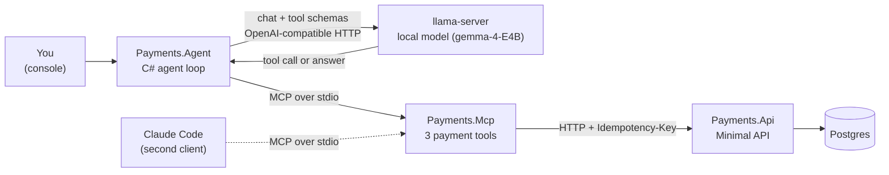
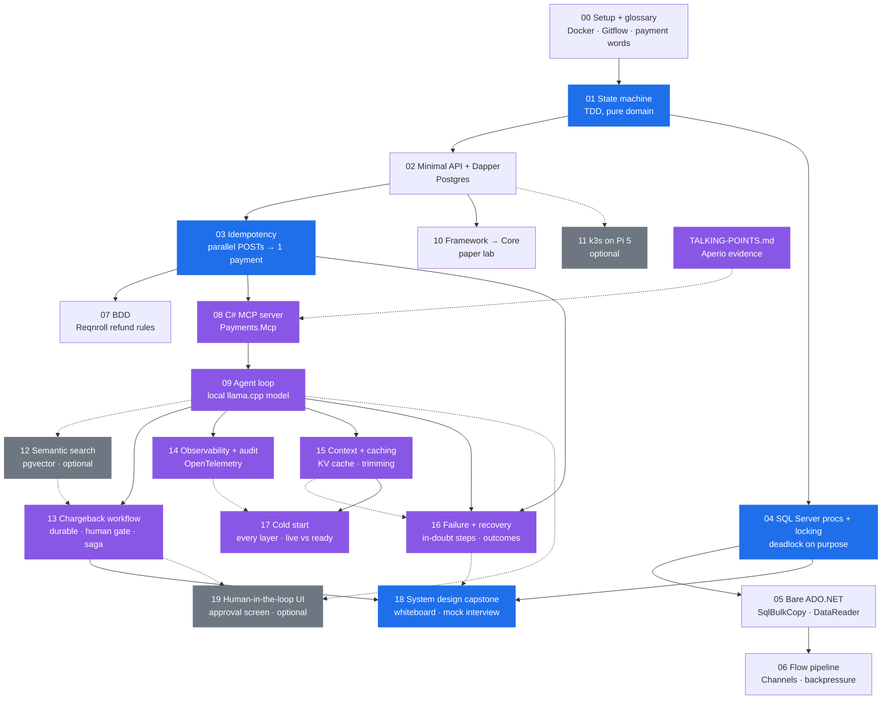

# Agent-Ready Payments Labs — Plan

Written 2026-10-17 from `SPEC.md`. Target role: **Senior Full Stack .NET Engineer (AI)** at a payment technology company. See `README.md` for the goal.

Rules from the spec, short form:

- Labs, not an app. One topic per lab. About 2–3 hours each.
- The agent writes the lab spec (`README.md`) and the failing tests. **You write the code.**
- Every lab folder has a `README.md` that opens with **"What we solve / Simple example / Why it matters for a payment platform"**. The full spec is added below that when the lab starts.
- Every lab folder has a `QA.md`: 10–24 interview questions with answers (and follow-up "traps") that the lab lets you answer from first-hand work. Read it before the lab. Say the answers out loud after the lab.
- All runnable code is **.NET 10**. .NET Framework cannot run on macOS, so Framework topics are paper-only (Lab 10).
- Data access: **Dapper** first, **bare ADO.NET** once (Lab 05), **EF Core as the alternative where it fits** (see "Dapper vs EF Core" below).
- **Postgres** for the API / Docker / k3s path. **SQL Server** (amd64 image under Rosetta) for stored procedures and locking. Never target SQL Server at the Pi.
- Testing tooling stays open until Lab 01 is done (see "Open decisions").

---

## 1. The labs

| # | Folder | Topic | Bucket | Size | Needs | Deliverable (what exists when done) |
|---|---|---|---|---|---|---|
| 00 | `labs/00-setup-and-glossary` | Docker up, Postgres + SQL Server containers, **empty lab databases + DbUp runner**, solution layout, Gitflow branches, **payments words** | 1, 5 | 2–3 h | — | `docker-compose.yml`, `src/Payments.Db` migrating empty DBs on both engines, `develop` branch, you can explain every word in `QA.md` |
| 01 | `labs/01-payment-state-machine` | Payment state machine via **TDD**. Pure domain, no DB. | 1, 5 | 2–3 h | 00 | `Payments.Domain` + green tests: authorise → capture → refund / void; illegal moves rejected |
| 02 | `labs/02-minimal-api-dapper` | Minimal API + **Dapper** over Postgres. Explicit contracts, ProblemDetails, no hidden state | 1, 2, 4 | 3 h | 01 | `Payments.Api` with `POST /payments`, `POST /payments/{id}/capture`, `GET /payments/{id}`; integration tests vs real Postgres |
| 03 | `labs/03-idempotency` | `Idempotency-Key`, unique index, insert-first, replay = same answer, N parallel requests → 1 payment | 2, 3, 4 | 2–3 h | 02 | Idempotency middleware/filter + a concurrency test that fires 50 identical POSTs |
| 04 | `labs/04-sqlserver-procs-locking` | SQL Server **stored procedures**, `UPDLOCK`/`ROWLOCK`/`READPAST`, `rowversion`, a deadlock made on purpose and fixed, RCSI | 2, 3 | 3 h | 01, 00 (MSSQL) | `usp_CapturePayment`, `usp_ClaimNextBatch`; a test that deadlocks before the fix and passes after |
| 05 | `labs/05-bare-adonet` | Bare **ADO.NET**: `SqlCommand`, streaming `SqlDataReader`, `SqlBulkCopy`, TVPs. Why Dapper is a thin layer on top | 2, 1 | 2 h | 04 | Load 1M rows with `SqlBulkCopy`; stream them back with constant memory; same query in Dapper for comparison |
| 06 | `labs/06-flow-pipeline-channels` | **Flow-based processing**: settlement batch with `System.Threading.Channels` — producer → N workers → writer, bounded, backpressure, cancellation, retry, poison message | 3 | 3 h | 05 | `Payments.Settlement` worker; tests for backpressure, cancel, poison queue, graceful shutdown |
| 07 | `labs/07-bdd-refund-rules` | **BDD**: Gherkin `.feature` files for refund rules, step definitions against the running API | 5 | 2–3 h | 03 | `refunds.feature` (Reqnroll — SpecFlow's successor) running in `dotnet test` |
| 08 | `labs/08-mcp-server` | **The C# MCP server.** Minimal. Typed tools `get_payment`, `list_payments`, `refund_payment` (two-phase confirm) | 4 | 3 h | 03 | `Payments.Mcp` project, talks to `Payments.Api` over HTTP; usable from Claude Code |
| 09 | `labs/09-agent-loop` | Write a **tiny C# agent loop** (~150 lines) that uses a **local model on llama.cpp** and calls `Payments.Mcp`. It has a step cap and a destructive-tool rule. The whole flow runs offline | 4 | 3 h | 08 | `Payments.Agent` console app doing "refund the last captured payment" end to end against `llama-server`; tests with a fake model |
| 10 | `labs/10-framework-to-core` | **.NET Framework → .NET Core**: paper lab. Read, classify, plan a port of a small Framework-style sample | 1 | 2 h | 02 | A migration note: what breaks, what replaces it, in what order |
| 11 | `labs/11-k3s-pi` *(optional)* | k3s on the Pi 5: Postgres StatefulSet + API Deployment. Postgres only | infra | 3 h | 02 | Manifests + the API answering from the Pi |
| 12 | `labs/12-semantic-search` *(optional)* | **Semantic search** for the agent: refund/chargeback policy snippets, embedded with a **local embedding model** on llama.cpp, stored in **pgvector**, hybrid with Postgres full-text. New MCP tool `search_policies` | 4, 2 | 3 h | 09 | Policies searchable by meaning; the agent cites a policy id before it proposes a refund; SQL Server 2025 `VECTOR` as a discussion |
| 13 | `labs/13-chargeback-workflow` | **Durable agentic workflow:** a chargeback process that runs for days. The code decides the steps, the model fills bounded steps (classify, gather evidence, draft). It has a human approval, a deadline, compensation, and resume after a crash | 4, 3 | 3 h | 09 (+ 12 for `search_policies`, optional) | `WorkflowInstance` runner (`SKIP LOCKED`), crash/resume, deadline and compensation tests with `TimeProvider` |
| 14 | `labs/14-observability-audit` | **Observability + audit for agents:** OpenTelemetry trace across agent → MCP → API → SQL, GenAI spans, agent metrics, audit rows linked by trace id | 4 | 2–3 h | 08, 09 | One refund = one trace across 3 processes; audit row with the same trace id; a test proves no card data or prompt text in spans |
| 15 | `labs/15-context-and-caching` | **Context and caching:** KV cache and stable prefixes (measured with `prompt_n` / `cache_n`), staged trimming, pinned task state, offloading big tool results, read-tool cache with write invalidation | 4 | 3 h | 09 | Cache hit ratio logged per step; prefix-hash test; 40-turn run that never loses the pending refund token |
| 16 | `labs/16-failure-recovery-outcomes` | **Failures, recovery and expected outcomes:** model and network retries, circuit breaker, write-ahead `Started` steps, **in-doubt tool calls** replayed with the same idempotency key, MCP restart, task contract with checkpoints and postconditions | 4, 3 | 3 h | 09, 03 (+ 15) | Chaos test drops the refund response after processing → exactly one refund; early "Done" fails the postcondition |
| 17 | `labs/17-cold-start` | **Cold start at every layer:** .NET (JIT vs ReadyToRun vs Native AOT), DB pool, EF model, MCP process, model weights, KV cache, agent context, data. Warm-up service, **live vs ready**, `startupProbe`, honest "starting up" status, no retry storm | 4, 1 | 2–3 h | 09, 14, 15 | Startup timeline cold vs warm; `/health/ready` false until warm; 10 parallel first requests → one warm-up, no timeouts |
| 18 | `labs/18-system-design-capstone` | **System design capstone:** an agent-ready payment platform on a whiteboard — components, data flow, consistency and transactions, concurrency, scaling, failure modes, LLM gateway (local vs cloud), security and audit. Mock interview | all | 3 h | 03, 04, 09, 13 (ideally all) | A one-page design doc + diagram in your own words; 45-minute mock interview with the agent as the interviewer |
| 19 | `labs/19-human-in-the-loop-ui` *(optional)* | **The human in the loop:** an approval screen for agent proposals. The person sees the exact action, evidence and expiry, then approves exactly that version (`If-Match`). Four-eyes, `payments:approve` scope (never on agent keys), no "edit" for money. Svelte 5; patterns reused from `scrooge-financing` | 4, UI | 3 h | 08, 09 (+ 04 stretch, 13) | Pending list + card against the real API; tests for stale (`412`), expired, double click, agent key `403`, `four_eyes_required` |

Buckets (from `SPEC.md` §1): **1** C#/.NET · **2** SQL Server · **3** concurrency / flow · **4** agent orchestration · **5** TDD/BDD/Gitflow.

### Dapper vs EF Core — where each one goes

Rule of thumb you can say in the interview: **EF Core when the app owns the schema and saves whole aggregates. Dapper / ADO.NET when the schema already exists, when stored procedures own the logic, on hot paths and for bulk work.** A payment core is usually the second case, so Dapper leads. EF Core still shows up where it is the better tool:

| Lab | Main tool | EF Core part | Why |
|---|---|---|---|
| 02 | Dapper | **Stretch:** a second `IPaymentStore` implementation in EF Core; the same integration tests run against both | Two engines behind one interface — the same story as Aperio's two-backend store |
| 03 | Dapper insert-first | **Second implementation:** EF Core check + `DbUpdateException` catch on the unique index; same 50-parallel test | Shows the race and the fix in both styles; the EF version is what most codebases have |
| 04 | T-SQL procs | EF Core optimistic concurrency (`[Timestamp]` / `rowversion` → `DbUpdateConcurrencyException`); calling a proc with `Database.SqlQuery<T>` / `ExecuteSqlAsync` | EF has no lock hints; know when it's the wrong tool |
| 05 | ADO.NET | Compare `AddRange` + `SaveChanges`, `ExecuteUpdateAsync` (set-based) and `SqlBulkCopy` on the same data | Know the numbers, not just the opinion |
| 06 | Channels + bulk writer | One rule only: one `DbContext` per unit of work via `IDbContextFactory`, never shared across workers | `DbContext` is not thread-safe |
| 09 | EF Core | `AgentRun` / `AgentStep` persistence (JSON column, `rowversion`) | The app owns this schema — EF's home ground |
| 10 | — | EF6 → EF Core migration path | Part of the Framework → Core move |

### The dedicated MCP server (`src/Payments.Mcp`)

One C# MCP server project for the whole repo. It is born in Lab 08 and stays small.

- It is a **separate process** that calls `Payments.Api` over HTTP. It does not touch the database. This keeps the tool boundary honest: the agent can only do what the API allows.
- Transport: **stdio**, official `ModelContextProtocol` C# SDK. Nothing else.
- Tools in Lab 08: `get_payment`, `list_payments`, `refund_payment` (propose → token → confirm).
- **Scope decided (2026-10-17): payment tools only.** No study/helper tools. Later labs may add one *payment* tool if it teaches something (for example `get_settlement_batch` after Lab 06). No tool is added "because we can".

### The whole flow, fully local (Lab 09)

No API key and no cloud. Everything runs on the Mac.



- **Model server:** `llama-server` (already installed: `/opt/homebrew/bin/llama-server`, build 10090). It serves an OpenAI-compatible `/v1/chat/completions` with tool calling. Tool calling needs the chat template, so start it with `--jinja`.
- **Model:** start with the one Aperio already uses, `unsloth/gemma-4-E4B-it-qat-GGUF:UD-Q4_K_XL`. 32 GB RAM also fits a larger tool-capable model. If the small one gets tool calls wrong too often, pick a larger one in Lab 09.
- **C# side:** `Microsoft.Extensions.AI` `IChatClient` (an OpenAI-compatible client pointed at `http://localhost:8080/v1`), plus the MCP C# SDK **client** to start `Payments.Mcp` and list its tools. **You write the loop yourself.** Do not use the auto tool-calling middleware (`UseFunctionInvocation()`), because that would hide the loop the lab is about.
- **Why a weak local model is a good thing here:** small models make real mistakes. They send broken JSON, repeat the same call, or print a tool call as plain text. Your loop must handle each one. Aperio met the same problems with this exact model (`id/reference/tech-debt.md`: "gemma-4-E4B tool-call leakage"). That gives you real stories, not theory.
- **Claude Code** stays as a second MCP client. Use it to compare a strong model with the local one on the same tools.
- **Not on the Pi.** The Pi 5 is too slow for a useful agent loop. Lab 11 stays API + Postgres only.

### The lab database (decided 2026-10-17)

Full plan: **`db/README.md`** (tables, which lab adds what, ER diagram, seed data, test setup).

- One small payments database that **grows lab by lab**. Each lab adds its own migration.
- **Postgres** `payments_labs` (with pgvector) for the API and agent flow. **SQL Server** `PaymentsLabs` for stored procedures, locking, bulk and settlement. The shared tables are kept in lockstep in both engines.
- **DbUp** runs numbered plain `.sql` files. The runner is `src/Payments.Db`.
- **Seeder** in the same tool: deterministic (seed 42), `small` (~1,000 payments, with named demo fixtures) and `large` (1,000,000 payments, for Labs 05–06).
- **Tests** get a clean database each time: Testcontainers (Postgres), one database per test class (SQL Server), and Respawn between tests.

### Local or cloud models? (stance, 2026-10-17)

**We don't know what the company uses. Don't guess in the interview — ask.** What we can say with confidence:

- **Regulation pushes towards control, not necessarily towards "local":** PCI DSS (card data must never reach a prompt), GDPR (personal data, EU residency), **DORA** (EU, applies to payment institutions since 17 Jan 2025: third-party ICT risk, including AI providers), and the EU AI Act for some uses.
- **A Microsoft-stack company often lands in the middle:** a cloud model in its *own* cloud tenancy and EU region (for example Azure OpenAI / Azure AI Foundry under an enterprise agreement), plus self-hosted models where data must not leave, or where volume makes per-token pricing expensive. **Hybrid is the common answer.**
- **The agents may not be the company's at all.** "APIs consumed by automated tools or orchestration layers" can also mean **merchants' or shoppers' agents calling the platform** (agentic commerce: card schemes and others announced agent-payment programmes and protocols in 2025). Then the platform doesn't pick the model — it must make its API safe for *any* caller's agent. Our labs already do that (scopes, idempotency, two-phase confirm, audit).
- **So the design is provider-agnostic:** the loop talks to `IChatClient`. A local `llama-server` and a cloud endpoint are one registration apart. An **LLM gateway** in front (routing, redaction, rate limits, cost, fallback) is a system design topic in Lab 18.

**Our labs run local** (no key, no cost, offline, realistic failures). **Which local model:** decided by data, not taste. Lab 09 builds a 10-scenario **evaluation set** and runs it on a ladder from Aperio's own catalog (`db/migrations/011_model_facts.sql`):

| Rung | Model | Size | Why try it |
|---|---|---|---|
| 1 | `unsloth/gemma-4-E4B-it-qat-GGUF` | 3.9 GB | Small and fast; known tool-call leaks (Aperio tech-debt) → good for testing guards |
| 2 | `unsloth/Qwen3.5-9B-GGUF` (Q4_K_M) | 5.3 GB | Still small; dense |
| 3 | `unsloth/gemma-4-26B-A4B-it-GGUF` | 15.8 GB | MoE, 4B active → near-small speed, bigger brain |
| 4 | `unsloth/Qwen3.6-35B-A3B-MTP-GGUF` | 21.3 GB | MoE, 3B active; the largest that fits 32 GB with room for KV cache |

Pick the **smallest rung that passes** the evaluation set. Keep rung 1 for guard tests.

### Concurrency and atomic transactions — where each is drilled

| Concept | Lab |
|---|---|
| Conditional update (compare-and-swap), `@@ROWCOUNT` | 04, 13 |
| Unique index as the arbiter (insert-first) | 03 |
| Pessimistic locks: `UPDLOCK`, `FOR UPDATE` | 04 |
| Queue claims: `READPAST`, `SKIP LOCKED` | 04, 13 |
| Optimistic concurrency: `rowversion`, EF `[Timestamp]` | 04, 09 |
| Deadlocks: cause, detect (1205), fix | 04 |
| Isolation levels, RCSI | 04 |
| One transaction for state + step log; transactional outbox | 13, 16 |
| Sagas and compensation (no distributed transaction) | 13 |
| Threads, `SemaphoreSlim`, Channels, backpressure, thread-pool starvation | 06 |
| Single-flight warm-up, thundering herd | 17 |
| Two agents, one payment; two workers, one run | 09 |
| In-doubt calls after a lost response | 16 |
| Putting it all together on a whiteboard | 18 |

### API shape (decided 2026-10-17)

**Minimal API.** No controllers. Small and grown on the fly — each pattern comes in only when a lab feels the pain it solves. That is also the interview answer: "I add structure when the code asks for it, not before."

| When | What comes in | Why then |
|---|---|---|
| Lab 02 | Minimal API + `MapGroup("/payments")`, endpoints in one static class per feature, ProblemDetails, **.NET 10 built-in validation** (`AddValidation()` + DataAnnotations) | Simplest thing that works |
| Lab 02 | **CQRS-lite:** writes go through command handlers → domain → repository; reads are separate query services that return DTOs straight from Dapper | The split is natural: writes need the state machine, reads don't |
| Lab 03 | **FluentValidation** (via an endpoint filter) | Rules get conditional (idempotency key + body hash + currency rules) — DataAnnotations get ugly here |
| Lab 08–09 | Same handlers reused by the MCP server through the API | Proves the handlers are the real contract |

What we **don't** add:
- **MediatR** — plain handler classes injected into endpoints are enough. MediatR also moved to a commercial licence in 2025. Know it (most codebases have it), don't need it here.
- **Full CQRS** (separate read DB, event sourcing) — far too big for a lab; say when you'd use it (Lab 02 `QA.md`).
- It is the main demo for the interview: "here is a payment API shaped to be a deterministic tool, and here is an agent using it safely".

---

## 2. Dependency path



Blue = the labs that carry most interview weight on the .NET/SQL side. Purple = the AI differentiator. Grey = optional.

When a lab starts, its `README.md` gets its own small Mermaid diagram (the flow inside that lab).

---

## 3. Fast path (if an interview gets booked early)

Do these, in this order, and skip the rest until after:

1. **00** (1 h version: only the glossary + Postgres container).
2. **01** — state machine. Proves TDD.
3. **03** — idempotency (fold the minimum of 02 into it).
4. **04** — stored procedure + locking. The ad names this directly.
5. **08** — MCP server. The differentiator.
6. **13** (if time allows) — even a fake-model version shows "orchestrate workflows".
6b. **18** (one evening) — the whiteboard run-through. It is the best rehearsal for a system design round.
7. Reread `TALKING-POINTS.md` and every `QA.md` the morning of the interview.

---

## 4. Repo layout (target, grows lab by lab)

```
agent-ready-payments/
├── PLAN.md  SPEC.md  APERIO-TOUR.md  APERIO-MAP.md  TALKING-POINTS.md  AGENT-READY-BACKEND.md
├── docker-compose.yml          # Lab 00: postgres + mssql
├── Payments.Labs.sln
├── src/
│   ├── Payments.Domain/             # Lab 01
│   ├── Payments.Api/                # Lab 02–03
│   ├── Payments.Data.SqlServer/     # Lab 04–05 (procs, ADO.NET)
│   ├── Payments.Settlement/         # Lab 06
│   ├── Payments.Mcp/                # Lab 08 — the dedicated MCP server
│   └── Payments.Agent/              # Lab 09
├── tests/
│   ├── Payments.Domain.Tests/
│   ├── Payments.Api.IntegrationTests/
│   ├── Payments.Data.SqlServer.Tests/
│   ├── Payments.Settlement.Tests/
│   ├── Payments.Specs/              # Lab 07 (BDD)
│   └── Payments.Mcp.Tests/
├── db/
│   ├── README.md               # the lab database plan
│   ├── postgres/               # numbered .sql migrations (DbUp)
│   └── sqlserver/              # tables + stored procedures (lockstep)
└── labs/
    └── NN-name/
        ├── README.md           # simple example + why (now); full spec (when the lab starts)
        └── QA.md               # interview questions + answers (now)
```

---

## 5. Gitflow in this repo

The repo itself is the Gitflow evidence.

- `main` — only tagged, "finished" states. Tag after each lab: `lab-01`, `lab-02`, …
- `develop` — integration branch. Created in Lab 00.
- `feature/lab-NN-short-name` — one per lab, branched from `develop`, merged back with `--no-ff` so the merge is visible in history.
- `release/x.y` — cut once, after Lab 08, to show the release step (bump, changelog, merge to `main` and back to `develop`).
- `hotfix/…` — only if a real bug shows up on `main`. Do not fake one.

---

## 6. How each lab runs

1. You say "start Lab NN".
2. Agent adds the spec to `labs/NN-…/README.md` (new words, acceptance criteria, Mermaid of the flow) and writes the **failing tests**.
3. You branch `feature/lab-NN-…`, make the tests green, commit.
4. You answer `QA.md` out loud (or to the agent, who grills you).
5. Merge to `develop`, tag.

---

## 7. Open decisions (decide later, not now)

| Decision | When | Default if nobody decides |
|---|---|---|
| Unit test framework: xUnit vs NUnit | Before Lab 01 tests are written | **xUnit v3** + FluentAssertions-free plain asserts (Shouldly optional). NUnit is common in older Framework shops; mention you know both. |
| BDD tool: Reqnroll vs SpecFlow | Lab 07 | **Reqnroll**. SpecFlow is end-of-life; Reqnroll is its open-source fork with the same Gherkin and bindings. |
| How deep BDD goes | After Lab 03 | One feature file, 5–8 scenarios, against the real API. |
| ~~Integration test DB~~ | **Decided 2026-10-17** | Testcontainers for Postgres; compose SQL Server with one database per test class; Respawn between tests. See `db/README.md`. |
| ~~Migrations~~ | **Decided 2026-10-17** | DbUp with plain `.sql` files; EF Core maps onto existing tables (database-first). |
| ~~MCP server scope~~ | **Decided 2026-10-17** | Payment tools only |
| ~~API style~~ | **Decided 2026-10-17** | Minimal API; CQRS-lite (Lab 02) and FluentValidation (Lab 03) on the fly |
| ~~Agent for Lab 09~~ | **Decided 2026-10-17** | Own C# loop on **llama-server + local gemma-4-E4B** (fully local). Claude Code as a second MCP client for comparison. No API key needed. |
| Local model | Lab 09 | The smallest rung of the model ladder (see "Local or cloud models?") that passes the 10-scenario evaluation set |

---

## 8. Carry-forward notes (read at the start of every session)

- **Best payments bridge in Aperio:** `db_execute` is confirm-gated, then does an atomic claim — `UPDATE … WHERE status IN ('approved','edited')`. A capture stored procedure uses the same trick (`WHERE Status = 'Authorised'`). It is story 6 in `TALKING-POINTS.md`.
- **Gap to own, not hide:** Aperio has no time limit for a whole agent turn. The step cap of 6 is the only hard bound. It is in the weak-points list.
- **The MCP server** is `src/Payments.Mcp`. Lab 08 builds it with 3 tools. It calls the API over HTTP and never touches the database.
- **Sketches + everyday pictures** (restaurant, vending machine, card double-tap, hotel reception, IKEA label, approval gate) live in `AGENT-READY-BACKEND.md`. Reuse them in lab READMEs and in answers.
- **EF Core** is the alternative where it fits — see "Dapper vs EF Core" above.
- **Decided 2026-10-17 (agentic coverage, option A):** added **Lab 13** (durable chargeback workflow: workflow vs agent, human gate, deadline, compensation, resume) and **Lab 14** (OpenTelemetry + audit). Tightened Lab 08 (API key per agent with scopes + audit row per tool call), Lab 09 (crash/resume test + two-agents-one-refund test), Lab 12 (prompt-injection test).
- **Added 2026-10-17:** **Lab 15** (KV cache, trimming, pinned task state, offload, tool cache) and **Lab 16** (network failures, in-doubt tool calls, resume, task contracts with expected outcomes).
- **Added 2026-10-17:** **Lab 17 — cold start** at every layer (.NET, DB, EF, MCP, model, KV cache, agent context, data). Key Aperio facts: llama-server `/health` is green before the model loads; the first message used to pay minutes until `modelPreload.js` moved it to boot.
- **Stance 2026-10-17:** we don't know if the company uses local or cloud models — ask them. Design provider-agnostic (`IChatClient`); labs run local; the model is picked by Lab 09's evaluation set over a ladder from Aperio's `011_model_facts.sql`. Agents may also be *merchants'* agents calling the platform (agentic commerce).
- **Added 2026-10-17:** optional **Lab 19 — human-in-the-loop UI** (approval screen). Reuses frontend patterns, not files, from `BaiGanio/scrooge-financing` (Svelte). Do it after Lab 13.
- **Added 2026-10-17:** **Lab 18 — system design capstone**, and a "concurrency and atomic transactions" index in this plan.
- **Rule from 2026-10-17: Aperio is the backbone.** Every lab README has an **"Aperio comparison"** table (has / partly / no, file, what the lab adds), and every `QA.md` ends with **Q-APERIO "Have you solved this before?"**. The overview is `APERIO-MAP.md`. Verify every Aperio claim against the code before writing it.
- **Lab database:** planned in `db/README.md`. It grows one migration per lab; the seeder makes deterministic demo and bulk data.
- **Every lab:** README opens with a simple example + an everyday picture; `QA.md` has many questions (more is better).
- **Decided 2026-10-17:** MCP server scope = **payment tools only** (`get_payment`, `list_payments`, `refund_payment`). No study tools.
- **Decided 2026-10-17:** Lab 09 runs the **whole flow locally**: C# loop → `llama-server` (gemma-4-E4B) → `Payments.Mcp` → `Payments.Api` → Postgres. See "The whole flow, fully local".
- **Added 2026-10-17:** optional **Lab 12 — semantic search** (pgvector + local embedding model + hybrid full-text). Good Aperio story: `db/migrations/013_vec_meta.sql` marks a vector store stale when the embedding model changes and falls back to full-text.
- **Decided 2026-10-17:** API = **Minimal API**, CQRS-lite and FluentValidation added **on the fly** when a lab needs them — see "API shape".

- **Decided 2026-10-18 (Lab 00 scope, option A):** full Lab 00 — both engines at once (Postgres native + SQL Server under Rosetta), `src/Payments.Db` DbUp runner, `develop` branch, glossary. Rejected the Postgres-only slice: Rosetta is the risky part, and it is cheaper to find that out now than in Lab 04 next to procedures and locking.
- **Rule from 2026-10-18: three files per lab.** `README.md` = spec and "Done when". **`WORKBENCH.md`** = the ordered bench sheet the user works through; every step is **Goal / Why (3-4 sentences) / Do / Proof**, and the file ends with a Traps table and a "Notes while you work" section. `QA.md` = interview questions. Steps live in `WORKBENCH.md` only, so the spec stays still while the steps move. Lab 00 is the template.
- **Verified 2026-10-18:** this Mac has `dotnet 10.0.401` (section 9 said `10.0.302`). Docker Desktop was not running at the start of the session.

## 9. Environment checklist

- `dotnet --version` → `10.0.302` ✓
- Start Docker Desktop. Turn on **"Use Rosetta for x86_64/amd64 emulation"** in Settings → General.
- SQL Server image: `mcr.microsoft.com/mssql/server:2022-latest` with `platform: linux/amd64`.
- Postgres image: `pgvector/pgvector:pg17` (native arm64; Postgres 17 with pgvector built in, needed for Lab 12).
- Local model (Lab 09): `llama-server -hf unsloth/gemma-4-E4B-it-qat-GGUF:UD-Q4_K_XL --jinja -c 16384 --port 8080`. Check that it works: `curl http://localhost:8080/v1/models`.
