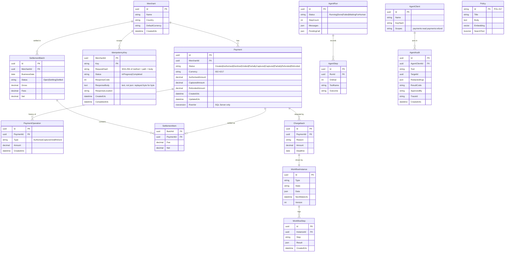

# The Lab Database

One small **payments database** for all labs. It grows lab by lab: each lab adds its own migration script. Nothing is built before a lab needs it.

## Two databases, one model

| Database | Engine | Container | Used by |
|---|---|---|---|
| `payments_labs` | **Postgres 17 + pgvector** (`pgvector/pgvector:pg17`, native arm64) | `payments-postgres` | Labs 02, 03, 07, 08, 09, 12 — the API and agent flow |
| `PaymentsLabs` | **SQL Server 2022** (`mcr.microsoft.com/mssql/server:2022-latest`, amd64 under Rosetta) | `payments-mssql` | Labs 04, 05, 06 — stored procedures, locking, bulk, settlement |

The shared tables (`Merchant`, `Payment`, `PaymentOperation`) exist in **both** engines with the same columns. The two script sets are kept **in lockstep**: if you change one, you change the other in the same commit. This is the same rule as Aperio's `db/migrations/` + `db/migrations-sqlite/`.

## Tables, and which lab adds them



| Lab | Engine | Migration adds |
|---|---|---|
| 00 | both | Empty databases + the migration runner. No tables yet. |
| 01 | — | Nothing. The domain is pure; no database. |
| 02 | Postgres | `merchant`, `payment`, `payment_operation` + the index `(merchant_id, created_at desc, id desc)` for keyset paging |
| 03 | Postgres | `idempotency_key` table, primary key `(merchant_id, key)`, with the request hash and the stored answer. Not a column on `payment`: a refund writes no `payment` row (decided 2026-10-20) |
| 04 | SQL Server | Same three tables (lockstep) + `RowVer`, `usp_CapturePayment`, `usp_ClaimNextBatch`; RCSI switched on |
| 05 | SQL Server | `StagingSettlementFile` (a heap for `SqlBulkCopy`) + a TVP type |
| 06 | SQL Server | `SettlementBatch`, `SettlementItem`, `SettlementPoison` |
| 08 | Postgres | `AgentClient` (key hash, name, scopes) and `AgentAudit` (one row per agent tool call, with trace id) |
| 09 | Postgres | `AgentRun`, `AgentStep` (EF Core owns these two) |
| 12 | Postgres | `CREATE EXTENSION vector`, `Policy` with an HNSW index and a full-text index |
| 13 | Postgres | `Chargeback`, `WorkflowInstance` (state, JSON data, `NextWakeUtc`, version), `WorkflowStep` (step log), `Outbox`; `Payment.DisputeHold` column |
| 14 | Postgres | Nothing new. It uses `AgentAudit.TraceId` from Lab 08. |
| 15 | Postgres | `ToolResult` (offloaded big results: id, run id, tool, content, created) |
| 16 | Postgres | `AgentStep` gets `Status` (`Planned/Started/Completed/Failed/InDoubt`), `IdempotencyKey`, `StartedUtc`; `AgentRun` gets `NextWakeUtc` and `ToolSchemaHash` |

## Naming: `snake_case` in Postgres, `PascalCase` in SQL Server

Decided 2026-10-19 (`plan/PLAN.md` §8). Postgres folds an unquoted identifier to lower case, so `PascalCase` there means `"quotes"` on every line of SQL forever. SQL Server has no such habit and keeps `PascalCase`.

So the **lockstep rule is about columns, types and rules — not about spelling**. `payment.captured_amount numeric(19,4)` in Postgres and `Payment.CapturedAmount decimal(19,4)` in SQL Server are the same column. The diagram above uses `PascalCase` for readability; the Postgres scripts are the truth for Postgres.

Dapper bridges it with one alias per column, written in the query that depends on it:

```sql
select created_at as "CreatedAt", captured_amount as "CapturedAmount" from payment
```

The global switch `DefaultTypeMap.MatchNamesWithUnderscores = true` also works, and is rejected on purpose: it changes how every query in the process maps, from one line far away that nobody reads.

## Migrations: DbUp

**DbUp** runs plain numbered `.sql` files, once each, in order, and records them in a journal table. This fits a stored-procedure world. You see every line of SQL, and it works the same on Postgres and SQL Server.

```
db/
├── postgres/
│   ├── 0001_merchant_payment.sql        (Lab 02)
│   ├── 0002_idempotency.sql             (Lab 03)
│   └── …
└── sqlserver/
    ├── 0001_merchant_payment.sql        (Lab 04, lockstep with postgres/0001)
    ├── 0002_procs_capture_claim.sql     (Lab 04)
    └── …
```

The runner is a tiny console app, `src/Payments.Db`: `dotnet run --project src/Payments.Db -- migrate --engine postgres`.

EF Core does **not** create these tables. In Labs 02–05, EF Core maps onto the existing tables ("database-first"), just like it would in a real payment codebase. The only exception is Lab 09: EF Core owns `AgentRun` and `AgentStep`, but they still ship as a DbUp script that you write from the EF model.

## Test data: the seeder

`dotnet run --project src/Payments.Db -- seed --engine postgres --size small`

- **Deterministic:** a fixed random seed (42), so every run makes exactly the same data and a failing test can be repeated.
- **Realistic mix:** 10 merchants (retail, hotel, gaming); currencies EUR, GBP, USD; most payments captured, some partially refunded, some voided, a few declined; amounts with correct decimals.
- **Named fixtures** for demos and agent scenarios, for example merchant `M1 Hotel Sofia` with a known "double charge" pair of captured payments for the Lab 08 / 09 refund story.

| Size | Rows | Used in |
|---|---|---|
| `small` | 10 merchants, ~1,000 payments | API, BDD, MCP and agent demos |
| `large` | 10 merchants, 1,000,000 payments | Lab 05 (bulk, streaming), Lab 06 (settlement pipeline) |

`large` loads with `SqlBulkCopy`, so you will build that part in Lab 05.

## Tests: a clean database every time

- **Postgres:** **Testcontainers** starts a throwaway `pgvector/pgvector:pg17` container per test run, runs the migrations, and drops it at the end.
- **SQL Server:** we use the compose container. Starting it fresh per run is too slow under Rosetta. Each test class creates its own database (`PaymentsLabs_Test_<guid>`), migrates it and drops it at the end.
- **Between tests:** **Respawn** deletes all rows quickly but keeps the schema. Each test then seeds only what it needs.
- Tests never use the demo seed. Each test arranges its own data, so test order never matters.

## Connection strings (local only)

| Engine | Connection string |
|---|---|
| Postgres | `Host=localhost;Port=5432;Database=payments_labs;Username=labs;Password=labs` |
| SQL Server | `Server=localhost,1433;Database=PaymentsLabs;User Id=sa;Password=<from .env>;TrustServerCertificate=true` |

Passwords live in `.env`, which is git-ignored. `TrustServerCertificate=true` is for local development only.
