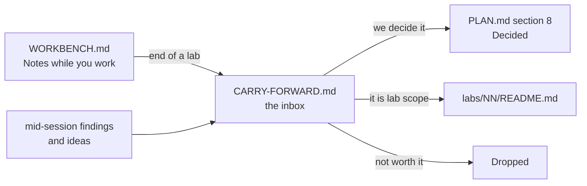

# Carry-forward

The **inbox** of this repo. Anything we notice but do not act on now lands here.

Read it at the start of every session. Groom it at the end of every lab.

## How it works

Rules:

- One line per item. If it needs a paragraph, it is a decision — put it in `PLAN.md` §8 instead.
- Every item has an **id**, a **date** it was raised, and where it came from.
- Nothing lives in two places. When an item graduates, set `Status` to `→ PLAN §8`, `→ lab NN` or `Dropped`, and move the row to **Closed** at the bottom.
- `PLAN.md` wins over this file. This file is ideas; that file is decisions.
- Ids never get reused, even after the row closes.

Statuses: `Open` · `→ PLAN §8` · `→ lab NN` · `Dropped`

---

## Open questions

Things we cannot answer alone. Some are for the company at interview.

| Id | Raised | From | Question | Status |
|---|---|---|---|---|
| CF-001 | 2026-10-18 | PLAN §8 | Does the company run **local or cloud** models? It changes the gateway design. Ask them. Labs stay provider-agnostic (`IChatClient`) until we know. | Open |
| CF-002 | 2026-10-18 | PLAN §8 | Are the agents **our** agents, or **merchants'** agents calling our platform (agentic commerce)? The second case changes auth, scopes and rate limits. | Open |

## Findings

Things we learned that are not a decision yet.

| Id | Raised | From | Finding | Status |
|---|---|---|---|---|
| CF-003 | 2026-10-18 | this machine | `dotnet` here is `10.0.401`, not the `10.0.302` in `PLAN.md` §9. Harmless, but pin the SDK with a `global.json` if a lab ever behaves differently. | Open |
| CF-004 | 2026-10-18 | Aperio | `llama-server` `/health` goes green **before** the model is loaded. So a readiness probe on `/health` lies. Lab 17 owns the fix; keep it in mind earlier. | → lab 17 |
| CF-015 | 2026-10-19 | lab 02 decision | Replay loading costs N domain calls per read, and a row written under an older rule can refuse to replay at all. Watch it in labs 05 and 06 (bulk, 1M rows) and decide then whether a `Payment.Rehydrate(...)` factory earns its place. | Open |
| CF-016 | 2026-10-19 | lab 02 step 9 | The test fixture repeats `RepoRoot()` and the DbUp builder from `src/Payments.Db/Program.cs`. Third copy and it needs lifting — same shape as `CF-009`. | Open |
| CF-017 | 2026-10-19 | lab 02 prep | `db/README.md` gave `PaymentOperation` a `Result` and an `ErrorCode` column, but the lab 01 domain only records operations that **succeeded**, so both would always say `Ok`. Lab 02 leaves them out. Decide in lab 14 (audit) whether refused attempts get rows of their own, and where — `PaymentOperation` or an audit table. | Open |
| CF-018 | 2026-10-19 | lab 02 prep | Lab 02 names the error code `amount_exceeds_captured`, derived straight from `PaymentErrorCode.AmountExceedsCaptured`. Labs 04, 07, 08, 09 and 18 were written earlier with `refund_exceeds_captured`. Lab 02's name wins (it is mechanical, with no hand-kept mapping); align each of those labs when its own bench sheet is written. | Open |

## Fix later

Known debt. Each one needs a lab or a commit, not a discussion.

| Id | Raised | From | What | Status |
|---|---|---|---|---|
| CF-020 | 2026-10-20 | lab 02 step 10 | The `ValidationTests` group (8 tests) was not written — commit `02dba21` names it but the file does not exist. Nothing checks that a missing `currency`, a `"EURO"`, a negative amount or malformed JSON is a `400` with the field named. Write it in the lab that next touches the create endpoint; lab 03 (idempotency) is the natural home. | Open |
| CF-021 | 2026-10-20 | lab 02 steps 11–13 | The five command endpoints — `authorise`, `void`, `capture`, `refund` — and their four test groups were skipped. Lab 02 ships with `POST /payments` and `GET /payments/{id}` only. Lab 03 needs `refund` for the `Idempotency-Key`, so it builds the endpoint and its tests first. The `409` against `422` rule is specified in the lab 02 `README.md` and still stands. | → lab 03 |
| CF-022 | 2026-10-20 | lab 02 steps 14–16 | Stretch A, keyset paging with an opaque cursor and the 9 `PagingTests`, was skipped. The `payment_by_merchant_newest` index that serves it already exists in migration `0001`. Lab 05 (bulk, 1M rows) is where paging starts to matter. | Open |
| CF-023 | 2026-10-20 | lab 02 steps 17–19 | Stretch B, the EF Core store, was skipped, so `STORE-NOTES.md` is still empty and the Dapper-against-EF comparison is unmade. `StoreTests` is already a `[Theory]` with the engine as a parameter, and `ApiTestBase.StoreFor` holds a commented-out `"ef"` arm, so the work is: build the store, uncomment, add one `[InlineData("ef")]` per test. | Open |
| CF-005 | 2026-10-18 | lab 00 | No `global.json`, so the SDK version floats. Add one if a version difference ever bites. | Open |
| CF-006 | 2026-10-18 | lab 00 | No CI, and no PR gate: `develop` merges into `main` with nothing checking it. **Scoped 2026-10-20**, to run as its own branch after lab 02 closes and before lab 03 starts: a PR on `develop` → `main` with a required build-and-test check, branch protection on `main`, and the `runs=ci` / `runs=local` trait convention decided **before** the YAML is written. `feature` → `develop` stays a local `--no-ff` merge; the tag stays manual. The two open questions are in `plan/PLAN.md` §7. Lab 03's concurrency tests are the first that are flaky on one machine and honest on two. | Scoped |
| CF-010 | 2026-10-18 | lab 00 build | `dotnet build` warns NU1903: `System.Security.Cryptography.Pkcs` 9.0.11 pulled in by `dbup-sqlserver` has a high severity advisory. Bump or pin the transitive package. | Open |
| CF-013 | 2026-10-19 | lab 01 step 12 | The transition rule is written twice: once in each method's first guard, once in `AllowedActions`. Step 12 (drive both from one `Table`, plus a shared amount check for `Capture`/`Refund`) was not done — lab 01 closes green at step 11. A verified-green version of the refactor exists; redo it in a later lab where a second aggregate shares the rule. | Open |
| CF-012 | 2026-10-19 | lab 01 step 11 | `The_history_cannot_be_changed_from_outside` asserted `Operations` is not an `ICollection<T>`, which no BCL wrapper satisfies — `ReadOnlyCollection<T>` implements `IList<T>`. Test now asserts `IsReadOnly` and that `Add` throws. `README.md` and `WORKBENCH.md` corrected in the same commit. | Open |
| CF-019 | 2026-10-20 | lab 02 step 10 | `updatedAt` comes from two clocks: the POST handler sets it from `DateTimeOffset.Now`, while `InsertAsync` writes `updated_at = created_at`. So a create and a read of the same payment disagree. Pick one source — the store — and have the create response return what was written. `GetPaymentTests.A_created_payment_can_be_read_back` leaves the field unasserted until then. | Open |
| CF-011 | 2026-10-18 | lab 01 setup | Lab 01 adds `global.json` (SDK pin + `test.runner` = Microsoft.Testing.Platform), because `dotnet test` on .NET 10 refuses the old VSTest host. That is what `CF-003` and `CF-005` asked for, so both can close. | Open |

## Ideas for later

Labs, tools or experiments. Cheap to write down, no promise to build.

| Id | Raised | From | Idea | Status |
|---|---|---|---|---|
| CF-007 | 2026-10-18 | PLAN §8 | Aperio has **no time limit for a whole agent turn** — the step cap of 6 is the only bound. Own this gap: add a turn deadline in Lab 09 or 16 and talk about it. | Open |
| CF-008 | 2026-10-18 | db/README | A `seed --size large` of 1M rows is planned for Lab 05. Check it does not make the Docker volume painful on this Mac before relying on it in Lab 06. | Open |
| CF-009 | 2026-10-18 | lab 00 step 6 | Practice exercise once there are 3+ projects: lift Lab 01's `Result<TValue, TError>` into a shared project and make `Payments.Db` return it instead of an exit code — a refactor across layers, done with the tests already green. | Open |
| CF-014 | 2026-10-19 | lab 02 prep | Move `MerchantId` into the `Payment` aggregate, once a rule actually needs it (per-merchant refund limits, per-merchant currency). Today it lives only in the database and the API. Could be a small lab of its own: a domain change driven by a new rule, with 160 green tests as the net. | Open |

---

## Closed

Keep the row. The history is the point.

| Id | Raised | Closed | Item | Went to |
|---|---|---|---|---|
| CF-024 | 2026-10-20 | 2026-10-20 | A loaded payment could not be acted on: `ReplayClock`'s queue holds exactly `created_at` plus one stamp per operation, so the replay drained it and the next domain call threw. Every command endpoint would have died on its first line. Found by `StoreTests.Update_inserts_only_the_new_operations`, the first test to act on a loaded aggregate. Fixed the same day: the clock takes a fallback `TimeProvider`. | `plan/PLAN.md` §8, and the lab 02 `WORKBENCH.md` steps 7 and 13b |
