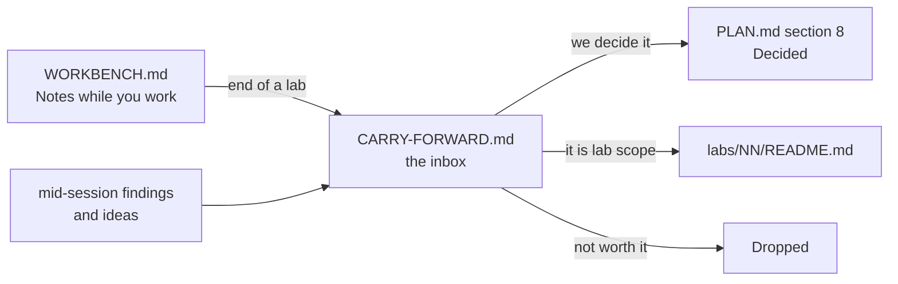

# Carry-forward

The **inbox** of this repo. Anything we notice but do not act on now lands here.

Read it at the start of every session. Groom it at the end of every lab.

## How it works

Rules:

- One line per item. If it needs a paragraph, it is a decision — put it in `PLAN.md` §8 instead.
- Every item has an **id**, a **date** it was raised, and where it came from.
- Nothing lives in two places. When an item graduates, set `Status` to `→ PLAN §8`, `→ lab NN` or `Dropped`, and move the row to **Closed** at the bottom.
- `PLAN.md` wins over this file. This file is ideas; that file is decisions.
- Ids never get reused, even after the row closes.

Statuses: `Open` · `→ PLAN §8` · `→ lab NN` · `Dropped`

---

## Open questions

Things we cannot answer alone. Some are for the company at interview.

| Id | Raised | From | Question | Status |
|---|---|---|---|---|
| CF-001 | 2026-10-18 | PLAN §8 | Does the company run **local or cloud** models? It changes the gateway design. Ask them. Labs stay provider-agnostic (`IChatClient`) until we know. | Open |
| CF-002 | 2026-10-18 | PLAN §8 | Are the agents **our** agents, or **merchants'** agents calling our platform (agentic commerce)? The second case changes auth, scopes and rate limits. | Open |

## Findings

Things we learned that are not a decision yet.

| Id | Raised | From | Finding | Status |
|---|---|---|---|---|
| CF-004 | 2026-10-18 | Aperio | `llama-server` `/health` goes green **before** the model is loaded. So a readiness probe on `/health` lies. Lab 17 owns the fix; keep it in mind earlier. | → lab 17 |
| CF-015 | 2026-10-19 | lab 02 decision | Replay loading costs N domain calls per read, and a row written under an older rule can refuse to replay at all. Watch it in labs 05 and 06 (bulk, 1M rows) and decide then whether a `Payment.Rehydrate(...)` factory earns its place. | Open |
| CF-016 | 2026-10-19 | lab 02 step 9 | The test fixture repeats `RepoRoot()` and the DbUp builder from `src/Payments.Db/Program.cs`. Third copy and it needs lifting — same shape as `CF-009`. | Open |
| CF-017 | 2026-10-19 | lab 02 prep | `db/README.md` gave `PaymentOperation` a `Result` and an `ErrorCode` column, but the lab 01 domain only records operations that **succeeded**, so both would always say `Ok`. Lab 02 leaves them out. Decide in lab 14 (audit) whether refused attempts get rows of their own, and where — `PaymentOperation` or an audit table. | Open |
| CF-034 | 2026-10-22 | lab 03 step 10 | Step 10's Goal and Proof said all three step 9 groups go green, but `KeyReuseTests.The_same_key_on_another_endpoint_is_422` and `..._on_another_payment_is_422` both need the commands to claim the key, which is step 12. Step 10 ends at 96 of 98. The two rows were corrected in `WORKBENCH.md` the same day, and step 12 closed both reds. Still open as a lesson: check the other labs for a Proof that counts tests a later step owns. | Open |
| CF-018 | 2026-10-19 | lab 02 prep | Lab 02 names the error code `amount_exceeds_captured`, derived straight from `PaymentErrorCode.AmountExceedsCaptured`. Labs 04, 07, 08, 09 and 18 were written earlier with `refund_exceeds_captured`. Lab 02's name wins (it is mechanical, with no hand-kept mapping); align each of those labs when its own bench sheet is written. Lab 08 aligned 2026-10-21. | Open |

## Fix later

Known debt. Each one needs a lab or a commit, not a discussion.

| Id | Raised | From | What | Status |
|---|---|---|---|---|
| CF-022 | 2026-10-20 | lab 02 steps 14–16 | Stretch A, keyset paging with an opaque cursor and the 9 `PagingTests`, was skipped. The `payment_by_merchant_newest` index that serves it already exists in migration `0001`. Lab 05 (bulk, 1M rows) is where paging starts to matter. Lab 08 (2026-10-21) ships a capped `list_payments` and refuses `cursor` as an unknown argument; the cursor plugs in as a `nextCursor` field plus a `cursor` argument. | Open |
| CF-023 | 2026-10-20 | lab 02 steps 17–19 | Stretch B, the EF Core store, was skipped, so `STORE-NOTES.md` is still empty and the Dapper-against-EF comparison is unmade. `StoreTests` is already a `[Theory]` with the engine as a parameter, and `ApiTestBase.StoreFor` holds a commented-out `"ef"` arm, so the work is: build the store, uncomment, add one `[InlineData("ef")]` per test. | Open |
| CF-025 | 2026-10-20 | lab 03 prep | `POST /payments/{id}/void` and the 4 `VoidTests` are still unbuilt — lab 03 builds only the commands refund needs. Build it, with an `Idempotency-Key`, in the first lab that needs a void (lab 13's workflow — lab 08 does not need it, 2026-10-21). | Open |
| CF-035 | 2026-10-22 | lab 03 step 13 | Step 13 and the 3 `ConcurrencyTests` were skipped, so **nothing tests the race**. Every test in the lab is sequential, and a claim written as `select`-then-`insert` would pass all 108 of them — the one thing the lab exists to prove is unproven. Four `README.md` "Done when" lines depend on it (50 parallel creates, 50 parallel refunds, and seeing it red once with the claim broken). The primary key still saves the money either way; what is untested is that the loser gets a `409` instead of a `500`. Cheap to add later: `Task.WhenAll` over 50 pre-built requests, no new code. Lab 13 (workflow) or the CI gate branch (`CF-006`) is the natural home, because a race test is honest on two machines and flaky on one. | Open |
| CF-036 | 2026-10-22 | lab 03 step 11 | `FailureTests` only breaks `InsertAsync`, so the crash path is tested on **create** only. The `catch` in `CommandAsync` — the release after a failed `authorise`, `capture` or `refund` — has no test. Add a `ThrowingPaymentStore` arm for `UpdateAsync` and repeat the two `FailureTests` against a refund. The double-refund case is the one that costs money, so it is the one that deserves the test more than create does. | Open |
| CF-037 | 2026-10-22 | lab 03 build | `dotnet build` on the solution prints **11 warnings** (measured 2026-10-22). Three are `CS8524` in `src/Payments.Api/ProblemMapper.cs`: the `switch` expressions in `ProblemMapper` (`Code`, `Status`, `Title`) are exhaustive over the named `PaymentErrorCode` members but not over an out-of-range cast. Noise on every build hides a real warning. Either add a `_ => throw new ArgumentOutOfRangeException(...)` arm to each, or decide the three switches should be one table. The rest: one more `CS8524` in `Payment.cs`, `CS8321` (unused `CheckArgs`) and `CS8600` in `src/Payments.Db/Program.cs`, `CS8603` in `Core.cs`, and the `CF-010` package rows. Clear the lot on the CI gate branch, then the gate can fail on a new warning. Pre-dates this lab. | Open |
| CF-026 | 2026-10-20 | lab 03 prep | A key whose request died hard (process killed) stays `InProgress` forever, and every retry gets `409`. Nothing reclaims it. The real fix is a `locked_at` column and a takeover after a timeout, plus a recovery point per step. Lab 16 owns in-doubt calls. | → lab 16 |
| CF-006 | 2026-10-18 | lab 00 | No CI, and no PR gate: `develop` merges into `main` with nothing checking it. **Scoped 2026-10-20**, to run as its own branch after lab 03 closes and before lab 04 starts (moved from "before lab 03" on 2026-10-20): a PR on `develop` → `main` with a required build-and-test check, branch protection on `main`, and the `runs=ci` / `runs=local` trait convention decided **before** the YAML is written. `feature` → `develop` stays a local `--no-ff` merge; the tag stays manual. The two open questions are in `plan/PLAN.md` §7. Lab 03's concurrency tests are the first that are flaky on one machine and honest on two. | Scoped |
| CF-010 | 2026-10-18 | lab 00 build | `dotnet build` warns NU1903 **and** NU1902: `System.Security.Cryptography.Pkcs` 9.0.11 pulled in by `dbup-sqlserver` has one high and one moderate severity advisory (still there 2026-10-22). Bump or pin the transitive package. | Open |
| CF-013 | 2026-10-19 | lab 01 step 12 | The transition rule is written twice: once in each method's first guard, once in `AllowedActions`. Step 12 (drive both from one `Table`, plus a shared amount check for `Capture`/`Refund`) was not done — lab 01 closes green at step 11. A verified-green version of the refactor exists; redo it in a later lab where a second aggregate shares the rule. | Open |
| CF-019 | 2026-10-20 | lab 02 step 10 | `updatedAt` comes from two clocks: the POST handler sets it from `DateTimeOffset.Now`, while `InsertAsync` writes `updated_at = created_at`. So a create and a read of the same payment disagree. Pick one source — the store — and have the create response return what was written. `GetPaymentTests.A_created_payment_can_be_read_back` leaves the field unasserted until then. **Half done 2026-10-22 (lab 03 step 12):** the three commands now answer with `payment.Operations[^1].At`, the value the store writes, so a command and a read agree. `POST /payments` still uses `DateTimeOffset.Now`. | Open |
| CF-029 | 2026-10-21 | lab 08 prep | A refund left `refund_in_doubt` whose token then expires cannot be retried from the agent: the token is gone, and with it the `Idempotency-Key`. A human must read the payment to know. Lab 16 owns in-doubt calls; it may keep in-doubt tokens past their expiry, or move proposals into the API. | → lab 16 |

## Ideas for later

Labs, tools or experiments. Cheap to write down, no promise to build.

| Id | Raised | From | Idea | Status |
|---|---|---|---|---|
| CF-007 | 2026-10-18 | PLAN §8 | Aperio has **no time limit for a whole agent turn** — the step cap of 6 is the only bound. Own this gap: add a turn deadline in Lab 09 or 16 and talk about it. | Open |
| CF-008 | 2026-10-18 | db/README | A `seed --size large` of 1M rows is planned for Lab 05. Check it does not make the Docker volume painful on this Mac before relying on it in Lab 06. | Open |
| CF-009 | 2026-10-18 | lab 00 step 6 | Practice exercise once there are 3+ projects: lift Lab 01's `Result<TValue, TError>` into a shared project and make `Payments.Db` return it instead of an exit code — a refactor across layers, done with the tests already green. | Open |
| CF-027 | 2026-10-20 | lab 03 prep | `idempotency_key` rows are kept forever. A real system deletes them after 24 h to a few days with a cleanup job, and needs an index on `created_at` for it. Pick the lab that first runs a background job (06 or 13). | Open |
| CF-014 | 2026-10-19 | lab 02 prep | Move `MerchantId` into the `Payment` aggregate, once a rule actually needs it (per-merchant refund limits, per-merchant currency). Today it lives only in the database and the API. Could be a small lab of its own: a domain change driven by a new rule, with 160 green tests as the net. | Open |
| CF-028 | 2026-10-21 | lab 08 prep | The agent's **own** database — lab 09's `AgentRun` / `AgentStep`, owned by EF Core — could live on **SQL Server** instead of Postgres: the real shape of "the app owns this schema", next to a payment core on another engine. It runs on the Mac, so the "never SQL Server on the Pi" rule holds. Decide when lab 09 starts. | → lab 09 |
| CF-030 | 2026-10-21 | lab 08 prep | `Payments.Mcp` could hide the tools its key cannot use, by asking the API for its own scopes at start (a `GET /me`). Fewer wrong calls by a weak model; the API still decides (QA Q26). Try it in lab 09 if gemma keeps calling `refund_payment` with a read-only key. | Open |
| CF-031 | 2026-10-22 | lab 08 step 20 | A `401` from the API reaches the model as `tool_failed`, "The payments API did not answer that call", with the hint "try once more" — the one thing that cannot help. An unknown key then costs a retry loop. Give `401` its own branch in `Mapped`, next to the `403` one, with a stop hint. | Open |
| CF-033 | 2026-10-22 | lab 08 step 18 | Two MCP harnesses repeat each other: `tests/Payments.Mcp.Tests/McpHarness.cs` and `tests/Payments.Api.Tests/McpEndToEndHarness.cs` share the pipes, the transport and the client. Not shared today because one owns a `StubApi` and a `FakeTimeProvider`, the other an `ApiFixture`, and the two test projects do not reference each other. A shared test project would fix it. | Open |

---

## Closed

Keep the row. The history is the point.

| Id | Raised | Closed | Item | Went to |
|---|---|---|---|---|
| CF-003 | 2026-10-18 | 2026-10-22 | `dotnet` here is `10.0.401`, not the `10.0.302` in `PLAN.md` §9. | `global.json` pins `10.0.401` with `rollForward: latestFeature`, added in lab 01 |
| CF-005 | 2026-10-18 | 2026-10-22 | No `global.json`, so the SDK version floats. | `global.json` added in lab 01. Same fix as `CF-003` and `CF-011` |
| CF-011 | 2026-10-18 | 2026-10-22 | Lab 01 adds `global.json` (SDK pin + `test.runner` = Microsoft.Testing.Platform), because `dotnet test` on .NET 10 refuses the old VSTest host. | Done in lab 01. The row itself said it closes `CF-003` and `CF-005`, so all three close together |
| CF-012 | 2026-10-19 | 2026-10-22 | `The_history_cannot_be_changed_from_outside` asserted `Operations` is not an `ICollection<T>`, which no BCL wrapper satisfies — `ReadOnlyCollection<T>` implements `IList<T>`. | Fixed in lab 01 step 11: the test asserts `IsReadOnly` and that `Add` throws. `README.md` and `WORKBENCH.md` corrected in the same commit |
| CF-020 | 2026-10-20 | 2026-10-22 | The `ValidationTests` group (8 tests) was never written: nothing checked that a missing `currency`, a `"EURO"`, a negative amount or malformed JSON is a `400` with the field named. | Lab 03 step 2 — 8 tests, green |
| CF-021 | 2026-10-20 | 2026-10-22 | The command endpoints and their test groups were skipped in lab 02, so it shipped with `POST /payments` and `GET /payments/{id}` only. | Lab 03 steps 3–4 built `authorise`, `capture` and `refund` with their tests. `void` stayed open as `CF-025` |
| CF-032 | 2026-10-22 | 2026-10-22 | Lab 08 closed without step 19: `A_dropped_answer_still_refunds_once` needed lab 03's replay. | Lab 03, before it closed. The test and the `DropFirstAnswer` `DelegatingHandler` live in `tests/Payments.Api.Tests/McpEndToEndTests.cs`; `McpEndToEndHarness.StartAsync` takes an optional handler. Seen red once with the `Claim.Replay` arm removed |
| CF-024 | 2026-10-20 | 2026-10-20 | A loaded payment could not be acted on: `ReplayClock`'s queue held exactly `created_at` plus one stamp per operation, so the replay drained it and the next domain call threw. Every command endpoint would have died on its first line. | Fixed the same day: the clock takes a fallback `TimeProvider`. `plan/PLAN.md` §8, and the lab 02 `WORKBENCH.md` steps 7 and 13b |
