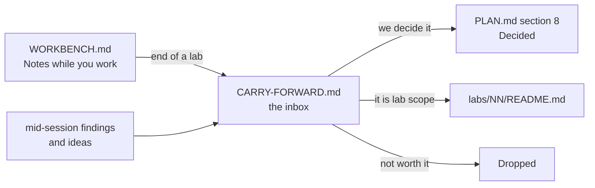

# Carry-forward

The **inbox** of this repo. Anything we notice but do not act on now lands here.

Read it at the start of every session. Groom it at the end of every lab.

## How it works

Rules:

- One line per item. If it needs a paragraph, it is a decision — put it in `PLAN.md` §8 instead.
- Every item has an **id**, a **date** it was raised, and where it came from.
- Nothing lives in two places. When an item graduates, set `Status` to `→ PLAN §8`, `→ lab NN` or `Dropped`, and move the row to **Closed** at the bottom.
- `PLAN.md` wins over this file. This file is ideas; that file is decisions.
- Ids never get reused, even after the row closes.

Statuses: `Open` · `→ PLAN §8` · `→ lab NN` · `Dropped`

---

## Open questions

Things we cannot answer alone. Some are for the company at interview.

| Id | Raised | From | Question | Status |
|---|---|---|---|---|
| CF-001 | 2026-10-18 | PLAN §8 | Does the company run **local or cloud** models? It changes the gateway design. Ask them. Labs stay provider-agnostic (`IChatClient`) until we know. | Open |
| CF-002 | 2026-10-18 | PLAN §8 | Are the agents **our** agents, or **merchants'** agents calling our platform (agentic commerce)? The second case changes auth, scopes and rate limits. | Open |

## Findings

Things we learned that are not a decision yet.

| Id | Raised | From | Finding | Status |
|---|---|---|---|---|
| CF-003 | 2026-10-18 | this machine | `dotnet` here is `10.0.401`, not the `10.0.302` in `PLAN.md` §9. Harmless, but pin the SDK with a `global.json` if a lab ever behaves differently. | Open |
| CF-004 | 2026-10-18 | Aperio | `llama-server` `/health` goes green **before** the model is loaded. So a readiness probe on `/health` lies. Lab 17 owns the fix; keep it in mind earlier. | → lab 17 |

## Fix later

Known debt. Each one needs a lab or a commit, not a discussion.

| Id | Raised | From | What | Status |
|---|---|---|---|---|
| CF-005 | 2026-10-18 | lab 00 | No `global.json`, so the SDK version floats. Add one if a version difference ever bites. | Open |
| CF-006 | 2026-10-18 | lab 00 | No CI. Nothing checks that `migrate` still runs on a clean machine. Decide later whether this repo gets a workflow at all. | Open |
| CF-010 | 2026-10-18 | lab 00 build | `dotnet build` warns NU1903: `System.Security.Cryptography.Pkcs` 9.0.11 pulled in by `dbup-sqlserver` has a high severity advisory. Bump or pin the transitive package. | Open |
| CF-012 | 2026-10-19 | lab 01 step 11 | `The_history_cannot_be_changed_from_outside` asserted `Operations` is not an `ICollection<T>`, which no BCL wrapper satisfies — `ReadOnlyCollection<T>` implements `IList<T>`. Test now asserts `IsReadOnly` and that `Add` throws. `README.md` and `WORKBENCH.md` corrected in the same commit. | Open |
| CF-011 | 2026-10-18 | lab 01 setup | Lab 01 adds `global.json` (SDK pin + `test.runner` = Microsoft.Testing.Platform), because `dotnet test` on .NET 10 refuses the old VSTest host. That is what `CF-003` and `CF-005` asked for, so both can close. | Open |

## Ideas for later

Labs, tools or experiments. Cheap to write down, no promise to build.

| Id | Raised | From | Idea | Status |
|---|---|---|---|---|
| CF-007 | 2026-10-18 | PLAN §8 | Aperio has **no time limit for a whole agent turn** — the step cap of 6 is the only bound. Own this gap: add a turn deadline in Lab 09 or 16 and talk about it. | Open |
| CF-008 | 2026-10-18 | db/README | A `seed --size large` of 1M rows is planned for Lab 05. Check it does not make the Docker volume painful on this Mac before relying on it in Lab 06. | Open |
| CF-009 | 2026-10-18 | lab 00 step 6 | Practice exercise once there are 3+ projects: lift Lab 01's `Result<TValue, TError>` into a shared project and make `Payments.Db` return it instead of an exit code — a refactor across layers, done with the tests already green. | Open |

---

## Closed

Keep the row. The history is the point.

| Id | Raised | Closed | Item | Went to |
|---|---|---|---|---|
| — | — | — | — | — |
