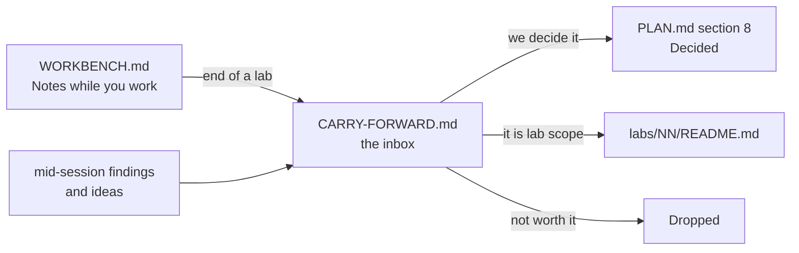

# Carry-forward

The **inbox** of this repo. Anything we notice but do not act on now lands here.

Read it at the start of every session. Groom it at the end of every lab.

## How it works

Rules:

- One line per item. If it needs a paragraph, it is a decision — put it in `PLAN.md` §8 instead.
- Every item has an **id**, a **date** it was raised, and where it came from.
- Nothing lives in two places. When an item graduates, set `Status` to `→ PLAN §8`, `→ lab NN` or `Dropped`, and move the row to **Closed** at the bottom.
- `PLAN.md` wins over this file. This file is ideas; that file is decisions.
- Ids never get reused, even after the row closes.

Statuses: `Open` · `→ PLAN §8` · `→ lab NN` · `Dropped`

---

## Open questions

Things we cannot answer alone. Some are for the company at interview.

| Id | Raised | From | Question | Status |
|---|---|---|---|---|
| CF-001 | 2026-10-18 | PLAN §8 | Does the company run **local or cloud** models? It changes the gateway design. Ask them. Labs stay provider-agnostic (`IChatClient`) until we know. | Open |
| CF-002 | 2026-10-18 | PLAN §8 | Are the agents **our** agents, or **merchants'** agents calling our platform (agentic commerce)? The second case changes auth, scopes and rate limits. | Open |

## Findings

Things we learned that are not a decision yet.

| Id | Raised | From | Finding | Status |
|---|---|---|---|---|
| CF-004 | 2026-10-18 | Aperio | `llama-server` `/health` goes green **before** the model is loaded. So a readiness probe on `/health` lies. Lab 17 owns the fix; keep it in mind earlier. | → lab 17 |
| CF-015 | 2026-10-19 | lab 02 decision | Replay loading costs N domain calls per read, and a row written under an older rule can refuse to replay at all. Watch it in labs 05 and 06 (bulk, 1M rows) and decide then whether a `Payment.Rehydrate(...)` factory earns its place. | Open |
| CF-016 | 2026-10-19 | lab 02 step 9 | The test fixture repeats `RepoRoot()` and the DbUp builder from `src/Payments.Db/Program.cs`. Third copy and it needs lifting — same shape as `CF-009`. **Checked 2026-10-22: still two copies** (`src/Payments.Db/Program.cs:93` and `tests/Payments.Api.Tests/ApiFixture.cs:79`; `Payments.Mcp.Tests` has neither). Left alone. The third arrives in lab 04, when the SQL Server tests need their own migrated database — lift it then, together with `CF-009`, into one shared project. **Routed 2026-10-22: lab 04 step 3, together with `CF-009`.** | → lab 04 |
| CF-017 | 2026-10-19 | lab 02 prep | `db/README.md` gave `PaymentOperation` a `Result` and an `ErrorCode` column, but the lab 01 domain only records operations that **succeeded**, so both would always say `Ok`. Lab 02 leaves them out. Decide in lab 14 (audit) whether refused attempts get rows of their own, and where — `PaymentOperation` or an audit table. | Open |
| CF-038 | 2026-10-22 | CF-034 audit | `labs/00-setup-and-glossary/GLOSSARY.md` is still the **empty scaffold**: all 28 bullets end at the em dash. But lab 00 is `Done`, tagged `lab-00`, and `docs/PROGRESS.md` says it shipped “`GLOSSARY.md` in your own words”. Either write the 28 lines (the agent must not — it is the learning) or correct the board. | Open |

## Fix later

Known debt. Each one needs a lab or a commit, not a discussion.

| Id | Raised | From | What | Status |
|---|---|---|---|---|
| CF-022 | 2026-10-20 | lab 02 steps 14–16 | Stretch A, keyset paging with an opaque cursor and the 9 `PagingTests`, was skipped. The `payment_by_merchant_newest` index that serves it already exists in migration `0001`. Lab 05 (bulk, 1M rows) is where paging starts to matter. Lab 08 (2026-10-21) ships a capped `list_payments` and refuses `cursor` as an unknown argument; the cursor plugs in as a `nextCursor` field plus a `cursor` argument. | Open |
| CF-023 | 2026-10-20 | lab 02 steps 17–19 | Stretch B, the EF Core store, was skipped, so `STORE-NOTES.md` is still empty and the Dapper-against-EF comparison is unmade. `StoreTests` is already a `[Theory]` with the engine as a parameter, and `ApiTestBase.StoreFor` holds a commented-out `"ef"` arm, so the work is: build the store, uncomment, add one `[InlineData("ef")]` per test. | Open |
| CF-025 | 2026-10-20 | lab 03 prep | `POST /payments/{id}/void` and the 4 `VoidTests` are still unbuilt — lab 03 builds only the commands refund needs. Build it, with an `Idempotency-Key`, in the first lab that needs a void (lab 13's workflow — lab 08 does not need it, 2026-10-21). | Open |
| CF-026 | 2026-10-20 | lab 03 prep | A key whose request died hard (process killed) stays `InProgress` forever, and every retry gets `409`. Nothing reclaims it. The real fix is a `locked_at` column and a takeover after a timeout, plus a recovery point per step. Lab 16 owns in-doubt calls. | → lab 16 |
| CF-006 | 2026-10-18 | lab 00 | No CI, and no PR gate: `develop` merges into `main` with nothing checking it. **Scoped 2026-10-20. Both open decisions answered 2026-10-22 (`PLAN.md` §8): the PR gate shape, and `[Trait("runs","local")]` tagging the exceptions.** Built as a proof of concept **on `develop`**, not on a branch of its own. What is left: add `.github/workflows/ci.yml`, push it, then turn on branch protection for `main` in the GitHub UI with the check required. The repo is public, so required checks and protection are free.  **2026-10-22: the push and the protection wait until lab 04 closes; lab 04 step 1 does the back-merge.** | In flight |
| CF-013 | 2026-10-19 | lab 01 step 12 | The transition rule is written twice: once in each method's first guard, once in `AllowedActions`. Step 12 (drive both from one `Table`, plus a shared amount check for `Capture`/`Refund`) was not done — lab 01 closes green at step 11. A verified-green version of the refactor exists; redo it in a later lab where a second aggregate shares the rule. | Open |
| CF-029 | 2026-10-21 | lab 08 prep | A refund left `refund_in_doubt` whose token then expires cannot be retried from the agent: the token is gone, and with it the `Idempotency-Key`. A human must read the payment to know. Lab 16 owns in-doubt calls; it may keep in-doubt tokens past their expiry, or move proposals into the API. | → lab 16 |

## Ideas for later

Labs, tools or experiments. Cheap to write down, no promise to build.

| Id | Raised | From | Idea | Status |
|---|---|---|---|---|
| CF-007 | 2026-10-18 | PLAN §8 | Aperio has **no time limit for a whole agent turn** — the step cap of 6 is the only bound. Own this gap: add a turn deadline in Lab 09 or 16 and talk about it. | Open |
| CF-008 | 2026-10-18 | db/README | A `seed --size large` of 1M rows is planned for Lab 05. Check it does not make the Docker volume painful on this Mac before relying on it in Lab 06. | Open |
| CF-009 | 2026-10-18 | lab 00 step 6 | Practice exercise once there are 3+ projects: lift Lab 01's `Result<TValue, TError>` into a shared project and make `Payments.Db` return it instead of an exit code — a refactor across layers, done with the tests already green. **Routed 2026-10-22: lab 04 steps 2 and 4** — `Result` to `Payments.Core`, `Migrator` returns it. | → lab 04 |
| CF-027 | 2026-10-20 | lab 03 prep | `idempotency_key` rows are kept forever. A real system deletes them after 24 h to a few days with a cleanup job, and needs an index on `created_at` for it. Pick the lab that first runs a background job (06 or 13). | Open |
| CF-014 | 2026-10-19 | lab 02 prep | Move `MerchantId` into the `Payment` aggregate, once a rule actually needs it (per-merchant refund limits, per-merchant currency). Today it lives only in the database and the API. Could be a small lab of its own: a domain change driven by a new rule, with 160 green tests as the net. | Open |
| CF-028 | 2026-10-21 | lab 08 prep | The agent's **own** database — lab 09's `AgentRun` / `AgentStep`, owned by EF Core — could live on **SQL Server** instead of Postgres: the real shape of "the app owns this schema", next to a payment core on another engine. It runs on the Mac, so the "never SQL Server on the Pi" rule holds. Decide when lab 09 starts. | → lab 09 |
| CF-030 | 2026-10-21 | lab 08 prep | `Payments.Mcp` could hide the tools its key cannot use, by asking the API for its own scopes at start (a `GET /me`). Fewer wrong calls by a weak model; the API still decides (QA Q26). Try it in lab 09 if gemma keeps calling `refund_payment` with a read-only key. | Open |
| CF-033 | 2026-10-22 | lab 08 step 18 | Two MCP harnesses repeat each other: `tests/Payments.Mcp.Tests/McpHarness.cs` and `tests/Payments.Api.Tests/McpEndToEndHarness.cs` share the pipes, the transport and the client. Not shared today because one owns a `StubApi` and a `FakeTimeProvider`, the other an `ApiFixture`, and the two test projects do not reference each other. **Judged 2026-10-22: not worth it yet.** Only `CallAsync` and `DisposeAsync` are truly identical (24 of 218 lines); the DI setup genuinely differs. Build the shared project in **lab 09**, which adds a third harness (agent loop) and needs both a stub and the real API. | Open |

---

## Closed

Keep the row. The history is the point.

| Id | Raised | Closed | Item | Went to |
|---|---|---|---|---|
| CF-003 | 2026-10-18 | 2026-10-22 | `dotnet` here is `10.0.401`, not the `10.0.302` in `PLAN.md` §9. | `global.json` pins `10.0.401` with `rollForward: latestFeature`, added in lab 01 |
| CF-005 | 2026-10-18 | 2026-10-22 | No `global.json`, so the SDK version floats. | `global.json` added in lab 01. Same fix as `CF-003` and `CF-011` |
| CF-011 | 2026-10-18 | 2026-10-22 | Lab 01 adds `global.json` (SDK pin + `test.runner` = Microsoft.Testing.Platform), because `dotnet test` on .NET 10 refuses the old VSTest host. | Done in lab 01. The row itself said it closes `CF-003` and `CF-005`, so all three close together |
| CF-012 | 2026-10-19 | 2026-10-22 | `The_history_cannot_be_changed_from_outside` asserted `Operations` is not an `ICollection<T>`, which no BCL wrapper satisfies — `ReadOnlyCollection<T>` implements `IList<T>`. | Fixed in lab 01 step 11: the test asserts `IsReadOnly` and that `Add` throws. `README.md` and `WORKBENCH.md` corrected in the same commit |
| CF-020 | 2026-10-20 | 2026-10-22 | The `ValidationTests` group (8 tests) was never written: nothing checked that a missing `currency`, a `"EURO"`, a negative amount or malformed JSON is a `400` with the field named. | Lab 03 step 2 — 8 tests, green |
| CF-021 | 2026-10-20 | 2026-10-22 | The command endpoints and their test groups were skipped in lab 02, so it shipped with `POST /payments` and `GET /payments/{id}` only. | Lab 03 steps 3–4 built `authorise`, `capture` and `refund` with their tests. `void` stayed open as `CF-025` |
| CF-032 | 2026-10-22 | 2026-10-22 | Lab 08 closed without step 19: `A_dropped_answer_still_refunds_once` needed lab 03's replay. | Lab 03, before it closed. The test and the `DropFirstAnswer` `DelegatingHandler` live in `tests/Payments.Api.Tests/McpEndToEndTests.cs`; `McpEndToEndHarness.StartAsync` takes an optional handler. Seen red once with the `Claim.Replay` arm removed |
| CF-024 | 2026-10-20 | 2026-10-20 | A loaded payment could not be acted on: `ReplayClock`'s queue held exactly `created_at` plus one stamp per operation, so the replay drained it and the next domain call threw. Every command endpoint would have died on its first line. | Fixed the same day: the clock takes a fallback `TimeProvider`. `plan/PLAN.md` §8, and the lab 02 `WORKBENCH.md` steps 7 and 13b |
| CF-018 | 2026-10-19 | 2026-10-22 | The error code was `amount_exceeds_captured` in lab 02 and the code, but `refund_exceeds_captured` in labs 04, 07, 09, 18 and `docs/aperio/AGENT-READY-BACKEND.md`. | All 7 occurrences renamed 2026-10-22. The Aperio example in §6 was wrong in two more ways and was corrected against `src/Payments.Api/ProblemMapper.cs`: the `type` is a URN, not an `https://` domain, and the status is `422`, not `409`. Lab 08 was aligned 2026-10-21 |
| CF-034 | 2026-10-22 | 2026-10-22 | Lab 03 step 10's Proof counted tests that step 12 owned. Audit the other labs for the same bug. | Audited labs 00, 01, 02, 08 and the blueprint 2026-10-22. **Two found.** Lab 01 step 7 claimed all of `ClockAndHistoryTests` green, but 3 of its 5 tests call `Capture` (step 8) or `Refund` (step 10) — steps 7 and 10 corrected, with the real split (2 pass, 3 red). Lab 00 step 8's Proof was step 9's job verbatim (“read `QA.md` out loud”) — replaced with a glossary proof. Lab 08 was correct (13 = 15 − 2); its list-test Proof now says why the runner prints 10 for 8 names. Lab 02 claims four steps it never shipped, so a “what this lab actually shipped” table went at the top of its `WORKBENCH.md`. The lesson is now a **rule in `labs/_TEMPLATE/WORKBENCH.md`** under Proof, so it cannot be forgotten again |
| CF-010 | 2026-10-18 | 2026-10-22 | `System.Security.Cryptography.Pkcs` 9.0.11, pulled in by `dbup-sqlserver`, had NU1903 (high) and NU1902 (moderate). | Pinned with a direct `PackageReference` on `10.0.13` in `src/Payments.Db/Payments.Db.csproj`. A direct reference beats a transitive one. Bumping `Microsoft.Data.SqlClient` does **not** work: 7.1.1 still brings `9.0.18`, flagged the same way (measured) |
| CF-037 | 2026-10-22 | 2026-10-22 | `dotnet build` printed warnings on every build, which hides a real one. | **0 warnings, 0 errors.** `CS8603` in `Core.cs` (`_error!`, matching `_value!`), four `CS8524` given a `_ => throw new ArgumentOutOfRangeException` arm (`Payment.AllowedActions` and `ProblemMapper`'s `Code`/`Status`/`Title`), `CS8600` in `Payments.Db/Program.cs` (`string? pass` plus a clear message when `.env` is missing), `CS8321` closed by **wiring `CheckArgs` up** rather than deleting it — it had been written in lab 00 and left commented out, so the runner validated nothing. The `_ => throw` option was taken over the one-table refactor the row also offered; see `PLAN.md` §8. The CI gate can now fail on a new warning |
| CF-019 | 2026-10-20 | 2026-10-22 | `updatedAt` came from two clocks: `POST /payments` used `DateTimeOffset.Now` while `InsertAsync` wrote `updated_at = created_at`. | Fully closed. The create response now answers `payment.CreatedAt`, the value really in the row, and `GetPaymentTests.A_created_payment_can_be_read_back` asserts both that create and read agree and that `createdAt == updatedAt` on a new payment. Seen red first: the two clocks were 98 **microseconds** apart, so the 1 ms tolerance overload would have let it through — the exact-equality assert is the one that bites |
| CF-031 | 2026-10-22 | 2026-10-22 | A `401` from the API reached the model as `tool_failed` with the hint "try once more", which is a retry loop. | `Mapped` in `src/Payments.Mcp/PaymentTools.cs` has a `401` branch next to the `403` one: code `api_key_invalid`, and a hint that says stop and name a human. `ReadToolTests.A_401_is_api_key_invalid_with_a_stop_hint` asserts the hint contains "human", does **not** contain "try", that only one request reached the API, and that the API's own wording never reaches the model |
| CF-035 | 2026-10-22 | 2026-10-22 | Lab 03 skipped step 13, so **nothing tested the race**. A claim written as `select`-then-`insert` would have passed every test. | `tests/Payments.Api.Tests/ConcurrencyTests.cs`, 3 tests, `Task.WhenAll` over 50 pre-built requests. Seen red with the claim swapped for `select`-then-`insert`: all 3 failed with real `500`s, and the row counts stayed right — exactly as this row predicted, the primary key saved the money and what broke was the **answer**. It also found a live bug in `LoadAsync` that no sequential test could see; see `PLAN.md` §8, "the load is one snapshot" |
| CF-036 | 2026-10-22 | 2026-10-22 | `FailureTests` only broke `InsertAsync`, so the `catch` in `CommandAsync` — the release after a failed command — had no test. | `ThrowingPaymentStore` takes `ThrowOn.Insert` or `ThrowOn.Update`, and `FailureTests` is 2 tests to 4: `A_crash_during_a_refund_releases_the_key` and `A_retry_after_a_crashed_refund_refunds_once`. Seen red by deleting the `ReleaseAsync` from `CommandAsync`'s catch — the two **new** tests failed (stuck key, retry blocked by a `409` for ever) and the two old create tests stayed green, which is the proof the path really was untested |
