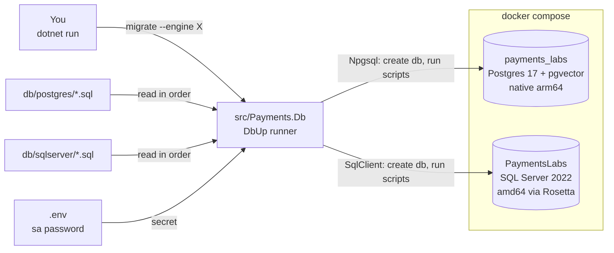
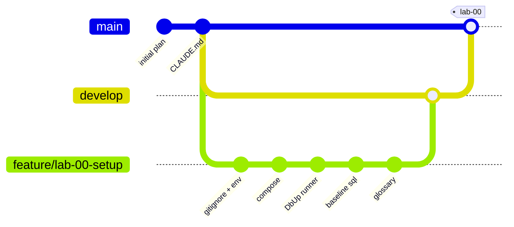
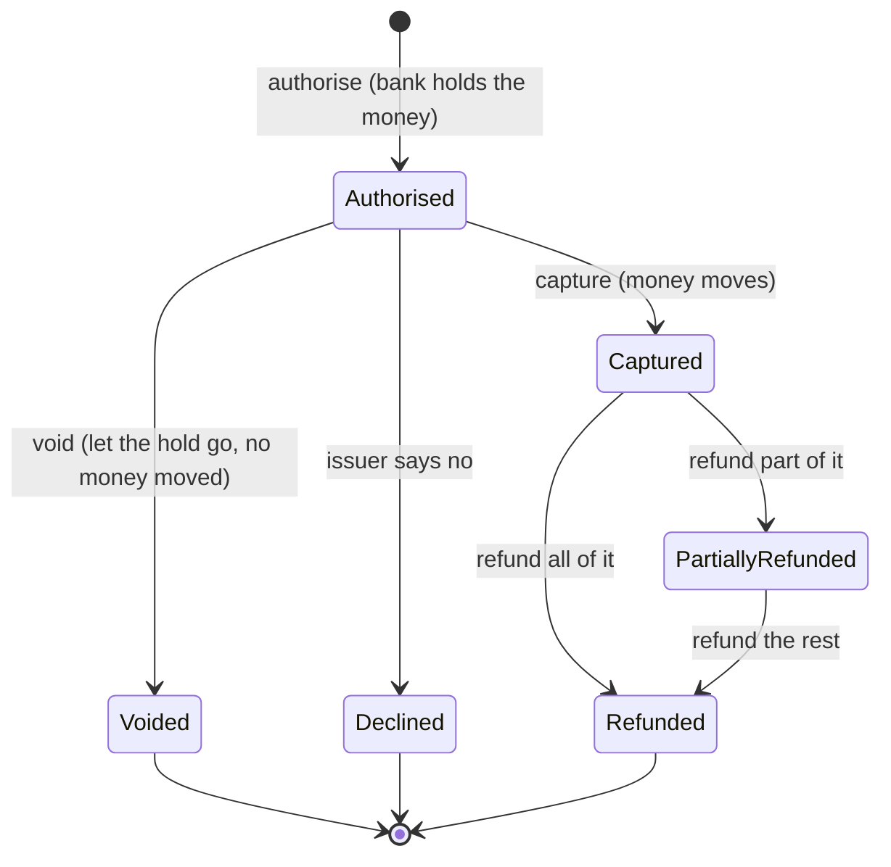
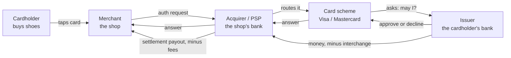

# Lab 00 — Workbench

Follow the steps in order. Each step says **Goal**, **Why**, **Do**, **Proof**, **Commit**.

Spec and Done-when list: `README.md` in this folder. Interview questions: `QA.md`.

Started 2026-10-18.

## The target state

Two containers, two databases, one runner. No tables yet.



The two script folders are kept **in lockstep**: the same change lands in both in the same commit.

---

## Step 0 — Read the questions, not the answers

**Goal.** You have skimmed every question in `QA.md`. 5 minutes. No answers read.

**Why.** Knowing the questions first changes what you notice while you work, and attention is most of the learning. Reading the **answers** now would spoil the test — afterwards you would *recognise* them instead of *recalling* them, which feels like knowing and does not survive an interview. So eyes off every `A:` line. If one question makes no sense at all, read that single answer and move on.

**Do.**

```bash
grep -E '^\*\*Q' labs/00-setup-and-glossary/QA.md
```

**Proof.** You can say, in one sentence, what this lab is going to be asked about.

**Commit.** Nothing to commit.

---

## Step 1 — Make the machine ready

**Goal.** Docker Desktop runs, and it can run amd64 images.

**Why.** Everything in this lab lives in containers. SQL Server has no ARM image, so on an Apple Silicon Mac it must be emulated. Rosetta does that emulation, and it is off by default. If you skip this, the SQL Server container restarts in a loop and the error message does not tell you why.

**Do.**

1. Start Docker Desktop.
2. Open Settings → General. Turn on **"Use Rosetta for x86_64/amd64 emulation"**. Apply and restart.
3. Check the tools:

```bash
dotnet --version     # 10.x
docker info          # must not error
uname -m             # arm64
```

**Proof.** `docker info` prints a block of text and no error.

**Commit.** Nothing to commit. This step changes your machine, not the repo.

---

## Step 2 — Create the Gitflow branches

**Goal.** `develop` and `feature/lab-00-setup` exist. You are on the feature branch.

**Why.** Gitflow is one of the five buckets this repo trains, and the repo itself has to show it. `main` holds finished states only, so no lab work happens there. `develop` is the integration branch where each lab lands. One feature branch per lab keeps the history readable, and the `--no-ff` merge at the end leaves a visible marker that a lab was completed.

**Do.**

```bash
git checkout -b develop
git checkout -b feature/lab-00-setup
```

**Proof.**

```bash
git branch        # main, develop, * feature/lab-00-setup
```

**Commit.** Nothing to commit. A branch is not a commit.

Where this lab ends up:



---

## Step 3 — Protect the secret before the first commit

**Goal.** `.gitignore` and `.env.example` are committed. `.env` holds the real SQL Server password and is ignored.

**Why.** SQL Server needs an `sa` password, and that password is a secret. Once a secret is committed it stays in git history forever, even if you delete the file in the next commit. So the ignore rule must exist **before** the file does. `.env.example` is committed with fake values so the next person — or you in six months — knows which keys to set.

**Do.**

1. Create `.gitignore` with at least:

```
bin/
obj/
.env
*.user
```

2. Create `.env.example`:

```
MSSQL_SA_PASSWORD=ChangeMe_Str0ng!
```

3. Copy it to `.env` and put a real strong password in. SQL Server demands 8+ characters with upper case, lower case, a digit and a symbol. A weak password makes the container exit, and the reason is buried in the container logs.

**Proof.**

```bash
git status --short        # .env must NOT appear
```

**Commit.** Stage `.gitignore` and `.env.example`. Never stage `.env`.

```
chore(repo): add .gitignore and .env.example
```

---

## Step 4 — Write `docker/docker-compose.yml`

**Goal.** One file, `docker/docker-compose.yml`, with two services in it. Both containers start and report `(healthy)`.

**Why.** Two engines, because the labs need both: Postgres is native on ARM and fast, and it carries pgvector for Lab 12; SQL Server is the engine where stored procedures and lock hints actually behave the way an interview will ask about. They go in **one** file so one command brings the whole lab environment up and down together — two files would let you run half an environment and not notice. Running them side by side also forces the lockstep discipline: the same tables in both engines, changed in the same commit. That is the same rule Aperio keeps with its Postgres and SQLite migration folders.

**Do.**

**1. Make the folder and the file.** One file. It does not exist yet.

```bash
mkdir -p docker
touch docker/docker-compose.yml
```

Where things live after this step:

```
agent-ready-payments/
├── .env                      # your real password. git ignores it
├── .env.example              # fake values. committed
└── docker/
    └── docker-compose.yml    # this step. ONE file, TWO services
```

**2. Fill it.** Here is the shape. Copy it, then replace every `TODO` yourself — the `TODO` lines are the learning, the rest is plumbing.

```yaml
services:
  payments-postgres:
    image: pgvector/pgvector:pg17
    container_name: payments-postgres
    environment:
      POSTGRES_USER: labs
      POSTGRES_PASSWORD: labs
      POSTGRES_DB: postgres
    ports:
      - "5432:5432"
    volumes:
      - payments-postgres-data:/var/lib/postgresql/data
    healthcheck:
      test: TODO   # the pg_isready command, as a list
      interval: 5s
      timeout: 5s
      retries: 10

  payments-mssql:
    image: mcr.microsoft.com/mssql/server:2022-latest
    container_name: payments-mssql
    platform: linux/amd64
    environment:
      ACCEPT_EULA: "Y"
      MSSQL_SA_PASSWORD: ${MSSQL_SA_PASSWORD}
    ports:
      - "1433:1433"
    volumes:
      - payments-mssql-data:/var/opt/mssql
    healthcheck:
      test: TODO   # the sqlcmd command, as a list
      interval: 10s
      timeout: 5s
      retries: 20
      start_period: 60s

volumes:
  payments-postgres-data:
  payments-mssql-data:
```

The two healthchecks you must write:

| Service | Use this command inside the container |
|---|---|
| `payments-postgres` | `pg_isready -U labs -d postgres` |
| `payments-mssql` | `/opt/mssql-tools18/bin/sqlcmd -C -S localhost -U sa -P "$MSSQL_SA_PASSWORD" -Q "SELECT 1"` |

Wrap each one in a list that starts with `CMD-SHELL`. Look up the exact syntax — reading the Compose healthcheck docs once is part of the step.

Three rules behind that file:

- **A named volume per service.** Without one, `docker compose down` throws your databases away.
- **A healthcheck per service.** "Container started" and "database accepts connections" are not the same moment. Under Rosetta that gap is 30–60 seconds, and a migration run inside that gap fails for no visible reason.
- **Do not create `payments_labs` or `PaymentsLabs` here.** The runner creates them in Step 6. Database creation belongs in one place, in code, where you can test it and run it again safely.

`POSTGRES_DB=postgres` on purpose: the runner must connect to some existing database before it can say `CREATE DATABASE payments_labs`. You cannot create a database from inside the database you are creating.

**3. Run it.** Both commands point at that **same one file**. Run them from the repo root.

```bash
docker compose -f docker/docker-compose.yml --env-file .env up -d
docker compose -f docker/docker-compose.yml --env-file .env ps
```

- `-f docker/docker-compose.yml` says which file to read. Without it, Compose looks for a compose file in the folder you are standing in, finds none, and stops.
- `--env-file .env` says where `${MSSQL_SA_PASSWORD}` comes from. Compose looks for `.env` next to the compose file, which here is `docker/`. Your `.env` is at the repo root, so you must say so. Skip this flag and SQL Server starts with an empty password and dies.

**Proof.** Both services show `(healthy)`. Give SQL Server a minute on the first start — that is what `start_period: 60s` is for.

```bash
docker compose -f docker/docker-compose.yml --env-file .env ps
# both lines must say   Up (healthy)
```

If one says `Up` but never `(healthy)`, read its log:

```bash
docker logs payments-mssql --tail 30
```

**Commit.** Stage `docker/docker-compose.yml`.

```
build(lab-00): add docker compose with postgres and sql server
```

---

## Step 5 — Create the solution

**Goal.** `Payments.slnx` exists with one project, `src/Payments.Db`.

**Why.** Every later lab adds a project to this solution: the domain, the API, the MCP server, the agent. Starting the solution now means you never have to restructure later. `Payments.Db` comes first because nothing else can run until the databases exist.

**Do.**

```bash
dotnet new sln -n Payments
dotnet new console -o src/Payments.Db -n Payments.Db
dotnet sln add src/Payments.Db
```

Add these packages to `src/Payments.Db`:

| Package | Why |
|---|---|
| `dbup-core` | The engine: finds scripts, orders them, records what ran |
| `dbup-postgresql` | Postgres journal and `EnsureDatabase` |
| `dbup-sqlserver` | SQL Server journal and `EnsureDatabase` |
| `DotNetEnv` | Loads `.env` into environment variables (or read the file yourself) |

**Proof.**

```bash
dotnet build      # 0 errors
```

**Commit.** Stage `Payments.slnx` and `src/Payments.Db/`.

```
chore(repo): add Payments solution and Payments.Db project
```

---

## Step 6 — Build the migration runner

**Goal.** Two commands work against both engines.

```bash
dotnet run --project src/Payments.Db -- migrate --engine postgres
dotnet run --project src/Payments.Db -- migrate --engine sqlserver
dotnet run --project src/Payments.Db -- status  --engine postgres
```

**Why.** A payment database is never built by hand, and it is never dropped and recreated — it holds money records. So it grows by small numbered scripts that each run exactly once, in order, recorded in a journal table. DbUp does that with plain `.sql` files, which fits a stored-procedure world where you want to read every line of SQL that touches `Payment`. EF Core migrations would hide that SQL and would want to own the schema, which is the wrong shape for this repo.

**Do.** `migrate` does four things, in this order:

1. Read the connection string for the chosen engine. Postgres is fixed. SQL Server takes the password from `.env`.
2. **Ensure the database exists:** `EnsureDatabase.For.PostgresqlDatabase(cs)` or `EnsureDatabase.For.SqlDatabase(cs)`. Both are safe to run again — they do nothing when the database is already there.
3. Build the upgrader against `db/postgres` or `db/sqlserver`, with `.WithScriptsFromFileSystem(path)`, `.LogToConsole()` and `.WithTransactionPerScript()`.
4. Run it. On failure, print the error and **exit with code 1**. A runner that exits 0 after a failed migration is worse than no runner, because CI goes green and the schema is half-applied.

`status` prints what has run and what is waiting. Use `upgrader.GetScriptsToExecute()`.

### The shape of it

This is the skeleton, with the holes left for you. Fill every `TODO`. You write the code.

```csharp
// Program.cs
using DbUp;
using DbUp.Engine;

// 1. Read the two arguments: the command and the engine.
//    args = [ "migrate", "--engine", "postgres" ]
// TODO: parse them. Unknown command or engine -> print usage, return 2.

// 2. Find the repo root, then db/<engine>.
static string RepoRoot()
{
    var dir = new DirectoryInfo(AppContext.BaseDirectory);
    // TODO: walk up while no "Payments.slnx" (or "Payments.sln") sits in dir.
    //       Nothing found -> throw. Never hard-code "../../../../db".
    return dir.FullName;
}

// 3. Connection string per engine. The sa password comes from .env.
// TODO: DotNetEnv.Env.Load(Path.Combine(RepoRoot(), ".env"));
//       postgres  -> "Host=localhost;Port=5432;Database=payments_labs;Username=labs;Password=labs"
//       sqlserver -> "Server=localhost,1433;Database=PaymentsLabs;User Id=sa;Password=" +
//                    Environment.GetEnvironmentVariable("MSSQL_SA_PASSWORD") + ";TrustServerCertificate=true"

// 4. Make the database if it is missing. Safe to run again.
// postgres : EnsureDatabase.For.PostgresqlDatabase(cs);
// sqlserver: EnsureDatabase.For.SqlDatabase(cs);

// 5. Build the upgrader. Same four calls for both engines, only the first line differs.
UpgradeEngine Build(string engine, string cs, string scriptDir)
{
    var builder = engine == "postgres"
        ? DeployChanges.To.PostgresqlDatabase(cs)
        : DeployChanges.To.SqlDatabase(cs);

    return builder
        .WithScriptsFromFileSystem(scriptDir)   // TODO: throw if the folder is missing or empty
        .WithTransactionPerScript()
        .LogToConsole()
        .Build();
}

// 6. Run it.
// migrate: var result = upgrader.PerformUpgrade();
//          TODO: result.Successful == false -> print result.Error, return 1. Else return 0.
// status : TODO: print upgrader.GetScriptsToExecute() names, or "nothing waiting". Return 0.
```

Two details that will cost you an hour if you miss them:

- **Finding the `db/` folder.** `dotnet run` sets the working directory to the project folder, not the repo root. Walk up from `AppContext.BaseDirectory` until you find the folder holding `Payments.slnx`, then resolve `db/` from there. Never hard-code `../../../../db`. Also fail loudly when the script folder is empty — a silent "0 scripts" plus exit 0 looks exactly like success.
- **Journal table name.** Keep DbUp's default, `SchemaVersions`, on both engines. Lockstep means the same shape everywhere, including the bookkeeping. One catch: DbUp sends the name unquoted, and Postgres folds unquoted names to lowercase. So the real table is `schemaversions` on Postgres and `SchemaVersions` on SQL Server. Your code never notices, because DbUp is unquoted on both sides. You notice the moment you query it by hand.

**Proof.** Both `migrate` commands print one applied script and exit 0.

**Commit.** Stage `src/Payments.Db/`.

```
feat(db): add DbUp migration runner for both engines
```

What one `migrate` run actually does:

```mermaid
sequenceDiagram
    autonumber
    actor You
    participant R as Payments.Db
    participant FS as db/&lt;engine&gt;/*.sql
    participant DB as Database engine

    You->>R: migrate --engine postgres
    R->>R: walk up to find Payments.slnx, then db/
    R->>R: read .env for the sa password
    R->>DB: EnsureDatabase - CREATE DATABASE if missing
    DB-->>R: database exists
    R->>FS: list scripts, sort by file name
    FS-->>R: 0000_baseline.sql
    R->>DB: SELECT from SchemaVersions
    DB-->>R: already applied: none
    loop each new script
        R->>DB: BEGIN
        R->>DB: run the script
        R->>DB: INSERT into SchemaVersions
        R->>DB: COMMIT
    end
    R-->>You: exit 0, or print error and exit 1
```

The journal read is what makes the second run do nothing. That is the whole idea.

---

## Step 7 — Add the baseline scripts

**Goal.** One script per engine, applied and journalled. Still zero tables.

**Why.** Lab 00 deliberately creates no tables — each later lab adds its own, so nothing is built before a lab needs it. But an untested runner is not a runner. One harmless script per engine makes DbUp create the `SchemaVersions` table and record a row, which proves the whole path works: connect, create database, find script, run it, journal it.

**Do.**

`db/postgres/0000_baseline.sql`

```sql
COMMENT ON DATABASE payments_labs IS 'Agent-ready payments labs';
```

`db/sqlserver/0000_baseline.sql`

```sql
PRINT 'PaymentsLabs baseline';
```

Then run `migrate` for both engines, and run it **a second time**.

**Proof.** The second run says there are no new scripts to execute. That line is the point of the whole step. It proves the journal works, and a journal that works is what stops a migration running twice in production.

```bash
docker exec payments-postgres psql -U labs -d payments_labs -c 'TABLE schemaversions;'
```

**Commit.** Stage `db/postgres/0000_baseline.sql` and `db/sqlserver/0000_baseline.sql`.

```
feat(db): add baseline migration scripts for both engines
```

---

## Step 8 — Write the glossary

**Goal.** `labs/00-setup-and-glossary/GLOSSARY.md` is filled in, one line per word, in your own words.

The file already exists as a **scaffold**: headings, all 28 words as empty bullets, and a self-check list at the bottom. Typing the words is not the learning, so that part is done for you. The definitions are yours.

**Why.** Every ticket in a payment backlog is written in these words, and an interviewer hears in one sentence whether you have used them or only read them. Mixing up "void" and "refund" is the classic tell, because they feel similar and are not: one cancels a hold, the other moves money back. Writing the lines yourself is the work — copying a definition teaches nothing.

**Do.** Open the file and fill every bullet:

```bash
open labs/00-setup-and-glossary/GLOSSARY.md
```

The words, for reference:

**Money movement:** authorise · capture · void · refund · partial refund · reversal · chargeback · representment · settlement · payout

**Who is who:** cardholder · merchant · issuer · acquirer · PSP · card scheme · gateway

**Technical:** idempotency key · auth hold · MID · interchange · 3-D Secure · PCI DSS · tokenisation · AVS · CVV · ISO 4217 · minor units

Rule: if you cannot explain a word without using another word from the list, you do not know it yet.

The four pairs that catch people:

| Pair | The difference |
|---|---|
| void vs refund | Void cancels a hold before money moved. Refund gives back money that already moved. |
| capture vs settlement | Capture claims one payment's money. Settlement is the batch of captures paid out to the merchant. |
| issuer vs acquirer | Issuer is the cardholder's bank. Acquirer is the merchant's bank. |
| chargeback vs refund | A refund is the merchant choosing to give money back. A chargeback is the issuer taking it back. |

**Proof.** Read `QA.md` out loud and answer without looking.

### One payment, over its life



`void` and `refund` sit on different sides of `Captured`. That single picture is the answer to the most common interview trap. A **chargeback** is not on this diagram on purpose: it is the issuer taking money back against your will, so it is its own record (Lab 13), not a status the merchant chooses.

### Who is who, in one card payment



This is the **four-party model**. A payment technology company usually sits in the `Acquirer / PSP` box, which is why every lab in this repo is written from that seat.

**Commit.** Stage `labs/00-setup-and-glossary/GLOSSARY.md`.

```
docs(lab-00): fill the payments glossary
```

---

## Step 9 — Say the answers out loud

**Goal.** You answered every question in `QA.md` out loud, then checked.

**Why.** This is the test the lab was for. Speaking the answer uses a different path than reading it, and it is the path an interview uses. Mark every question you got wrong or said badly — those marked ones are a 5-minute warm-up at the start of your next session, and that repeat is where most of the gain sits.

**Do.**

1. Cover the file. Work down the question list.
2. Say the answer out loud. Then read the real answer.
3. Mark the misses. Read the **Trap** follow-up for each one.
4. Answer `Q-APERIO` last: "Have you solved this before?"

**Proof.** You answered every question without looking. The marked list is short.

**Commit.** Nothing to commit.

---

## Step 10 — Close the lab

**Goal.** Lab 00 is on `develop`, `main` has the `lab-00` tag, and the feature branch is gone.

**Why.** The merge and the tag are the record that a lab finished. `--no-ff` keeps a merge commit even when a fast-forward is possible, so the history shows the lab as one unit of work instead of loose commits. A branch name is only a pointer at one commit, so deleting a merged feature branch drops the pointer and never the work — from here on the tag `lab-00` is the bookmark. This is the pattern every later lab repeats, so get it right once.

**Do.** Run the full Done-when list in `README.md` first. Every step above is already committed, so nothing is left to commit here. Check that with `git status --short` — it must be empty — then:

Git opens an editor for each `--no-ff` merge message; `--no-edit` keeps git's own default and opens nothing. If vim is on your screen anyway, `:wq` then **Enter** saves and finishes, `:q!` then **Enter** cancels. See [`docs/EVERYDAY-COMMANDS.md`](../../docs/EVERYDAY-COMMANDS.md).

```bash
git checkout develop
git merge --no-ff --no-edit feature/lab-00-setup
git checkout main
git merge --no-ff --no-edit develop
git tag lab-00
git checkout develop
git merge main          # the back-merge. Without it develop is behind main
git branch -d feature/lab-00-setup
```

The back-merge was missing when this lab was first written, and it bit at the start of Lab 01: the merge commit `Merge branch 'develop'` sat only on `main`, so `develop` was five commits behind. The fix is one line, every lab. Check it with `git log --oneline develop..main` — an empty answer means the two are level.

The small `-d` deletes the branch only if its work is really merged. If something is unmerged, git refuses and prints the branch name. That makes `-d` a safety check. Never use the capital `-D` here: it deletes the pointer with no check.

You run every git command. The agent never commits, merges, pushes or tags.

**Proof.**

```bash
git log --oneline --graph --all | head -20
git tag                           # lab-00
git branch                        # develop and main only — no feature branch
git log --oneline develop..main   # empty: develop is level with main
```

To prove the work survived the delete, stand at the tag and look around, then come back:

```bash
git checkout lab-00    # detached HEAD, exactly the end of Lab 00
git log --oneline -3
git checkout develop   # back to work
```

**Commit.** Nothing to commit. The merge commits are the record of this step.

---

## Traps

| Trap | What happens | Fix |
|---|---|---|
| `git branch -d` refused | git says the branch is not fully merged, so one commit never reached `develop` | Do not reach for `-D`. Merge first, then delete |
| Deleting the branch while standing on it | "Cannot delete branch ... checked out" | `git checkout develop` first, then delete |
| Rosetta off | `payments-mssql` restarts forever | Turn it on in Docker Desktop, then recreate the container |
| Weak `sa` password | Container exits; the logs say the password fails the policy | 8+ chars: upper, lower, digit, symbol |
| `.env` committed | The secret is in git history forever | Add the ignore rule **before** the first commit |
| `--env-file .env` left off | `MSSQL_SA_PASSWORD` is empty, so SQL Server exits at once | Compose reads `.env` next to the compose file, which is `docker/`. Yours is at the repo root, so pass `--env-file .env` |
| `docker compose up` without `-f` | "no configuration file provided" | There is no compose file at the repo root. Always pass `-f docker/docker-compose.yml` |
| Connecting before healthy | `migrate` fails on a cold start | Wait for `(healthy)`. SQL Server needs 30–60 s under Rosetta |
| Runner started in the wrong folder | "0 scripts found", exit 0, nothing happened | Resolve `db/` from the solution root; fail loudly on an empty folder |
| Editing an applied script | DbUp will not run it again, so the engines drift apart | Never edit an applied script. Add a new numbered one. |
| `TABLE "SchemaVersions";` on Postgres | `ERROR: relation "SchemaVersions" does not exist`, so you think the migration failed when it worked | Postgres folds unquoted names to lowercase, and DbUp sends the name unquoted. Double quotes ask for the exact capitals, so they never match. Query `schemaversions` with no quotes. SQL Server keeps the capitals, so there the name really is `SchemaVersions` |
| `$` in the `sa` password | Compose reads `$NAME` as a variable, warns `The "N" variable is not set`, and starts the container with a different password. The container then never goes healthy | No `$` in `.env`. Letters, digits, `_`, `-` and `!` are safe. `$$` fixes Compose but breaks `DotNetEnv`, which reads `.env` too |

## Notes while you work

Write what surprised you here, as it happens. At the end of the lab these move into `CARRY-FORWARD.md` (the inbox) as `CF-NNN` rows. From there each one graduates to `PLAN.md` section 8, to a lab `README.md`, or it is dropped.

-
