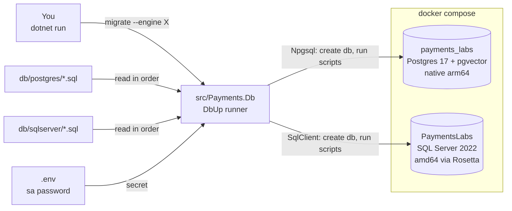
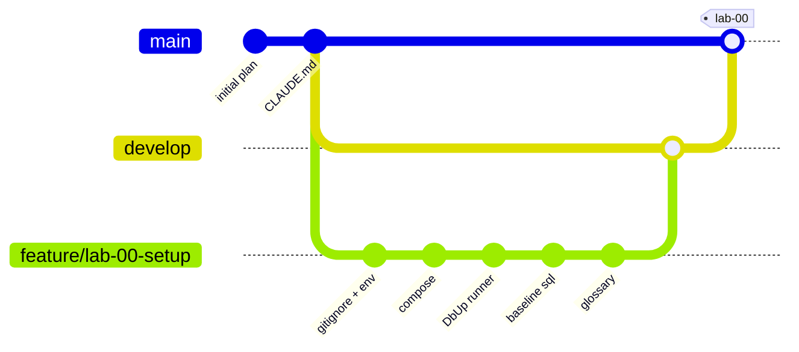
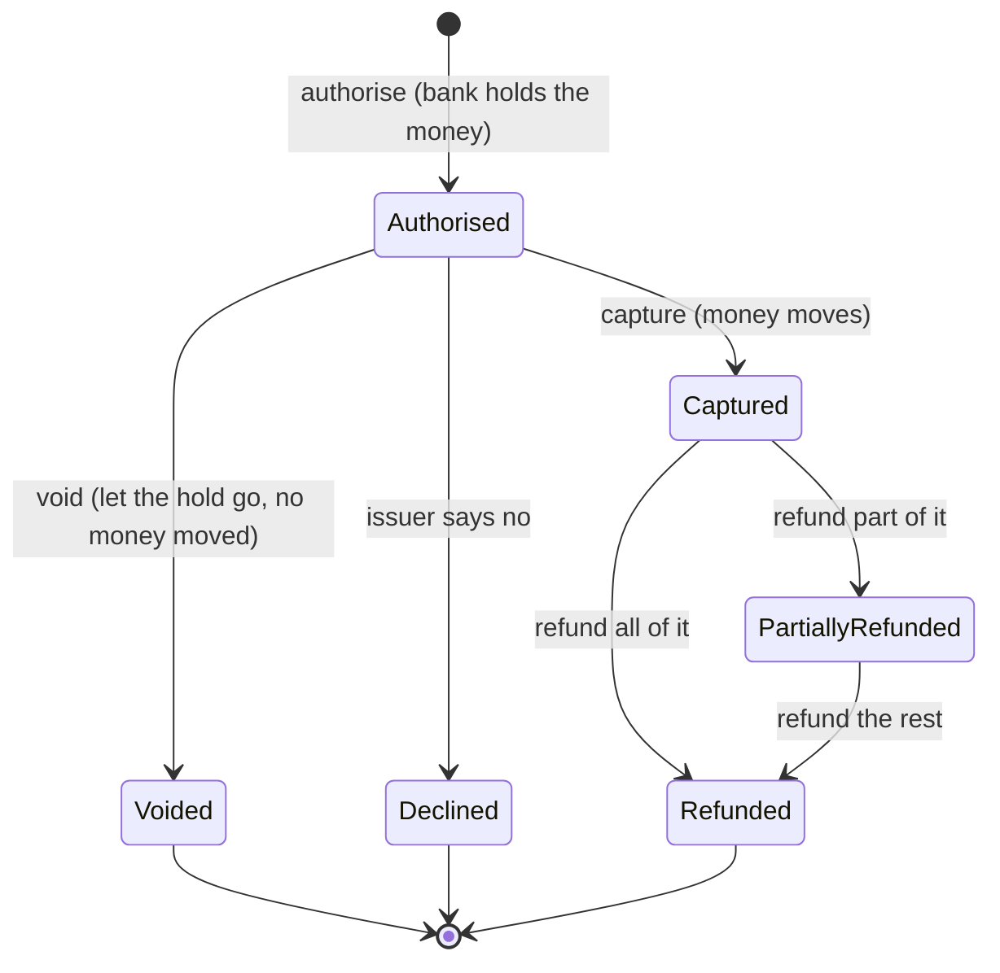
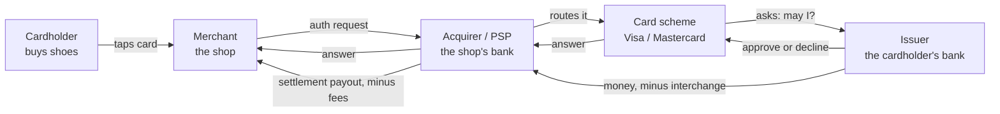

# Lab 00 — Workbench

Follow the steps in order. Each step says **Goal**, **Why**, **Do**, **Proof**.

Spec and Done-when list: `README.md` in this folder. Interview questions: `QA.md`.

Started 2026-10-18.

## The target state

Two containers, two databases, one runner. No tables yet.



The two script folders are kept **in lockstep**: the same change lands in both in the same commit.

---

## Step 0 — Make the machine ready

**Goal.** Docker Desktop runs, and it can run amd64 images.

**Why.** Everything in this lab lives in containers. SQL Server has no ARM image, so on an Apple Silicon Mac it must be emulated. Rosetta does that emulation, and it is off by default. If you skip this, the SQL Server container restarts in a loop and the error message does not tell you why.

**Do.**

1. Start Docker Desktop.
2. Open Settings → General. Turn on **"Use Rosetta for x86_64/amd64 emulation"**. Apply and restart.
3. Check the tools:

```bash
dotnet --version     # 10.x
docker info          # must not error
uname -m             # arm64
```

**Proof.** `docker info` prints a block of text and no error.

---

## Step 1 — Create the Gitflow branches

**Goal.** `develop` and `feature/lab-00-setup` exist. You are on the feature branch.

**Why.** Gitflow is one of the five buckets this repo trains, and the repo itself has to show it. `main` holds finished states only, so no lab work happens there. `develop` is the integration branch where each lab lands. One feature branch per lab keeps the history readable, and the `--no-ff` merge at the end leaves a visible marker that a lab was completed.

**Do.**

```bash
git checkout -b develop
git checkout -b feature/lab-00-setup
```

**Proof.**

```bash
git branch        # main, develop, * feature/lab-00-setup
```

Where this lab ends up:



---

## Step 2 — Protect the secret before the first commit

**Goal.** `.gitignore` and `.env.example` are committed. `.env` holds the real SQL Server password and is ignored.

**Why.** SQL Server needs an `sa` password, and that password is a secret. Once a secret is committed it stays in git history forever, even if you delete the file in the next commit. So the ignore rule must exist **before** the file does. `.env.example` is committed with fake values so the next person — or you in six months — knows which keys to set.

**Do.**

1. Create `.gitignore` with at least:

```
bin/
obj/
.env
*.user
```

2. Create `.env.example`:

```
MSSQL_SA_PASSWORD=ChangeMe_Str0ng!
```

3. Copy it to `.env` and put a real strong password in. SQL Server demands 8+ characters with upper case, lower case, a digit and a symbol. A weak password makes the container exit, and the reason is buried in the container logs.

**Proof.**

```bash
git status --short        # .env must NOT appear
```

---

## Step 3 — Write `docker/docker-compose.yml`

**Goal.** Two database containers start and report healthy.

**Why.** Two engines, because the labs need both: Postgres is native on ARM and fast, and it carries pgvector for Lab 12; SQL Server is the engine where stored procedures and lock hints actually behave the way an interview will ask about. Running them side by side also forces the lockstep discipline — the same tables in both engines, changed in the same commit. That is the same rule Aperio keeps with its Postgres and SQLite migration folders.

**Do.** Two services, nothing else yet.

| Service | Image | Port | Must have |
|---|---|---|---|
| `payments-postgres` | `pgvector/pgvector:pg17` | `5432:5432` | `POSTGRES_USER=labs`, `POSTGRES_PASSWORD=labs`, `POSTGRES_DB=postgres` |
| `payments-mssql` | `mcr.microsoft.com/mssql/server:2022-latest` | `1433:1433` | `platform: linux/amd64`, `ACCEPT_EULA=Y`, `MSSQL_SA_PASSWORD=${MSSQL_SA_PASSWORD}` |

Three rules for the file:

- **Named volume per service.** Without one, `docker compose down` throws your databases away.
- **Healthcheck per service.** Use `pg_isready` for Postgres, and `/opt/mssql-tools18/bin/sqlcmd -C -Q "SELECT 1"` for SQL Server. "Container started" and "database accepts connections" are not the same moment. Under Rosetta that gap is 30–60 seconds, and a migration run inside that gap fails for no visible reason.
- **Do not create `payments_labs` or `PaymentsLabs` here.** The runner creates them in Step 5. Database creation belongs in one place, in code, where you can test it and run it again safely.

`POSTGRES_DB=postgres` on purpose: the runner must connect to some existing database before it can say `CREATE DATABASE payments_labs`. You cannot create a database from inside the database you are creating.

**Do (run it).**

```bash
docker compose -f docker/docker-compose.yml up -d
docker compose -f docker/docker-compose.yml ps
```

**Proof.** Both services show `(healthy)`. Give SQL Server a minute on the first start.

---

## Step 4 — Create the solution

**Goal.** `Payments.sln` exists with one project, `src/Payments.Db`.

**Why.** Every later lab adds a project to this solution: the domain, the API, the MCP server, the agent. Starting the solution now means you never have to restructure later. `Payments.Db` comes first because nothing else can run until the databases exist.

**Do.**

```bash
dotnet new sln -n Payments
dotnet new console -o src/Payments.Db -n Payments.Db
dotnet sln add src/Payments.Db
```

Add these packages to `src/Payments.Db`:

| Package | Why |
|---|---|
| `dbup-core` | The engine: finds scripts, orders them, records what ran |
| `dbup-postgresql` | Postgres journal and `EnsureDatabase` |
| `dbup-sqlserver` | SQL Server journal and `EnsureDatabase` |
| `DotNetEnv` | Loads `.env` into environment variables (or read the file yourself) |

**Proof.**

```bash
dotnet build      # 0 errors
```

---

## Step 5 — Build the migration runner

**Goal.** Two commands work against both engines.

```bash
dotnet run --project src/Payments.Db -- migrate --engine postgres
dotnet run --project src/Payments.Db -- migrate --engine sqlserver
dotnet run --project src/Payments.Db -- status  --engine postgres
```

**Why.** A payment database is never built by hand, and it is never dropped and recreated — it holds money records. So it grows by small numbered scripts that each run exactly once, in order, recorded in a journal table. DbUp does that with plain `.sql` files, which fits a stored-procedure world where you want to read every line of SQL that touches `Payment`. EF Core migrations would hide that SQL and would want to own the schema, which is the wrong shape for this repo.

**Do.** `migrate` does four things, in this order:

1. Read the connection string for the chosen engine. Postgres is fixed. SQL Server takes the password from `.env`.
2. **Ensure the database exists:** `EnsureDatabase.For.PostgresqlDatabase(cs)` or `EnsureDatabase.For.SqlDatabase(cs)`. Both are safe to run again — they do nothing when the database is already there.
3. Build the upgrader against `db/postgres` or `db/sqlserver`, with `.WithScriptsFromFileSystem(path)`, `.LogToConsole()` and `.WithTransactionPerScript()`.
4. Run it. On failure, print the error and **exit with code 1**. A runner that exits 0 after a failed migration is worse than no runner, because CI goes green and the schema is half-applied.

`status` prints what has run and what is waiting. Use `upgrader.GetScriptsToExecute()`.

Two details that will cost you an hour if you miss them:

- **Finding the `db/` folder.** `dotnet run` sets the working directory to the project folder, not the repo root. Walk up from `AppContext.BaseDirectory` until you find the folder holding `Payments.sln`, then resolve `db/` from there. Never hard-code `../../../../db`. Also fail loudly when the script folder is empty — a silent "0 scripts" plus exit 0 looks exactly like success.
- **Journal table name.** Keep DbUp's default, `SchemaVersions`, on both engines. Lockstep means the same shape everywhere, including the bookkeeping.

**Proof.** Both `migrate` commands print one applied script and exit 0.

What one `migrate` run actually does:

```mermaid
sequenceDiagram
    autonumber
    actor You
    participant R as Payments.Db
    participant FS as db/&lt;engine&gt;/*.sql
    participant DB as Database engine

    You->>R: migrate --engine postgres
    R->>R: walk up to find Payments.sln, then db/
    R->>R: read .env for the sa password
    R->>DB: EnsureDatabase - CREATE DATABASE if missing
    DB-->>R: database exists
    R->>FS: list scripts, sort by file name
    FS-->>R: 0000_baseline.sql
    R->>DB: SELECT from SchemaVersions
    DB-->>R: already applied: none
    loop each new script
        R->>DB: BEGIN
        R->>DB: run the script
        R->>DB: INSERT into SchemaVersions
        R->>DB: COMMIT
    end
    R-->>You: exit 0, or print error and exit 1
```

The journal read is what makes the second run do nothing. That is the whole idea.

---

## Step 6 — Add the baseline scripts

**Goal.** One script per engine, applied and journalled. Still zero tables.

**Why.** Lab 00 deliberately creates no tables — each later lab adds its own, so nothing is built before a lab needs it. But an untested runner is not a runner. One harmless script per engine makes DbUp create the `SchemaVersions` table and record a row, which proves the whole path works: connect, create database, find script, run it, journal it.

**Do.**

`db/postgres/0000_baseline.sql`

```sql
COMMENT ON DATABASE payments_labs IS 'Agent-ready payments labs';
```

`db/sqlserver/0000_baseline.sql`

```sql
PRINT 'PaymentsLabs baseline';
```

Then run `migrate` for both engines, and run it **a second time**.

**Proof.** The second run says there are no new scripts to execute. That line is the point of the whole step. It proves the journal works, and a journal that works is what stops a migration running twice in production.

```bash
docker exec payments-postgres psql -U labs -d payments_labs -c "TABLE \"SchemaVersions\";"
```

---

## Step 7 — Write the glossary

**Goal.** `labs/00-setup-and-glossary/GLOSSARY.md`, one line per word, in your own words.

**Why.** Every ticket in a payment backlog is written in these words, and an interviewer hears in one sentence whether you have used them or only read them. Mixing up "void" and "refund" is the classic tell, because they feel similar and are not: one cancels a hold, the other moves money back. Writing the lines yourself is the work — copying a definition teaches nothing.

**Do.** Cover these:

**Money movement:** authorise · capture · void · refund · partial refund · reversal · chargeback · representment · settlement · payout

**Who is who:** cardholder · merchant · issuer · acquirer · PSP · card scheme · gateway

**Technical:** idempotency key · auth hold · MID · interchange · 3-D Secure · PCI DSS · tokenisation · AVS · CVV · ISO 4217 · minor units

Rule: if you cannot explain a word without using another word from the list, you do not know it yet.

The four pairs that catch people:

| Pair | The difference |
|---|---|
| void vs refund | Void cancels a hold before money moved. Refund gives back money that already moved. |
| capture vs settlement | Capture claims one payment's money. Settlement is the batch of captures paid out to the merchant. |
| issuer vs acquirer | Issuer is the cardholder's bank. Acquirer is the merchant's bank. |
| chargeback vs refund | A refund is the merchant choosing to give money back. A chargeback is the issuer taking it back. |

**Proof.** Read `QA.md` out loud and answer without looking.

### One payment, over its life



`void` and `refund` sit on different sides of `Captured`. That single picture is the answer to the most common interview trap. A **chargeback** is not on this diagram on purpose: it is the issuer taking money back against your will, so it is its own record (Lab 13), not a status the merchant chooses.

### Who is who, in one card payment



This is the **four-party model**. A payment technology company usually sits in the `Acquirer / PSP` box, which is why every lab in this repo is written from that seat.

---

## Step 8 — Close the lab

**Goal.** Lab 00 is on `develop`, and `main` has the `lab-00` tag.

**Why.** The merge and the tag are the record that a lab finished. `--no-ff` keeps a merge commit even when a fast-forward is possible, so the history shows the lab as one unit of work instead of loose commits. This is the pattern every later lab repeats, so get it right once.

**Do.** Run the full Done-when list in `README.md` first. Then suggested commits, smallest first:

```
chore(repo): add .gitignore and .env.example
build(lab-00): add docker compose with postgres and sql server
feat(db): add DbUp migration runner for both engines
feat(db): add baseline migration scripts
docs(lab-00): add payments glossary
```

Then:

```bash
git checkout develop
git merge --no-ff feature/lab-00-setup
git checkout main
git merge --no-ff develop
git tag lab-00
```

You run every git command. The agent never commits, merges, pushes or tags.

**Proof.**

```bash
git log --oneline --graph --all | head -20
git tag        # lab-00
```

---

## Traps

| Trap | What happens | Fix |
|---|---|---|
| Rosetta off | `payments-mssql` restarts forever | Turn it on in Docker Desktop, then recreate the container |
| Weak `sa` password | Container exits; the logs say the password fails the policy | 8+ chars: upper, lower, digit, symbol |
| `.env` committed | The secret is in git history forever | Add the ignore rule **before** the first commit |
| Connecting before healthy | `migrate` fails on a cold start | Wait for `(healthy)`. SQL Server needs 30–60 s under Rosetta |
| Runner started in the wrong folder | "0 scripts found", exit 0, nothing happened | Resolve `db/` from the solution root; fail loudly on an empty folder |
| Editing an applied script | DbUp will not run it again, so the engines drift apart | Never edit an applied script. Add a new numbered one. |

## Notes while you work

Write what surprised you here, as it happens. At the end of the lab these move into `CARRY-FORWARD.md` (the inbox) as `CF-NNN` rows. From there each one graduates to `PLAN.md` section 8, to a lab `README.md`, or it is dropped.

-
