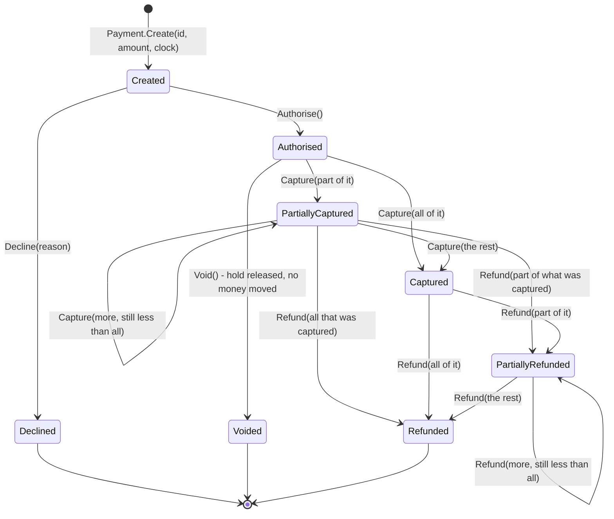
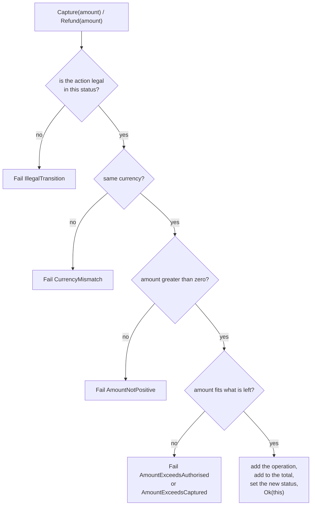

# Lab 01 — Payment state machine (TDD)

## What we solve
A payment can only move in certain ways. The code must make the wrong moves impossible.

## Simple example
- Payment is **Authorised** for €100. Capture €100 → OK, now **Captured**.
- Try to **Void** it now → must fail. The money already moved. You need a refund.
- Refund €60 → OK. Refund €50 more → must fail. Only €40 is left.

With three `bool` flags (`IsCaptured`, `IsVoided`, `IsRefunded`) a bug can set two at once. With one explicit state and a transition table, that bug can't exist.

## Why it matters for a payment platform
Every payment platform has this machine at its heart. A wrong move here is lost money or a double refund. Writing it test-first is also the cleanest way to show TDD in the interview.

## Everyday picture
A **parcel tracker**: Ordered → Packed → Shipped → Delivered. A parcel can't go from Delivered back to Packed, and it can't be Shipped and Cancelled at once. The tracker refuses the wrong move and says why. That is all a state machine is.

## Aperio comparison (our backbone)
| Case | Aperio | Where (verified 2026-10-17) | What this lab adds |
|---|---|---|---|
| Explicit status machine in the DB | ✅ Has | `db/migrations/008_agent_interrupts.sql`: `status` `CHECK` with 9 values; transitions in `lib/security/interruptService.js` | The same idea for payments: authorise → capture → refund / void |
| Illegal transition refused | ✅ Has | `decide()` on a non-pending interrupt throws `InterruptConflictError`; `FINAL_STATUSES` set | A **Result type** instead of exceptions for business outcomes |
| Injected clock | ✅ Has | `createInterruptService({ now = () => new Date() })` | `TimeProvider` in .NET |
| Money amounts and limits | ❌ No | — | Capture ≤ authorised, refunds ≤ captured |
| Test-first proof | ⚠️ Honest | Aperio has many tests, but I can't prove they were written first | Strict red → green → refactor, visible in the commits |

---

# Spec (started 2026-10-18)

Step-by-step bench sheet: **`WORKBENCH.md`** in this folder. It explains each step and why it exists. Follow that while you work. This section is the contract: what must exist, and how you prove it.

## What you deliver

```
agent-ready-payments/
|-- global.json                       (pins the SDK, turns on the new test runner)
|-- src/Payments.Domain/              (you write every line)
|   |-- Money.cs                      value object: amount + ISO 4217 currency
|   |-- Result.cs                     Result<TValue, TError>
|   |-- PaymentError.cs               PaymentErrorCode + PaymentError
|   |-- PaymentStatus.cs              the 8 statuses
|   |-- PaymentAction.cs              the 5 actions
|   |-- PaymentOperation.cs           one row of history
|   `-- Payment.cs                    the aggregate: the transition table + the amount rules
`-- tests/Payments.Domain.Tests/      (160 failing tests, already written)
```

Plus `labs/01-payment-state-machine/TDD-NOTES.md`, written in your own words at the end.

No database, no API, no NuGet package in the domain project. `Payments.Domain` references **nothing**.

## The machine you build



`Void` and `Refund` sit on different sides of the first capture. That is the whole lab in one picture.

## The transition table

8 statuses x 5 actions = 40 cases. These 8 are allowed. The other 32 must fail with `IllegalTransition`.

| From | Authorise | Decline | Capture | Void | Refund |
|---|---|---|---|---|---|
| `Created` | ✅ | ✅ | ✖ | ✖ | ✖ |
| `Authorised` | ✖ | ✖ | ✅ | ✅ | ✖ |
| `PartiallyCaptured` | ✖ | ✖ | ✅ | ✖ | ✅ |
| `Captured` | ✖ | ✖ | ✖ | ✖ | ✅ |
| `PartiallyRefunded` | ✖ | ✖ | ✖ | ✖ | ✅ |
| `Declined` | ✖ | ✖ | ✖ | ✖ | ✖ |
| `Voided` | ✖ | ✖ | ✖ | ✖ | ✖ |
| `Refunded` | ✖ | ✖ | ✖ | ✖ | ✖ |

Three simplifications this lab makes on purpose, so they are not bugs:

- **No `Void` after any capture.** Real processors sometimes allow it until the batch settles. Here: capture once and only a refund is left.
- **No `Capture` after any refund.** It is legal in some schemes. Here it is `IllegalTransition`.
- **No `Expired`.** A real authorisation expires after about 7 days. That needs a clock that fires by itself, so it waits for a later lab.

## The public shape

The tests call exactly this. Nothing more, nothing less — if a name differs, the tests do not compile.

### `Money` — `readonly record struct`

| Member | Rule |
|---|---|
| `decimal Amount` | never negative |
| `string Currency` | exactly three upper-case letters (ISO 4217) |
| `static Money Of(decimal, string)` | throws `ArgumentOutOfRangeException` on a negative amount, `ArgumentException` on a bad currency |
| `static Money Zero(string currency)` | an empty total |
| `bool IsZero` | `Amount == 0` |
| `+`, `-` | same currency only, else throw `CurrencyMismatchException` |
| `>`, `<`, `>=`, `<=` | same currency only, else throw `CurrencyMismatchException` |

`decimal`, never `double`. A negative amount cannot be built at all, so "negative" never reaches `Payment`.

### `Result<TValue, TError>` — `sealed class`

| Member | Rule |
|---|---|
| `bool IsSuccess`, `bool IsFailure` | opposites |
| `TValue Value` | throws `InvalidOperationException` on a failure |
| `TError Error` | throws `InvalidOperationException` on a success |
| `static Ok(TValue)`, `static Fail(TError)` | the only two ways to build one |

### Enums and small records

```csharp
public enum PaymentStatus { Created, Authorised, Declined, Voided, PartiallyCaptured, Captured, PartiallyRefunded, Refunded }
public enum PaymentAction { Authorise, Decline, Capture, Void, Refund }
public enum PaymentErrorCode { IllegalTransition, AmountNotPositive, AmountExceedsAuthorised, AmountExceedsCaptured, CurrencyMismatch }

public sealed record PaymentError(PaymentErrorCode Code, string Message);
public sealed record PaymentOperation(PaymentAction Kind, Money Amount, DateTimeOffset At);
public sealed class CurrencyMismatchException(string message) : Exception(message);
```

`AllowedActions.Order()` in the tests sorts by enum value, so the declaration order above matters.

### `Payment` — `sealed class`, the aggregate

| Member | Rule |
|---|---|
| `static Payment Create(string id, Money amount, TimeProvider clock)` | blank id → `ArgumentException`; zero amount → `ArgumentOutOfRangeException`; null clock → `ArgumentNullException`; status `Created`, no operations |
| `string Id`, `Money Amount`, `PaymentStatus Status` | read-only |
| `Money CapturedTotal`, `Money RefundedTotal` | sums, start at `Money.Zero(currency)` |
| `Money CapturableRemaining` | `Amount - CapturedTotal` while capture is allowed, else zero |
| `Money RefundableRemaining` | `CapturedTotal - RefundedTotal` while refund is allowed, else zero |
| `string? DeclineReason` | set by `Decline`, else `null` |
| `DateTimeOffset CreatedAt` | from the clock |
| `IReadOnlyList<PaymentOperation> Operations` | in the order things happened; the returned object must **refuse** `Add` and `Remove` (`IsReadOnly` is true, mutation throws `NotSupportedException`) |
| `IReadOnlyCollection<PaymentAction> AllowedActions` | what is legal right now; empty on `Declined`, `Voided`, `Refunded` |
| `Authorise()`, `Decline(string reason)`, `Capture(Money)`, `Void()`, `Refund(Money)` | all return `Result<Payment, PaymentError>`; on success the value is the **same** instance |

The order of checks inside `Capture` and `Refund` is tested, so it is part of the contract:



A refused call changes **nothing**: same status, same totals, same number of operations. That is tested for all 32 illegal pairs.

`Decline("  ")` throws `ArgumentException`: a blank reason is a programming bug, not a business outcome.

## Hard requirements

| # | Requirement |
|---|---|
| 1 | `Payments.Domain` has **no** `PackageReference` and no `ProjectReference`. Pure .NET 10. |
| 2 | No `DateTimeOffset.UtcNow` or `DateTime.Now` anywhere in `src/Payments.Domain`. Time comes from the injected `TimeProvider`. |
| 3 | Money is `decimal` + currency. `double` and `float` appear nowhere. |
| 4 | Business outcomes are `Result<…>` values. Exceptions only for programming mistakes (bad id, blank reason, mixed currency arithmetic). |
| 5 | `AllowedActions` agrees with the methods: if it lists an action, that action succeeds; if it does not, the action fails with `IllegalTransition`. |
| 6 | All 160 tests in `tests/Payments.Domain.Tests` pass. You never edit a test to make it pass. |
| 7 | Red before green: a `test(lab-01)` commit exists before the `feat(lab-01)` commits. |
| 8 | Lab work happens on `feature/lab-01-state-machine`, branched from `develop`. |
| 9 | No database and no migration in this lab. `db/` is untouched. |

## Done when

Every line must pass.

```bash
dotnet build                                   # 0 errors
dotnet test                                    # 160 passed, 0 failed
grep -rn "UtcNow\|DateTime.Now" src/Payments.Domain   # no hits
grep -rn "double\|float" src/Payments.Domain          # no hits
grep -c PackageReference src/Payments.Domain/Payments.Domain.csproj   # 0
git log --oneline | head -20                   # a test(...) commit before the feat(...) commits
```

- `TDD-NOTES.md` is filled in, in your own words.
- You can answer every question in `QA.md` without looking.

## Test framework

**xUnit v3**, decided 2026-10-18 (`docs/plan/PLAN.md` §8). Plain `Assert`, no assertion library. `global.json` carries the `test.runner` opt-in, because .NET 10 dropped the old VSTest host.

## The tests are given, once

The 160 tests in `tests/Payments.Domain.Tests` were written for you — this is the **last** lab where that happens. They are the worked example of what good test code looks like: one act per test, behaviour names, the whole matrix in one `[Theory]`, a hand-written `TimeProvider` instead of a mocking library. Read them. From Lab 02 you write the tests yourself (`CLAUDE.md` → "Who writes the code").
