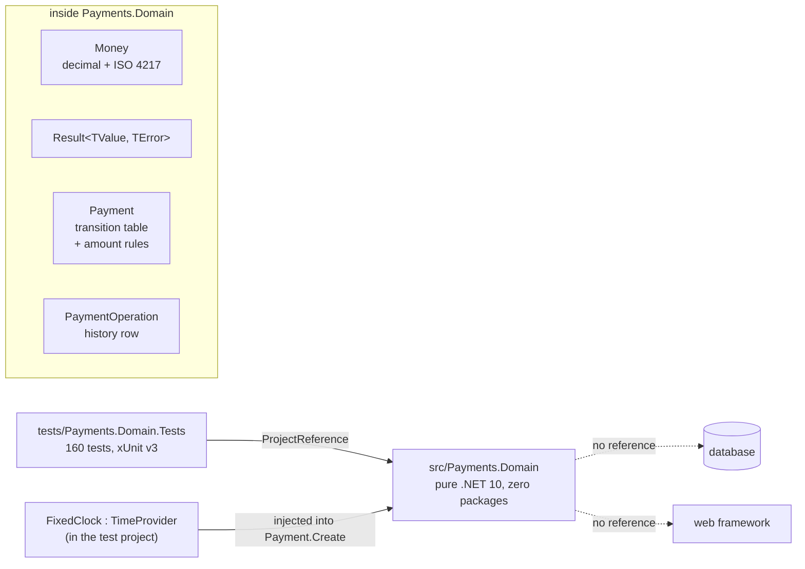

# Lab 01 — Workbench

Follow the steps in order. Each step says **Goal**, **Why**, **Do**, **Proof**, **Commit**.

Spec and Done-when list: `README.md` in this folder. Interview questions: `QA.md`.

Started 2026-10-18.

You write every line in `src/Payments.Domain`. The 160 tests in `tests/Payments.Domain.Tests` are given to you — this is the last lab where that happens.

## The target state

One project with no dependencies, and one test project that drives it.



The dotted arrows are the point: the domain knows nothing about storage or HTTP, so its tests need no container and run in under a second.

---

## Step 0 — Read the questions, not the answers

**Goal.** You have skimmed every question in `QA.md`. 5 minutes. No answers read.

**Why.** Knowing the questions first changes what you notice while you work, and attention is most of the learning. Reading the **answers** now would spoil the test — afterwards you would *recognise* them instead of *recalling* them, which feels like knowing and does not survive an interview. So eyes off every `A:` line. If one question makes no sense at all, read that single answer and move on.

**Do.**

```bash
grep -E '^\*\*Q' labs/01-payment-state-machine/QA.md
```

**Proof.** You can say, in one sentence, what this lab is going to be asked about.

**Commit.** Nothing to commit.

---

## Step 1 — Start the lab and pin the tooling

**Goal.** You are on `feature/lab-01-state-machine`, and `global.json` exists.

**Why.** One feature branch per lab is the Gitflow rule this repo demonstrates, and it keeps the 15 commits of this lab readable as one unit. `global.json` does two jobs at once: it pins the SDK so the labs behave the same in six months, and it turns on the new test runner. .NET 10 dropped the old VSTest host, and xUnit v3 test projects are plain executables that run on **Microsoft.Testing.Platform**. Without the `test` block, `dotnet test` stops with "Testing with VSTest target is no longer supported".

**Do.**

```bash
git checkout develop
git checkout -b feature/lab-01-state-machine
```

Create `global.json` at the repo root:

```json
{
  "sdk": {
    "version": "10.0.401",
    "rollForward": "latestFeature"
  },
  "test": {
    "runner": "Microsoft.Testing.Platform"
  }
}
```

`rollForward: latestFeature` means "10.0.4xx or newer in the same band is fine" — the pin is a floor, not a cage.

**Proof.**

```bash
git branch --show-current     # feature/lab-01-state-machine
dotnet --version              # 10.0.401
```

**Commit.** Stage `global.json`.

```
build(repo): pin the sdk and switch dotnet test to Microsoft.Testing.Platform
```

---

## Step 2 — Wire the empty domain project to the tests

**Goal.** `src/Payments.Domain` exists, both projects are in the solution, and `dotnet test` **fails to compile**.

**Why.** A failing build is the first red of this lab, and it is a real red: the tests name types that do not exist yet, so the compiler lists your whole to-do list for you. Wiring this up before writing any code also proves the harness works, so later failures are about your rules and never about plumbing. The domain project gets **no** packages — the moment it references a database or a web framework, the tests stop being fast and the design starts leaking.

**Do.**

```bash
dotnet new classlib -o src/Payments.Domain -n Payments.Domain
rm src/Payments.Domain/Class1.cs
dotnet sln add src/Payments.Domain tests/Payments.Domain.Tests
dotnet test
```

Open `src/Payments.Domain/Payments.Domain.csproj` and make sure it has `net10.0`, `ImplicitUsings`, `Nullable`, and **no** `PackageReference`.

**Proof.** The build fails with many `CS0246: The type or namespace name 'Money' could not be found`. Count them:

```bash
dotnet build 2>&1 | grep -c "error CS"
```

That number is your to-do list.

**Commit.** Stage `src/Payments.Domain/`, `tests/Payments.Domain.Tests/` and `Payments.slnx`.

```
test(lab-01): add the failing domain tests and the empty domain project
```

This is the **red** commit. It must come before every `feat(lab-01)` commit — that is how TDD shows up in the history.

---

## Step 3 — Type the contract, nothing more

**Goal.** The solution compiles. `dotnet test` runs and reports **152 failed, 8 passed**.

**Why.** Red has two shapes: "it does not compile" and "it compiles and the assert fails". The second one is far more useful, because now each test can tell you exactly which rule is missing instead of hiding behind a compiler error. So you first type only the shape — the types, the members, the signatures from `README.md` → "The public shape" — with every body throwing `NotImplementedException`. Typing the contract by hand is also how you learn it; copying a finished file would teach nothing.

**Do.** Create one file per type in `src/Payments.Domain`, exactly as `README.md` lists them. Every body is one line:

```csharp
public static Money Of(decimal amount, string currency) => throw new NotImplementedException();
```

The enums and the two small records are real code already — there is nothing to stub about them:

```csharp
public enum PaymentStatus { Created, Authorised, Declined, Voided, PartiallyCaptured, Captured, PartiallyRefunded, Refunded }
public enum PaymentAction { Authorise, Decline, Capture, Void, Refund }
public enum PaymentErrorCode { IllegalTransition, AmountNotPositive, AmountExceedsAuthorised, AmountExceedsCaptured, CurrencyMismatch }

public sealed record PaymentError(PaymentErrorCode Code, string Message);
public sealed record PaymentOperation(PaymentAction Kind, Money Amount, DateTimeOffset At);
public sealed class CurrencyMismatchException(string message) : Exception(message);
```

Keep the enum **order** as written. `AllowedActions.Order()` in the tests sorts by the underlying number, so a reordered enum breaks tests that have nothing to do with ordering.

```bash
dotnet build          # 0 errors
dotnet test           # 160 total, 152 failed, 8 passed
```

**Proof.** 152 red. The 8 that pass are not a win: in `A_refused_move_changes_nothing` the 8 **allowed** pairs of the matrix return early and assert nothing. Spotting that an early return makes a test pass without testing anything is the skill — look for it in your own tests later.

**Commit.** Stage `src/Payments.Domain/`.

```
test(lab-01): add the domain contract as not-implemented stubs
```

---

## Step 4 — Read the tests you are about to make green

**Goal.** You know what each test file covers, without reading every line.

**Why.** These tests are a worked example of the style this repo wants, and from Lab 02 you write them yourself. Four habits are in there on purpose: one **Act** per test, names that read as behaviour (`Refunding_more_than_was_captured_is_refused`), the full 40-case matrix in one `[Theory]` instead of 40 copies, and a 15-line hand-written `TimeProvider` instead of a mocking library. Reading them now also gives you the order to work in, from the smallest type up.

**Do.**

```bash
ls tests/Payments.Domain.Tests
grep -rc "\[Fact\]\|\[Theory\]" tests/Payments.Domain.Tests/*.cs
```

| File | Covers |
|---|---|
| `MoneyTests.cs` | the value object: negative, zero, bad currency, add, subtract, compare, equality |
| `ResultTests.cs` | `Ok` / `Fail`, and that reading the wrong side throws |
| `TransitionMatrixTests.cs` | all 40 `(status, action)` pairs, and that a refused move changes nothing |
| `AuthoriseTests.cs` | `Create`, `Authorise`, `Decline` |
| `CaptureTests.cs` | partial capture, full capture, one cent over, zero, wrong currency |
| `RefundTests.cs` | partial refund, full refund, over the captured total, after a void |
| `VoidTests.cs` | void before capture, refused after capture |
| `AllowedActionsTests.cs` | what an agent may do next, and the two remaining amounts |
| `ClockAndHistoryTests.cs` | the injected clock, history order, history is read-only |
| `TestData.cs`, `FixedClock.cs` | helpers, not tests |

Read `FixedClock.cs` in full. It is the whole answer to "how do you test time?".

**Proof.** You can say which file holds the amount-limit rules without looking.

**Commit.** Nothing to commit.

---

## Step 5 — Make `Money` green

**Goal.** `dotnet test --filter "MoneyTests"` is all green.

**Why.** Money is the bottom of the stack: `Payment` cannot be written until amounts behave. It is also where most real payment bugs live, so the rules are strict — `decimal` because binary floating point cannot hold 0.10 exactly and sums drift, a currency beside every amount because "100" alone is meaningless, and **no negative amount at all**. That last choice removes a whole class of test: if a negative `Money` cannot be built, `Capture(-5)` is impossible before it reaches `Payment`.

**Do.** Write `src/Payments.Domain/Money.cs`. The shape, with the thinking left to you:

```csharp
public readonly record struct Money
{
    // TODO: Amount and Currency as read-only properties. A record struct gives you
    //       equality for free, which is why MoneyTests asserts on whole values.

    // TODO: a private constructor, so Of() is the only door in.

    public static Money Of(decimal amount, string currency) =>
        throw new NotImplementedException();
        // TODO: negative amount    -> ArgumentOutOfRangeException
        // TODO: currency that is not exactly 3 upper-case letters -> ArgumentException
        //       ("eur" is rejected on purpose: ISO 4217 codes are upper case)

    // TODO: Zero(currency), IsZero
    // TODO: + and -   : same currency, else throw CurrencyMismatchException
    // TODO: > < >= <= : same currency, else throw CurrencyMismatchException
}
```

Two hints you will want:

- `char.IsAsciiLetterUpper` makes the currency check one line.
- Write one private `static void SameCurrency(Money a, Money b)` and call it from every operator. Six copies of the same `if` is the thing you refactor away while green.

```bash
dotnet test --filter "MoneyTests"
```

**Proof.** The `MoneyTests` filter reports 0 failed. `Cents_add_up_exactly` passing is the proof you used `decimal`; it fails with `double`.

**Commit.** Stage `src/Payments.Domain/Money.cs`.

```
feat(lab-01): add the Money value object with currency rules
```

---

## Step 6 — Make `Result<TValue, TError>` green

**Goal.** `dotnet test --filter "ResultTests"` is all green.

**Why.** A refund that is too large is an expected answer, not a crash, so it must come back as a value the caller has to look at. An exception would let a caller ignore it with an empty `catch`, and it would turn a normal business answer into a 500 at the API edge. The type also protects itself: reading `Value` on a failure throws, because that can only mean the caller forgot to check `IsSuccess`. In Lab 02 this error code becomes a stable `ProblemDetails` code that an agent can branch on.

**Do.** Write `src/Payments.Domain/Result.cs`.

```csharp
public sealed class Result<TValue, TError>
{
    // TODO: private fields for the value and the error, plus the success flag.
    // TODO: private constructor. Ok() and Fail() are the only two doors in.
    // TODO: Value  -> InvalidOperationException when IsFailure
    // TODO: Error  -> InvalidOperationException when IsSuccess
}
```

Keep it boring. No implicit conversions, no `Map`, no `Bind` — nothing a test did not ask for. That restraint is the part of TDD that stops over-building.

```bash
dotnet test --filter "ResultTests"
```

**Proof.** 4 tests green.

**Commit.** Stage `src/Payments.Domain/Result.cs`.

```
feat(lab-01): add the Result type for business outcomes
```

---

## Step 7 — `Create`, `Authorise`, `Decline`

**Goal.** `dotnet test --filter "AuthoriseTests"` is all green, and so is `ClockAndHistoryTests`.

**Why.** This is the first slice of the aggregate, so it sets the shape every later method copies: check the transition, change the state, append one operation, return `Ok(this)`. The clock is injected here and never read anywhere else, which is what makes the whole domain deterministic — `DateTimeOffset.UtcNow` inside a domain class means a test can only assert "some time near now", and that is how flaky tests are born. Note the split between an exception and a result: a blank id or a missing clock is a **programming** mistake and throws, while "you cannot authorise twice" is a **business** answer and comes back as `Fail`.

**Do.** Write `src/Payments.Domain/Payment.cs`.

```csharp
public sealed class Payment
{
    private readonly List<PaymentOperation> _operations = [];
    private readonly TimeProvider _clock;

    // TODO: private constructor. Create() validates and is the only door in.

    public static Payment Create(string id, Money amount, TimeProvider clock) =>
        throw new NotImplementedException();
        // TODO: blank id -> ArgumentException        (string.IsNullOrWhiteSpace)
        // TODO: amount.IsZero -> ArgumentOutOfRangeException
        // TODO: clock is null -> ArgumentNullException
        // TODO: Status = Created, CapturedTotal = RefundedTotal = Money.Zero(currency),
        //       CreatedAt = clock.GetUtcNow()

    public IReadOnlyList<PaymentOperation> Operations => _operations.AsReadOnly();
    //       AsReadOnly() returns a wrapper that is NOT an ICollection<T>, which is
    //       exactly what The_history_cannot_be_changed_from_outside checks.
    //       Returning _operations directly passes every other test and fails that one.

    // TODO: Authorise() : only from Created. Append one Authorise operation for the
    //       full Amount, stamped with _clock.GetUtcNow(). Return Ok(this).
    // TODO: Decline(reason) : only from Created. Blank reason -> ArgumentException.
    //       Keep the reason. The operation amount is Money.Zero(currency).
}
```

Write one small private helper now and you will use it five times:

```csharp
private Result<Payment, PaymentError> Fail(PaymentErrorCode code, string message) => ...
```

```bash
dotnet test --filter "AuthoriseTests"
dotnet test --filter "ClockAndHistoryTests"
```

**Proof.** Both filters green. `Each_operation_is_stamped_with_the_time_of_the_clock` is the one that proves you never touched the wall clock.

**Commit.** Stage `src/Payments.Domain/Payment.cs`.

```
feat(lab-01): add Payment.Create, Authorise and Decline
```

---

## Step 8 — `Capture` and the authorised limit

**Goal.** `dotnet test --filter "CaptureTests"` is all green.

**Why.** Capture is where money starts moving, so it carries the first hard limit: the sum of captures may never pass the authorised amount. The edges are the real test — exactly equal must pass, one cent over must fail — because that is where an off-by-one `<` instead of `<=` hides, and in production that bug is money. The status also has to split on the amount: part of it leaves the payment `PartiallyCaptured`, all of it makes it `Captured`. Check in the order the spec gives (transition, currency, positive, limit), because the tests assert on which error comes back.

**Do.** Add to `Payment.cs`:

```csharp
// TODO: Capture(Money amount)
//   1. Status must be Authorised or PartiallyCaptured, else Fail(IllegalTransition)
//   2. amount.Currency != Amount.Currency  -> Fail(CurrencyMismatch)
//      Compare the codes yourself. Do NOT use Money's operators here: they throw,
//      and a wrong currency from a caller must come back as a Result, not a crash.
//   3. amount.IsZero -> Fail(AmountNotPositive)
//   4. amount > CapturableRemaining -> Fail(AmountExceedsAuthorised)
//   5. append the operation, add to CapturedTotal, set the new status:
//      CapturedTotal == Amount ? Captured : PartiallyCaptured
```

Nothing may change before the last check passes. Write step 5 as the only block that touches a field, and `A_refused_move_changes_nothing` stays green by construction.

```bash
dotnet test --filter "CaptureTests"
```

**Proof.** 10 tests green, including `Capturing_one_cent_more_than_authorised_is_refused` and `Capturing_exactly_what_is_left_is_allowed`.

**Commit.** Stage `src/Payments.Domain/Payment.cs`.

```
feat(lab-01): add Capture with the authorised-amount limit
```

---

## Step 9 — `Void`

**Goal.** `dotnet test --filter "VoidTests"` is all green.

**Why.** Void is the smallest method in the lab and the biggest interview point: it releases a hold **before** any money moved, so it is only legal straight from `Authorised`. One capture, even a partial one, and the only way back is a refund. Mixing these two up is the classic tell that someone has never worked on payments, so write this method slowly and say the rule out loud while you do.

**Do.** Add to `Payment.cs`:

```csharp
// TODO: Void()
//   1. Status must be Authorised, else Fail(IllegalTransition)
//      PartiallyCaptured is NOT allowed: money already moved.
//   2. Status = Voided, append one Void operation for the full Amount.
```

**Proof.** 6 tests green. `Voiding_a_partially_captured_payment_is_refused` is the one that matters.

**Commit.** Stage `src/Payments.Domain/Payment.cs`.

```
feat(lab-01): add Void for an uncaptured authorisation
```

---

## Step 10 — `Refund` and the captured limit

**Goal.** `dotnet test --filter "RefundTests"` is all green.

**Why.** A refund is limited by what was **captured**, never by what was authorised — mix those two and a partially captured payment can be over-refunded, which means paying a customer money you never took. The status rule mirrors capture: less than the captured total leaves it `PartiallyRefunded`, the whole captured total makes it `Refunded`, and `Refunded` is terminal. This is also the method the agent labs call later, so its error codes have to be precise: `AmountExceedsCaptured` tells an agent to ask for less, while `IllegalTransition` tells it to stop asking.

**Do.** Add to `Payment.cs`:

```csharp
// TODO: Refund(Money amount)
//   1. Status must be PartiallyCaptured, Captured or PartiallyRefunded,
//      else Fail(IllegalTransition)
//   2. currency check   -> Fail(CurrencyMismatch)
//   3. amount.IsZero    -> Fail(AmountNotPositive)
//   4. amount > RefundableRemaining -> Fail(AmountExceedsCaptured)
//      RefundableRemaining is CapturedTotal - RefundedTotal. Never Amount.
//   5. append, add to RefundedTotal, then:
//      RefundedTotal == CapturedTotal ? Refunded : PartiallyRefunded
```

Refunding everything that was captured on a **partial** capture ends in `Refunded`, not `PartiallyRefunded` — the payment is finished, the uncaptured part of the hold is simply never claimed.

```bash
dotnet test --filter "RefundTests"
```

**Proof.** 12 tests green, including `A_refund_is_limited_by_what_was_captured_not_by_what_was_authorised`.

**Commit.** Stage `src/Payments.Domain/Payment.cs`.

```
feat(lab-01): add Refund with the captured-amount limit
```

---

## Step 11 — `AllowedActions` and the remaining amounts

**Goal.** `dotnet test` is all green: 160 passed, 0 failed.

**Why.** This is the lab's bridge to the agent labs. An agent cannot guess what a payment allows, so the payment says it: `AllowedActions` is the deterministic answer to "what can I do next?", and the two remaining amounts answer "how much may I ask for?". The rule that makes it trustworthy is that it must agree with the methods — if it lists `Refund`, a refund of one cent must succeed. Derive it from the status instead of storing it, so the two can never drift apart.

**Do.** Add to `Payment.cs`:

```csharp
// TODO: AllowedActions => Status switch { ... }
//   Created           -> Authorise, Decline
//   Authorised        -> Capture, Void
//   PartiallyCaptured -> Capture, Refund
//   Captured          -> Refund
//   PartiallyRefunded -> Refund
//   Declined, Voided, Refunded -> empty
//
// TODO: CapturableRemaining => capture allowed ? Amount - CapturedTotal : Money.Zero(currency)
// TODO: RefundableRemaining => refund allowed  ? CapturedTotal - RefundedTotal : Money.Zero(currency)
```

A `switch` expression over the status with no `default` makes the compiler warn when a new status is added later. Take that warning as a gift: it is a to-do list for every rule the new status touches.

```bash
dotnet test
```

**Proof.** `160 passed`. The full matrix test is the one that proves `AllowedActions` and the methods agree.

**Commit.** Stage `src/Payments.Domain/Payment.cs`.

```
feat(lab-01): add AllowedActions and the remaining amounts
```

---

## Step 12 — Refactor, with the tests green

**Goal.** The five methods share one transition check, and `dotnet test` is still 160 green.

**Why.** This is the third beat of TDD, and the one people skip. Right now the legal-move rule is written twice — once in each method's first `if`, and once in `AllowedActions` — so the two can drift. Moving both onto one table makes the rule exist in exactly one place, which is the whole argument against `bool` flags in the first place. Do it only now, because green tests are what makes a refactor safe: if anything turns red, the last edit did it.

**Do.** Pull the table out, then let both sides read it:

```csharp
private static readonly Dictionary<PaymentStatus, PaymentAction[]> Table = new()
{
    [PaymentStatus.Created] = [PaymentAction.Authorise, PaymentAction.Decline],
    // TODO: the other four rows. Terminal statuses are absent, or map to [].
};

// TODO: AllowedActions reads the table.
// TODO: every method starts with one line: if (!IsAllowed(PaymentAction.Capture)) ...
```

Run `dotnet test` after **every** small edit, not at the end. That is the habit the step is really teaching.

Then look for the other duplication: the currency check, the positive check and the limit check are the same three lines in `Capture` and `Refund`, differing only in the limit and the error code.

**Proof.** `dotnet test` still says 160 passed, and the word `IllegalTransition` appears once in a method body:

```bash
grep -c "IllegalTransition" src/Payments.Domain/Payment.cs
```

**Commit.** Stage `src/Payments.Domain/Payment.cs`.

```
refactor(lab-01): drive the transitions from one table
```

---

## Step 13 — Prove the domain is pure

**Goal.** The four guard checks in `README.md` → "Done when" all pass.

**Why.** "Pure domain" is easy to claim and easy to break by accident: one `DateTime.Now` in a corner, one NuGet package for convenience, one `double` in a helper. These greps are the cheap, repeatable test for the claim, and they are the same checks an interviewer makes when they ask "where does the time come from?". Running them now means the answer in the interview is a fact, not a hope.

**Do.**

```bash
grep -rn "UtcNow\|DateTime.Now" src/Payments.Domain     # expect: no hits
grep -rn "double\|float" src/Payments.Domain            # expect: no hits
grep -c PackageReference src/Payments.Domain/Payments.Domain.csproj   # expect: 0
dotnet test                                             # 160 passed
```

If `grep` finds a `double` in a comment, fix the comment. The rule is "nobody reading this file can think floating point is acceptable here".

**Proof.** All four lines as expected. `grep` prints nothing and returns 1 when it finds nothing — that empty output is the pass.

**Commit.** Nothing to commit if nothing was found. If a grep found something:

```
fix(lab-01): remove the last wall-clock call from the domain
```

---

## Step 14 — Write `TDD-NOTES.md`

**Goal.** `labs/01-payment-state-machine/TDD-NOTES.md` is filled in, in your own words.

**Why.** `QA.md` asks "what did TDD change in your design?" and that question cannot be answered from a book — it is only answerable from the lab you just did. The file is a **scaffold**: the questions are there, the answers are not, because writing them is the learning. Five honest lines written now beat a smooth generic answer in six months, and the interviewer can tell the difference immediately.

**Do.**

```bash
open labs/01-payment-state-machine/TDD-NOTES.md
```

Fill every bullet. Short is fine. Honest is the requirement — "the matrix test caught my `<` that should have been `<=`" is worth more than any theory.

**Proof.** No placeholder line is left, and every sentence is yours.

**Commit.** Stage `labs/01-payment-state-machine/TDD-NOTES.md`.

```
docs(lab-01): write the TDD notes
```

---

## Step 15 — Say the answers out loud

**Goal.** You answered every question in `QA.md` out loud, then checked.

**Why.** This is the test the lab was for. Speaking the answer uses a different path than reading it, and it is the path an interview uses. Mark every question you got wrong or said badly — those marked ones are a 5-minute warm-up at the start of your next session, and that repeat is where most of the gain sits.

**Do.**

1. Cover the file. Work down the question list.
2. Say the answer out loud. Then read the real answer.
3. Mark the misses. Read the **Trap** follow-up for each one.
4. For Q11 ("what did TDD change in your design?"), read your own `TDD-NOTES.md` answer out loud.
5. Answer `Q-APERIO` last: "Have you solved this before?"

**Proof.** You answered every question without looking. The marked list is short.

**Commit.** Nothing to commit.

---

## Step 16 — Close the lab

**Goal.** Lab 01 is on `develop`, `main` has the `lab-01` tag, `develop` is level with `main`, the feature branch is gone, and `PROGRESS.md` says `Done`.

**Why.** The merge and the tag are the record that a lab finished. `--no-ff` keeps a merge commit even when a fast-forward is possible, so the history shows the lab as one unit of work instead of loose commits. Before that, the lab's notes move into the inbox, because a finding written in a workbench file is lost the moment the next lab starts. Every lab repeats this, so the shape stays the same.

**Do.** Run the full Done-when list in `README.md` first. Then move every line from **Notes while you work** below into `CARRY-FORWARD.md` as a `CF-NNN` row with the date, and groom the inbox. Set the Lab 01 row in `PROGRESS.md` to `Done` with the tag, and tick its list. Then:

```bash
git status --short      # must be empty
git checkout develop
git merge --no-ff feature/lab-01-state-machine
git checkout main
git merge --no-ff develop
git tag lab-01
git checkout develop
git merge main          # the back-merge. Without it develop is behind main
git branch -d feature/lab-01-state-machine
```

The back-merge is the line people forget. Merging `develop` into `main` makes a merge commit that lives **only** on `main`, so from that second on `develop` is behind. The content is the same today, but the next lab branches from a base that is missing `main`'s history, and a later hotfix on `main` would be missing from `develop` altogether — that one is lost work, not just untidy history. `git merge main` on `develop` costs nothing and keeps the two in step.

The small `-d` deletes the branch only if its work is really merged. Never use the capital `-D` here: it skips that check.

You run every git command. The agent never commits, merges, pushes or tags.

**Proof.**

```bash
git log --oneline --graph --all | head -25
git tag                           # lab-00, lab-01
git branch                        # develop and main only
git log --oneline develop..main   # empty: develop is level with main
```

The history must show a `test(lab-01)` commit before the `feat(lab-01)` commits. That is the TDD evidence you point at in the interview.

**Commit.** The grooming and the board are one commit, on the feature branch, **before** the merges. Stage `CARRY-FORWARD.md` and `PROGRESS.md`:

```
docs(plan): groom the inbox and close lab 01 on the board
```

The merges are the record of the rest of this step.

---

## Traps

| Trap | What happens | Fix |
|---|---|---|
| `dotnet test` stops with "Testing with VSTest target is no longer supported" | .NET 10 removed the old test host, and xUnit v3 needs Microsoft.Testing.Platform | Add the `test.runner` block to `global.json` (Step 1). A `dotnet.config` file does **not** work for this |
| `--filter` finds nothing | Under Microsoft.Testing.Platform the filter is a plain substring of the full test name | `dotnet test --filter "RefundTests"`, not a VSTest `FullyQualifiedName~` expression |
| Enum members reordered | `AllowedActionsTests` fails on ordering, far from the real mistake | Keep the enum order exactly as `README.md` lists it. `Order()` sorts by the number behind the name |
| `Operations` returns the list itself | Every test passes except `The_history_cannot_be_changed_from_outside` | Return `_operations.AsReadOnly()`. A plain `List<T>` is an `ICollection<T>`, so a caller can clear your history |
| `Money`'s operators used for the currency check in `Capture` | A wrong currency throws `CurrencyMismatchException` instead of returning `Fail(CurrencyMismatch)` | Compare the currency codes by hand first, and only then do arithmetic |
| `<` instead of `<=` on a limit | `Capturing_exactly_what_is_left_is_allowed` goes red | The limit is inclusive: exactly the remaining amount must pass |
| A refund limited by `Amount` | Over-refunds a partially captured payment: you pay out money you never took | `RefundableRemaining` is `CapturedTotal - RefundedTotal`, never `Amount` |
| State changed before the last check | The status moves on a refused call, and `A_refused_move_changes_nothing` goes red for 1 of 32 pairs | Do every check first, then one block that mutates |
| `DateTimeOffset.UtcNow` in the domain | Clock tests fail, or pass only on a fast machine | Take the time from the injected `TimeProvider` |
| 8 tests pass at Step 3 | Looks like free progress | They are the allowed pairs of `A_refused_move_changes_nothing`, which returns early. A test that asserts nothing is not a passing test |
| Lab work committed straight to `main` | `develop` is behind, and the next feature branch starts from a stale base | Commit lab work on `feature/lab-01-state-machine`. If it already landed on `main`, fast-forward `develop`: `git checkout develop && git merge --ff-only main` |
| The back-merge skipped at the end | `git log --oneline develop..main` is not empty, so `develop` is behind `main` | `git checkout develop && git merge main`. Do it every lab |
| Editing a test to make it pass | The lab is pointless, and the interview answer becomes a lie | Never. If a test looks wrong, ask — `CLAUDE.md` says the agent must ask before changing a test |
| `NU1903` warnings during `dotnet test` | A transitive package in `Payments.Db` has an advisory. Not this lab's problem | It is `CF-010` in the inbox. Do not widen Lab 01 to fix it |

## Notes while you work

Write what surprised you here, as it happens. At the end of the lab these move into `CARRY-FORWARD.md` (the inbox) as `CF-NNN` rows. From there each one graduates to `PLAN.md` section 8, to a lab `README.md`, or it is dropped.

-
