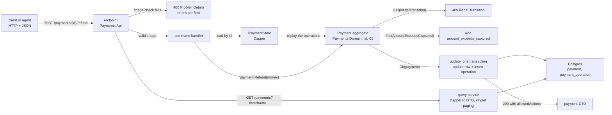

# Lab 02 — Minimal API + Dapper (Postgres)

## What we solve
Put the state machine behind an HTTP API that is **predictable**: same input, same answer, clear errors.

## Simple example
A client sends `POST /payments/42/refund` with €500 on a €100 payment.
- Bad API: `500 Internal Server Error` and a stack trace. The client — or an AI agent — has no idea what to do.
- Good API: `422` with `{"code": "amount_exceeds_captured", "detail": "Cannot refund 500.00 when only 40.00 was captured and not yet refunded"}`, and the body also says `refundableRemaining: 40.00`. The caller knows exactly what went wrong and what is allowed.
- Why `422` and not `409`: the request is well formed and arrived at a perfectly good moment — only the number is wrong. `409` is kept for "not now" (the state forbids it). See the error table below.

## Why it matters for a payment platform
The ad asks for *"backend services with clear and deterministic interfaces that can be used within AI-driven workflows."* This lab is that sentence in code. Dapper (not EF) because the job is a wrapper over an existing database.

## What this lab builds



## Everyday picture
- **Vending machine:** B4 = Snickers, every time. The bad machine has one "GO" button, a hidden dial, says "THANK YOU" when it fails, and setting 3 phones your mother. That is a fat `/process` endpoint. The fix is more buttons, each labelled.
- **Hotel reception:** a shrug, a long apology in French, or a printed card "ROOM NOT READY — code 409". Only the card helps. ProblemDetails is that card.

Code sketches: `AGENT-READY-BACKEND.md` §4 (bad vs good endpoint) and §6 (one error shape).

## EF Core angle (stretch)
Write a second `IPaymentStore` with EF Core. Run the **same** integration tests against both. You will see where EF saves code (aggregate update) and where Dapper is clearer (hand-written list query).

## API shape
Minimal API with `MapGroup`. **CQRS-lite:** commands (create, capture, refund) go through the domain; queries (get, list) are Dapper straight to DTOs. Validation starts with .NET 10 built-in validation; FluentValidation comes in Lab 03. See PLAN.md "API shape".

## Stretch: keyset paging for the list query
Idea borrowed from an earlier lab of mine (ScroogeCorp B04, "Stable order and real paging").

`GET /payments?merchant=M1&limit=50&cursor=…` returns `{ "items": [...], "nextCursor": "…" }`.
- **Stable order:** `ORDER BY created_at DESC, id DESC`. `id` is unique, so there are never ties. Order by `created_at` alone, and two rows from the same millisecond can swap places between two identical calls.
- **Keyset, not offset:** `WHERE (created_at, id) < (@afterCreatedAt, @afterId) LIMIT @limit`. Same cost on page 1 and page 500. No skipped or doubled rows when new payments arrive at the top.
- **Opaque cursor:** the last row's `(created_at, id)`, base64-encoded. Clients (and agents) pass it back; they never build it.
- **Hard limits:** `limit` is clamped to 100. `0` or a negative value falls back to the default. A broken cursor is a `400 invalid_cursor`. It is never a 500, and never silently page 1.
- **The honest limit:** keyset is not a snapshot. A payment captured while you are on page 3 shows its new status on page 4. Write that in a code comment.

Tests: 5 rows with the **same** `created_at` come back in the same order 20 times in a row; walking all pages returns every row exactly once, even with inserts between page calls; clamp, default and bad-cursor cases.

## Aperio comparison (our backbone)
| Case | Aperio | Where (verified 2026-10-17) | What this lab adds |
|---|---|---|---|
| Typed tool contracts | ✅ Has | MCP tools with zod schemas (`mcp/tools/*.js`) | Typed HTTP contracts in C# |
| Real HTTP status codes | ✅ Has | routes in `lib/routes/` return 400/404/409/500 … | — |
| One standard error shape | ⚠️ Partly | bodies are `{ error: "…" }`, mostly the same key, but not RFC 9457 ProblemDetails; no stable `type` URI or `code` field | ProblemDetails with a stable `code` from one place |
| One interface, two data engines | ✅ Has | `db/index.js` + `db/sqlite/store.js` + `db/postgres/store.js` | `IPaymentStore` with Dapper and EF Core behind it |
| Parameterised raw SQL | ✅ Has | `$1` parameters in `db/postgres/store.js`, prepared statements in SQLite | Dapper parameters, explicit types |

## Done when
Create / capture / refund / get endpoints work; integration tests run against a real Postgres.
- *Stretch:* `GET /payments` pages with a keyset cursor; the "same timestamp" and "walk every page" tests pass.

---

## What actually shipped (2026-10-20)

The spec below is unchanged — it is still what the lab asks for. This is what the branch closed with, so the next reader is not surprised.

| Shipped | Skipped, and where it went |
|---|---|
| Migration `0001`, the Dapper store with replay, `ProblemMapper`, the contracts | — |
| `POST /payments`, `GET /payments/{id}` | the five command endpoints → `CF-021` (lab 03 needs `refund` first) |
| `HealthTests`, `CreatePaymentTests`, `GetPaymentTests`, `StoreTests` | `ValidationTests` → `CF-020`; the four command groups → `CF-021` |
| `StoreTests` written as a `[Theory]` on the engine, so stretch B is one `[InlineData]` away | stretch A paging → `CF-022`; stretch B EF Core and `STORE-NOTES.md` → `CF-023` |

The store contract is the part that got the full treatment, and it is the part the later labs lean on.

---

# The spec

Written 2026-10-19. Steps live in [`WORKBENCH.md`](WORKBENCH.md). Test names live in [`TEST-LIST.md`](TEST-LIST.md). Questions live in [`QA.md`](QA.md).

## Decisions taken for this lab (2026-10-19)

| Question | Decision | Why |
|---|---|---|
| Where does `MerchantId` live? | **Persistence and API only.** The lab 01 aggregate is not reopened for it. | The state machine never reads the merchant. Putting it in the aggregate for later per-merchant rules is `CF-014`. |
| `Payment.Id` type | **`Guid`**, end to end: `Guid` in the domain, `uuid` in Postgres, a uuid string in JSON. Lab 01's `Payment.Create` and 4 test call sites change in step 2. | One type, no parsing, no "pay_1" reaching the database. The `uuid` column keeps the narrow index that labs 03, 04 and 12 assume. |
| How is a stored payment rebuilt? | **Replay.** Load the operation rows in order and re-apply `Authorise` / `Capture` / `Void` / `Refund` through the real domain methods, with a `ReplayClock` that hands back the stored timestamps. Then check the replayed status equals the stored status. | The state machine is the one source of truth, and every read proves it. The cost — N method calls per read, and a row written under an older rule can refuse to replay — is paid on purpose, and is `CF-015`. **Amended 2026-10-20:** `ReplayClock` falls back to a real `TimeProvider` once the stored stamps run out, because the replayed aggregate is the one a command then acts on. |
| Postgres naming | **`snake_case`** tables and columns, no quoting. SQL Server keeps `PascalCase` (lab 04). | Unquoted identifiers fold to lower case in Postgres, so `PascalCase` would need `"quotes"` on every line forever. |
| Concurrency | **Not in scope.** Two refunds at the same moment can both pass. | Idempotency is lab 03, row versions and locking are lab 04. Do not solve it early. |

## The HTTP surface

| Method | Path | Success | Errors |
|---|---|---|---|
| `POST` | `/payments` | `201` + `Location` | `400` shape, `404 merchant_not_found` |
| `POST` | `/payments/{id}/authorise` | `200` | `404`, `409` |
| `POST` | `/payments/{id}/capture` | `200` | `400`, `404`, `409`, `422` |
| `POST` | `/payments/{id}/void` | `200` | `404`, `409` |
| `POST` | `/payments/{id}/refund` | `200` | `400`, `404`, `409`, `422` |
| `GET` | `/payments/{id}` | `200` | `404` |
| `GET` | `/payments?merchant=&limit=&cursor=` | `200` | `400 invalid_cursor` |

`Decline` has no endpoint. A decline is the acquirer's answer, not a client's command; a fake acquirer arrives in lab 16.

## The one error shape

Every failure is RFC 9457 ProblemDetails (`application/problem+json`) with a stable machine `code`.

```json
{
  "type": "urn:payments-labs:error:amount_exceeds_captured",
  "title": "The refund is larger than what is left to refund.",
  "status": 422,
  "detail": "Cannot refund 500.00 when only 40.00 was captured and not yet refunded",
  "code": "amount_exceeds_captured",
  "instance": "/payments/8e9…/refund"
}
```

`type` is a URN, not an `https://` URL, because a URI is required but a web page is not — and inventing a domain that serves nothing is worse than saying so.

| Domain result | HTTP | `code` |
|---|---|---|
| `IllegalTransition` | `409` | `illegal_transition` |
| `AmountNotPositive` | `422` | `amount_not_positive` |
| `AmountExceedsAuthorised` | `422` | `amount_exceeds_authorised` |
| `AmountExceedsCaptured` | `422` | `amount_exceeds_captured` |
| `CurrencyMismatch` | `422` | `currency_mismatch` |
| no such payment | `404` | `payment_not_found` |
| no such merchant | `404` | `merchant_not_found` |
| cursor will not decode | `400` | `invalid_cursor` |
| body or query shape is wrong | `400` | framework `errors` dictionary, one entry per field |

The split is the rule you must be able to defend: **409 is "not now"** (the state forbids it, the same body may work later), **422 is "not like that"** (the shape is fine, the number is wrong).

## The payment DTO

```json
{
  "id": "8e9c1f2a-…",
  "merchantId": "11111111-…",
  "status": "PartiallyCaptured",
  "currency": "EUR",
  "authorisedAmount": 100.00,
  "capturedAmount": 40.00,
  "refundedAmount": 0.00,
  "capturableRemaining": 60.00,
  "refundableRemaining": 40.00,
  "allowedActions": ["Capture", "Refund"],
  "declineReason": null,
  "createdAt": "2026-10-19T09:00:00Z",
  "updatedAt": "2026-10-19T09:05:00Z"
}
```

`allowedActions` and the two remaining amounts are the agent-ready part. A caller never has to know the state machine to pick a legal next call — the payment tells it. This is the field the MCP tools in lab 08 lean on.

## What you deliver

| # | Deliverable | Where |
|---|---|---|
| 1 | `Payment.Id` is a `Guid`; the 160 lab 01 tests are still green | `src/Payments.Domain` |
| 2 | First migration: `merchant`, `payment`, `payment_operation` + the paging index | `db/postgres/0001_merchant_payment.sql` |
| 3 | `Payments.Api`: 7 endpoints in one `MapGroup`, ProblemDetails from one mapper | `src/Payments.Api` |
| 4 | `IPaymentStore` + a Dapper implementation (insert, replay-load, update-in-one-transaction) | `src/Payments.Api/Storage` |
| 5 | Integration tests against a real Postgres (Testcontainers + DbUp + Respawn + `WebApplicationFactory`) | `tests/Payments.Api.Tests` |
| 6 | *Stretch A:* `GET /payments` with keyset paging and an opaque cursor | `src/Payments.Api` |
| 7 | *Stretch B:* a second `IPaymentStore` on EF Core, and the same tests run against both | `src/Payments.Api.EfCore` |
| 8 | `STORE-NOTES.md` — Dapper vs EF Core, in your own words | this folder |

## Hard requirements

1. **The domain never learns about HTTP or SQL.** `Payments.Domain` keeps zero packages and zero `using Npgsql`.
2. **Every error is ProblemDetails with a `code`.** No stack trace, no exception message, ever, in any response body.
3. **One place maps a domain error to a status code.** A second place that invents a status is a bug.
4. **Status codes:** 409 for state conflicts, 422 for failed money rules. One rule, no exceptions.
5. **Every SQL value is a Dapper parameter.** Nothing is concatenated into a SQL string. Not even a `limit`.
6. **Writes are one transaction.** The payment row update and the new operation row commit together or not at all.
7. **The replayed status must equal the stored status**, or the load fails loudly. A silent disagreement is a corrupt read.
8. **`async` all the way down.** No `.Result`, no `.Wait()`, no `.GetAwaiter().GetResult()`.
9. **Tests arrange their own data.** No demo seed, no test order, no shared payment between tests.
10. **No real card data.** No PAN, no CVV, in any row, log or test.
11. *Stretch A:* `limit` is clamped to 100; a bad cursor is `400 invalid_cursor`, never a 500 and never a silent page 1.
12. *Stretch B:* the same test class passes against both stores, with no `if (store is DapperStore)` anywhere.

## Done when

- [ ] `dotnet test` is green: the 160 domain tests plus the API tests.
- [ ] `dotnet run --project src/Payments.Db -- migrate --engine postgres` run twice: the second run finds no new scripts.
- [ ] All 7 endpoints answer by hand with `curl` — the happy path and at least one 400, 404, 409 and 422.
- [ ] `grep -rn "Npgsql\|Microsoft.AspNetCore" src/Payments.Domain` finds nothing.
- [ ] `grep -c PackageReference src/Payments.Domain/Payments.Domain.csproj` is still `0`.
- [ ] `grep -rn "\.Result\|\.Wait()\|GetAwaiter" src/Payments.Api` finds nothing.
- [ ] No response body anywhere contains the word `Exception` or a stack trace.
- [ ] *Stretch A:* the same-timestamp test and the walk-every-page test pass.
- [ ] *Stretch B:* every store test passes twice, once per store.
- [ ] `STORE-NOTES.md` is filled in, in your own words.
- [ ] `QA.md` answered out loud, misses marked.

