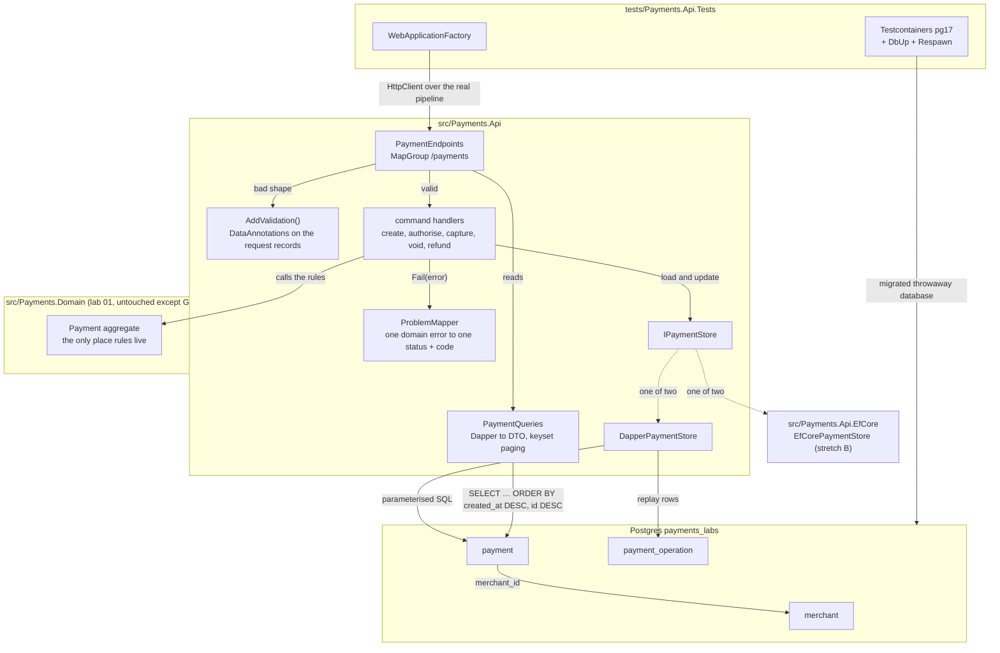
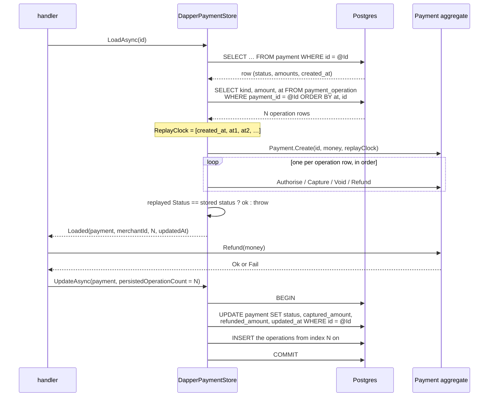
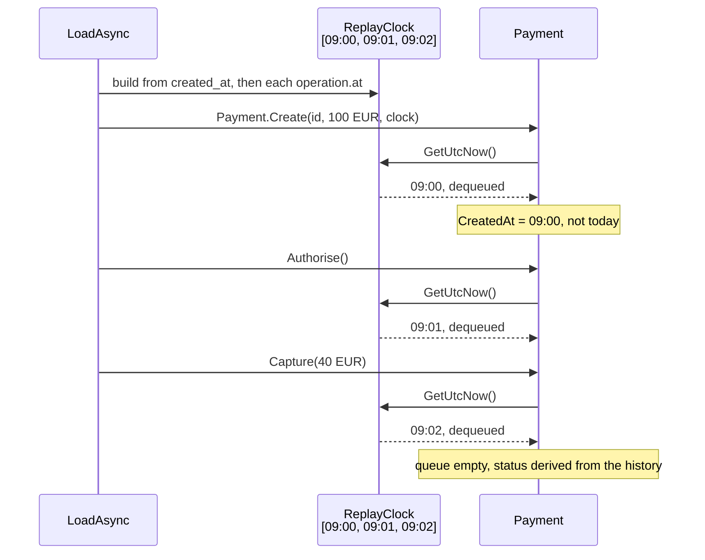
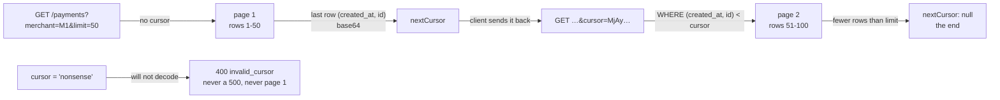

# Lab 02 — Workbench

Follow the steps in order. Each step says **Goal**, **Why**, **Do**, **Proof**, **Commit**.

Spec and Done-when list: [`README.md`](README.md). Test names you must write: [`TEST-LIST.md`](TEST-LIST.md). Interview questions: [`QA.md`](QA.md).

Started 2026-10-19.

**Size.** This is the full lab: core **and** both stretches. The core is steps 1–13 (about 3 hours) and it is a complete, defensible lab on its own — stop there if the day runs out. Stretch A (paging) is steps 14–16, stretch B (EF Core) is steps 17–19. Each stretch is about 1.5 hours.

**You write all the code, tests included.** Every `// TODO:` block below is your work. The agent wrote the rules, the names and the proofs, not the bodies.

## The target state



---

## Step 0 — Read the questions, not the answers

**Goal.** You have skimmed every question in `QA.md`. 5 minutes. No answers read.

**Why.** Knowing the questions first changes what you notice while you work, and attention is most of the learning. Reading the **answers** now would spoil the test — afterwards you would *recognise* them instead of *recalling* them, which feels like knowing and does not survive an interview. So eyes off every `A:` line. This lab has 34 questions in five groups, so expect the skim to feel long; it is the cheapest five minutes in the lab.

**Do.**

```bash
grep -E '^\*\*Q' labs/02-minimal-api-dapper/QA.md
```

**Proof.** You can say, in one sentence, what this lab is going to be asked about.

**Commit.** Nothing to commit.

---

## Step 1 — Start the lab and start the database

**Goal.** You are on `feature/lab-02-minimal-api-dapper`, and Postgres says `Up (healthy)`.

**Why.** First bring `develop` level with `main`, then branch. The lab 01 merge commit and its tag live only on `main` until you merge back, so a branch cut from a stale `develop` starts life missing part of the history and then fights over those same commits. Postgres has to be up before anything else, because this lab's proof is a real database and not a mock — finding out in step 7 that Docker Desktop is closed wastes the step. Only Postgres is needed; SQL Server belongs to lab 04 and can stay stopped.

**Do.**

```bash
git checkout develop
git merge main                       # the back-merge: develop must not be behind main
git log --oneline develop..main      # must print nothing
git checkout -b feature/lab-02-minimal-api-dapper

docker compose -f docker/docker-compose.yml --env-file .env up -d
docker compose -f docker/docker-compose.yml --env-file .env ps
```

**Proof.**

```bash
git branch --show-current            # feature/lab-02-minimal-api-dapper
git log --oneline develop..main      # empty
```

`payments-postgres` says `Up (healthy)`. `Up` alone is not ready yet.

**Commit.** Nothing to commit.

---

## Step 2 — Make `Payment.Id` a `Guid`

**Goal.** `Payment.Create` takes a `Guid`, and `dotnet test` is still **160 passed**.

**Why.** An id has one type or three. Keep the `string` and the API can be handed `"pay_1"`, which travels happily through the domain and only explodes at the `uuid` column — the worst place to find out, because the error names Npgsql and not the caller. A `Guid` in C#, a `uuid` in Postgres and a uuid string in JSON is one idea with three spellings, and the `uuid` column stays 16 bytes wide, which is what labs 03, 04 and 12 build indexes on. This is the one time we reopen lab 01, so it happens now, alone, with the tests as the net. The blank-id rule has to change with it: a `Guid` is never blank or whitespace, so the equivalent rule is `Guid.Empty` is refused.

**Do.** In `src/Payments.Domain/Payment.cs`:

```csharp
// TODO: public Guid Id { get; }
// TODO: private Payment(Guid id, …)
// TODO: public static Payment Create(Guid id, Money amount, TimeProvider clock)
//       the blank check becomes:
//       if (id == Guid.Empty) throw new ArgumentException("An id is required", nameof(id));
```

Then four call sites in `tests/Payments.Domain.Tests` (you edit these; the rule they check is the same rule):

| File | Was | Becomes |
|---|---|---|
| `TestData.cs` | `Payment.Create("pay_1", …)` | `Payment.Create(Guid.NewGuid(), …)` |
| `AuthoriseTests.cs` | `Payment.Create("  ", …)` → `ArgumentException` | `Payment.Create(Guid.Empty, …)` → `ArgumentException`, and rename the test to `An_empty_id_is_refused` |
| `AuthoriseTests.cs` | `Payment.Create("pay_1", Money.Zero(…))` | `Payment.Create(Guid.NewGuid(), Money.Zero(…))` |
| `ClockAndHistoryTests.cs` | `Payment.Create("pay_1", …, null!)` | `Payment.Create(Guid.NewGuid(), …, null!)` |

`Guid.NewGuid()` in a test helper is fine: no test asserts on the id's value, only that two payments are different things.

```bash
dotnet test
```

**Proof.** `160 passed`, and the id type is gone from the string world:

```bash
grep -rn '"pay_1"' src tests        # no hits
```

**Commit.** Stage `src/Payments.Domain/Payment.cs` and `tests/Payments.Domain.Tests/`.

```
refactor(lab-02): make Payment.Id a Guid
```

This is the only commit in the lab that touches lab 01. Keep it on its own, so `git show` tells the whole story.

---

## Step 3 — The first migration

**Goal.** `merchant`, `payment` and `payment_operation` exist in `payments_labs`, and a second `migrate` finds nothing to do.

**Why.** The tables come before the code, because this is a database-first lab: the schema is the contract both stores map onto, and the integration tests migrate a throwaway container from the same files. The columns mirror the aggregate exactly, including `Created` and `PartiallyCaptured`, so a `CHECK` constraint can refuse a status the domain cannot produce — a cheap second lock on the state machine, at the layer that outlives the code. The paging index is created now rather than in stretch A, because adding it later means a second migration for a column list we already know. Names are `snake_case`: Postgres folds unquoted identifiers to lower case, so `PascalCase` would need `"quotes"` on every line of SQL forever.

**Do.** Write `db/postgres/0001_merchant_payment.sql`:

```sql
-- TODO: create table merchant
--   id uuid primary key
--   name text not null
--   country char(2) not null
--   default_currency char(3) not null
--   created_at timestamptz not null default now()

-- TODO: create table payment
--   id uuid primary key
--   merchant_id uuid not null references merchant(id)
--   status text not null
--     check (status in ('Created','Authorised','Declined','Voided',
--                       'PartiallyCaptured','Captured','PartiallyRefunded','Refunded'))
--   currency char(3) not null
--   authorised_amount numeric(19,4) not null check (authorised_amount > 0)
--   captured_amount   numeric(19,4) not null default 0
--   refunded_amount   numeric(19,4) not null default 0
--   decline_reason text null
--   created_at timestamptz not null
--   updated_at timestamptz not null

-- TODO: create index payment_by_merchant_newest
--         on payment (merchant_id, created_at desc, id desc);

-- TODO: create table payment_operation
--   id uuid primary key
--   payment_id uuid not null references payment(id) on delete cascade
--   kind text not null check (kind in ('Authorise','Decline','Capture','Void','Refund'))
--   amount numeric(19,4) not null
--   at timestamptz not null

-- TODO: create index payment_operation_by_payment
--         on payment_operation (payment_id, at);

-- TODO: insert two merchants, fixed uuids, so the tests and curl have something to point at.
--   11111111-1111-1111-1111-111111111111  'M1 Hotel Sofia'   BG  EUR
--   22222222-2222-2222-2222-222222222222  'M2 Retail Plovdiv' BG  EUR
```

`payment_operation` has **no currency column** on purpose: one payment has one currency, and the domain's `Money` operators throw on a mismatch, so storing it per operation would store a value that can only ever agree. Read it from the parent row.

```bash
dotnet run --project src/Payments.Db -- migrate --engine postgres
dotnet run --project src/Payments.Db -- migrate --engine postgres   # again
```

**Proof.**

```bash
docker exec payments-postgres psql -U labs -d payments_labs -c '\dt'
docker exec payments-postgres psql -U labs -d payments_labs -c 'TABLE schemaversions;'
```

Three new tables plus `schemaversions`. The second `migrate` run says there is nothing new. Try to break the check constraint by hand and watch it refuse:

```bash
docker exec payments-postgres psql -U labs -d payments_labs \
  -c "insert into payment (id, merchant_id, status, currency, authorised_amount, created_at, updated_at) values (gen_random_uuid(), '11111111-1111-1111-1111-111111111111', 'Nonsense', 'EUR', 10, now(), now());"
```

That must fail with `violates check constraint`. **That error is the proof.**

**Commit.** Stage `db/postgres/0001_merchant_payment.sql`.

```
feat(lab-02): add the first postgres migration for merchant and payment
```

---

## Step 4 — The API project, and one endpoint that cannot fail

**Goal.** `src/Payments.Api` runs, `GET /health` answers `200`, and the project is in the solution.

**Why.** Start with the endpoint that has no rules, no database and no error shape, so that when the next step breaks you know it is the next step. It also settles the plumbing once: the port, the `MapGroup`, the JSON options and `InternalsVisibleTo`, which the test project needs because top-level statements compile `Program` as an internal class. Keeping the whole API in one project and splitting it only by folder is the right size for a lab — a project per layer here buys ceremony, not safety, and the dependency rule is enforced by the domain having no packages, not by a project count.

**Do.**

```bash
dotnet new web -o src/Payments.Api -n Payments.Api
dotnet sln add src/Payments.Api
dotnet add src/Payments.Api reference src/Payments.Domain
dotnet add src/Payments.Api package Dapper        # 2.1.89
dotnet add src/Payments.Api package Npgsql        # 10.0.3
```

In `src/Payments.Api/Payments.Api.csproj` add, so the tests can see `Program`:

```xml
<ItemGroup>
  <InternalsVisibleTo Include="Payments.Api.Tests" />
</ItemGroup>
```

`src/Payments.Api/Program.cs`:

```csharp
// TODO: builder.Services.AddProblemDetails();
// TODO: builder.Services.AddValidation();          // .NET 10, no package needed
// TODO: the connection string from configuration, key "Postgres",
//       default "Host=localhost;Port=5432;Database=payments_labs;Username=labs;Password=labs"
// TODO: app.MapGet("/health", () => Results.Ok(new { status = "ok" }));
// TODO: app.Run();
```

Put the connection string in `src/Payments.Api/appsettings.Development.json`. It has no secret in it — the lab Postgres password is `labs` and it listens on localhost only. The SQL Server `sa` password stays in `.env` and never moves.

```bash
dotnet run --project src/Payments.Api --urls http://localhost:5080
# in another terminal:
curl -i http://localhost:5080/health
```

**Proof.** `200 OK` and `{"status":"ok"}`.

**Commit.** Stage `src/Payments.Api/` and `Payments.slnx`.

```
feat(lab-02): add the Payments.Api project with a health endpoint
```

---

## Step 5 — The one error shape, in one place

**Goal.** A static `ProblemMapper` turns any `PaymentError` into an `IResult`, and `GET /problems/demo/{code}` proves each one by hand.

**Why.** This is the step the whole lab is named after. If each endpoint invents its own status code, the contract is a rumour: the same failure comes back as 400 in one place and 500 in another, and an agent reading the response has to pattern-match on English. One mapper means the table in `README.md` is executable. Doing it **before** the first real endpoint also stops the usual accident where the happy path ships and the errors are "added later" as raw exception text. The demo route is temporary scaffolding and is deleted in step 13, but it lets you see all five bodies before any database exists.

**Do.** Write `src/Payments.Api/ProblemMapper.cs`:

```csharp
// TODO: static string Code(PaymentErrorCode c) => c switch { … }   // snake_case strings
//       IllegalTransition       -> "illegal_transition"
//       AmountNotPositive       -> "amount_not_positive"
//       AmountExceedsAuthorised -> "amount_exceeds_authorised"
//       AmountExceedsCaptured   -> "amount_exceeds_captured"
//       CurrencyMismatch        -> "currency_mismatch"
//
// TODO: static int Status(PaymentErrorCode c) => c switch { … }
//       IllegalTransition -> 409      // "not now"
//       everything else   -> 422      // "not like that"
//
// TODO: static IResult ToProblem(PaymentError error, HttpContext http)
//       Results.Problem(
//           type:   $"urn:payments-labs:error:{Code(error.Code)}",
//           title:  a short fixed sentence per code, no numbers in it
//           detail: error.Message,          // the domain's sentence, for humans
//           statusCode: Status(error.Code),
//           instance: http.Request.Path,
//           extensions: new Dictionary<string, object?> { ["code"] = Code(error.Code) })
//
// TODO: static IResult NotFound(string code, string detail, HttpContext http)  // 404
//       used for payment_not_found and merchant_not_found
```

Switch expressions with no `default`: when lab 03 adds an error code, the compiler tells you that this file has to answer for it.

Add a throwaway route in `Program.cs`:

```csharp
// TODO: app.MapGet("/problems/demo/{code}", (PaymentErrorCode code, HttpContext http) =>
//           ProblemMapper.ToProblem(new PaymentError(code, "a demo message"), http));
```

**Proof.**

```bash
curl -i http://localhost:5080/problems/demo/IllegalTransition      # 409, code illegal_transition
curl -i http://localhost:5080/problems/demo/AmountExceedsCaptured  # 422, code amount_exceeds_captured
```

Both say `Content-Type: application/problem+json` and both carry a `"code"` field. If the content type is plain `application/json`, you built the body by hand instead of using `Results.Problem`.

**Commit.** Stage `src/Payments.Api/`.

```
feat(lab-02): map domain errors to one ProblemDetails shape
```

---

## Step 6 — The contracts: requests, DTO, store interface

**Goal.** The request records, `PaymentDto` and `IPaymentStore` exist and compile. No behaviour yet.

**Why.** Typing the contract first is the same trick as lab 01's step 3: the shape is the hard thinking, and once it is written the rest is filling in. The request records carry DataAnnotations, so .NET 10's `AddValidation()` can refuse a bad shape before any handler runs. `PaymentDto` carries `allowedActions`, `capturableRemaining` and `refundableRemaining` — the three fields that make this API usable by something that does not know the state machine, which is the whole claim of the lab. `IPaymentStore` is an interface from the start, not because of a "always code to interfaces" habit, but because stretch B puts a second one behind it and the tests swap them.

**Do.** Write `src/Payments.Api/Contracts.cs`:

```csharp
// TODO: public record CreatePaymentRequest(
//           [Required] Guid MerchantId,
//           [Range(0.01, 1_000_000)] decimal Amount,
//           [Required, RegularExpression("^[A-Z]{3}$")] string Currency);
//
// TODO: public record AmountRequest(
//           [Range(0.01, 1_000_000)] decimal Amount,
//           [Required, RegularExpression("^[A-Z]{3}$")] string Currency);
//       used by capture and refund. Same shape, same rules, one record.
//
// TODO: public record PaymentDto(
//           Guid Id, Guid MerchantId, string Status, string Currency,
//           decimal AuthorisedAmount, decimal CapturedAmount, decimal RefundedAmount,
//           decimal CapturableRemaining, decimal RefundableRemaining,
//           IReadOnlyCollection<string> AllowedActions,
//           string? DeclineReason,
//           DateTimeOffset CreatedAt, DateTimeOffset UpdatedAt);
//
// TODO: static PaymentDto From(Payment p, Guid merchantId, DateTimeOffset updatedAt)
//       AllowedActions as strings: p.AllowedActions.Select(a => a.ToString())
```

Write `src/Payments.Api/Storage/IPaymentStore.cs`:

```csharp
// TODO: Task<Guid?> FindMerchantAsync(Guid merchantId, CancellationToken ct);
// TODO: Task<Loaded?> LoadAsync(Guid paymentId, CancellationToken ct);
// TODO: Task InsertAsync(Payment payment, Guid merchantId, CancellationToken ct);
// TODO: Task UpdateAsync(Payment payment, int persistedOperationCount, CancellationToken ct);
//
// TODO: public sealed record Loaded(Payment Payment, Guid MerchantId,
//                                   int OperationCount, DateTimeOffset UpdatedAt);
```

`persistedOperationCount` is the odd one, and it is the point of stretch B. The aggregate has no idea which of its operations are already on disk, so the handler tells the store: it counts the operations after loading, calls the domain method, and passes the old count. Everything from that index on is new and gets inserted. That hand-written bookkeeping is exactly what EF Core's change tracker does for you — remember the discomfort, you will compare it in step 19.

**Proof.** `dotnet build` succeeds. Nothing runs yet.

**Commit.** Stage `src/Payments.Api/`.

```
feat(lab-02): add the request, DTO and store contracts
```

---

## Step 7 — The Dapper store: write and replay

**Goal.** `DapperPaymentStore` inserts a payment, loads it back by replaying its operations, and updates it in one transaction with only the new operations.

**Why.** This is the heaviest step, and the most interesting one. The aggregate can only be built by `Payment.Create`, so a half-captured payment is rebuilt by replaying its operation rows through the real `Capture` and `Refund` methods — the state machine stays the single source of truth, and every read re-proves it. That needs the stored timestamps back, so a tiny `ReplayClock` hands them out in order; this is what the injected `TimeProvider` was for in lab 01, cashed in. The replay is then checked against the stored `status` column, and a disagreement throws: that column is a cache, and a cache you never verify is just a lie waiting. The cost is real — N method calls per read, and a row written under an older rule can refuse to replay. That is `CF-015`, taken on purpose.



**Do.** Write `src/Payments.Api/Storage/ReplayClock.cs`:

```csharp
// TODO: sealed class ReplayClock(IEnumerable<DateTimeOffset> stamps, TimeProvider afterReplay)
//       : TimeProvider
//       a queue of the stored timestamps.
//       GetUtcNow() dequeues the next one.
//       empty queue -> afterReplay.GetUtcNow()
```

The second clock is not optional, and the reason is easy to miss. The queue holds exactly `created_at` plus one stamp per operation, so the replay drains it to empty. The aggregate a command then acts on **is** that replayed one, so `loaded.Payment.Authorise()` asks for one stamp more than the database had. Throw there and every command endpoint dies on its first line. The fallback lets a real `Authorise` stamp with the real now, which is correct — it is happening now.

Write the condition happy-path first: `_stamps.TryDequeue(out var next) ? next : afterReplay.GetUtcNow()`. Invert it by accident and it still compiles, with no warning, because `out var` is assigned either way.

Nothing is lost by not throwing. The guard that catches a corrupt row is the status check in step 4 below, and it is the stronger one: it compares the whole replayed state against the stored column, not just a count of stamps.

Write `src/Payments.Api/Storage/DapperPaymentStore.cs`:

```csharp
// TODO: ctor takes the connection string AND a TimeProvider (the ReplayClock's
//       fallback). Program.cs already registers TimeProvider.System.
//       Open a connection per method:
//       await using var conn = new NpgsqlConnection(_cs);
//       The Npgsql pool makes that cheap. Never hold one in a field.
//
// TODO: FindMerchantAsync -> QuerySingleOrDefaultAsync<Guid?>(
//           "select id from merchant where id = @Id", new { Id = merchantId })
//
// TODO: InsertAsync: one transaction.
//       1. insert into payment (…) values (@Id, @MerchantId, @Status, …)
//          Status = payment.Status.ToString()
//       2. insert the operations from index 0 on (a new payment has 0 or 1)
//
// TODO: LoadAsync:
//       1. select the payment row. No row -> return null. QuerySingleOrDefaultAsync,
//          not QueryFirst: two rows with one id would be a bug, and Single says so.
//       2. select the operation rows, "order by at, id".
//       3. build the ReplayClock from [created_at, then each at], plus the injected clock
//          Name the local replayClock, or it shadows the ctor's clock and the fallback
//          becomes the ReplayClock itself.
//       4. Payment.Create(id, Money.Of(authorised_amount, currency), clock)
//       5. foreach row: switch on kind ->
//            "Authorise" -> payment.Authorise()
//            "Decline"   -> payment.Decline(declineReason ?? "unknown")
//            "Capture"   -> payment.Capture(Money.Of(row.Amount, currency))
//            "Void"      -> payment.Void()
//            "Refund"    -> payment.Refund(Money.Of(row.Amount, currency))
//          Any Fail during replay -> throw. The row was legal when written.
//       6. if (payment.Status.ToString() != row.Status) throw
//       7. return new Loaded(payment, row.MerchantId, operations.Count, row.UpdatedAt)
//
// TODO: UpdateAsync(payment, persistedOperationCount): one transaction.
//       1. update payment set status=@Status, captured_amount=@Captured,
//          refunded_amount=@Refunded, decline_reason=@Reason, updated_at=@Now
//          where id=@Id
//       2. insert payment.Operations.Skip(persistedOperationCount)
//       3. commit
```

Aliasing is the thing to get right. Postgres gives you `created_at`; your row type has `CreatedAt`. Alias in the SQL — `select created_at as "CreatedAt"` — so the mapping is visible in the query that depends on it. The global switch `DefaultTypeMap.MatchNamesWithUnderscores = true` also works, but it is action at a distance: it changes how every query in the process maps, including one a colleague writes next year.

**Proof.** `dotnet build` succeeds. The real proof is step 9; resist testing this by hand with a console app.

**Commit.** Stage `src/Payments.Api/Storage/`.

```
feat(lab-02): add the Dapper store with replay loading
```

---

## Step 8 — `POST /payments` and `GET /payments/{id}`

**Goal.** You can create a payment with `curl` and read it back.

**Why.** One write and one read close the loop end to end, which is the first moment the lab is real: the endpoint, the validation, the handler, the aggregate, the store, the SQL and the DTO all have to agree. Create is also where the ids are decided — the server mints the `Guid`, because a client-chosen id is a door to both collisions and enumeration, and `201 Created` carries a `Location` header so the caller is told where the thing now lives instead of guessing the URL. Checking the merchant exists in the handler, not in a validator, is deliberate: a validator that queries the database has already gone stale by the time the row is written.

**Do.** Write `src/Payments.Api/PaymentEndpoints.cs`:

```csharp
// TODO: public static void MapPayments(this WebApplication app)
//       var group = app.MapGroup("/payments");
//
// TODO: group.MapPost("/", async (CreatePaymentRequest req, IPaymentStore store,
//                                TimeProvider clock, HttpContext http, CancellationToken ct) =>
//       1. merchant missing -> ProblemMapper.NotFound("merchant_not_found", …, http)
//       2. var payment = Payment.Create(Guid.CreateVersion7(), Money.Of(req.Amount, req.Currency), clock);
//       3. await store.InsertAsync(payment, req.MerchantId, ct);
//       4. Results.Created($"/payments/{payment.Id}", PaymentDto.From(payment, req.MerchantId, now))
//
// TODO: group.MapGet("/{id:guid}", …)
//       LoadAsync -> null ? ProblemMapper.NotFound("payment_not_found", …) : Results.Ok(dto)
```

Register the services in `Program.cs`:

```csharp
// TODO: builder.Services.AddSingleton(TimeProvider.System);
// TODO: builder.Services.AddScoped<IPaymentStore>(_ => new DapperPaymentStore(cs));
// TODO: app.MapPayments();
```

`Guid.CreateVersion7()` instead of `Guid.NewGuid()`: a v7 Guid starts with a timestamp, so new rows land next to each other in the index instead of scattering across it, and `order by id` roughly means `order by age`. v4 is random, which makes every insert a page split somewhere else. It costs nothing to pick the better one now.

```bash
curl -i -X POST http://localhost:5080/payments \
  -H 'Content-Type: application/json' \
  -d '{"merchantId":"11111111-1111-1111-1111-111111111111","amount":100.00,"currency":"EUR"}'

curl -s http://localhost:5080/payments/<the id from Location> | python3 -m json.tool
```

**Proof.** `201` with a `Location` header. The `GET` returns `status: "Created"`, `allowedActions: ["Authorise","Decline"]`, and both remaining amounts `0.00`. The row is really there:

```bash
docker exec payments-postgres psql -U labs -d payments_labs \
  -c 'select id, status, authorised_amount from payment;'
```

**Commit.** Stage `src/Payments.Api/`.

```
feat(lab-02): add create and get payment endpoints
```

---

## Step 9 — The integration test harness

**Goal.** `tests/Payments.Api.Tests` starts a throwaway Postgres, migrates it, and one test gets `200` from `/health`.

**Why.** From here on the proof is a test and not a `curl`, so the harness has to be trustworthy before the tests that depend on it. Testcontainers starts a real `pgvector/pgvector:pg17`, so the `CHECK` constraints, the `numeric` rounding and the `uuid` type are the real ones — a sqlite or a mocked `IDbConnection` would test your intentions instead of your SQL. The migrations run from the same `db/postgres/` files as production, which is what makes a green test mean anything. Respawn then deletes rows between tests but keeps the schema, so tests are independent without paying for a container each.

**Do.**

```bash
mkdir -p tests/Payments.Api.Tests
```

Write `tests/Payments.Api.Tests/Payments.Api.Tests.csproj` — copy the shape from `tests/Payments.Domain.Tests` and add the packages:

```xml
<!-- TODO: OutputType Exe, TestingPlatformDotnetTestSupport, IsPackable false -->
<!-- TODO: xunit.v3 4.0.2 -->
<!-- TODO: Microsoft.AspNetCore.Mvc.Testing 10.0.13 -->
<!-- TODO: Testcontainers.PostgreSql 4.16.0 -->
<!-- TODO: Respawn 7.0.0 -->
<!-- TODO: Dapper 2.1.89, Npgsql 10.0.3 -->
<!-- TODO: dbup-postgresql 7.0.1 -->
<!-- TODO: ProjectReference to src/Payments.Api -->
```

```bash
dotnet sln add tests/Payments.Api.Tests
```

Write `tests/Payments.Api.Tests/ApiFixture.cs`:

```csharp
// TODO: sealed class ApiFixture : IAsyncLifetime
//   InitializeAsync:
//     1. var pg = new PostgreSqlBuilder()
//            .WithImage("pgvector/pgvector:pg17")
//            .WithDatabase("payments_labs").WithUsername("labs").WithPassword("labs")
//            .Build();
//        await pg.StartAsync();
//     2. run DbUp against pg.GetConnectionString(), scripts from RepoRoot()/db/postgres.
//        RepoRoot(): walk up from AppContext.BaseDirectory until Payments.slnx is there.
//        Same walk as src/Payments.Db/Program.cs — see CF-016.
//     3. Factory = new WebApplicationFactory<Program>().WithWebHostBuilder(b =>
//            b.UseSetting("ConnectionStrings:Postgres", pg.GetConnectionString()));
//     4. Respawner.CreateAsync(conn, new RespawnerOptions {
//            DbAdapter = DbAdapter.Postgres,
//            TablesToIgnore = ["schemaversions", "merchant"] });
//        Keep the two seeded merchants; wipe everything else.
//   ResetAsync(): await _respawner.ResetAsync(_conn);
//   DisposeAsync(): factory, then container.
//
// TODO: [CollectionDefinition("api")] class ApiCollection : ICollectionFixture<ApiFixture>;
//       One container for the whole test run, not one per class.
//
// TODO: a base class that calls ResetAsync in its constructor or IAsyncLifetime,
//       so every test starts from the same empty tables.
```

Write the first test, `tests/Payments.Api.Tests/HealthTests.cs`:

```csharp
// TODO: [Collection("api")] + one [Fact]: GET /health is 200.
```

```bash
dotnet test tests/Payments.Api.Tests
```

**Proof.** 1 passed. The first run pulls the image and takes a minute; later runs are seconds. While it runs, `docker ps` shows a container with a random name — Testcontainers' doing, and it removes it at the end.

**Commit.** Stage `tests/Payments.Api.Tests/` and `Payments.slnx`.

```
test(lab-02): add the integration test harness with Testcontainers
```

---

## Step 10 — The tests for create, get and validation

**Goal.** The `CreatePaymentTests`, `GetPaymentTests` and `ValidationTests` groups from `TEST-LIST.md` are written and green.

**Why.** Now the harness exists, the tests come **before** the remaining endpoints, so the rest of the lab is red-green like lab 01 was. Writing them yourself is the learning: a test you read is a claim, a test you wrote is a decision about what the API promises. The validation group is the one people skip and the one an agent hits first — a missing `currency`, a negative amount, a `"EURO"` — and each of those must be a 400 with the field named, never a 500 and never a silent default.

**Do.**

```bash
grep -n '^###' labs/02-minimal-api-dapper/TEST-LIST.md
sed -n '/^### CreatePaymentTests/,/^### AuthoriseTests/p' labs/02-minimal-api-dapper/TEST-LIST.md
```

Write one method per line in those three groups. The rule next to each name is what it must assert — the name is yours to keep, the rule is not negotiable.

Read a body back with `await res.Content.ReadFromJsonAsync<PaymentDto>()`, and a problem with `ReadFromJsonAsync<ProblemDetails>()` plus a check on the `code` extension.

Three helpers belong in `ApiTestBase`, not in one test class, because every later group needs them:

```csharp
// TODO: protected static readonly Guid SeededMerchant = …1111;   the first seeded merchant
// TODO: protected Task<PaymentDto> CreatePaymentAsync(decimal amount = 100m, string currency = "EUR")
//         posts a good body, asserts the 201, returns the DTO
// TODO: protected static Task<string?> ErrorCodeAsync(HttpResponseMessage res)
//         reads problem.Extensions["code"] — it deserialises as a JsonElement, never a string
// TODO: protected Task<long> CountRowsAsync(string table)
//         opens an NpgsqlConnection on Fixture.ConnectionString, Dapper ExecuteScalarAsync<long>
```

`CreatePaymentAsync` asserts the `201` itself, so the test **of** the `201` cannot use it — that test would be checking the helper. Every other test is free to.

Two traps this group will hand you. `A_created_payment_can_be_read_back` cannot assert `updatedAt`: the POST handler takes it from `DateTimeOffset.Now` while the store writes `updated_at = created_at`, so the two endpoints answer that field from different clocks (`CF-019`). Leave the field unasserted and fix the code later. And `createdAt` needs the tolerance overload, `Assert.Equal(a, b, TimeSpan.FromMilliseconds(1))`, because `timestamptz` keeps microseconds and .NET keeps ticks.

```bash
dotnet test tests/Payments.Api.Tests
```

**Proof.** Every test in those three groups passes. One deliberate break proves they bite: change `Results.Created` to `Results.Ok` and watch a test go red, then put it back.

**Commit.** Stage `tests/Payments.Api.Tests/`.

```
test(lab-02): add create, get and validation tests
```

---

## Step 11 — `authorise` and `void`

**Goal.** `POST /payments/{id}/authorise` and `/void` work, and their tests are green.

**Why.** These two are the cheapest commands — no body, no amount, no money rules — so they isolate one thing: the handler shape that every command shares. Load, act, map the failure, update, return the DTO. Void is also the first genuine `409`: voiding a captured payment is not a bad request and not a server fault, it is a legal request at the wrong time, and the same body would have worked a minute earlier. Getting the handler shape right here means capture and refund are a copy with one line changed.

**Do.** In `PaymentEndpoints.cs`:

```csharp
// TODO: group.MapPost("/{id:guid}/authorise", …)
//   1. var loaded = await store.LoadAsync(id, ct); null -> 404 payment_not_found
//   2. var result = loaded.Payment.Authorise();
//   3. result.IsFailure -> ProblemMapper.ToProblem(result.Error, http)
//   4. await store.UpdateAsync(loaded.Payment, loaded.OperationCount, ct);
//   5. Results.Ok(PaymentDto.From(…))
//
// TODO: group.MapPost("/{id:guid}/void", …)  — the same five lines, calling Void()
```

Note what step 4 relies on: `loaded.OperationCount` was read **before** the domain call, so the operation the call just appended is the only one inserted. Pull that line below the domain call and you insert nothing.

Write the `AuthoriseTests` and `VoidTests` groups from `TEST-LIST.md`.

**Proof.** `dotnet test` green. By hand, the 409:

```bash
curl -i -X POST http://localhost:5080/payments/<an authorised id>/authorise
```

`409`, `code: illegal_transition`, and the `detail` is the domain's own sentence.

**Commit.** Stage `src/Payments.Api/` and `tests/Payments.Api.Tests/`.

```
feat(lab-02): add authorise and void endpoints
```

---

## Step 12 — `capture`, and 409 against 422

**Goal.** `POST /payments/{id}/capture` works, and the `CaptureTests` group is green.

**Why.** Capture is where the two failure families stop being theory. A capture on a voided payment is `409` — the state forbids it, and no amount would help. A capture of €500 on a €100 authorisation is `422` — the request is perfectly formed and arrived at a perfectly good moment, the number is simply wrong. An agent uses that difference to decide its next move: `409` means stop asking, `422` means ask for less, and the `capturableRemaining` field in the response tells it how much less. This is the single most defensible design choice in the lab, so be able to say the rule in one sentence.

**Do.**

```csharp
// TODO: group.MapPost("/{id:guid}/capture", async (Guid id, AmountRequest req, …)
//   the five lines from step 11, with
//   loaded.Payment.Capture(Money.Of(req.Amount, req.Currency))
```

`Money.Of` throws on a negative amount or a bad currency code — and the shape validator already refused both, so that throw can only fire if the two disagree. Do not catch it. An unreachable exception that you swallow becomes a 500 with no cause the day the validator changes.

Write the `CaptureTests` group.

**Proof.** `dotnet test` green, including `Capturing_more_than_authorised_is_422_with_amount_exceeds_authorised` and `Capturing_on_a_voided_payment_is_409`. By hand:

```bash
curl -i -X POST http://localhost:5080/payments/<authorised id>/capture \
  -H 'Content-Type: application/json' -d '{"amount":500.00,"currency":"EUR"}'
```

`422` with `code: amount_exceeds_authorised`, and the `detail` names the real limit.

**Commit.** Stage `src/Payments.Api/` and `tests/Payments.Api.Tests/`.

```
feat(lab-02): add the capture endpoint
```

---

## Step 13 — `refund`, and the core is done

**Goal.** `POST /payments/{id}/refund` works, the `RefundTests` group is green, and the demo problem route is gone.

**Why.** Refund is the endpoint every later lab calls: lab 03 puts an `Idempotency-Key` on it, lab 07 writes its rules in Gherkin, lab 08 exposes it as an MCP tool, lab 09 lets a model call it. So its contract is the one that must be exactly right, and the limit it enforces is money leaving the company: a refund is bounded by what was **captured** minus what was already refunded, never by what was authorised. Deleting the demo route now matters too — scaffolding that ships becomes an endpoint someone depends on.

**Do.**

```csharp
// TODO: group.MapPost("/{id:guid}/refund", …) with
//       loaded.Payment.Refund(Money.Of(req.Amount, req.Currency))
// TODO: delete the /problems/demo/{code} route from Program.cs
```

Write the `RefundTests` group. Include the one that matters most: on a payment authorised for €100 with €40 captured, a €50 refund is `422 amount_exceeds_captured`, and the response's `refundableRemaining` says `40.00`.

**Proof.**

```bash
dotnet test                                  # the 160 domain tests + every API test
grep -rn "problems/demo" src/                # no hits
grep -rn "\.Result\|\.Wait()\|GetAwaiter" src/Payments.Api   # no hits
grep -rn "Npgsql\|Microsoft.AspNetCore" src/Payments.Domain  # no hits
```

Walk the whole life of a payment by hand, with `curl`: create, authorise, capture 40, refund 40, then try to refund 1 more and read the `422`.

**Commit.** Stage `src/Payments.Api/` and `tests/Payments.Api.Tests/`.

```
feat(lab-02): add the refund endpoint and drop the demo problem route
```

**The core lab is complete here.** If you stop now: jump to step 20, and move stretches A and B to `CARRY-FORWARD.md` as rows of their own.

---

## Step 13b — The store's own tests

**Goal.** The `StoreTests` group from `TEST-LIST.md` is written and green, with the engine as a test parameter.

**Why.** Every other group talks to the API over `HttpClient`, because routing, binding, JSON and ProblemDetails are part of what the endpoints promise. The store makes three promises that **no HTTP response can show you**: a timestamp written in March still reads back as March; the `status` column still agrees with the operation rows; two statements commit together or not at all. You cannot see a half-written row through a `200`, and the API only ever shows you a payment created seconds ago. So this is the one group allowed to call a store directly — and it is a letter, not a number, because it is a different kind of test, not the next endpoint.

The engine is a `[Theory]` parameter from the first line, even while only Dapper exists. That is what turns stretch B (step 18) from a refactor into one extra `[InlineData]`.

**Do.** First, a clock you control. `FixedClock` lives in `Payments.Domain.Tests`, and you do **not** reference that project from here — write a small one of your own in `tests/Payments.Api.Tests/SteppingClock.cs`:

```csharp
// TODO: sealed class SteppingClock(DateTimeOffset start, TimeSpan step) : TimeProvider
//   GetUtcNow() returns the current value, then advances by one step.
//   Default start: a date in the PAST, on a whole second — new(2026, 3, 1, 9, 0, 0, TimeSpan.Zero)
```

Both choices are load-bearing. **Whole seconds**, because Postgres `timestamptz` keeps microseconds and .NET keeps 100-nanosecond ticks: a stamp with sub-second digits is rounded on the way in, and the round trip then needs a tolerance. **A date in the past**, because a stamp close to now would still roughly pass with the replay broken.

Second, one place that names an engine — in `ApiTestBase`:

```csharp
// TODO: protected IPaymentStore StoreFor(string engine) => engine switch
//   "dapper" => new DapperPaymentStore(Fixture.ConnectionString),
//   _ => throw new ArgumentOutOfRangeException(…)
```

There is a `switch` on engine names here, and that is fine — this is wiring, not a test body. Step 18 adds the `"ef"` arm and nothing inside a test changes.

Third, two helpers for the tests that must go behind the store's back — in `ApiTestBase`:

```csharp
// TODO: protected Task ExecuteSqlAsync(string sql, object? parameters = null)
//         for arranging rows no store would ever write
// TODO: protected Task<T> QuerySqlAsync<T>(string sql, object? parameters = null)
//         for checking what a store really wrote
```

Now write the four tests. What the replay is doing, and why the timestamps survive:



Four notes, one per test:

- **`A_round_trip_keeps_every_amount_and_timestamp`** — insert **then** update, so the `persistedOperationCount` skip is exercised; a plain insert never touches it. Compare against the live aggregate, not against literals: this test asks "did the store change anything?", not "do I remember the state machine?" — the 160 domain tests own that. `PaymentOperation` is a `record`, so one `Assert.Equal(payment.Operations, reloaded.Operations)` checks kind, amount and `At` for every row, in order. That single line is what `ReplayClock` exists for.
- **`A_replayed_payment_matches_the_stored_status`** — you must lie to the database, so set up with raw SQL: a `payment` row saying `Captured` with one `Authorise` operation under it. Assert `InvalidOperationException`, and match the message loosely (`Assert.Contains("replayed to", …)`) — the sentence is for humans and may be reworded. `status` is a **cache**, kept so a list query need not replay a thousand payments, and every cache can go stale.
- **`Update_inserts_only_the_new_operations`** — load the payment back and keep `loaded.OperationCount`, which is the honest "how many are already on disk". The count after one more capture is **3, not 5**. Pass `0` instead and watch it become 5: `InsertOperationsAsync` mints a fresh `Guid.CreateVersion7()` per row, so a duplicated history breaks no key and the database never complains. `Skip(skip)` is the only thing standing in the way.
- **`A_failed_update_leaves_nothing_behind`** — the first statement must succeed and the second must fail, and no legal domain operation can do that: the only check on `payment_operation` is the `kind` list. So attack the database, not the C#. Add a `before insert` trigger that raises, call `UpdateAsync`, expect the throw, then assert **both** halves rolled back — the operation count is unchanged **and** `payment.status` and `captured_amount` still show the pre-capture values. Drop the trigger in a `finally`: Respawn deletes rows, not schema objects. Attacking the real database rather than mocking the connection is the point — the identical test passes against EF Core's `SaveChangesAsync` with nothing changed, while a mocked-connection version would prove only that you can mock.

```bash
dotnet test tests/Payments.Api.Tests --filter "StoreTests"
```

**Proof.** All four pass. Then feel the clock: in `DapperPaymentStore.LoadAsync`, replace `new ReplayClock([…], clock)` with `TimeProvider.System`. The round-trip test goes red on `createdAt` with today's date. Put it back. It is the best thirty seconds in this lab.

Then prove the rollback test bites, because a weak version of it passes on a broken store: move `tx.CommitAsync` **above** `InsertOperationsAsync`. The `status` assert goes red with `PartiallyCaptured`, while the row count alone would still have read 1. Put it back.

**This step found a real bug on 2026-10-20**, and it is the one to tell in an interview: `Update_inserts_only_the_new_operations` is the first test that acts on a **loaded** aggregate, and it threw `The replay asked for more timestamps than the database had`. That is the fallback clock above. Four groups of HTTP tests had passed without noticing, because every one of them acted on a freshly created payment.

**Commit.** Stage `tests/Payments.Api.Tests/`.

```
test(lab-02): add the store tests, parameterised by engine
```

---

## Step 14 — *Stretch A:* the list query, newest first

**Goal.** `GET /payments?merchant=…&limit=…` returns the newest payments of one merchant, with a stable order.

**Why.** This is the read side of CQRS-lite, and it deliberately skips the aggregate: rebuilding 50 payments by replay to show a list would be absurd, so Dapper maps straight from SQL to the DTO. The order is the whole lesson. `ORDER BY created_at DESC` alone is not an order — two payments created in the same millisecond can come back either way round, SQL promises nothing about ties, and the bug shows up as a test that passes nineteen times out of twenty. Adding `id DESC` makes the order **total**, because `id` is unique, and the index from step 3 is in exactly that shape so the database reads the rows already sorted.

**Do.** Write `src/Payments.Api/Storage/PaymentQueries.cs`:

```csharp
// TODO: Task<IReadOnlyList<PaymentListItem>> ListAsync(
//           Guid merchantId, int limit, (DateTimeOffset At, Guid Id)? after, CancellationToken ct)
//
//   select id as "Id", merchant_id as "MerchantId", status as "Status", currency as "Currency",
//          authorised_amount as "AuthorisedAmount", captured_amount as "CapturedAmount",
//          refunded_amount as "RefundedAmount", created_at as "CreatedAt"
//     from payment
//    where merchant_id = @MerchantId
//      and (@AfterAt is null or (created_at, id) < (@AfterAt, @AfterId))
//    order by created_at desc, id desc
//    limit @Limit
//
// TODO: limit: clamp to 1..100. 0 or negative -> the default, 20.
//       The clamp happens in C# and the value still goes as a parameter.
//       "limit " + limit is a habit that ends in an injection; never start it.
```

Postgres compares row values — `(created_at, id) < (@AfterAt, @AfterId)` is one tuple comparison, not three OR'd conditions, and it matches the index. Write the honest limit as a comment right there:

```csharp
// A keyset page is not a snapshot. It walks a moving list in a stable direction.
// A payment captured while the caller is on page 3 shows its NEW status on page 4.
```

**Proof.** `dotnet build`. The test is step 16.

**Commit.** Stage `src/Payments.Api/Storage/`.

```
feat(lab-02): add the keyset list query
```

---

## Step 15 — *Stretch A:* the opaque cursor

**Goal.** `GET /payments?merchant=…&cursor=…` pages through, and a broken cursor is `400 invalid_cursor`.

**Why.** The cursor is the API's promise about paging, so it has to be a thing the client carries and never builds. Base64 of `created_at|id` is opaque enough for that: nobody will hand-craft one, and you can change what is inside it later without breaking a caller. Decoding it is the risky part — it arrives from outside, so every failure must be a `400` with `code: invalid_cursor`. A `FormatException` escaping into a 500 says "we crashed" when the truth is "your input was wrong", and the difference decides whether a client retries forever or fixes its call.



**Do.**

```csharp
// TODO: static string Encode(DateTimeOffset at, Guid id)
//       Base64Url of $"{at:O}|{id}"
// TODO: static bool TryDecode(string s, out (DateTimeOffset At, Guid Id) cursor)
//       false on: bad base64, no '|', unparsable date, unparsable guid, extra parts.
//       No exception leaves this method.
//
// TODO: group.MapGet("/", async (Guid merchant, int? limit, string? cursor, …)
//       1. cursor present and TryDecode fails -> 400, code "invalid_cursor"
//       2. rows = await queries.ListAsync(merchant, Clamp(limit), after, ct)
//       3. nextCursor = rows.Count == clampedLimit ? Encode(last row) : null
//       4. Results.Ok(new { items = rows, nextCursor })
```

Step 3 has a known wart: when the last page happens to be exactly `limit` rows long, the caller gets a `nextCursor` that returns an empty page. The alternative is asking for `limit + 1` rows and keeping `limit`. Pick one and write the reason in a comment — an interviewer may well ask, and "I knew and chose" is the answer that lands.

**Proof.**

```bash
curl -s 'http://localhost:5080/payments?merchant=11111111-1111-1111-1111-111111111111&limit=2' | python3 -m json.tool
curl -i 'http://localhost:5080/payments?merchant=11111111-1111-1111-1111-111111111111&cursor=nonsense'
```

The second is `400` with `code: invalid_cursor`.

**Commit.** Stage `src/Payments.Api/`.

```
feat(lab-02): add the opaque keyset cursor
```

---

## Step 16 — *Stretch A:* the paging tests

**Goal.** The `PagingTests` group from `TEST-LIST.md` is green.

**Why.** Paging bugs do not announce themselves — a dropped row looks like a row that was never created, and a flaky order looks like a flaky test. So these tests are written to be mean on purpose: five payments with the **same** `created_at`, asked for twenty times, must come back in the same order every time; and walking every page while new payments are being inserted must return each original row exactly once. Those two cover the failures that matter in production, where the feed is never still.

**Do.** Write the `PagingTests` group. The same-timestamp test needs a fixed clock, so insert those five rows with direct SQL rather than through the API.

```bash
dotnet test tests/Payments.Api.Tests --filter "PagingTests"
```

**Proof.** Green, 20 runs out of 20 on the order test. Run the whole class three times in a row; flaky is a fail.

**Commit.** Stage `tests/Payments.Api.Tests/`.

```
test(lab-02): add the keyset paging tests
```

---

## Step 17 — *Stretch B:* the EF Core store

**Goal.** `src/Payments.Api.EfCore` has an `EfCorePaymentStore` that implements the same `IPaymentStore`, mapped onto the existing tables.

**Why.** This is the lab's honest comparison, and the first thing it teaches is a refusal: the lab 01 aggregate cannot be mapped by EF Core. It has a private constructor with arguments, no public setters and an injected `TimeProvider` field, and EF needs a way in. That is not a flaw in either tool — it is what "database-first over an existing schema" really feels like. So the EF store maps plain row classes and rebuilds the aggregate by the same replay, which keeps the domain pure and makes the comparison fair: both stores do the same job, one with hand-written SQL, one with a change tracker.

**Do.**

```bash
dotnet new classlib -o src/Payments.Api.EfCore -n Payments.Api.EfCore
dotnet sln add src/Payments.Api.EfCore
dotnet add src/Payments.Api.EfCore reference src/Payments.Domain src/Payments.Api
dotnet add src/Payments.Api.EfCore package Npgsql.EntityFrameworkCore.PostgreSQL   # 10.0.3
```

```csharp
// TODO: class PaymentRow { Id, MerchantId, Status, Currency, AuthorisedAmount,
//                          CapturedAmount, RefundedAmount, DeclineReason,
//                          CreatedAt, UpdatedAt, List<PaymentOperationRow> Operations }
// TODO: class PaymentOperationRow { Id, PaymentId, Kind, Amount, At }
//
// TODO: class PaymentsDbContext : DbContext
//   OnModelCreating: ToTable("payment"), HasColumnName("merchant_id") per property, …
//   No migrations. EF maps onto what DbUp already made:
//   never call Database.EnsureCreated() or Migrate() — two tools owning one schema
//   is how a schema ends up in two shapes.
//
// TODO: class EfCorePaymentStore : IPaymentStore
//   LoadAsync: ctx.Payments.AsNoTracking()? NO — the update needs tracking.
//              Include(p => p.Operations) ordered, then the same replay.
//   UpdateAsync: update the tracked row's fields, Add the new operation rows,
//              await ctx.SaveChangesAsync(ct);   // one transaction, no BEGIN written by you
```

Write the comparison down as you go — step 19 needs it, and the detail is gone by tomorrow.

**Proof.** `dotnet build` succeeds, and the EF project has no SQL string in it:

```bash
grep -rn "select \|insert \|update " src/Payments.Api.EfCore   # no hits
```

**Commit.** Stage `src/Payments.Api.EfCore/` and `Payments.slnx`.

```
feat(lab-02): add an EF Core store behind the same interface
```

---

## Step 18 — *Stretch B:* the same tests against both stores

**Goal.** Every store test runs twice — once per store — with no `if` anywhere that names a store.

**Why.** This is the payoff, and the proof that the contract lives in the interface and the tests rather than in either tool. If a test needs to know which store is behind it, the abstraction was decoration. Making the store a test parameter instead of a hard-coded dependency is also how you would carry a real migration from Dapper to EF in production: run both, prove they agree, then switch.

**Do.**

```csharp
// TODO: in ApiFixture, let a test ask for a client bound to a named store:
//       Factory.WithWebHostBuilder(b => b.ConfigureServices(s => {
//           s.RemoveAll<IPaymentStore>();
//           s.AddScoped<IPaymentStore>(_ => store == "ef"
//               ? new EfCorePaymentStore(…) : new DapperPaymentStore(cs));
//       }))
//
// TODO: [Theory] [InlineData("dapper")] [InlineData("ef")] on every store test
//       that asserts behaviour rather than wire format.
```

```bash
dotnet test
```

**Proof.** The test count for the store groups has doubled, and both halves are green.

**Commit.** Stage `tests/Payments.Api.Tests/`.

```
test(lab-02): run the store tests against both Dapper and EF Core
```

---

## Step 19 — *Stretch B:* write `STORE-NOTES.md`

**Goal.** `labs/02-minimal-api-dapper/STORE-NOTES.md` is filled in, in your own words.

**Why.** `QA.md` Q25 asks what running the same tests against both implementations actually showed, and that is not answerable from a blog post — only from the two stores you just wrote. The file is a **scaffold**: the questions are there, the answers are not, because writing them is the learning. Four honest lines now beat a smooth generic answer in six months, and an interviewer can tell the difference in one sentence.

**Do.**

```bash
open labs/02-minimal-api-dapper/STORE-NOTES.md
```

**Proof.** No placeholder line is left, and every sentence is yours.

**Commit.** Stage `labs/02-minimal-api-dapper/STORE-NOTES.md`.

```
docs(lab-02): write the store comparison notes
```

---

## Step 20 — Say the answers out loud

**Goal.** You answered every question in `QA.md` out loud, then checked.

**Why.** This is the test the lab was for. Speaking the answer uses a different path than reading it, and it is the path an interview uses. Mark every question you got wrong or said badly — those marked ones are a 5-minute warm-up at the start of your next session, and that repeat is where most of the gain sits.

**Do.**

1. Cover the file. Work down the question list.
2. Say the answer out loud. Then read the real answer.
3. Mark the misses. Read the **Trap** follow-up for each one.
4. For Q3 and Q25, read your own code and `STORE-NOTES.md` out loud.
5. Answer `Q-APERIO` last: "Have you solved this before?"

Two answers must come out without a pause, because they are this lab's claim: **"409 is not now, 422 is not like that"**, and **"`ORDER BY created_at DESC, id DESC`, because `id` makes the order total"**.

**Proof.** You answered every question without looking. The marked list is short.

**Commit.** Nothing to commit.

---

## Step 21 — Close the lab

**Goal.** Lab 02 is on `develop`, `main` carries the `lab-02` tag, `develop` is level with `main`, the feature branch is gone, and `docs/PROGRESS.md` says `Done`.

**Why.** The merge and the tag are the record that a lab finished. `--no-ff` keeps a merge commit even when a fast-forward is possible, so the history shows the lab as one unit of work. Before that, the lab's notes move into the inbox, because a finding written in a workbench file is lost the moment the next lab starts. Every lab repeats this, so the shape stays the same.

**Do.** Run the full Done-when list in `README.md` first. Then move every line from **Notes while you work** below into `docs/plan/CARRY-FORWARD.md` as a `CF-NNN` row with the date, and groom the inbox. Set the lab 02 row in `docs/PROGRESS.md` to `Done` with the tag. Then:

```bash
git status --short      # must be empty
git checkout develop
git merge --no-ff feature/lab-02-minimal-api-dapper
git checkout main
git merge --no-ff develop
git tag lab-02
git checkout develop
git merge main          # the back-merge. Without it develop is behind main
git branch -d feature/lab-02-minimal-api-dapper
```

Stop the database when you are done for the day. `stop` keeps the data; `down -v` destroys it.

```bash
docker compose -f docker/docker-compose.yml --env-file .env stop
```

**Proof.**

```bash
git log --oneline --graph --all | head -30
git tag                           # lab-00, lab-01, lab-02
git branch                        # develop and main only
git log --oneline develop..main   # empty: develop is level with main
```

The history must show `test(lab-02)` commits sitting before the `feat(lab-02)` commits they cover.

**Commit.** The grooming and the board are one commit, on the feature branch, **before** the merges. Stage `docs/plan/CARRY-FORWARD.md` and `docs/PROGRESS.md`:

```
docs(plan): groom the inbox and close lab 02 on the board
```

The merge commits are the record of the rest of this step.

---

## Traps

| Trap | What happens | Fix |
|---|---|---|
| `WebApplicationFactory<Program>` will not compile | Top-level statements make `Program` internal, so the test project cannot name it | Add `<InternalsVisibleTo Include="Payments.Api.Tests" />` to `Payments.Api.csproj` (step 4) |
| xUnit warning `xUnit1051` on every `await client.GetAsync(...)` | The analyzer wants a cancellation token | Pass `TestContext.Current.CancellationToken`. It is a warning, not an error, but fix it once and the noise is gone |
| Dapper maps every column to `null` or `0` | Postgres returns `created_at`, your type wants `CreatedAt`, and Dapper matches by name | Alias in the SQL: `select created_at as "CreatedAt"`. The double quotes are needed, or Postgres lower-cases the alias too |
| `payment_not_found` for an id that is really there | `QueryFirstAsync` on a filtered query that returned nothing throws instead of returning null | Use `QuerySingleOrDefaultAsync` for "zero or one", and let `Single` shout if a duplicate id ever appears |
| A refused command still wrote a row | `UpdateAsync` was called before checking the `Result`, so a `409` or a `422` saved the unchanged aggregate anyway | Only an `Ok` result reaches the store. Return from the failure branch first — `UpdateAsync` is **not** the last line of every handler |
| `UpdateAsync` inserts nothing | `OperationCount` was read **after** the domain call, so the new operation is already counted | Read the count from `Loaded` before calling the domain method. The handler's order is: load, count, act, update |
| `UpdateAsync` inserts the same operation twice | The count was 0 because the store re-loaded the payment instead of using the loaded one | One load per request. Pass the aggregate down; do not reload to update |
| A command on a loaded payment throws `The replay asked for more timestamps` | The stamp queue holds exactly `created_at` plus one per operation, so the replay drains it — and then `loaded.Payment.Authorise()` asks for one more | `ReplayClock` takes a second `TimeProvider` and falls back to it when the queue is empty. The list is still `[created_at, at1, at2, …]`, length operations + 1; what changes is what happens after the last one |
| `ReplayClock` returns `0001-01-01`, or today | The `TryDequeue` condition is inverted — `!_stamps.TryDequeue(out var next) ? next : …` compiles with no warning, because `out var` is assigned either way | Happy path first: `_stamps.TryDequeue(out var next) ? next : afterReplay.GetUtcNow()`. The round-trip store test catches it on `createdAt` |
| Replay throws on a legal-looking row | An operation row is out of order, so `Refund` arrives before `Capture` | `order by at, id` — `at` alone can tie when a capture and a refund share a timestamp in a test |
| The stored status and the replay disagree | A write updated the row but not the operations, or the other way round | Both statements must be in the same transaction. That check is doing its job — do not soften it into a log line |
| `numeric(19,4)` silently rounds | `0.00005` goes in, `0.0001` comes back, a total is one cent out and no error was raised | Four decimals is the column's promise. Refuse more at the edge, or widen the column on purpose in a new migration |
| A `CHECK` constraint rejects `Created` | The status list in the migration was copied from `db/README.md`, which was missing `Created` and `PartiallyCaptured` | All eight domain statuses belong in the list. `db/README.md` was corrected on 2026-10-19 |
| Every test sees the previous test's payments | Respawn was configured but never called, or it is wiping `merchant` too | Call `ResetAsync` per test, and keep `merchant` and `schemaversions` in `TablesToIgnore` |
| The container is still running after the tests | The fixture threw before `DisposeAsync` | `docker ps` then `docker rm -f <id>`. Testcontainers' Ryuk reaper also clears it within minutes |
| Testcontainers cannot reach Docker | Docker Desktop is not running, or the socket path is not where the library looks | Start Docker Desktop. On a Mac, `docker context ls` shows which socket is live |
| The order test is flaky, one run in twenty | `ORDER BY created_at DESC` with no tiebreak, so same-millisecond rows swap | `ORDER BY created_at DESC, id DESC`. An order without a unique last key is not an order |
| A `500` with `FormatException` from a bad cursor | The decode throws instead of returning false | `TryDecode` catches everything and returns false. Outside input is never trusted, not even your own base64 |
| `limit` concatenated into the SQL string | Works, until the day the value comes from a caller | Every value is a parameter, `limit` included. There is no exception to this rule |
| EF Core creates its own tables | `EnsureCreated()` or `Migrate()` was called somewhere | Delete the call. DbUp owns the schema; EF only maps onto it |
| EF Core cannot materialise `Payment` | The aggregate has a private constructor with arguments and an injected `TimeProvider` | That is the lesson, not a bug. EF maps the row classes; the aggregate is rebuilt by replay |
| A store test has `if (store == "ef")` in it | The abstraction is decoration, and the test proves nothing about the contract | Any difference belongs in the store, not the test. If it truly cannot be hidden, it is a finding for the inbox |
| `$"/payments/{Guid.NewGuid}"` compiles | The `()` is missing, so that is the method, not a guid. The route does not match, you get the `404` you asserted, and the test passes for the wrong reason | Call it: `Guid.NewGuid()`. A green test that proves nothing is worse than a red one |
| A read-back test fails on `updatedAt` | Two clocks: the POST handler uses `DateTimeOffset.Now`, the store writes `updated_at = created_at` | `CF-019`. Leave the field out of the assert; fix the handler to return what the store wrote |
| A timestamp round trip is off by a fraction | `timestamptz` keeps microseconds, `DateTimeOffset` keeps 100-nanosecond ticks | Either assert with a `TimeSpan` tolerance, or stamp on whole seconds so there is nothing to round |
| Lab work committed straight to `main` | `develop` is behind, and the next feature branch starts from a stale base | Commit on `feature/lab-02-minimal-api-dapper`. If it already landed, `git checkout develop && git merge --ff-only main` |
| An exception message in a response body | Internals leak, and the text changes between versions, so callers bind to a moving target | ProblemDetails only. `code` is the contract, `detail` is for humans |
| Editing a test to make it pass | The lab is pointless, and the interview answer becomes a lie | Never. If a test looks wrong, ask — `CLAUDE.md` says the agent must ask before changing a test |

## Notes while you work

Write what surprised you here, as it happens. At the end of the lab these move into `docs/plan/CARRY-FORWARD.md` (the inbox) as `CF-NNN` rows. From there each one graduates to `docs/plan/PLAN.md` section 8, to a lab `README.md`, or it is dropped.

-
