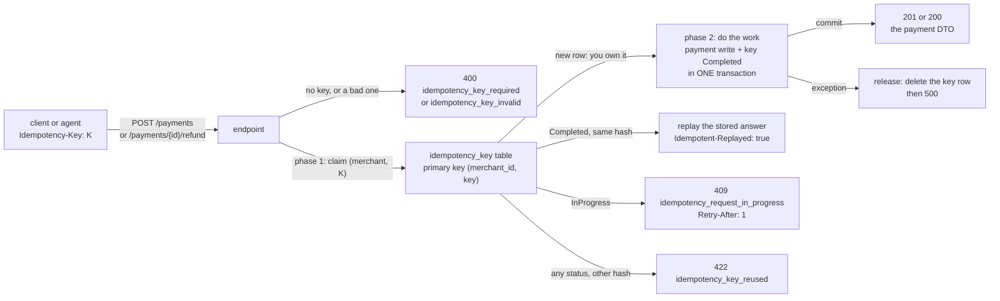
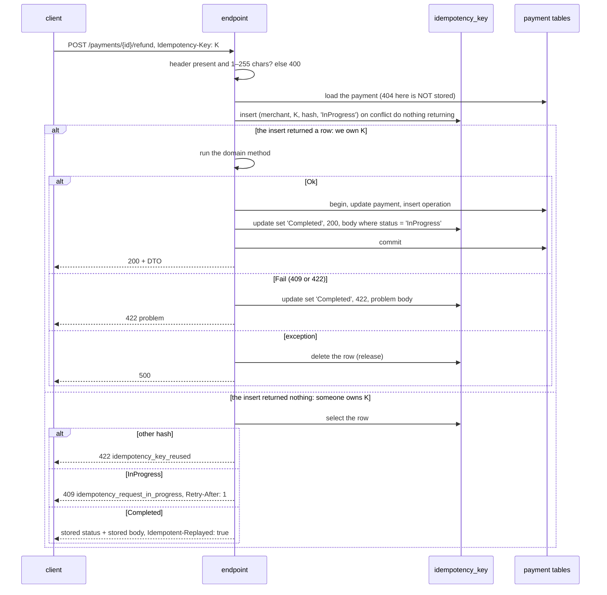
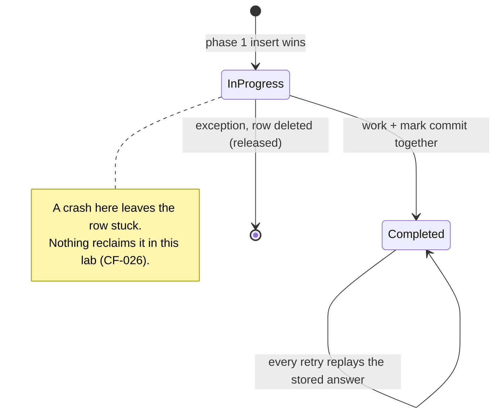

# Lab 03 — Idempotency

## What we solve
A retry must never charge the customer twice.

## Simple example
The shop sends "charge €80". The network times out. The shop doesn't know if it worked, so it sends "charge €80" again.
- Without idempotency: two charges. The customer pays €160 and calls their bank. Chargeback.
- With idempotency: both requests carry the same `Idempotency-Key: 7f3a…`. The second one gets the **same answer** as the first. One charge.

Now make it hard: 50 copies of that request arrive **at the same moment**. Still exactly one payment.

**Idempotent** means: doing it twice has the same effect as doing it once. The **`Idempotency-Key`** is a string the client makes up, once per logical operation, and sends again with every retry of that operation.

## Why it matters for a payment platform
It is the classic payments interview question. It also matters for AI agents: agents retry a lot, so every write tool they call must be idempotent.

## Everyday picture
**Double-tap on the card reader.** You pay for coffee, the reader beeps oddly, you tap again. A good shop has your receipt number written down, sees it again, and shows the same receipt. One coffee, one charge. The agent is a nervous customer who taps twice a lot.

The race: two tills check the list at the same instant, both see "not there yet", both charge. A clipboard check is not enough. You need a till that **physically refuses a duplicate number** — the unique index.

And the slow till: the first tap is still being processed when the second arrives. The shop does not charge again and does not guess. It says "still working on it, ask again in a second". That is the `409` with `Retry-After`.

Code sketch: `docs/aperio/AGENT-READY-BACKEND.md` §5. It shows the simple one-phase version; this lab builds the two-phase version below.

## What this lab builds



## Aperio comparison (our backbone)
| Case | Aperio | Where (verified 2026-10-20) | What this lab adds |
|---|---|---|---|
| `Idempotency-Key` header | ❌ No | — | The full header pattern with a unique key |
| Same call twice in one turn → one execution | ✅ Has | `findPriorToolResult()` reuses the earlier result (`lib/tools/executor.js` 469) | — |
| An approved action runs exactly once | ✅ Has | conditional claim `UPDATE … WHERE status IN ('approved','edited')` (`db/postgres/store.js` 1156) | The same conditional update marks a key `Completed` — `WHERE status = 'InProgress'` |
| Check-then-act race found and fixed | ✅ Has | `approvePending()`: two approvals could both pass the `status='pending'` check. Fixed with `SELECT … FOR UPDATE` + conditional `UPDATE` in a transaction (`db/postgres/store.js` 238; SQLite: one `db.transaction`) | The same race on payment create, under 50 parallel requests |
| Idempotent import | ✅ Has | `mcp/tools/data.js`: memories matched by id, wiki by slug, so running twice changes nothing | — |

## EF Core angle
**Dropped from this lab (2026-10-20).** The lesson is "the unique key decides, not the `if`", and the Dapper version shows it in full. QA Q21–Q25 stay: answer them from the sketch in `AGENT-READY-BACKEND.md` §5. EF Core gets real code in lab 09, where the app owns the schema. See `docs/plan/PLAN.md` §8.

---

# The spec

Written 2026-10-20. Steps live in [`WORKBENCH.md`](WORKBENCH.md). Test names live in [`TEST-LIST.md`](TEST-LIST.md). Questions live in [`QA.md`](QA.md).

This lab has four files: `README.md`, `WORKBENCH.md`, `QA.md` and `TEST-LIST.md`. No scaffold.

## Decisions taken for this lab (2026-10-20)

| Question | Decision | Why |
|---|---|---|
| Where do keys live? | **Their own table**, `idempotency_key`, primary key `(merchant_id, key)`. Not a column on `payment`. | A refund writes no new `payment` row, so a column on `payment` can only cover create. The table also holds the request hash and the stored answer. |
| What do the 49 losers of a race get? | **Two phases.** Phase 1 claims the key in its own committed insert. A request that finds the key `InProgress` gets `409` with `Retry-After`. | This is the shape that survives an external call — an acquirer, a bank. Lab 16 needs it, so learn it here on the easy case. |
| Does "key completed" commit with the work? | **Yes, one transaction.** The payment write and the key's `Completed` mark commit together or not at all. | The Stripe pattern: an *atomic phase*. A payment written with no stored answer would make a retry run the work again. |
| Which command endpoints? | **`authorise`, `capture`, `refund`.** Refund needs a captured payment, which needs the other two. `void` is not needed, so it stays in the inbox (`CF-025`). | Build what the lab needs, not what lab 02 skipped. |
| Validation | **.NET 10 built-in validation stays.** The 8 `ValidationTests` from lab 02 are written here (closes `CF-020`). No FluentValidation. | The key check is three lines. FluentValidation comes when a lab feels the pain. |
| EF Core | **None.** QA Q21–Q25 are answered on paper. | See "EF Core angle" above. |

## The header

| Rule | Value |
|---|---|
| Name | `Idempotency-Key` |
| Required on | `POST /payments`, `POST /payments/{id}/authorise`, `/capture`, `/refund` — every money-moving POST (`CLAUDE.md`) |
| Not on | `GET`. A read is already safe to repeat |
| Length | 1 to 255 characters, after trimming nothing. A blank value counts as missing |
| Scope | Per merchant. Create takes the merchant from the body. A command takes it from the stored payment |
| Lifetime | Kept forever in this lab. A real system deletes keys after 24 h to a few days (`CF-027`) |

## The flow of one request



Two things to see in it:

- **A `404` is never stored.** It is found before the claim. The payment may exist on the next try, so a stored `404` would be a lie.
- **A domain `409` or `422` is stored.** It is a final business answer. The same request gets the same answer, even after the payment moved on.

## The life of a key



## The request hash

The hash is how the server tells "a retry" from "a new request that reused a key". Same key plus a different hash is a client bug, so it is a `422`.

- Input: the HTTP method, the request path, and the bound request record serialized with the API's own JSON options. `POST /payments/8e9…/refund` + `{"amount":40.0,"currency":"EUR"}`.
- Output: SHA-256, as 64 lower-case hex characters.
- The path is in the hash on purpose. The same key on `/capture` and then `/refund`, or on two different payments, is a reuse.
- The bound record, not the raw bytes. Two bodies that differ only in spaces or key order are the same request.
- One static method computes it: `RequestHash.Of(method, path, request)`. Tests call the same method to arrange a row.

## The contracts

New, in `src/Payments.Api/Storage`:

```csharp
public interface IIdempotencyStore
{
    Task<Claim> ClaimAsync(Guid merchantId, string key, string requestHash, CancellationToken ct);
    Task CompleteAsync(Completion completion, CancellationToken ct);     // an answer with no payment write: 409, 422
    Task ReleaseAsync(Guid merchantId, string key, CancellationToken ct);
}

public abstract record Claim
{
    public sealed record Claimed : Claim;
    public sealed record InProgress : Claim;
    public sealed record Mismatch : Claim;
    public sealed record Replay(int StatusCode, string Body, string? Location) : Claim;
}

public sealed record Completion(Guid MerchantId, string Key, int StatusCode, string Body, string? Location);
```

Changed: `IPaymentStore.InsertAsync` and `UpdateAsync` take a `Completion?` as the last argument before the `CancellationToken`. When it is not `null`, the store marks the key `Completed` inside the same transaction. The four lab 02 `StoreTests` pass `null`.

The mark is a conditional update — `… where merchant_id = @M and key = @K and status = 'InProgress'` — and it must change exactly one row. Zero rows means someone else completed or released the key, so the store throws and the transaction rolls back. It is the same trick as Aperio's approved-action claim.

## The new error codes

All go through `ProblemMapper`, like every other code.

| Case | HTTP | `code` | Headers |
|---|---|---|---|
| No `Idempotency-Key`, or a blank one | `400` | `idempotency_key_required` | — |
| A key longer than 255 characters | `400` | `idempotency_key_invalid` | — |
| Same key, different request hash | `422` | `idempotency_key_reused` | — |
| Same key, first request still running | `409` | `idempotency_request_in_progress` | `Retry-After: 1` |

A replay is **not** an error. It is the stored status code and the stored body, byte for byte, plus `Idempotent-Replayed: true`. A replayed `201` also gets its stored `Location` back. A replayed status of `400` or above goes out as `application/problem+json`; anything else as `application/json`.

## What you deliver

| # | Deliverable | Where |
|---|---|---|
| 1 | `ValidationTests`, the 8 from lab 02 (closes `CF-020`) | `tests/Payments.Api.Tests` |
| 2 | `authorise`, `capture`, `refund` endpoints and their test groups | `src/Payments.Api`, `tests/Payments.Api.Tests` |
| 3 | Migration `0002`: the `idempotency_key` table | `db/postgres/0002_idempotency.sql` |
| 4 | `IIdempotencyStore`, `Claim`, `Completion`, `RequestHash`, and `DapperIdempotencyStore` | `src/Payments.Api/Storage` |
| 5 | `InsertAsync` / `UpdateAsync` complete the key in their own transaction | `src/Payments.Api/Storage/DapperPaymentStore.cs` |
| 6 | The `Idempotency-Key` on create, authorise, capture and refund | `src/Payments.Api/PaymentEndpoints.cs` |
| 7 | The 50-parallel test, for create and for refund | `tests/Payments.Api.Tests/ConcurrencyTests.cs` |

## Hard requirements

1. **The database decides, never an `if`.** No `select` before the claim insert. The primary key on `(merchant_id, key)` is the only arbiter.
2. **The claim is `insert … on conflict do nothing returning`.** No catch of `23505` in the Dapper store: an empty result says you lost.
3. **The work and the `Completed` mark are one transaction.** A payment row without a stored answer must be impossible.
4. **The `Completed` mark is a conditional update that must hit exactly one row**, or it throws.
5. **An exception releases the key**, so the retry can really try again. A `5xx` is never stored.
6. **A `404` and a `400` are never stored.** Both are decided before the claim.
7. **A replay is byte for byte.** Same status, same body. Never rebuilt from today's state of the payment.
8. **Every money-moving POST requires the key.** `GET` never does.
9. **No new rule in `Payments.Domain`.** Idempotency is an API concern. The domain stays without packages.
10. **Every SQL value is a Dapper parameter.** The key is client input; it never touches a SQL string.
11. **No real card data**, in any key, row, log or test.

## Done when

- [ ] `dotnet test` is green: the 160 domain tests plus every API test. `ConcurrencyTests` is not among them — see `CF-035`.
- [ ] 50 parallel `POST /payments` with one key: exactly **one** `payment` row; every `201` carries the same id; every other answer is `409 idempotency_request_in_progress`; a retry after the storm replays the `201`. **Skipped 2026-10-22 — `CF-035`.**
- [ ] 50 parallel refunds with one key: exactly **one** `Refund` operation row. **Skipped 2026-10-22 — `CF-035`.**
- [ ] You saw `ConcurrencyTests` go **red** once, with the claim swapped for a `select`-then-`insert`, and then green again. A race test that never failed proves nothing. **Skipped 2026-10-22 — `CF-035`.**
- [ ] `dotnet run --project src/Payments.Db -- migrate --engine postgres` run twice: the second run finds nothing new.
- [ ] By hand with `curl`: one create sent twice with one key shows `Idempotent-Replayed: true` on the second; a reused key with another amount is `422`.
- [ ] `grep -rn "select.*idempotency_key" src/Payments.Api` shows no `select` that runs **before** the claim insert.
- [ ] `grep -c PackageReference src/Payments.Domain/Payments.Domain.csproj` is still `0`.
- [ ] `grep -rn "\.Result\|\.Wait()\|GetAwaiter" src/Payments.Api` finds nothing.
- [ ] `QA.md` answered out loud, misses marked.
