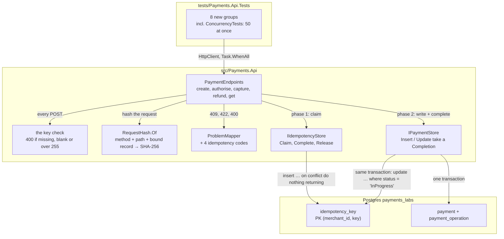
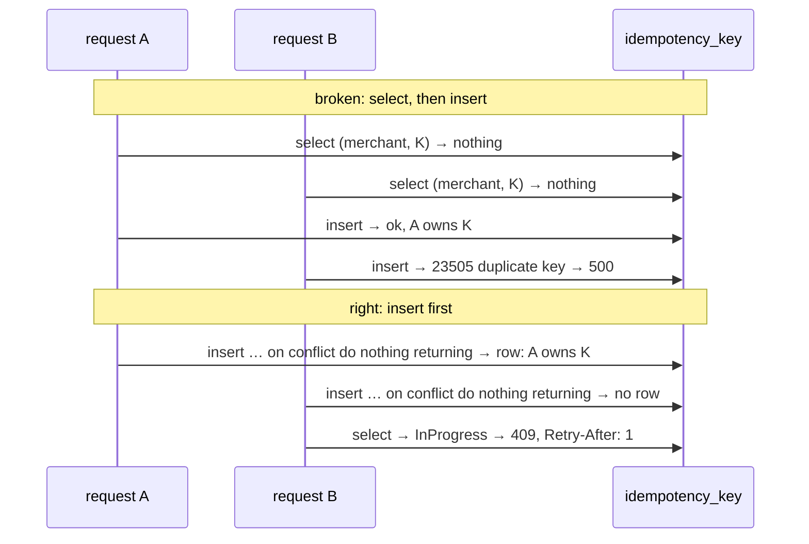

# Lab 03 — Workbench

Follow the steps in order. Each step says **Goal**, **Why**, **Do**, **Proof**, **Commit**.

Spec and Done-when list: [`README.md`](README.md). Test names you must write: [`TEST-LIST.md`](TEST-LIST.md). Interview questions: [`QA.md`](QA.md).

Started 2026-10-20.

**Size.** About 5 hours, in three parts. Steps 2–4 finish the command endpoints lab 02 skipped (about 1.5 h). Steps 5–8 build the key table and its store (about 1.5 h). Steps 9–13 put the key on the endpoints and prove the race (about 2 h). Step 4 is a safe place to stop for the day: everything before it is green and committed.

**TDD shows in the history.** From step 3 on, a `test(lab-03)` step (red) comes before the `feat(lab-03)` step (green) it covers.

**You write all the code, tests included.** Every `// TODO:` block below is your work. The agent wrote the rules, the names and the proofs, not the bodies.

## The target state



---

## Step 0 — Read the questions, not the answers

**Goal.** You have skimmed every question in `QA.md`. 5 minutes. No answers read.

**Why.** Knowing the questions first changes what you notice while you work, and attention is most of the learning. Reading the **answers** now would spoil the test — afterwards you would *recognise* them instead of *recalling* them, which feels like knowing and does not survive an interview. This lab is the one payments interviewers ask about most, so the skim pays more here than anywhere. Q21–Q25 are about EF Core, which this lab does not build: read them anyway, you answer them from the sketch.

**Do.**

```bash
grep -E '^\*\*Q' labs/03-idempotency/QA.md
```

**Proof.** You can say, in one sentence, what this lab is going to be asked about.

**Commit.** Nothing to commit.

---

## Step 1 — Start the lab and start the database

**Goal.** You are on `feature/lab-03-idempotency`, `develop` is level with `main`, and Postgres says `Up (healthy)`.

**Why.** First bring `develop` level with `main`, then branch. The lab 02 merge commit lives only on `main` until you merge it back, so a branch cut from a stale `develop` starts life missing part of the history. If you already cut the branch to commit this lab's prep, the git lines below are done — the proof still has to hold. Postgres must be up before step 2, because every proof in this lab is a real database.

**Do.**

```bash
git checkout develop
git merge main                       # the back-merge: develop must not be behind main
git log --oneline develop..main      # must print nothing
git checkout -b feature/lab-03-idempotency

docker compose -f docker/docker-compose.yml --env-file .env up -d
docker compose -f docker/docker-compose.yml --env-file .env ps
dotnet test                          # the starting line: everything lab 02 left is green
```

**Proof.**

```bash
git branch --show-current            # feature/lab-03-idempotency
git log --oneline develop..main      # empty
```

`payments-postgres` says `Up (healthy)`. `dotnet test` is green. If it is not green now, fix that first — you cannot see your own red against someone else's.

**Commit.** Nothing to commit.

---

## Step 2 — The validation tests lab 02 skipped

**Goal.** The `ValidationTests` group is written and green. `CF-020` is closed by code.

**Why.** These tests pin what the API does **today** with a bad body: `400`, the field named, nothing written. Step 10 puts a header check in front of the body check, and without these tests you would not notice if that broke the old behaviour. They go green at once, because the behaviour already exists — that is fine for a pinning test, but make each one fail once by hand (change an expected field name) so you know it can. A test that has never been red has never been tested.

**Do.** Write `tests/Payments.Api.Tests/ValidationTests.cs` from the `ValidationTests` group in `TEST-LIST.md`.

```csharp
// TODO: public sealed class ValidationTests(ApiFixture fixture) : ApiTestBase(fixture)
//   For the field tests, read the body as ValidationProblemDetails, not ProblemDetails:
//   that type has the Errors dictionary.
//   For An_empty_body_is_400 and Malformed_json_is_400, send StringContent by hand
//   with "application/json" — PostAsJsonAsync cannot send broken JSON.
```

**Proof.** `dotnet test tests/Payments.Api.Tests` green, 8 more tests than step 1. Each test went red once when you broke its expectation by hand.

**Commit.** Stage `tests/Payments.Api.Tests/ValidationTests.cs`.

```
test(lab-03): add the validation tests lab 02 skipped
```

---

## Step 3 — The command tests, red

**Goal.** `AuthoriseTests`, `CaptureTests` and `RefundTests` are written and fail with `404` or `405`, because the endpoints do not exist yet. Every POST helper sends an `Idempotency-Key`.

**Why.** Refund is the endpoint this lab cares about, and a refund needs a captured payment, which needs an authorised one. So the three endpoints come first, tests first. The helpers learn to send a key **now**, while the server still ignores it: in step 10 the key becomes required, and if the helpers did not already send one, 40 green tests would turn red for a reason that has nothing to do with what they check. Writing them red first proves each test can fail, which the green-at-once validation tests could not prove on their own.

**Do.** In `tests/Payments.Api.Tests/ApiFixture.cs`, in `ApiTestBase`:

```csharp
// TODO: CreatePaymentAsync(decimal amount = 100m, string currency = "EUR", string? key = null)
//   sends the header "Idempotency-Key" = key ?? Guid.NewGuid().ToString().
//   PostAsJsonAsync cannot add a header: build an HttpRequestMessage,
//   set Content = JsonContent.Create(body), add the header, SendAsync.
//
// TODO: Task<HttpResponseMessage> PostAsync(string path, object? body = null, string? key = null)
//   the same shape, for the commands. No body for authorise.
//   Returns the raw response: a test must be able to assert a 409.
//
// TODO: small arrange helpers the groups share, e.g.
//   AuthorisedPaymentAsync(amount), CapturedPaymentAsync(amount, captured)
```

Then write the three groups from `TEST-LIST.md`. Note two changes from the lab 02 list: there is no void endpoint, so the "on a voided payment" capture test uses a `Created` payment instead; and every "twice" test says whether it uses one key or two.

**Proof.** `dotnet test tests/Payments.Api.Tests`: the 20 new tests fail, with `404` or `405` in the messages. Every older test is still green.

**Commit.** Stage `tests/Payments.Api.Tests/`.

```
test(lab-03): add failing tests for authorise, capture and refund
```

---

## Step 4 — `authorise`, `capture`, `refund`, green

**Goal.** The three endpoints exist, the 20 tests from step 3 are green, and the demo problem route is gone.

**Why.** Every command has the same five lines: load, act, map the failure, update, return the DTO. Write it once for `authorise` and the other two are a copy with one line changed. Read the operation count from `Loaded` **before** the domain call, because the update inserts only the operations past that count — read it after and you insert nothing. The `/problems/demo` route was scaffolding from lab 02, and scaffolding that ships becomes an endpoint someone depends on.

**Do.** In `src/Payments.Api/PaymentEndpoints.cs`:

```csharp
// TODO: group.MapPost("/{id:guid}/authorise", …)
//   1. var loaded = await store.LoadAsync(id, ct); null -> ProblemMapper.NotFound("payment_not_found", …)
//   2. var result = loaded.Payment.Authorise();
//   3. result is a failure -> ProblemMapper.ToProblem(result.Error, http)
//   4. await store.UpdateAsync(loaded.Payment, loaded.OperationCount, ct);
//   5. Results.Ok(PaymentDto.From(…))
//
// TODO: "/{id:guid}/capture" and "/{id:guid}/refund" take an AmountRequest,
//       and call Capture / Refund with Money.Of(req.Amount, req.Currency).
//
// TODO: delete the /problems/demo/{code} route from Program.cs.
```

**Proof.**

```bash
dotnet test
grep -rn "problems/demo" src/        # no hits
```

Walk the life of a payment by hand: create, authorise, capture 40, refund 40, then refund 1 more and read the `422`. The commands are in [`docs/EVERYDAY-COMMANDS.md`](../../docs/EVERYDAY-COMMANDS.md) → "The API".

**Commit.** Stage `src/Payments.Api/`.

```
feat(lab-03): add the authorise, capture and refund endpoints
```

**A safe place to stop for the day.** Everything so far is green and committed.

---

## Step 5 — The key table

**Goal.** `idempotency_key` exists in `payments_labs`, and a second `migrate` finds nothing to do.

**Why.** The table is the arbiter, so it comes before any code that uses it. The primary key on `(merchant_id, key)` is the whole safety of this lab: two inserts of the same pair cannot both succeed, however close together they arrive, and no `if` in C# can promise that. The stored answer is `text`, not `jsonb`, because `jsonb` re-orders keys and drops spaces, and a replay must be byte for byte. A `check` constraint makes "Completed with no answer" a state the database refuses, so a bug in the store shows up as an error, not as an empty replay.

**Do.** Write `db/postgres/0002_idempotency.sql`:

```sql
-- TODO: create table idempotency_key
--   merchant_id       uuid        not null references merchant (id)
--   key               text        not null check (length(key) between 1 and 255)
--   request_hash      char(64)    not null
--   status            text        not null check (status in ('InProgress', 'Completed'))
--   response_code     int         null
--   response_body     text        null      -- text, not jsonb: a replay is byte for byte
--   response_location text        null
--   created_at        timestamptz not null default now()
--   completed_at      timestamptz null
--   primary key (merchant_id, key)
--
-- TODO: a table check: status = 'InProgress'
--         or (response_code is not null and response_body is not null and completed_at is not null)
```

```bash
dotnet run --project src/Payments.Db -- migrate --engine postgres
dotnet run --project src/Payments.Db -- migrate --engine postgres   # again
```

**Proof.**

```bash
docker exec payments-postgres psql -U labs -d payments_labs -c '\d idempotency_key'
```

The primary key shows as `idempotency_key_pkey` on `(merchant_id, key)`. The second `migrate` says there is nothing new. Now break the check on purpose:

```bash
docker exec payments-postgres psql -U labs -d payments_labs -c \
  "insert into idempotency_key (merchant_id, key, request_hash, status) values ('11111111-1111-1111-1111-111111111111', 'k', repeat('a', 64), 'Completed');"
```

It must fail with `violates check constraint`. Run the same insert twice with `'InProgress'`: the second must fail with `duplicate key value violates unique constraint`. **Those two errors are the proof.** Then clean up:

```bash
docker exec payments-postgres psql -U labs -d payments_labs -c "delete from idempotency_key;"
```

**Commit.** Stage `db/postgres/0002_idempotency.sql`.

```
feat(lab-03): add the idempotency_key table
```

---

## Step 6 — The contracts

**Goal.** `IIdempotencyStore`, `Claim`, `Completion` and `RequestHash` exist, and `IPaymentStore`'s two writes take a `Completion?`. Everything compiles and every test is still green.

**Why.** The shapes come before the bodies, so the tests in step 7 have something to call. `Claim` is a closed set of four answers, and a `switch` over it makes the endpoint handle every one — forget `InProgress` and the compiler tells you. The `Completion` goes **into** the payment store's write, not into a second call after it, because the work and the "key completed" mark must share one transaction: two calls means two transactions, and a crash between them leaves a payment with no stored answer. `RequestHash` is one static method so the endpoint and the tests compute the same value from the same code.

**Do.** The exact shapes are in `README.md` → "The contracts". Write them in `src/Payments.Api/Storage/`:

```csharp
// TODO: IIdempotencyStore.cs  — the interface, Claim and its four cases, Completion
//
// TODO: RequestHash.cs
//   public static string Of(string method, string path, object? request)
//     1. var json = request is null ? "" : JsonSerializer.Serialize(request, JsonSerializerOptions.Web);
//     2. SHA256.HashData(Encoding.UTF8.GetBytes($"{method} {path}\n{json}"))
//     3. Convert.ToHexStringLower(…)  — 64 characters
//
// TODO: IPaymentStore.InsertAsync(Payment, Guid merchantId, Completion? completion, CancellationToken)
//       IPaymentStore.UpdateAsync(Payment, int persistedOperationCount, Completion? completion, CancellationToken)
//       DapperPaymentStore: take the parameter, ignore it for now.
//       Every caller passes null for now: the endpoints and the four StoreTests.
```

**Proof.** `dotnet build` has no errors. `dotnet test` is green, with the same count as step 4.

**Commit.** Stage `src/Payments.Api/` and `tests/Payments.Api.Tests/StoreTests.cs`.

```
feat(lab-03): add the idempotency contracts and the request hash
```

---

## Step 7 — The key store's tests, red

**Goal.** `IdempotencyStoreTests` is written and fails, because no store implements the interface yet.

**Why.** The key store makes promises no HTTP response can show: one row per claim, a mismatch leaves the stored hash alone, a released key can be claimed again, and the `Completed` mark rolls back with a failed payment write. The last one is the heart of the lab — the atomic phase — and the only way to see it is to make the payment insert fail and then look at the key row. So this is the one new group that calls a store directly, like `StoreTests` in lab 02.

**Do.** Write `tests/Payments.Api.Tests/IdempotencyStoreTests.cs` from the `IdempotencyStoreTests` group in `TEST-LIST.md`.

```csharp
// TODO: a helper in ApiTestBase: IIdempotencyStore IdempotencyStore()
//       => new DapperIdempotencyStore(Fixture.ConnectionString)
//       It will not compile until step 8. To see red, not a build error,
//       add an empty DapperIdempotencyStore whose methods throw NotImplementedException.
//
// TODO: for The_completed_mark_rolls_back_with_the_payment_write:
//       insert a payment, then call InsertAsync again with the SAME payment and a Completion.
//       The primary key on payment.id makes the second insert fail.
//       Assert.ThrowsAnyAsync<PostgresException>, then read the key row with QuerySqlAsync.
```

**Proof.** `dotnet test tests/Payments.Api.Tests`: the 7 new tests fail with `NotImplementedException`. Every older test is still green.

**Commit.** Stage `src/Payments.Api/Storage/DapperIdempotencyStore.cs` (the empty one) and `tests/Payments.Api.Tests/`.

```
test(lab-03): add failing tests for the idempotency store
```

---

## Step 8 — The key store, green

**Goal.** `DapperIdempotencyStore` works, `DapperPaymentStore` completes the key inside its own transaction, and the 7 store tests are green.

**Why.** The claim is one statement: `insert … on conflict (merchant_id, key) do nothing returning key`. A row back means you own the key; no row means someone else does, and only then do you read the row to find out what they did. There is no `select` first, because a `select` that says "not there" is already out of date when the next line runs — that is the check-then-act race, the whole subject of this lab. The `Completed` mark is a conditional update that must change exactly one row, the same trick as Aperio's approved-action claim: if it changes zero, someone released or completed the key under you, and the transaction must not commit.

**Do.** In `src/Payments.Api/Storage/DapperIdempotencyStore.cs`:

```csharp
// TODO: ClaimAsync(merchantId, key, requestHash, ct)
//   1. insert into idempotency_key (merchant_id, key, request_hash, status)
//      values (@MerchantId, @Key, @RequestHash, 'InProgress')
//      on conflict (merchant_id, key) do nothing
//      returning key
//      -> QuerySingleOrDefaultAsync<string?>. Not null: return new Claim.Claimed().
//   2. null: select request_hash, status, response_code, response_body, response_location
//      for that (merchant_id, key), with "as" aliases like lab 02.
//      - no row at all (it was released between the two statements): return InProgress.
//        The client retries, and the retry will claim it.
//      - request_hash differs: Mismatch.  (Check the hash BEFORE the status.)
//      - status 'InProgress': InProgress.
//      - status 'Completed': Replay(code, body, location).
//
// TODO: CompleteAsync(completion, ct) — its own connection, one statement:
//   update idempotency_key
//      set status = 'Completed', response_code = @StatusCode, response_body = @Body,
//          response_location = @Location, completed_at = now()
//    where merchant_id = @MerchantId and key = @Key and status = 'InProgress'
//   affected != 1 -> throw InvalidOperationException.
//
// TODO: ReleaseAsync(merchantId, key, ct)
//   delete from idempotency_key where merchant_id = @M and key = @K and status = 'InProgress'
//   Never delete a Completed key: that would turn a stored answer into a second charge.
```

In `src/Payments.Api/Storage/DapperPaymentStore.cs`:

```csharp
// TODO: InsertAsync and UpdateAsync: when completion is not null, run the same
//       conditional update on the SAME conn and tx, as the FIRST statement after
//       BeginTransactionAsync. Put it in one private static method both writes call.
//       affected != 1 -> throw, and the using disposes the transaction uncommitted.
```

Why first and not last: inside one transaction the order does not change the outcome, but it changes what the test can see. Mark first, then let the payment insert fail: the rollback has to undo a mark that really happened. Mark last, and a failed insert means the mark never ran — the test passes and proves nothing.

**Proof.** `dotnet test` green, all of it. Then look at what a real claim leaves behind:

```bash
docker exec payments-postgres psql -U labs -d payments_labs -c 'table idempotency_key;'
```

(Empty — the tests run in a throwaway container. This is the habit, not the evidence. You will see real rows in step 14.)

**Commit.** Stage `src/Payments.Api/Storage/`.

```
feat(lab-03): add the Dapper idempotency store with insert-first claims
```

---

## Step 9 — The key on create, red

**Goal.** `KeyHeaderTests`, `ReplayTests` and `KeyReuseTests` are written and fail.

**Why.** These three groups are the contract a client sees. A missing key is the client's mistake, so it is a `400` before anything else runs. A repeat is not an error at all: it is the first answer again, word for word, with a header that says so. A reused key with a different body is a client bug that must be loud — quietly returning the old payment for a request that asked for a different amount would hide that bug until it costs money. `A_replay_shows_the_original_answer_not_the_current_state` is the one people get wrong in interviews: a replay is a stored answer, not a fresh read.

**Do.** Write the three groups from `TEST-LIST.md`. `A_missing_key_is_400_idempotency_key_required` is a `[Theory]` over all four POSTs, so it goes red for the commands too.

```csharp
// TODO: for the "no header" tests, send an HttpRequestMessage by hand.
//       The helpers from step 3 always add a key.
//
// TODO: for A_replay_returns_the_same_status_and_body, compare
//       await response.Content.ReadAsStringAsync(…) of both answers — strings, not DTOs.
//       Two DTOs can be equal while the bytes differ; the rule is about the bytes.
```

**Proof.** `dotnet test tests/Payments.Api.Tests`: the new tests fail, every older test is green. Read three failure messages and check each fails for the right reason — a replay test that fails with `400` means your helper forgot the key.

**Commit.** Stage `tests/Payments.Api.Tests/`.

```
test(lab-03): add failing tests for the idempotency key on create
```

---

## Step 10 — The key on create, green

**Goal.** Every POST checks the header. `POST /payments` runs the two-phase flow. `KeyHeaderTests`, `ReplayTests` and two of the four `KeyReuseTests` are green — 96 of 98.

**Why.** The order inside the handler is the design, so it is worth saying out loud: check the header, check the merchant, hash, claim, then — only if you own the key — do the work and complete in one transaction. The `404` for an unknown merchant comes before the claim, because the key row needs a real merchant and because a `404` may not be true tomorrow. The header check goes on all four POSTs now, in one helper, because "every money-moving POST takes a key" is a rule, and a rule enforced on one endpoint out of four is a bug report waiting to happen. The work is wrapped in a `try`: an exception releases the key and is rethrown, so the client's retry can really try again.

**Do.** In `src/Payments.Api/ProblemMapper.cs`:

```csharp
// TODO: one method for the four new codes, e.g.
//   Idempotency(string code, int status, string detail, HttpContext http)
//   same type URN, same "code" extension as every other problem.
//   idempotency_request_in_progress also sets http.Response.Headers.RetryAfter = "1".
```

In `src/Payments.Api/PaymentEndpoints.cs`:

```csharp
// TODO: a static helper: (string? key, IResult? problem) ReadKey(HttpContext http)
//   missing or whitespace -> 400 idempotency_key_required
//   longer than 255      -> 400 idempotency_key_invalid
//   Call it first in all four POSTs. The commands just ignore the key until step 12.
//   Add [FromHeader(Name = "Idempotency-Key")] string? key to the lambdas, or read http.Request.Headers.
//
// TODO: a static helper: IResult Replay(Claim.Replay r, HttpContext http)
//   http.Response.Headers["Idempotent-Replayed"] = "true";
//   Location header if r.Location is not null;
//   Results.Content(r.Body, r.StatusCode >= 400 ? "application/problem+json" : "application/json",
//                   statusCode: r.StatusCode)
//
// TODO: POST /payments, in this order:
//   1. ReadKey                                        -> 400
//   2. FindMerchantAsync                              -> 404, not stored
//   3. var hash = RequestHash.Of("POST", "/payments", req);
//   4. switch (await keys.ClaimAsync(req.MerchantId, key, hash, ct))
//        Mismatch   -> 422 idempotency_key_reused
//        InProgress -> 409 idempotency_request_in_progress
//        Replay r   -> Replay(r, http)
//        Claimed    -> go on
//   5. try {
//        create the payment, build the DTO,
//        var body = JsonSerializer.Serialize(dto, JsonSerializerOptions.Web);
//        await store.InsertAsync(payment, req.MerchantId,
//            new Completion(req.MerchantId, key, 201, body, $"/payments/{payment.Id}"), ct);
//        return Results.Content(body, "application/json", statusCode: 201) + the Location header;
//      } catch { await keys.ReleaseAsync(req.MerchantId, key, CancellationToken.None); throw; }
//
//   Return the SAME string you stored. Do not serialize the DTO a second time for the response:
//   the first answer and the replay must be the same bytes.
//
// TODO: register IIdempotencyStore in Program.cs, scoped, like IPaymentStore.
```

`CancellationToken.None` in the release, not `ct`: if the client hung up, `ct` is already cancelled, the release would be skipped, and the key would be stuck `InProgress`.

**Proof.** `dotnet test tests/Payments.Api.Tests`: 96 of 98. The two reds left are `The_same_key_on_another_endpoint_is_422` and `The_same_key_on_another_payment_is_422`: both reuse a key across two **commands**, so they need the claim that step 12 adds. Everything else is green, including the lab 02 command and store tests. Two `CreatePaymentTests` call `Client.PostAsJsonAsync` directly instead of the step 3 helper, so they send no key and now get a `400` — point them at `PostAsync`. That is the step 3 rule reaching a call site step 3 missed, not a test edited to go green. By hand, twice with one key:

```bash
curl -i -X POST http://localhost:5080/payments \
  -H 'Content-Type: application/json' -H 'Idempotency-Key: demo-1' \
  -d '{"merchantId":"11111111-1111-1111-1111-111111111111","amount":100.00,"currency":"EUR"}'
```

The first is `201` with no `Idempotent-Replayed`. The second is `201`, the same `id`, and `Idempotent-Replayed: true`. Change `100.00` to `200.00` and send it a third time: `422 idempotency_key_reused`.

**Commit.** Stage `src/Payments.Api/` and `tests/Payments.Api.Tests/CreatePaymentTests.cs`.

```
feat(lab-03): require an idempotency key and make create replay-safe
```

---

## Step 11 — The key on the commands, red

**Goal.** `CommandReplayTests`, `InProgressTests` and `FailureTests` are written and fail.

**Why.** Create was the easy case: a new row. A refund changes a row that already exists, so the same request twice would refund twice — that is the case agents hit in lab 08, and the one that really costs money. The in-progress tests arrange an open key by hand with SQL, because a test that waits for a race to happen is a test that passes by luck; the luck-based test is step 13, on purpose and labelled. The failure tests swap the store for one that throws, because a crash mid-work is the case where a stored `500` would block the client from ever succeeding.

**Do.** Write the three groups from `TEST-LIST.md`.

```csharp
// TODO: InProgressTests — arrange with ExecuteSqlAsync:
//   insert into idempotency_key (merchant_id, key, request_hash, status)
//   values (@M, @K, @Hash, 'InProgress')
//   with @Hash = RequestHash.Of("POST", "/payments", theRequestYouWillSend).
//   A different hash gives you a 422, not a 409 — that is the mismatch rule, not a bug.
//
// TODO: FailureTests — a ThrowingPaymentStore : IPaymentStore in the test project.
//   InsertAsync throws; the rest delegate to a real DapperPaymentStore.
//   var client = Fixture.Factory
//       .WithWebHostBuilder(b => b.ConfigureTestServices(s =>
//           s.AddScoped<IPaymentStore>(_ => new ThrowingPaymentStore(…))))
//       .CreateClient();
//   ConfigureTestServices is in Microsoft.AspNetCore.TestHost, which Mvc.Testing already brings.
```

**Proof.** `dotnet test tests/Payments.Api.Tests`: 108 tests, 7 red. The reds are the four `CommandReplayTests`, `InProgressTests.An_open_key_runs_no_work` and the two `KeyReuseTests` left over from step 10. Three of the new tests pass the moment they are written, and each one tells you something: `A_404_is_not_stored` passes because a command never claims a key yet, `An_open_key_is_409_idempotency_request_in_progress` and `The_409_says_when_to_retry` because they arrange their key on **create**, and both `FailureTests` because step 10's `catch` already releases. A test that is green on arrival is fine here — break it by hand once, so you know it can go red.

**Commit.** Stage `tests/Payments.Api.Tests/`.

```
test(lab-03): add failing tests for idempotent commands, open keys and crashes
```

---

## Step 12 — The key on the commands, green

**Goal.** `authorise`, `capture` and `refund` run the two-phase flow, and the step 11 groups are green.

**Why.** It is the create flow with two differences, and both teach something. The merchant comes from the stored payment, so the payment is loaded before the claim — and a `404` there is not stored. And a domain refusal is now a real outcome: a `409` or `422` from the state machine is a final business answer, so it is stored with `CompleteAsync` and replayed, while an exception is released and never stored. That split — store final answers, release transient failures — is QA Q9, and it is the rule you will be asked to defend.

**Do.** In `src/Payments.Api/PaymentEndpoints.cs`:

```csharp
// TODO: one private static method the three commands share, taking the domain call as a
//       Func<Payment, Result<…>> and the request record (null for authorise):
//   1. ReadKey                                    -> 400
//   2. var loaded = await store.LoadAsync(id, ct)  -> 404, not stored
//   3. var hash = RequestHash.Of("POST", http.Request.Path, req);
//   4. switch on ClaimAsync(loaded.MerchantId, key, hash, ct), as in create
//   5. try {
//        var result = act(loaded.Payment);
//        failure: build the problem body, keys.CompleteAsync(new Completion(…, status, body, null)),
//                 return it.
//        ok:      body = serialize the DTO;
//                 store.UpdateAsync(loaded.Payment, loaded.OperationCount,
//                                   new Completion(…, 200, body, null), ct);
//                 return Results.Content(body, "application/json", statusCode: 200);
//      } catch { release; throw; }
//
// To store a failure you need its body as a string. Build the ProblemDetails object
// yourself and serialize it — the same type, title, status, detail and code that
// ProblemMapper puts in it. Keep that in ProblemMapper, so there is still one place.
```

**Proof.** `dotnet test` green, all of it: **108 of 108** in `Payments.Api.Tests`, 160 in `Payments.Domain.Tests`, 55 in `Payments.Mcp.Tests`. By hand: create, authorise and capture 100 (each with its own key), then refund 40 twice with **one** key:

```bash
curl -i -X POST http://localhost:5080/payments/<id>/refund \
  -H 'Content-Type: application/json' -H 'Idempotency-Key: refund-1' \
  -d '{"amount":40.00,"currency":"EUR"}'
```

Both answers say `refundedAmount: 40.0`. The second has `Idempotent-Replayed: true`. Then `GET` the payment: still `40.0`.

**Commit.** Stage `src/Payments.Api/`.

```
feat(lab-03): make authorise, capture and refund replay-safe
```

Two things change beyond the TODOs, and both are the same rule — one body, one place:

- `ProblemMapper.ToProblem` now builds its body through the new `ProblemMapper.Refusal`, which returns the status **and** the body string. So the refusal a caller sees and the refusal stored against the key are the same bytes by construction, not by care.
- The three commands now share `CommandAsync`, so they also share one `updatedAt`: `payment.Operations[^1].At`, which is what the store writes. `authorise` used to answer with the **stale** `loaded.UpdatedAt`. See `CF-019`.

---

## Step 12b — `CF-032`: the dropped answer, from lab 08

**Goal.** `A_dropped_answer_still_refunds_once` is green, against the real lab 08 refund tool.

**Why.** Lab 08 closed without this test, because it is the one test that needs the replay you just built. It is also the clearest picture of why this lab exists: the refund runs, the answer is lost on the way back, and the agent retries exactly as its own error message told it to. Without the replay that retry pays the customer a second time. A `DelegatingHandler` that forwards the request and **then** throws is how you lose an answer on purpose — the work must really happen, or the test proves nothing.

**Do.**

```csharp
// TODO: McpEndToEndHarness.StartAsync takes an optional DelegatingHandler and splices it in
//       with api.AddHttpMessageHandler, outside the primary handler.
//
// TODO: DropFirstAnswer : DelegatingHandler, in McpEndToEndTests.cs
//   var response = await base.SendAsync(request, ct);   // await FIRST: the refund must run
//   first POST whose path ends in "/refund": dispose the response, throw HttpRequestException
//   every later call: return the response
//
// TODO: the test — propose, confirm (lost), confirm again.
//   The token is the same, so the Idempotency-Key is the same: "mcp-" + token.
//   After the lost answer: error is refund_in_doubt, and there is already ONE Refund row.
//   After the retry: result is "refunded", and there is STILL one Refund row.
```

**Proof.** `dotnet test tests/Payments.Api.Tests --filter-method '*A_dropped_answer_still_refunds_once*'` green. Then delete the `case Claim.Replay replay:` arm from `CommandAsync` and run it again: red, because the retry refunds a second time. Put the arm back. A test that has never been red has never been tested.

**Commit.** Stage `tests/Payments.Api.Tests/`.

```
test(lab-08): prove a dropped refund answer still refunds once
```

---

## Step 13 — Fifty at once, and watch it fail

> **Skipped 2026-10-22 (`CF-035`).** `ConcurrencyTests` was never written, so **no test covers the race**.
> Every other test in this lab is sequential, and a claim written as `select`-then-`insert` would pass all
> 109 of them. The primary key still stops the double payment; what is unproven is that the loser gets a
> `409` and not a `500`. The three `README.md` "Done when" lines that need this step are marked skipped too.
> Read the step anyway — the diagram below is the whole point of the lab.


**Goal.** `ConcurrencyTests` is green. You saw it go red once with the claim broken on purpose.

**Why.** Every test so far was sequential, so none of them could catch a race — a claim written as "select, then insert if missing" passes all of them. Fifty requests at the same instant is the only test that can tell the two apart, which is why you must break the claim on purpose and watch this test catch it. A race test that has never been red is a test you hope works. The unique key still saves the money when the claim is broken — the duplicate inserts fail with `23505` — but the client gets `500`s, and that is what the test sees.



**Do.** Write `tests/Payments.Api.Tests/ConcurrencyTests.cs` from `TEST-LIST.md`.

```csharp
// TODO: build 50 HttpRequestMessage objects first (same body, same key), then
//   var responses = await Task.WhenAll(requests.Select(r => Client.SendAsync(r, ct)));
//   An HttpRequestMessage can only be sent once — that is why there are 50 of them.
//
// TODO: group the status codes. Assert: only 201 and 409; at least one 201;
//   every 201 body has the same id; every 409 has code idempotency_request_in_progress;
//   CountRowsAsync("payment") == 1.
```

Then break it, on purpose, and only on your machine:

```csharp
// TODO, TEMPORARY — do not commit: in ClaimAsync, replace the insert … on conflict with
//   1. select … where merchant_id = @M and key = @K  → found: return InProgress
//   2. plain insert, no on conflict                 → return Claimed
```

Run `ConcurrencyTests` until it goes red — usually the first run. Read the failure: `500`s, from `23505`. Then put the real claim back:

```bash
git diff src/Payments.Api/Storage/DapperIdempotencyStore.cs   # must be empty again
```

**Proof.** `dotnet test` green, all of it, three runs in a row. You saw red with the broken claim. `git diff` on the store is empty.

**Commit.** Stage `tests/Payments.Api.Tests/ConcurrencyTests.cs` — the test only, never the broken claim.

```
test(lab-03): fire fifty identical requests and prove one payment
```

---

## Step 14 — The Done-when list, by hand

**Goal.** Every line of `README.md` → "Done when" is ticked.

**Why.** The tests ran against a throwaway container that is gone now. The real database and a real `curl` are what you will demo, and what you will describe in the interview — "I sent it twice and here is the header" is a better story than "a test passed". The greps check the hard requirements no test can see, like a `select` that sneaked in before the claim. It is also the first time you see rows in the real `idempotency_key` table, and reading them is the fastest way to understand the two phases.

**Do.**

```bash
dotnet run --project src/Payments.Api --urls http://localhost:5080
```

In a second terminal, the create from step 10 twice, then:

```bash
docker exec payments-postgres psql -U labs -d payments_labs \
  -c "select key, status, response_code, left(response_body, 40) from idempotency_key;"
grep -rn "select.*idempotency_key" src/Payments.Api
grep -c PackageReference src/Payments.Domain/Payments.Domain.csproj
grep -rn "\.Result\|\.Wait()\|GetAwaiter" src/Payments.Api
```

**Proof.** One row per key you used, every one `Completed`. The only `select` on `idempotency_key` is the one in `ClaimAsync` **after** the insert. The domain still has `0` packages. No `.Result`.

**Commit.** Nothing to commit.

---

## Step 15 — Say the answers out loud

**Goal.** You answered every question in `QA.md` out loud, then checked.

**Why.** This is the test the lab was for. Speaking the answer uses a different path than reading it, and it is the path an interview uses. Mark every question you got wrong or said badly — those marked ones are a 5-minute warm-up at the start of your next session, and that repeat is where most of the gain sits. For Q21–Q25 (EF Core), say the pattern from `AGENT-READY-BACKEND.md` §5 and say why you did not build it.

**Do.**

1. Cover the file. Work down the question list.
2. Say the answer out loud. Then read the real answer.
3. Mark the misses.
4. Answer `Q-APERIO` last: "Have you solved this before?"

**Proof.** You answered every question without looking. The marked list is short.

**Commit.** Nothing to commit.

---

## Step 16 — Close the lab

**Goal.** Lab 03 is on `develop`, `main` carries the `lab-03` tag, `develop` is level with `main`, the feature branch is gone, and `docs/PROGRESS.md` says `Done`.

**Why.** The merge and the tag are the record that a lab finished. `--no-ff` keeps a merge commit even when a fast-forward is possible, so the history shows the lab as one unit of work. Before that, the lab's notes move into the inbox, because a finding written in a workbench file is lost the moment the next lab starts. The CI gate (`CF-006`) was moved to run right after this step, so the next branch you cut is that one, not lab 04.

**Do.** Run the full Done-when list in `README.md` first. Then move every line from **Notes while you work** below into `docs/plan/CARRY-FORWARD.md` as a `CF-NNN` row with the date, and groom the inbox: `CF-020` and `CF-021` close. Set the lab 03 row in `docs/PROGRESS.md` to `Done` with the tag. Then:

Git opens an editor for each `--no-ff` merge message; `--no-edit` keeps git's own default and opens nothing. If vim is on your screen anyway, `:wq` then **Enter** saves and finishes, `:q!` then **Enter** cancels. See [`docs/EVERYDAY-COMMANDS.md`](../../docs/EVERYDAY-COMMANDS.md).

```bash
git status --short      # must be empty
git checkout develop
git merge --no-ff --no-edit feature/lab-03-idempotency
git checkout main
git merge --no-ff --no-edit develop
git tag lab-03
git checkout develop
git merge main          # the back-merge. Without it develop is behind main
git branch -d feature/lab-03-idempotency
```

The small `-d` deletes the branch only if its work is really merged. Never use the capital `-D` here: it skips that check.

Stop the database when you are done for the day. `stop` keeps the data; `down -v` destroys it.

```bash
docker compose -f docker/docker-compose.yml --env-file .env stop
```

**Proof.**

```bash
git log --oneline --graph --all | head -30
git tag                           # lab-00 … lab-03
git branch                        # develop and main only
git log --oneline develop..main   # empty: develop is level with main
```

The history must show each `test(lab-03)` commit before the `feat(lab-03)` commit it covers.

**Commit.** The grooming and the board are one commit, on the feature branch, **before** the merges. Stage `docs/plan/CARRY-FORWARD.md` and `docs/PROGRESS.md`:

```
docs(plan): groom the inbox and close lab 03 on the board
```

The merge commits are the record of the rest of this step.

---

## Traps

| Trap | What happens | Fix |
|---|---|---|
| A `select` before the claim "to save a round trip" | It works in every sequential test, and loses the race under load | Insert first. The `select` runs only after the insert returned nothing. Step 13 is the test that catches it |
| `catch (PostgresException)` around the claim | Works, but every lost race now throws, and a catch that is a little too wide also swallows a real error | `on conflict do nothing returning`. No row back means you lost; no exception at all |
| `on conflict do nothing` without `returning` | `ExecuteAsync` returns 0 or 1 and you cannot tell "lost" from a bug | Add `returning key` and read it with `QuerySingleOrDefaultAsync<string?>` |
| `response_body` is `jsonb` | Postgres re-orders keys and drops spaces, so the replay is not byte for byte, and `A_replay_returns_the_same_status_and_body` fails | `text`. The column stores an answer, not data you query |
| The DTO is serialized twice | The response and the stored body differ by a decimal format or a timestamp, and the replay test fails | Serialize once. Store that string, return that string |
| The `Completed` mark runs in its own connection | The payment commits, the process dies, the key stays `InProgress` — the client gets `409` forever | The mark goes on the payment write's `conn` **and** `tx`, before `CommitAsync` |
| `ReleaseAsync(…, ct)` in the `catch` | The client hung up, `ct` is cancelled, the release throws, the key is stuck `InProgress` | `CancellationToken.None` for the release. Cleanup must not depend on the caller still waiting |
| `ReleaseAsync` deletes a `Completed` key | A late release turns a stored answer into nothing, and the next retry runs the work again: a second charge | `… and status = 'InProgress'` in the `delete` |
| The status is checked before the hash | An open key with another body gets `409`, the client retries, and gets `422` only later | Hash first. A reused key is wrong whatever the first request is doing |
| A `404` gets stored | A refund on a payment that is created a second later stays `404` forever for that key | Load before the claim. Nothing found means no claim, so nothing to store |
| The request hash uses the raw body bytes | `{"amount":40,"currency":"EUR"}` and `{ "currency":"EUR", "amount":40 }` count as different requests | Hash the bound record, serialized by your own code |
| The path is left out of the hash | Capture with K, then refund with K, replays the capture's `200` for a refund that never ran | `method + path + body`. The path holds the payment id and the command |
| `InProgressTests` gets `422`, not `409` | The arranged row's hash was not computed for the exact request the test sends | `RequestHash.Of` with the same method, path and record. Same code, same value |
| `ConcurrencyTests` passes with the broken claim | The 50 requests did not really overlap | Build all 50 messages first, then `Task.WhenAll`. Run it three times. If it never goes red, say so in the notes — do not skip the red |
| `HttpRequestMessage` "already sent" | One message object was sent twice | One message per request. It is a one-shot object |
| Npgsql "The connection pool has been exhausted" | Something holds connections open — usually a missing `await using` | Every `NpgsqlConnection` in an `await using`. 50 requests fit in the default pool of 100 |
| `FailureTests`: `SendAsync` throws instead of returning `500` | Outside `Development`, `TestServer` hands an unhandled exception straight to the client | `WebApplicationFactory` runs as `Development`, where the developer exception page turns it into a `500`. Keep that default; do not set another environment in the fixture |
| `Retry-After` missing | The header was set on a result that `Results.Problem` then replaced | Set it on `http.Response.Headers` before returning the problem |
| A replayed `201` has no `Location` | The location was not stored | `response_location` holds it. Rebuilding it from the body is a guess |
| Editing a test to make it pass | The lab is pointless, and the interview answer becomes a lie | Never. If a test looks wrong, ask — `CLAUDE.md` says the agent must ask before changing a test |
| Lab work committed straight to `main` | `develop` is behind, and the next feature branch starts from a stale base | Commit on `feature/lab-03-idempotency` |

## Notes while you work

Write what surprised you here, as it happens. At the end of the lab these move into `docs/plan/CARRY-FORWARD.md` (the inbox) as `CF-NNN` rows. From there each one graduates to `docs/plan/PLAN.md` section 8, to a lab `README.md`, or it is dropped.

-
