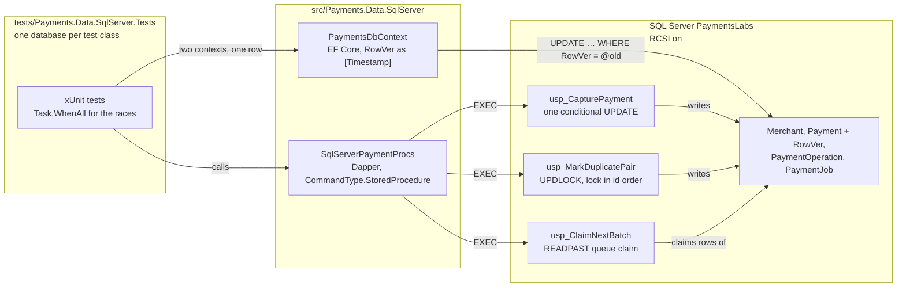
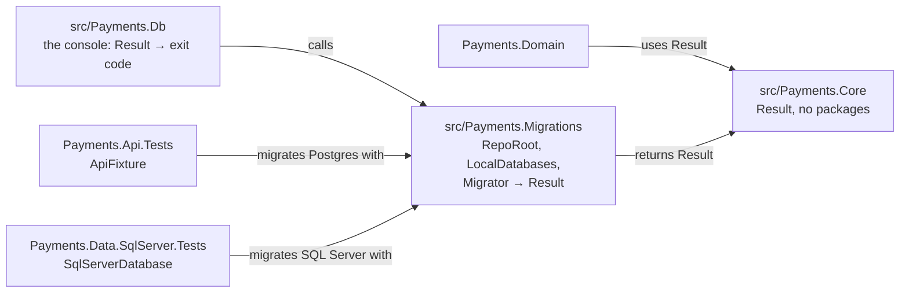

# Lab 04 — SQL Server stored procedures + locking

## What we solve
Two things try to change the same payment at the same time. Only one may win. And the database must not lock up.

## Simple example
- **Race:** two servers both try to capture payment 42. Both read "Authorised", both write "Captured". The money is captured twice. Fix: one `UPDATE … WHERE Status = 'Authorised'` — only one can win.
- **Deadlock:** job A locks payment 1, then wants payment 2. Job B locks payment 2, then wants payment 1. Both wait forever. SQL Server kills one (error 1205). You will make this happen on purpose, then fix it by always locking in the same order.
- **Queue:** 5 workers take jobs from one table. With `READPAST` each worker skips rows others are holding — no waiting.

## Why it matters for a payment platform
The ad says it word for word: *"SQL Server stored procedures for highly concurrent and multithreaded production environments."*

## Everyday picture
- **Race:** two people buy the last concert ticket at the same second. Without a rule, both get it. The rule: "sell only if still available" in one move — the conditional `UPDATE`.
- **Deadlock:** two cars at a narrow bridge, each waiting for the other to back up. Fix: everyone drives in the same direction first (lock in the same order).
- **READPAST:** a supermarket with many tills. You don't queue behind a busy till; you walk to a free one.

## EF Core angle
EF Core optimistic concurrency: `[Timestamp]` on a `rowversion` column → `DbUpdateConcurrencyException` on conflict. And call the capture proc from EF with `ExecuteSqlAsync`. Note: EF has no `UPDLOCK`/`READPAST` hints — for those, raw SQL or a proc.

## Moved out: ETag and If-Match
The HTTP version of this lab's rule — `ETag`, `If-Match`, `412 stale_version` — is now its own lab: [`labs/20-etag-if-match`](../20-etag-if-match). It changes the Postgres API, adds a migration there and touches lab 08's refund token, so it is a lab, not a stretch (decided 2026-10-22).

## Aperio comparison (our backbone)
| Case | Aperio | Where (verified 2026-10-22) | What this lab adds |
|---|---|---|---|
| SQL Server, stored procedures | ❌ No | Postgres and SQLite only | Everything T-SQL |
| Pessimistic row lock | ✅ Has (Postgres) | `SELECT … FOR UPDATE` in `approvePending()` (`db/postgres/store.js` 238) | `UPDLOCK, ROWLOCK` in SQL Server |
| Compare-and-swap update | ✅ Has | `claimAgentInterrupt` conditional `UPDATE … RETURNING` (`db/postgres/store.js` 1151) | Same in a capture proc with `@@ROWCOUNT` |
| Queue claim that skips locked rows | ❌ No | — | `READPAST` (and `SKIP LOCKED` in Lab 13) |
| Deadlock made, found and fixed | ❌ No | — | Deadlock on purpose, 1205, lock ordering |
| Isolation levels, RCSI, `rowversion` | ❌ No | default isolation only | All of it |

---

# The spec

Written 2026-10-22. Steps live in [`WORKBENCH.md`](WORKBENCH.md). Test names live in [`TEST-LIST.md`](TEST-LIST.md). Questions live in [`QA.md`](QA.md).

This lab has four files: `README.md`, `WORKBENCH.md`, `QA.md` and `TEST-LIST.md`. No scaffold.

## What this lab builds

Before the SQL Server work, two refactors from the inbox (`CF-009`, `CF-016`) make room for it:

## Decisions taken for this lab (2026-10-22)

| Question | Decision | Why |
|---|---|---|
| How big? | **Core + one EF Core step.** Procs, `UPDLOCK`, `READPAST`, the deadlock, RCSI, `rowversion`, then EF Core's `[Timestamp]` and a proc called from EF. | The ad names exactly this. The ETag stretch moved to lab 20. |
| What does the queue hold? | A new **`PaymentJob`** table, SQL Server only: `Id`, `PaymentId`, `Kind`, `Status` (`Ready`/`Claimed`/`Done`), `ClaimedBy`, `ClaimedAt`, `CreatedAt`. | A clean work queue. `Payment` stays in lockstep with Postgres. Labs 06 and 13 can reuse the shape. |
| What locks two payments? | **`usp_MarkDuplicatePair(@KeepId, @DuplicateId)`**: two operators flag a double charge, each from their own side. It adds a nullable **`DuplicateOf`** column to `Payment`, SQL Server only. | A real shape: the M1 Hotel Sofia double charge of labs 08 and 09. Two people flagging the same pair from opposite sides is exactly the opposite-order lock. |
| Where does RCSI get switched on? | In **`Migrator`**, right after the database is made, outside DbUp. | `ALTER DATABASE` fails inside a transaction (error 226, measured 2026-10-22), and DbUp wraps every script in one. RCSI is a database option, not schema. |
| How many migration files? | **One** for SQL Server: `db/sqlserver/0001_payments_procs_locking.sql`. While the lab is in flight you may **rewrite** it: drop the dev database and migrate again. It freezes when the lab is tagged. | The repo rule is one migration per lab. The tests make a fresh database per class, so they always see the current file. |
| `CF-009` and `CF-016` | **Both, together**, before any SQL Server code. `Result` moves to `Payments.Core`; the migration code moves to `Payments.Migrations` and returns a `Result`. | The SQL Server tests are the third copy of `RepoRoot()` and the DbUp builder. Lift before copying, with 330 green tests as the net. |
| Does the API call SQL Server? | **No.** The API stays on Postgres. The procs are called by `SqlServerPaymentProcs`, and only tests call that. | Lab 04 is about the database. Lab 05 adds bulk ADO.NET on the same project. |

## The proc contract

Every proc starts with `SET NOCOUNT ON; SET XACT_ABORT ON;` and has `BEGIN TRY / BEGIN TRAN … COMMIT / END TRY BEGIN CATCH … ROLLBACK; THROW; END CATCH`.

A refusal is a `THROW` with a number from this table. `SqlServerPaymentProcs` turns the number into a failed `Result` with the code. Any **other** `SqlException` — a 1205 deadlock among them — is not caught. It stays an exception, so a test sees it.

| Number | Code | Thrown by | When |
|---|---|---|---|
| 50001 | `payment_not_found` | capture, pair | No row with that id |
| 50002 | `illegal_transition` | capture | Status is not `Authorised` or `PartiallyCaptured` |
| 50003 | `currency_mismatch` | capture | `@Currency` is not the payment's currency |
| 50004 | `amount_not_positive` | capture | `@Amount <= 0` |
| 50005 | `amount_exceeds_authorised` | capture | `CapturedAmount + @Amount > AuthorisedAmount` |
| 50006 | `pair_already_marked` | pair | Either payment already has a `DuplicateOf`, or is already someone's duplicate |
| 50007 | `pair_not_eligible` | pair | Same id twice, another merchant, another currency or amount, or a payment that is not `Captured` |

The capture checks run in the **same order as the domain** (`Payment.Capture`): state, currency, amount positive, amount fits. The codes are the API's codes, so a later lab can map them with `ProblemMapper` as they are.

## The three procs

| Proc | Parameters | Returns | The lesson |
|---|---|---|---|
| `usp_CapturePayment` | `@PaymentId`, `@Amount decimal(19,4)`, `@Currency char(3)`, `@OperationId`, `@At datetimeoffset(6)` | the updated `Payment` row | **Compare-and-swap.** One `UPDATE` with every rule in its `WHERE`. `@@ROWCOUNT = 0` → read why, then `THROW`. The `PaymentOperation` row commits in the same transaction. |
| `usp_MarkDuplicatePair` | `@KeepId`, `@DuplicateId`, `@At`, `@PauseMs int = 0` | nothing | **`UPDLOCK`, read then write, lock order.** Reads both rows `WITH (UPDLOCK, ROWLOCK)`, checks them, sets `DuplicateOf` on the duplicate. `@PauseMs` waits between the two reads: a **test seam** that makes the deadlock happen every time instead of by luck. |
| `usp_ClaimNextBatch` | `@WorkerId varchar(50)`, `@BatchSize int`, `@At` | the claimed `PaymentJob` rows | **`READPAST` queue.** Oldest `Ready` rows first, `WITH (ROWLOCK, READPAST, UPDLOCK)`, `OUTPUT inserted.*`. |

## What you deliver

| # | Deliverable | Where |
|---|---|---|
| 1 | `Result` in its own project (`CF-009`) | `src/Payments.Core` |
| 2 | `RepoRoot`, `LocalDatabases`, `Migrator` returning `Result`, used by the runner and both fixtures (`CF-016`, `CF-009`) | `src/Payments.Migrations`, `src/Payments.Db`, `tests/Payments.Api.Tests/ApiFixture.cs` |
| 3 | The SQL Server migration: lockstep tables, `RowVer`, `DuplicateOf`, `PaymentJob`, three procs | `db/sqlserver/0001_payments_procs_locking.sql` |
| 4 | RCSI switched on by `Migrator` | `src/Payments.Migrations/Migrator.cs` |
| 5 | `SqlServerPaymentProcs` | `src/Payments.Data.SqlServer` |
| 6 | `PaymentsDbContext` with `RowVer` as the concurrency token | `src/Payments.Data.SqlServer/Ef` |
| 7 | The test project, one database per test class, every class `[Trait("runs", "local")]` | `tests/Payments.Data.SqlServer.Tests` |

## Hard requirements

1. **The database decides.** No C# `if` reads a status and then calls a write. The capture is one `UPDATE`; the pair is read and written under `UPDLOCK`.
2. **Every proc is `SET XACT_ABORT ON`** with `TRY/CATCH` and `THROW`. No `RAISERROR`, no `RETURN` codes.
3. **The capture and its `PaymentOperation` row commit together.**
4. **Lock order is decided in SQL**, not in C#. SQL Server sorts a `uniqueidentifier` differently from .NET's `Guid.CompareTo`; both callers must use the same order, so the proc picks it.
5. **No `NOLOCK`** anywhere. Not in procs, not in tests.
6. **No retry on 1205 hides the deadlock.** The fix is the lock order. A retry is allowed later as a last line, never as the fix here.
7. **Every SQL Server test class carries `[Trait("runs", "local")]`**, so the CI gate skips them (`plan/PLAN.md` §8).
8. **Every SQL value is a parameter.** No string-built SQL, in Dapper or in EF Core (`ExecuteSqlAsync` with an interpolated string is a parameter; `ExecuteSqlRawAsync` with `+` is not).
9. **`Payments.Domain` and `Payments.Core` have zero packages.**
10. **No real card data.** Test amounts and ids only.

## Done when

- [ ] `dotnet test` is green: the 330 from before plus the new SQL Server tests.
- [ ] `dotnet test Payments.slnx --filter-not-trait runs=local` runs the **same** count as before this lab: the CI gate skips every new test.
- [ ] You saw the deadlock test go **red with 1205**, read its graph in `system_health`, fixed the lock order, and saw it green 10 runs out of 10.
- [ ] 50 parallel full captures on one payment: exactly **one** wins, `CapturedAmount` equals the authorised amount, one `PaymentOperation` row.
- [ ] 50 parallel captures of 10 on a payment of 100: exactly **ten** win, never more.
- [ ] 5 workers claiming from 200 jobs: every job claimed **exactly once**.
- [ ] You watched a lost update happen by hand in two terminals, without `UPDLOCK`, and not happen with it.
- [ ] `dotnet run --project src/Payments.Db -- migrate --engine sqlserver` run twice: the second run finds nothing new.
- [ ] `grep -rni nolock db src tests` finds nothing.
- [ ] `grep -c PackageReference src/Payments.Domain/Payments.Domain.csproj src/Payments.Core/Payments.Core.csproj` prints `0` twice.
- [ ] `QA.md` answered out loud, misses marked.
