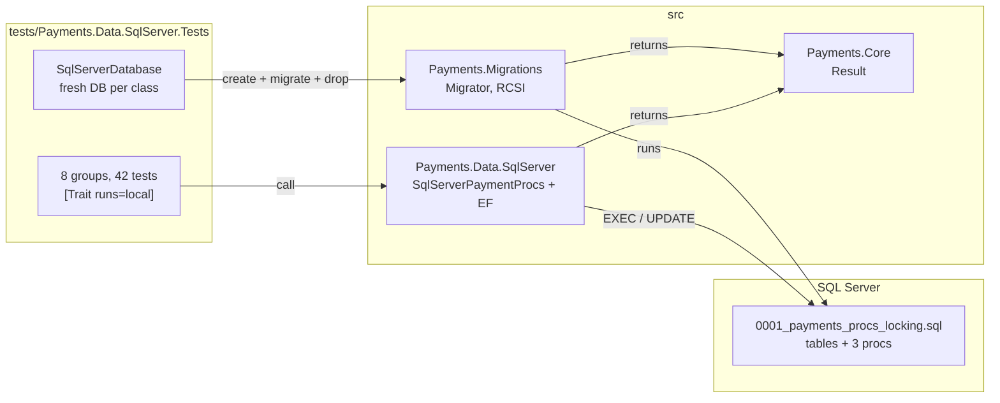

# Lab 04 — Workbench

Follow the steps in order. Each step says **Goal**, **Why**, **Do**, **Proof**, **Commit**.

Spec and Done-when list: [`README.md`](README.md). Test names you must write: [`TEST-LIST.md`](TEST-LIST.md). Interview questions: [`QA.md`](QA.md).

Started 2026-10-22.

**Size.** About 4–5 hours, in four parts. Steps 1–4 lift the shared code out of the way (about 1 h). Steps 5–8 build the SQL Server schema and its test harness (about 1 h). Steps 9–16 are the heart: capture, isolation, the deadlock (about 2 h). Steps 17–20 add the queue and EF Core (about 1 h). Step 8 is a safe place to stop for the day: everything before it is green and committed.

**TDD shows in the history.** From step 9 on, a `test(lab-04)` step (red) comes before the `feat(lab-04)` step (green) it covers.

**Who writes the code.** You say it, per task (`CLAUDE.md`). Every `// TODO:` and `-- TODO:` block below is the shape, not the body.

**Verified on this Mac, 2026-10-22,** on SQL Server 2022 CU26 under Rosetta: error 226 for `ALTER DATABASE` inside a transaction, `WAITFOR DELAY` with a `datetime` variable, the CTE claim with `OUTPUT`, the 1205 deadlock with opposite lock order, `READPAST` claiming other rows with no wait under RCSI, the lost update without `UPDLOCK` and its fix, and the `system_health` deadlock query (with `sqlcmd -I`).

## The target state



---

## Step 0 — Read the questions, not the answers

**Goal.** You have skimmed every question in `QA.md`. 5 minutes. No answers read.

**Why.** Knowing the questions first changes what you notice while you work, and attention is most of the learning. Reading the **answers** now would spoil the test — afterwards you would *recognise* them instead of *recalling* them, which feels like knowing and does not survive an interview. This lab is the one sentence of the job ad that names SQL Server, so expect most of these in a real interview. Q23–Q27 are EF Core: step 19 builds the first two for real.

**Do.**

```bash
grep -E '^\*\*Q' labs/04-sqlserver-procs-locking/QA.md
```

**Proof.** You can say, in one sentence, what this lab is going to be asked about.

**Commit.** Nothing to commit.

---

## Step 1 — Start the lab, commit the prep

**Goal.** You are on `feature/lab-04-sqlserver-procs-locking`, `develop` is level with `main`, the prep files are the first commit, and both databases say `Up (healthy)`.

**Why.** `develop` is behind `main` right now: the three CI gate commits and the race fix landed on `main` (`docs/PROGRESS.md`). A branch cut from that `develop` would start without them, and the lab would close by merging the same commits twice. The prep files (this file, the test list, the lab 20 spec) are uncommitted on `main`, and `git checkout develop` refuses to carry changes to files that differ between the branches — so stash them, move, and bring them back. Prep is lab work, so it is committed on the feature branch, never on `main`.

**Do.**

```bash
git stash -u                          # park the prep files; -u takes the new ones too
git checkout develop
git merge main                        # the back-merge: develop must not be behind main
git log --oneline develop..main       # must print nothing
git checkout -b feature/lab-04-sqlserver-procs-locking
git stash pop                         # the prep files come back

docker compose -f docker/docker-compose.yml --env-file .env up -d
docker compose -f docker/docker-compose.yml --env-file .env ps
dotnet test                           # the starting line
```

**Proof.**

```bash
git branch --show-current             # feature/lab-04-sqlserver-procs-locking
git log --oneline develop..main       # empty
```

Both containers say `Up (healthy)`. `dotnet test` is green, **330** tests. If it is not green now, fix that first — you cannot see your own red against someone else's.

**Commit.** Stage `labs/04-sqlserver-procs-locking/`, `labs/20-etag-if-match/`, `labs/19-human-in-the-loop-ui/README.md`, `docs/`, `db/README.md`, `README.md`.

```
docs(lab-04): prepare the bench sheet and test list, move the ETag stretch to lab 20
```

---

## Step 2 — `Result` gets its own project (`CF-009`, part 1)

**Goal.** `Result<TValue, TError>` lives in `src/Payments.Core`, a project with no packages. `Payments.Domain` references it. 330 still green.

**Why.** Step 4 makes the migration code return a `Result`, and migrations must not depend on the payment domain — a database tool that references `Payment` is a layer pointing the wrong way. So `Result` moves down into a project everybody can use and nobody depends *from*. It is a move, not a change: the 330 tests are the net, and not one assertion may change. The only edits outside `src/Payments.Core` are a project reference and a `<Using>` line, so no `.cs` file has to learn a new namespace.

**Do.**

```bash
dotnet new classlib -o src/Payments.Core -f net10.0
rm src/Payments.Core/Class1.cs
dotnet sln Payments.slnx add src/Payments.Core
dotnet add src/Payments.Domain reference src/Payments.Core
```

```csharp
// TODO: src/Payments.Core/Result.cs
//   namespace Payments.Core;
//   Cut the Result<TValue, TError> class out of src/Payments.Domain/Core.cs and paste it here.
//   Nothing else moves: PaymentError, the enums and the exceptions are domain words.
```

```xml
<!-- TODO: one line in each of these three csproj files, inside an <ItemGroup>:
       src/Payments.Domain/Payments.Domain.csproj
       src/Payments.Api/Payments.Api.csproj
       tests/Payments.Domain.Tests/Payments.Domain.Tests.csproj
     <Using Include="Payments.Core" />
     That is a global using: every .cs file in the project sees the namespace. -->
```

**Proof.**

```bash
dotnet build                     # 0 warnings, 0 errors
dotnet test                      # 330 green
grep -c PackageReference src/Payments.Core/Payments.Core.csproj    # 0
git diff --stat -- tests          # only the .csproj line, no .cs file
```

**Commit.** Stage `src/Payments.Core/`, `src/Payments.Domain/`, `src/Payments.Api/Payments.Api.csproj`, `tests/Payments.Domain.Tests/Payments.Domain.Tests.csproj`, `Payments.slnx`.

```
refactor(lab-04): move Result into Payments.Core
```

---

## Step 3 — One home for the migration code (`CF-016`)

**Goal.** `src/Payments.Migrations` holds `RepoRoot()`, the local connection strings and the DbUp builder. `Payments.Db` and `ApiFixture` call it. Their own copies are deleted. 330 still green.

**Why.** `RepoRoot()` and the DbUp builder are written twice today (`src/Payments.Db/Program.cs` and `tests/Payments.Api.Tests/ApiFixture.cs`). Step 7's SQL Server fixture would be the third copy, and three copies of a path search drift apart — one learns about a new marker file, two do not, and a test migrates the wrong folder. Lifting it now, before the third copy exists, costs one step; lifting it after costs a hunt. A library, not the console project, because a test project referencing an `.exe` gets its `Main` and its startup code along for the ride.

**Do.**

```bash
dotnet new classlib -o src/Payments.Migrations -f net10.0
rm src/Payments.Migrations/Class1.cs
dotnet sln Payments.slnx add src/Payments.Migrations
dotnet add src/Payments.Migrations reference src/Payments.Core
dotnet add src/Payments.Db reference src/Payments.Migrations
dotnet add tests/Payments.Api.Tests reference src/Payments.Migrations
```

Move the `dbup-core`, `dbup-postgresql`, `dbup-sqlserver`, `DotNetEnv` and `System.Security.Cryptography.Pkcs` package lines from `src/Payments.Db/Payments.Db.csproj` to `src/Payments.Migrations/Payments.Migrations.csproj`. Keep the Pkcs pin: it is the `CF-010` fix, and it must sit next to `dbup-sqlserver`.

```csharp
// TODO: src/Payments.Migrations/RepoRoot.cs
//   public static class RepoRoot { public static string Find() … }
//   The same walk up from AppContext.BaseDirectory to Payments.slnx.

// TODO: src/Payments.Migrations/LocalDatabases.cs
//   public static class LocalDatabases
//     Postgres(string database = "payments_labs")  → the 55432 string
//     SqlServer(string database = "PaymentsLabs")  → the 51433 string, password from .env
//   Load .env with DotNetEnv from RepoRoot.Find(). A missing password throws with the
//   same clear message Payments.Db prints today.

// TODO: src/Payments.Migrations/Migrator.cs — for now, the same shape the two copies have:
//   public static DatabaseUpgradeResult Run(string engine, string connectionString, string? scriptDir = null)
//   scriptDir defaults to Path.Combine(RepoRoot.Find(), "db", engine).
//   Step 4 changes the return type. Do not do both at once.
```

Then delete `RepoRoot()` and the builder from `Program.cs` and from `ApiFixture.cs`, and call the new ones.

**Proof.**

```bash
dotnet build                                         # 0 warnings
dotnet test                                          # 330 green
grep -rn "Payments.slnx" src tests --include=*.cs    # one hit: RepoRoot.cs
dotnet run --project src/Payments.Db -- migrate --engine postgres   # "No new scripts" or "All good!"
```

**Commit.** Stage `src/Payments.Migrations/`, `src/Payments.Db/`, `tests/Payments.Api.Tests/`, `Payments.slnx`.

```
refactor(lab-04): lift RepoRoot and the DbUp builder into Payments.Migrations
```

---

## Step 4 — `Migrator` returns a `Result` (`CF-009`, part 2)

**Goal.** `Migrator.Run` returns `Result<int, string>`: the number of scripts it ran, or why it failed. `Payments.Db` turns that into an exit code at the edge. `CF-009` and `CF-016` are done.

**Why.** Today a missing script folder is an exception and a failed script is a `DatabaseUpgradeResult` you must remember to check — two failure shapes for one question. A `Result` makes failure part of the signature, so the caller cannot forget it, and it is the same type the domain already uses. The console is the edge: it is the one place that speaks exit codes, so it is the one place that converts. This is the refactor across layers `CF-009` asked for, done with the tests green.

**Do.**

```csharp
// TODO: Migrator.Run(string engine, string connectionString, string? scriptDir = null)
//       → Result<int, string>
//   folder missing or empty   → Fail("No script folder: <path>")   — no throw
//   PerformUpgrade fails      → Fail(<the script name and the error message>)
//   success                   → Ok(result.Scripts.Count())          — 0 on a second run
//
// TODO: Migrator.EnsureDatabase(string engine, string connectionString)
//   moves the EnsureDatabase.For… lines out of Program.cs.
//
// TODO: Payments.Db/Program.cs, at the end:
//   Ok   → print "Ran N scripts" and return 0
//   Fail → print the error and return 1
//
// TODO: ApiFixture.Migrate: a failed Result throws InvalidOperationException with the error.
//   A test fixture may throw; that is its edge.
```

**Proof.**

```bash
dotnet test                                                          # 330 green
dotnet run --project src/Payments.Db -- migrate --engine postgres; echo "exit $?"   # Ran 0 scripts, exit 0
grep -rn "DbUp" src tests --include=*.cs | grep -v Payments.Migrations   # nothing
```

**Commit.** Stage `src/Payments.Migrations/`, `src/Payments.Db/`, `tests/Payments.Api.Tests/ApiFixture.cs`, `docs/plan/CARRY-FORWARD.md` (move `CF-009` and `CF-016` to **Closed**).

```
refactor(lab-04): return a Result from Migrator and close CF-009 and CF-016
```

---

## Step 5 — The SQL Server schema, in lockstep

**Goal.** `db/sqlserver/0001_payments_procs_locking.sql` creates `Merchant`, `Payment` and `PaymentOperation` with the same columns and rules as Postgres `0001`, plus `RowVer` and `DuplicateOf`. The runner applies it.

**Why.** The lockstep rule (`db/README.md`) is about columns, types and rules, not spelling: `captured_amount numeric(19,4)` in Postgres is `CapturedAmount decimal(19,4)` here. Two SQL Server-only columns join it on purpose: `RowVer`, which the database bumps on every write and EF Core uses in step 19, and `DuplicateOf`, which step 14's proc sets. Postgres `timestamptz` is an instant, so its partner is `datetimeoffset(6)` — the `6` because Postgres keeps microseconds and a wider column would invent digits. This one file grows through the lab; while the lab is in flight you may rewrite it and rebuild the dev database (`plan/PLAN.md` §8).

**Do.**

```sql
-- TODO: db/sqlserver/0001_payments_procs_locking.sql
-- Mirror db/postgres/0001_merchant_payment.sql, PascalCase:
--   Merchant(Id uniqueidentifier PK, Name nvarchar(200), Country char(2),
--            DefaultCurrency char(3), CreatedAt datetimeoffset(6) DEFAULT SYSDATETIMEOFFSET())
--   Payment(Id PK, MerchantId FK, Status varchar(20) + the same CHECK list,
--           Currency char(3), AuthorisedAmount decimal(19,4) CHECK (> 0),
--           CapturedAmount, RefundedAmount decimal(19,4) DEFAULT 0, DeclineReason nvarchar(200) NULL,
--           CreatedAt, UpdatedAt datetimeoffset(6),
--           DuplicateOf uniqueidentifier NULL REFERENCES Payment(Id),   -- SQL Server only
--           RowVer rowversion)                                          -- SQL Server only
--   the index IX_Payment_Merchant_Newest (MerchantId, CreatedAt DESC, Id DESC)
--   PaymentOperation(Id PK, PaymentId FK ON DELETE CASCADE, Kind varchar(20) + CHECK,
--                    Amount decimal(19,4), At datetimeoffset(6)),
--   IX_PaymentOperation_Payment (PaymentId, At)
--   the same two seeded merchants, same ids.
-- Every object as dbo.<Name>. End each batch that must stand alone with GO.
```

```bash
dotnet run --project src/Payments.Db -- migrate --engine sqlserver
dotnet run --project src/Payments.Db -- migrate --engine sqlserver     # second run: Ran 0 scripts
```

When you **change** this file later in the lab, rebuild the dev database first. DbUp will not run a script twice:

```bash
set -a; source .env; set +a
docker exec payments-mssql /opt/mssql-tools18/bin/sqlcmd -C -S localhost -U sa -P "$MSSQL_SA_PASSWORD" \
  -Q "ALTER DATABASE PaymentsLabs SET SINGLE_USER WITH ROLLBACK IMMEDIATE; DROP DATABASE PaymentsLabs;"
dotnet run --project src/Payments.Db -- migrate --engine sqlserver
```

**Proof.**

```bash
docker exec payments-mssql /opt/mssql-tools18/bin/sqlcmd -C -S localhost -U sa -P "$MSSQL_SA_PASSWORD" -d PaymentsLabs \
  -Q "SELECT name FROM sys.tables ORDER BY name; SELECT Name FROM dbo.Merchant;"
```

Four tables (`Merchant`, `Payment`, `PaymentOperation`, `SchemaVersions`) and the two merchants.

**Commit.** Stage `db/sqlserver/0001_payments_procs_locking.sql`.

```
feat(lab-04): add the SQL Server tables in lockstep with Postgres
```

---

## Step 6 — RCSI, and the transaction that refuses it

**Goal.** `Migrator` switches `READ_COMMITTED_SNAPSHOT` on for every SQL Server database it migrates. You saw error 226 first.

**Why.** With RCSI on, a reader gets the last **committed** version of a row from the version store instead of waiting for the writer's lock — readers stop blocking writers and writers stop blocking readers. It is a database option, so the natural first try is a line in the migration script, and that fails: DbUp wraps each script in a transaction, and `ALTER DATABASE` is not allowed inside one. See it fail once — it is a 30-second lesson about where database options live. Then put it in `Migrator`, after `EnsureDatabase` and before the scripts, with `WITH ROLLBACK IMMEDIATE`, because the switch needs the database to itself and would otherwise wait for every open connection.

**Do.**

1. Add this line at the top of `0001_payments_procs_locking.sql`, rebuild the dev database (step 5), migrate:

   ```sql
   ALTER DATABASE CURRENT SET READ_COMMITTED_SNAPSHOT ON;
   ```

   Read the error. Then delete the line again.

2. Put it where it belongs:

   ```csharp
   // TODO: in Migrator, for engine "sqlserver" only, right after EnsureDatabase:
   //   open a SqlConnection to master, run
   //     ALTER DATABASE [<name>] SET READ_COMMITTED_SNAPSHOT ON WITH ROLLBACK IMMEDIATE;
   //   The name comes from SqlConnectionStringBuilder(connectionString).InitialCatalog.
   //   Brackets, because the test databases have underscores and a guid in the name.
   //   It is idempotent: switching it on when it is on does nothing.
   ```

**Proof.** Step 1 printed `Msg 226 … ALTER DATABASE statement not allowed within multi-statement transaction.` After step 2:

```bash
dotnet run --project src/Payments.Db -- migrate --engine sqlserver
docker exec payments-mssql /opt/mssql-tools18/bin/sqlcmd -C -S localhost -U sa -P "$MSSQL_SA_PASSWORD" \
  -Q "SELECT name, is_read_committed_snapshot_on FROM sys.databases WHERE name = 'PaymentsLabs';"   # 1
```

**Commit.** Stage `src/Payments.Migrations/Migrator.cs`.

```
feat(lab-04): switch RCSI on in Migrator, outside the script transaction
```

---

## Step 7 — The test project and a fresh database per class

**Goal.** `tests/Payments.Data.SqlServer.Tests` exists, `SqlServerDatabase` makes and drops one database per test class, and `SchemaTests` is green. The CI filter skips all of it.

**Why.** Starting a SQL Server container per test run is too slow under Rosetta, so the tests use the compose container and make their own database inside it, `PaymentsLabs_Test_<guid>` (`db/README.md`). One per **class**, not per run, so two classes running in parallel never see each other's rows, and Respawn empties the tables between the tests of one class. Dropping it needs care: the connection pool keeps connections open after your test is done, so the drop says "database in use" unless you clear the pools and force single-user first. The `[Trait("runs", "local")]` on every class is what keeps the CI gate green, because a GitHub runner has no `payments-mssql` container.

**Do.**

```bash
dotnet new classlib -o src/Payments.Data.SqlServer -f net10.0
rm src/Payments.Data.SqlServer/Class1.cs
dotnet sln Payments.slnx add src/Payments.Data.SqlServer
dotnet add src/Payments.Data.SqlServer reference src/Payments.Core
dotnet add src/Payments.Data.SqlServer package Dapper --version 2.1.89
dotnet add src/Payments.Data.SqlServer package Microsoft.Data.SqlClient --version 6.1.4
```

`6.1.4` is the `Microsoft.Data.SqlClient` that `dbup-sqlserver` already brings, so the build has one. Write `tests/Payments.Data.SqlServer.Tests/Payments.Data.SqlServer.Tests.csproj` by hand from the API tests one: same `PropertyGroup`, packages `xunit.v3` 4.0.2, `Dapper` 2.1.89, `Respawn` 7.0.0, references to `src/Payments.Data.SqlServer` and `src/Payments.Migrations`. Then `dotnet sln Payments.slnx add tests/Payments.Data.SqlServer.Tests`.

```csharp
// TODO: SqlServerDatabase : IAsyncLifetime
//   InitializeAsync:
//     Name = $"PaymentsLabs_Test_{Guid.NewGuid():N}"
//     ConnectionString = LocalDatabases.SqlServer(Name)
//     Migrator.EnsureDatabase("sqlserver", …); Migrator.Run("sqlserver", …) — throw on a failed Result
//     Respawner with DbAdapter.SqlServer, TablesToIgnore = ["SchemaVersions", "Merchant"]
//   ResetAsync() → the respawner
//   DisposeAsync:
//     SqlConnection.ClearAllPools();
//     on master: ALTER DATABASE [Name] SET SINGLE_USER WITH ROLLBACK IMMEDIATE; DROP DATABASE [Name];
//
// TODO: [Trait("runs", "local")] public abstract class SqlServerTestBase(SqlServerDatabase db)
//         : IClassFixture<SqlServerDatabase>, IAsyncLifetime
//   InitializeAsync → db.ResetAsync(). And the helpers listed at the top of TEST-LIST.md.
//   Does a trait on an abstract base reach the test classes? Prove it in the Proof below.
//
// TODO: SchemaTests — the 5 tests in TEST-LIST.md.
```

**Proof.**

```bash
dotnet test tests/Payments.Data.SqlServer.Tests                  # 5 green
dotnet test Payments.slnx --filter-not-trait runs=local          # 330: the 5 are skipped
dotnet test Payments.slnx --filter-trait runs=local              # 5
docker exec payments-mssql /opt/mssql-tools18/bin/sqlcmd -C -S localhost -U sa -P "$MSSQL_SA_PASSWORD" \
  -Q "SELECT name FROM sys.databases WHERE name LIKE 'PaymentsLabs_Test_%';"     # nothing left behind
```

If the CI count is 335, the trait did not reach the classes: put it on each class instead.

**Commit.** Stage `src/Payments.Data.SqlServer/`, `tests/Payments.Data.SqlServer.Tests/`, `Payments.slnx`.

```
test(lab-04): add the SQL Server test project with a database per class
```

---

## Step 8 — Watch a lost update, by hand

**Goal.** You saw two captures of the same payment **both** win, without `UPDLOCK`, and then saw one refused with it.

**Why.** The bug this lab exists for is invisible in a single-threaded test, so watch it once with your own eyes. Each terminal reads the status, waits a second ("thinks"), then writes based on what it read. Under RCSI both reads see `Authorised` without waiting, both write `Captured`, and the money is captured twice. With `UPDLOCK` the second read **waits** for the first transaction, then sees `Captured` and refuses — that is pessimistic locking. Step 10's capture proc avoids the question altogether, by never reading first.

**Do.** One payment to fight over, in the dev database:

```bash
set -a; source .env; set +a
SQL() { docker exec -i payments-mssql /opt/mssql-tools18/bin/sqlcmd -C -S localhost -U sa -P "$MSSQL_SA_PASSWORD" -d PaymentsLabs "$@"; }
SQL -Q "DELETE dbo.Payment WHERE Id = '00000000-0000-0000-0000-0000000000aa';
        INSERT dbo.Payment (Id, MerchantId, Status, Currency, AuthorisedAmount, CreatedAt, UpdatedAt)
        VALUES ('00000000-0000-0000-0000-0000000000aa', '11111111-1111-1111-1111-111111111111',
                'Authorised', 'EUR', 100, SYSDATETIMEOFFSET(), SYSDATETIMEOFFSET());"
```

The race. `HINT` is empty the first time:

```bash
HINT=""
RACE="SET NOCOUNT ON; BEGIN TRAN; DECLARE @s varchar(20);
      SELECT @s = Status FROM dbo.Payment $HINT WHERE Id = '00000000-0000-0000-0000-0000000000aa';
      WAITFOR DELAY '00:00:01';
      IF @s = 'Authorised' BEGIN UPDATE dbo.Payment SET Status = 'Captured', CapturedAmount = CapturedAmount + 100
                                 WHERE Id = '00000000-0000-0000-0000-0000000000aa'; PRINT 'CAPTURED' END
      ELSE PRINT 'refused, saw ' + @s;
      COMMIT;"
SQL -Q "$RACE" & SQL -Q "$RACE" & wait
SQL -Q "SELECT Status, CapturedAmount FROM dbo.Payment WHERE Id = '00000000-0000-0000-0000-0000000000aa';"
```

Then reset the row (the `INSERT` again), set `HINT="WITH (UPDLOCK, ROWLOCK)"`, rebuild `RACE`, and run it again.

**Proof.** Without the hint: `CAPTURED` twice and `CapturedAmount = 200` on a payment of 100. With it: one `CAPTURED`, one `refused, saw Captured`, `CapturedAmount = 100`.

**Commit.** Nothing to commit.

---

## Step 9 — The capture tests, red

**Goal.** `CaptureProcTests` is written and red, because neither the proc nor `SqlServerPaymentProcs.CaptureAsync` exists.

**Why.** The tests pin the contract before the T-SQL exists: the order of the checks, the error codes, the operation row and the `RowVer` bump. The order matters because the domain checks state first, and a proc that checks the amount first would answer `amount_exceeds_authorised` on a `Created` payment — a different answer for the same question, depending on which engine you asked. `A_refused_capture_writes_nothing` is the one that catches a proc that updates first and checks later. Red first proves each test can fail.

**Do.**

```csharp
// TODO: src/Payments.Data.SqlServer/SqlServerPaymentProcs.cs — only the signature, so the tests compile:
//   public sealed record ProcError(string Code, string Message);
//   public sealed record PaymentRow(Guid Id, Guid MerchantId, string Status, string Currency,
//       decimal AuthorisedAmount, decimal CapturedAmount, decimal RefundedAmount,
//       Guid? DuplicateOf, byte[] RowVer, DateTimeOffset UpdatedAt);
//   public sealed class SqlServerPaymentProcs(string connectionString)
//     public Task<Result<PaymentRow, ProcError>> CaptureAsync(
//         Guid paymentId, decimal amount, string currency, Guid operationId, DateTimeOffset at)
//       => throw new NotImplementedException();
//
// TODO: tests/…/CaptureProcTests.cs — the 11 tests in TEST-LIST.md.
```

**Proof.** `dotnet test tests/Payments.Data.SqlServer.Tests`: 5 green, 11 red with `NotImplementedException`.

**Commit.** Stage `src/Payments.Data.SqlServer/SqlServerPaymentProcs.cs`, `tests/Payments.Data.SqlServer.Tests/CaptureProcTests.cs`.

```
test(lab-04): add failing tests for the capture proc
```

---

## Step 10 — `usp_CapturePayment`: one conditional update

**Goal.** The capture proc exists, `CaptureAsync` calls it, and the 11 `CaptureProcTests` are green.

**Why.** This is the compare-and-swap: one `UPDATE` whose `WHERE` holds **every** rule, so the check and the write are one atomic step and no second caller can slip between them. `@@ROWCOUNT = 0` means "some rule said no"; only then do you read the row to find out **which**, in the domain's order, and `THROW` that number. The new status is a `CASE` in the `SET`, and every expression in a `SET` sees the row as it was *before* the update — so `CapturedAmount + @Amount` means the same thing in both places. The operation row is inserted in the same transaction, so a capture without its history cannot exist.

**Do.**

```sql
-- TODO: append to 0001_payments_procs_locking.sql, after a GO:
-- CREATE OR ALTER PROCEDURE dbo.usp_CapturePayment
--     @PaymentId uniqueidentifier, @Amount decimal(19,4), @Currency char(3),
--     @OperationId uniqueidentifier, @At datetimeoffset(6)
-- AS
-- BEGIN
--   SET NOCOUNT ON; SET XACT_ABORT ON;
--   BEGIN TRY
--     BEGIN TRAN;
--       UPDATE dbo.Payment SET CapturedAmount = …, Status = CASE … END, UpdatedAt = @At
--       WHERE Id = @PaymentId AND Status IN (…) AND Currency = @Currency
--         AND @Amount > 0 AND CapturedAmount + @Amount <= AuthorisedAmount;
--       IF @@ROWCOUNT = 0
--       BEGIN
--         -- read the row once; THROW 50001…50005 in the domain's order (README "The proc contract")
--       END
--       INSERT dbo.PaymentOperation (Id, PaymentId, Kind, Amount, At) VALUES (…, 'Capture', …);
--     COMMIT;
--     SELECT … FROM dbo.Payment WHERE Id = @PaymentId;   -- the PaymentRow
--   END TRY
--   BEGIN CATCH
--     IF @@TRANCOUNT > 0 ROLLBACK;
--     THROW;
--   END CATCH
-- END
```

```csharp
// TODO: CaptureAsync
//   new SqlConnection, Dapper QuerySingleAsync<PaymentRow>("dbo.usp_CapturePayment", new { … },
//       commandType: CommandType.StoredProcedure)
//   catch (SqlException ex) when (ex.Number is >= 50001 and <= 50099)
//       → Result.Fail(new ProcError(CodeFor(ex.Number), ex.Message))
//   Any other SqlException is not caught. A deadlock must stay loud.
```

Rebuild the dev database (step 5) and migrate, so the proc is in it too.

**Proof.** `dotnet test tests/Payments.Data.SqlServer.Tests`: 16 green.

**Commit.** Stage `db/sqlserver/0001_payments_procs_locking.sql`, `src/Payments.Data.SqlServer/SqlServerPaymentProcs.cs`.

```
feat(lab-04): add usp_CapturePayment as one conditional update
```

---

## Step 11 — The capture survives a storm

**Goal.** `CaptureRaceTests` is written and green 10 runs out of 10. You saw it red once, by hand.

**Why.** "Done when" says the capture proc survives a parallel test, and this is that test: 50 callers at once, exactly one winner, and the money adds up. It goes green at once if step 10 is right, so a green run alone proves little — make it red once on purpose. Swap the conditional `UPDATE` for the step 8 shape (read the status into a variable, then update), run it, watch more than one win, and put the proc back. A race test you have never seen fail is a test you hope works.

**Do.**

```csharp
// TODO: tests/…/CaptureRaceTests.cs — the 3 tests in TEST-LIST.md.
//   var calls = Enumerable.Range(0, 50).Select(_ => (Func<Task<…>>)(() => Procs.CaptureAsync(…))).ToArray();
//   var results = await Task.WhenAll(calls.Select(c => Task.Run(c)));
//   Build the 50 delegates first. Then fire.
```

**Proof.**

```bash
for i in $(seq 1 10); do dotnet test tests/Payments.Data.SqlServer.Tests --filter-class "Payments.Data.SqlServer.Tests.CaptureRaceTests"; done
```

10 green runs. And once, with the read-first proc, `Fifty_parallel_full_captures_capture_once` was red with more than one success.

**Commit.** Stage `tests/Payments.Data.SqlServer.Tests/CaptureRaceTests.cs`.

```
test(lab-04): prove the capture proc under 50 parallel callers
```

---

## Step 12 — What RCSI really changes

**Goal.** `IsolationTests` is written and green: a reader does not wait for an open capture, sees the old row, and a locking hint brings the wait back.

**Why.** RCSI is the reason step 8's two reads both saw `Authorised` without waiting — and the reason it does **not** fix a lost update. It lets readers read the last committed version; it does nothing about two writers. These tests make the difference something you can point at: an open transaction holds an exclusive lock on the row, a plain read returns at once with the old status, and the same read `WITH (READCOMMITTEDLOCK)` waits until its timeout. A command timeout is the clean way to prove "it waited": the client gives up, SQL Server does not.

**Do.**

```csharp
// TODO: tests/…/IsolationTests.cs — the 3 tests in TEST-LIST.md.
//   Connection A: OpenAsync, BeginTransaction, run the UPDATE yourself (not the proc: the proc commits).
//   Connection B: a second SqlConnection, CommandTimeout = 1 or 2 seconds.
//   A command timeout is SqlException.Number == -2.
//   Dispose A at the end of each test, so the lock is released before Respawn runs.
```

**Proof.** `dotnet test tests/Payments.Data.SqlServer.Tests`: 22 green.

**Commit.** Stage `tests/Payments.Data.SqlServer.Tests/IsolationTests.cs`.

```
test(lab-04): show that RCSI stops readers waiting and nothing more
```

---
## Step 13 — The pair tests and the deadlock tests, red

**Goal.** `DuplicatePairTests` and `DeadlockTests` are written and red, because `MarkDuplicatePairAsync` does not exist.

**Why.** Two operators look at the same double charge — M1 Hotel Sofia, two captures of the same amount a minute apart. One flags B as the duplicate of A; at the same moment the other flags A as the duplicate of B. Both are right, and only one mark may win. The proc must read **both** rows, check them, and write one — a read-then-write, so it needs `UPDLOCK`, and two callers that lock the pair from opposite ends are exactly the two cars on the narrow bridge. The deadlock tests describe the **good** behaviour (one winner, one clean refusal, nobody killed), so they will be red twice: now with `NotImplementedException`, in step 14 with 1205.

**Do.**

```csharp
// TODO: SqlServerPaymentProcs — the signature only:
//   public Task<Result<Unit, ProcError>> MarkDuplicatePairAsync(
//       Guid keepId, Guid duplicateId, DateTimeOffset at, int pauseMs = 0)
//   Use whatever "no value" type you like for Unit — a record struct Unit is one line in Payments.Core.
//
// TODO: tests/…/DuplicatePairTests.cs (7) and DeadlockTests.cs (3), from TEST-LIST.md.
//   DeadlockTests: build both calls first, then Task.WhenAll. pauseMs: 500.
//   Do NOT catch SqlException in the test. A 1205 must fail the test, loudly.
```

**Proof.** 22 green, 10 red.

**Commit.** Stage `src/`, `tests/Payments.Data.SqlServer.Tests/DuplicatePairTests.cs`, `tests/Payments.Data.SqlServer.Tests/DeadlockTests.cs`.

```
test(lab-04): add failing tests for marking a duplicate pair
```

---

## Step 14 — The pair proc, deadlocking on purpose

**Goal.** `usp_MarkDuplicatePair` locks the two rows in **argument order**. The 7 `DuplicatePairTests` are green; the 3 `DeadlockTests` are red with **error 1205**.

**Why.** This is the deadlock the job ad is quietly asking about, and you make it on purpose so you can recognise it. Caller 1 takes an update lock on A, pauses, asks for B. Caller 2 has taken B, pauses, asks for A. Neither can move, and SQL Server's lock monitor notices within about 5 seconds, picks a **victim**, rolls its transaction back and sends it 1205. `@PauseMs` is a test seam: without it the two callers interleave only sometimes, and a test that deadlocks "sometimes" proves nothing in either direction.

**Do.**

```sql
-- TODO: append to 0001_payments_procs_locking.sql:
-- CREATE OR ALTER PROCEDURE dbo.usp_MarkDuplicatePair
--     @KeepId uniqueidentifier, @DuplicateId uniqueidentifier, @At datetimeoffset(6), @PauseMs int = 0
-- AS … the same NOCOUNT / XACT_ABORT / TRY / TRAN frame as the capture proc …
--   IF @KeepId = @DuplicateId THROW 50007, …
--   SELECT … FROM dbo.Payment WITH (UPDLOCK, ROWLOCK) WHERE Id = @KeepId;       -- first lock
--   IF @PauseMs > 0 WAITFOR DELAY <@PauseMs as a time>;                         -- the seam
--   SELECT … FROM dbo.Payment WITH (UPDLOCK, ROWLOCK) WHERE Id = @DuplicateId;  -- second lock
--   the checks, in this order: 50001 (either missing), 50006 (either already marked:
--     DuplicateOf IS NOT NULL on either, or either is someone's DuplicateOf), 50007 (merchant,
--     currency, amount, both Captured)
--   UPDATE dbo.Payment SET DuplicateOf = @KeepId, UpdatedAt = @At WHERE Id = @DuplicateId;
--
-- WAITFOR DELAY takes no int and no expression, and refuses a `time` (Msg 9815). A datetime
-- variable works (measured 2026-10-22: 700 ms asked, 708 ms waited):
--   DECLARE @Pause datetime = DATEADD(millisecond, @PauseMs, CAST(0 AS datetime));
--   WAITFOR DELAY @Pause;
```

Rebuild the dev database, migrate, run the tests.

**Proof.** 29 green, 3 red. Each red one says `Transaction (Process ID …) was deadlocked on lock resources with another process and has been chosen as the deadlock victim. Rerun the transaction.` and its `SqlException.Number` is `1205`.

**Commit.** Stage `db/sqlserver/0001_payments_procs_locking.sql`, `src/Payments.Data.SqlServer/SqlServerPaymentProcs.cs`. The red is the point of this commit; say so.

```
feat(lab-04): add usp_MarkDuplicatePair, locking in argument order (deadlocks)
```

---

## Step 15 — Read the deadlock graph

**Goal.** You read the deadlock your test just made, from `system_health`, and can name both resources, both lock modes and the victim.

**Why.** In production nobody hands you a red test; you get a 1205 in a log and a deadlock graph. The `system_health` Extended Events session is on by default and keeps the last deadlock reports, so this is the first place to look (QA Q13). The graph names each process, the statement it was running, the lock it **held** and the lock it **wanted** — and the cycle between them is the bug. Reading your own deadlock first, where you already know the answer, is how you learn to read the next one, where you do not.

**Do.**

```bash
set -a; source .env; set +a
docker exec payments-mssql /opt/mssql-tools18/bin/sqlcmd -C -I -S localhost -U sa -P "$MSSQL_SA_PASSWORD" -y 0 -Q "
SET NOCOUNT ON;
SELECT TOP 1 CAST(event_data AS xml).query('/event/data/value/deadlock')
FROM sys.fn_xe_file_target_read_file('system_health*.xel', NULL, NULL, NULL)
WHERE object_name = 'xml_deadlock_report'
ORDER BY CAST(event_data AS xml).value('(/event/@timestamp)[1]', 'datetime2') DESC;" > deadlock.xml
```

`-I` turns `QUOTED_IDENTIFIER` on; without it the XML methods fail with `Msg 1934`. Open `deadlock.xml`. Find `<victim-list>`, the two `<process>` nodes with their `<inputbuf>`, and the two `<keylock>` nodes with `<owner mode="U">` and `<waiter mode="U">`. Delete the file when you are done; it is not committed.

**Proof.** You can say out loud: "process X held U on payment A and wanted U on payment B; process Y held U on B and wanted U on A; X was the victim."

**Commit.** Nothing to commit.

---

## Step 16 — Fix it: lock in one order

**Goal.** The proc locks the lower id first, whatever the argument order. All 32 tests green, and `DeadlockTests` green 10 runs out of 10.

**Why.** A deadlock needs a cycle, and a cycle needs two callers to take the same locks in a different order. Make every caller take them in **one** order and the cycle cannot form: the second caller simply waits for the first, then reads the mark the first one wrote and gets `pair_already_marked`. The order must be computed **in SQL**: SQL Server sorts a `uniqueidentifier` by its last six bytes first, so it disagrees with .NET's `Guid.CompareTo`, and one caller sorting in C# while another sorts in SQL would rebuild the very cycle you removed. Note what is **not** the fix: a retry on 1205. A retry hides the cycle and pays for it on every collision.

**Do.**

```sql
-- TODO: in usp_MarkDuplicatePair, before the first SELECT:
--   DECLARE @First uniqueidentifier = CASE WHEN @KeepId < @DuplicateId THEN @KeepId ELSE @DuplicateId END;
--   DECLARE @Second uniqueidentifier = …the other one…;
--   lock @First, pause, lock @Second. Then read both rows by their role (keep, duplicate) as before.
```

Rebuild the dev database, migrate.

**Proof.**

```bash
dotnet test tests/Payments.Data.SqlServer.Tests                    # 32 green
for i in $(seq 1 10); do dotnet test tests/Payments.Data.SqlServer.Tests --filter-class "Payments.Data.SqlServer.Tests.DeadlockTests"; done
```

10 green runs. `The_loser_waits_and_then_sees_the_winners_mark` proves it waited, not died.

**Commit.** Stage `db/sqlserver/0001_payments_procs_locking.sql`.

```
fix(lab-04): lock the duplicate pair in id order, decided in SQL
```

---

## Step 17 — The queue tests, red

**Goal.** `ClaimTests` is written and red. The `PaymentJob` table exists, so the tests can seed it.

**Why.** Five workers taking jobs from one table is the supermarket with many tills. Without `READPAST`, worker 2 queues behind the rows worker 1 is holding, and five workers do the work of one. The test that proves `READPAST` works is the one with an **open** transaction: worker 1 holds its five rows, worker 2 must come back at once with five **other** rows. The five-worker test is the correctness half: fast is worthless if a job runs twice — a settlement paid twice is the double charge in another costume.

**Do.**

```sql
-- TODO: append to 0001_payments_procs_locking.sql:
-- dbo.PaymentJob(Id bigint IDENTITY PRIMARY KEY, PaymentId uniqueidentifier FK,
--                Kind varchar(20) CHECK (Kind IN ('Settle')),
--                Status varchar(10) CHECK (Status IN ('Ready','Claimed','Done')) DEFAULT 'Ready',
--                ClaimedBy varchar(50) NULL, ClaimedAt datetimeoffset(6) NULL,
--                CreatedAt datetimeoffset(6) NOT NULL)
-- an index IX_PaymentJob_Ready (Status, Id), so a claim finds Ready rows without a scan.
```

```csharp
// TODO: SqlServerPaymentProcs:
//   public sealed record JobRow(long Id, Guid PaymentId, string Kind, string Status,
//       string? ClaimedBy, DateTimeOffset? ClaimedAt);
//   public Task<IReadOnlyList<JobRow>> ClaimNextBatchAsync(string workerId, int batchSize, DateTimeOffset at)
//     => throw new NotImplementedException();
//
// TODO: tests/…/ClaimTests.cs — the 6 tests in TEST-LIST.md. A SeedJobsAsync(count) helper in the base.
//   A_second_worker_skips_rows_held_by_the_first needs worker 1's claim INSIDE an open transaction:
//   run the claim's UPDATE yourself on connection A, the way IsolationTests does.
```

Rebuild the dev database, migrate.

**Proof.** 32 green, 6 red.

**Commit.** Stage `db/sqlserver/0001_payments_procs_locking.sql`, `src/Payments.Data.SqlServer/SqlServerPaymentProcs.cs`, `tests/Payments.Data.SqlServer.Tests/`.

```
test(lab-04): add the PaymentJob queue and failing claim tests
```

---

## Step 18 — `usp_ClaimNextBatch` with `READPAST`

**Goal.** The claim proc exists, and the 6 `ClaimTests` are green 10 runs out of 10.

**Why.** Three hints, one job each. `UPDLOCK` claims the row as "I will write this", so two workers cannot both pick it. `READPAST` skips any row another worker has already locked, instead of waiting for it. `ROWLOCK` asks for row locks, so the claim does not grab a whole page of other workers' rows. `UPDATE TOP (n)` alone has no order, so the oldest-first rule needs a CTE with `ORDER BY` that the `UPDATE` targets, and `OUTPUT inserted.*` hands the claimed rows back in the same statement — no second `SELECT`, no second race.

**Do.**

```sql
-- TODO: append to 0001_payments_procs_locking.sql:
-- CREATE OR ALTER PROCEDURE dbo.usp_ClaimNextBatch
--     @WorkerId varchar(50), @BatchSize int, @At datetimeoffset(6)
-- AS … NOCOUNT, XACT_ABORT …
--   WITH next AS (
--       SELECT TOP (@BatchSize) *
--       FROM dbo.PaymentJob WITH (ROWLOCK, READPAST, UPDLOCK)
--       WHERE Status = 'Ready'
--       ORDER BY Id)
--   UPDATE next SET Status = 'Claimed', ClaimedBy = @WorkerId, ClaimedAt = @At
--   OUTPUT inserted.Id, inserted.PaymentId, …;
```

Fill in `ClaimNextBatchAsync` with Dapper `QueryAsync<JobRow>`. Rebuild the dev database, migrate.

**Proof.**

```bash
dotnet test tests/Payments.Data.SqlServer.Tests                                     # 38 green
for i in $(seq 1 10); do dotnet test tests/Payments.Data.SqlServer.Tests --filter-class "Payments.Data.SqlServer.Tests.ClaimTests"; done
```

Then remove `READPAST` once, by hand: `A_second_worker_skips_rows_held_by_the_first` goes red with a timeout. Put it back.

**Commit.** Stage `db/sqlserver/0001_payments_procs_locking.sql`, `src/Payments.Data.SqlServer/SqlServerPaymentProcs.cs`.

```
feat(lab-04): add usp_ClaimNextBatch, a READPAST queue claim
```

---

## Step 19 — EF Core: the tests, red

**Goal.** `EfCoreTests` is written and red, against a `PaymentsDbContext` that maps `Payment` but has no concurrency token yet.

**Why.** EF Core's optimistic concurrency is the same idea as step 10, done by the framework: it adds `WHERE RowVer = @original` to every `UPDATE`, and zero rows affected becomes `DbUpdateConcurrencyException`. Map the entity **without** the token first, so the first test fails for the right reason: both saves succeed, and the second silently overwrites the first — the lost update from step 8, now inside an ORM. Database-first, as every lab here: EF maps onto the table the migration made, it never creates one (`db/README.md`).

**Do.**

```bash
dotnet add src/Payments.Data.SqlServer package Microsoft.EntityFrameworkCore.SqlServer --version 10.0.13
dotnet add tests/Payments.Data.SqlServer.Tests package Microsoft.EntityFrameworkCore.SqlServer --version 10.0.13
dotnet list src/Payments.Data.SqlServer package --include-transitive | grep -i SqlClient   # one version
```

```csharp
// TODO: src/Payments.Data.SqlServer/Ef/PaymentEntity.cs — the Payment columns as properties,
//   byte[] RowVer included, but NO [Timestamp] yet.
// TODO: src/Payments.Data.SqlServer/Ef/PaymentsDbContext.cs
//   DbSet<PaymentEntity> Payments; ToTable("Payment", "dbo"). Built from a connection string.
// TODO: tests/…/EfCoreTests.cs — the 4 tests in TEST-LIST.md.
```

**Proof.** 38 green. `A_second_save_of_a_stale_row_throws_DbUpdateConcurrencyException` is red: no exception, the second save won. `Reloading_after_the_conflict_lets_the_save_through` is red with it, because it needs the exception to catch. The two proc tests are already green: calling a proc from EF needs no token.

**Commit.** Stage `src/Payments.Data.SqlServer/`, `tests/Payments.Data.SqlServer.Tests/`.

```
test(lab-04): add failing EF Core concurrency tests
```

---

## Step 20 — EF Core: `RowVer` as the token

**Goal.** `RowVer` is the concurrency token. All 42 tests are green.

**Why.** One attribute closes the gap: `[Timestamp]` (or `IsRowVersion()` in `OnModelCreating`) tells EF the database owns this column, bumps it on every write, and that the original value must still match when EF saves. It is optimistic: nobody waits, the loser finds out at save time and must reload and decide again. That suits a human editing a record for a minute; it does not suit a hot capture, which is why the capture is a proc. Also see what EF **cannot** do: there is no LINQ for `UPDLOCK` or `READPAST`, which is why the queue and the pair are procs too (QA Q24).

**Do.**

```csharp
// TODO: [Timestamp] on PaymentEntity.RowVer — or .IsRowVersion() in OnModelCreating. Pick one; not both.
```

**Proof.**

```bash
dotnet test tests/Payments.Data.SqlServer.Tests      # 42 green
dotnet test                                          # 372 green: 330 + 42
```

**Commit.** Stage `src/Payments.Data.SqlServer/Ef/`.

```
feat(lab-04): make RowVer the EF Core concurrency token
```

---

## Step 21 — Run the Done-when list

**Goal.** Every box in `README.md` "Done when" is ticked, and the board says so.

**Why.** The steps above each proved one thing in isolation. The Done-when list proves them together, on a clean build, with the CI filter, from the runner — the way someone cloning this repo would meet the lab. It also catches what no step owns: a forgotten `NOLOCK`, a package that crept into `Payments.Core`, a test database left behind. Tick the boxes in `README.md` as you go; a box you cannot tick is a `CF` row, not a quiet skip.

**Do.**

```bash
dotnet build                                                       # 0 warnings
dotnet test                                                        # 372
dotnet test Payments.slnx --filter-not-trait runs=local            # 330, the CI count
dotnet run --project src/Payments.Db -- migrate --engine sqlserver # twice; Ran 0 scripts
grep -rni nolock db src tests                                      # nothing
grep -c PackageReference src/Payments.Domain/Payments.Domain.csproj src/Payments.Core/Payments.Core.csproj
docker exec payments-mssql /opt/mssql-tools18/bin/sqlcmd -C -S localhost -U sa -P "$MSSQL_SA_PASSWORD" \
  -Q "SELECT name FROM sys.databases WHERE name LIKE 'PaymentsLabs_Test_%';"   # nothing
```

**Proof.** Every Done-when box is ticked. The lab 04 tick list in `docs/PROGRESS.md` is all ticked.

**Commit.** Stage `labs/04-sqlserver-procs-locking/README.md`, `docs/PROGRESS.md`.

```
docs(lab-04): tick the done-when list
```

---

## Step 22 — Say the answers out loud

**Goal.** You answered every question in `QA.md` out loud, then checked.

**Why.** This is the test the lab was for. Speaking the answer uses a different path than reading it, and it is the path an interview uses. Mark every question you got wrong or said badly — those marked ones are a 5-minute warm-up at the start of your next session, and that repeat is where most of the gain sits. For Q5, Q6, Q7 and Q11, answer with **your** proc, not the textbook one.

**Do.**

1. Cover the file. Work down the question list.
2. Say the answer out loud. Then read the real answer.
3. Mark the misses. Read the **Trap** follow-up for each one.
4. Answer `Q-APERIO` last: "Have you solved this before?"

**Proof.** You answered every question without looking. The marked list is short.

**Commit.** Nothing to commit.

---

## Step 23 — Close the lab

**Goal.** The lab is merged to `develop`, `main` carries the `lab-04` tag, `develop` is level with `main`, the feature branch is gone, `docs/PROGRESS.md` says `Done`, and the inbox is groomed.

**Why.** The merge and the tag are the record that a lab finished. `--no-ff` keeps a merge commit even when a fast-forward is possible, so the history shows the lab as one unit of work. A branch name is only a pointer at one commit, so deleting a merged feature branch drops the pointer and never the work — the tag is the bookmark after that. From this lab the migration file `0001_payments_procs_locking.sql` is frozen: a change after the tag is a new numbered script.

**Do.** First, on the feature branch: move "Notes while you work" below into `docs/plan/CARRY-FORWARD.md` as `CF` rows, groom the inbox, set lab 04 to `Done` in `docs/PROGRESS.md` (one line under **Finished labs**, delete the tick list). Commit that:

```
docs(lab-04): close the lab, groom the inbox
```

Then the merges. Git opens an editor for each `--no-ff` merge message; `--no-edit` keeps git's own default and opens nothing. If vim is on your screen anyway, `:wq` then **Enter** saves and finishes, `:q!` then **Enter** cancels.

```bash
git checkout develop
git merge --no-ff --no-edit feature/lab-04-sqlserver-procs-locking
git checkout main
git merge --no-ff --no-edit develop
git tag lab-04
git checkout develop
git merge main                 # the back-merge. Without it develop is behind main
git branch -d feature/lab-04-sqlserver-procs-locking
```

The small `-d` deletes the branch only if its work is really merged. Never use the capital `-D` here: it skips that check.

The CI gate (`CF-006`) still waits: push `develop`, then turn on branch protection for `main`. It was put after this lab on 2026-10-22.

You run every git command. The agent never commits, merges, pushes or tags.

**Proof.**

```bash
git log --oneline --graph --all | head -20
git tag                           # … lab-03 lab-04 lab-08
git branch                        # develop and main only
git log --oneline develop..main   # empty
```

**Commit.** Nothing more to commit. The merge commits are the record of this step.

---

## Traps

| Trap | What happens | Fix |
|---|---|---|
| `ALTER DATABASE … READ_COMMITTED_SNAPSHOT` in a migration script | `Msg 226`: not allowed in a multi-statement transaction. DbUp wraps every script in one | Set it in `Migrator`, on `master`, `WITH ROLLBACK IMMEDIATE` (step 6) |
| RCSI switch without `ROLLBACK IMMEDIATE` | It waits for every other connection to the database, and looks hung | Add `WITH ROLLBACK IMMEDIATE` |
| Dropping a test database | "Cannot drop database because it is currently in use" — the pool still holds connections | `SqlConnection.ClearAllPools()`, then `SET SINGLE_USER WITH ROLLBACK IMMEDIATE`, then `DROP` |
| Editing `0001` and migrating | DbUp says "no new scripts": it ran that file name already | Rebuild the dev database (step 5). After the tag, add `0002` instead |
| `sqlcmd` and XML methods | `Msg 1934 … QUOTED_IDENTIFIER` | `sqlcmd -I` |
| Reading first, writing later, no hint | Two writers both win. RCSI makes it **more** likely, because nobody waits on the read | One conditional `UPDATE`, or `UPDLOCK` on the read |
| Sorting the pair's ids in C# | .NET and SQL Server order a `Guid` differently; two code paths can lock in two orders | Decide the order in the proc |
| `WAITFOR DELAY` with a `time` variable | `Msg 9815`, and an inline `DATEADD(…)` is a syntax error | A `datetime` variable (step 14) |
| A deadlock that only happens "sometimes" | The test passes before the fix, and proves nothing | The `@PauseMs` seam: both callers hold lock one before either asks for lock two |
| Catching every `SqlException` in `SqlServerPaymentProcs` | The 1205 turns into a polite `Result`, and the deadlock test passes while deadlocking | Catch only `Number` 50001–50099 |
| `UPDATE TOP (n)` without a CTE | Rows come back in no promised order | CTE with `ORDER BY Id`, then update the CTE |
| A trait on the abstract base does not reach the class | The CI filter runs the SQL Server tests, and CI goes red | Step 7's count check: 330, not 335 |
| `Guid.CreateVersion7()` as a SQL Server clustered key | Sequential in Postgres, **not** in SQL Server, which sorts the last bytes first: page splits | Fine for this lab. Say it in QA Q21 |
| `NOLOCK` "to make it faster" | Dirty reads, rows missed or read twice. Never for money | `READPAST` for queues, RCSI for readers |

## Notes while you work

Write what surprised you here, as it happens. At the end of the lab these move into `CARRY-FORWARD.md` (the inbox) as `CF-NNN` rows. From there each one graduates to `PLAN.md` section 8, to a lab `README.md`, or it is dropped.

-
