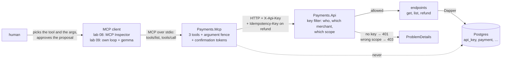
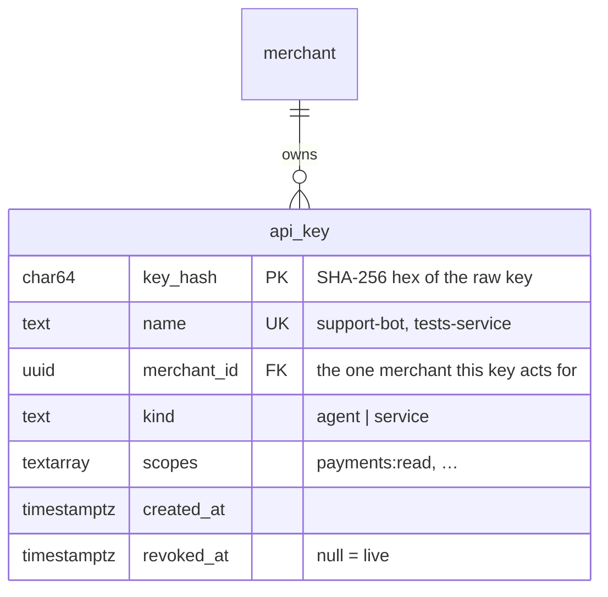
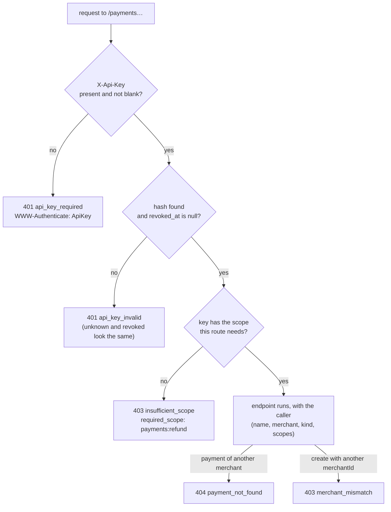
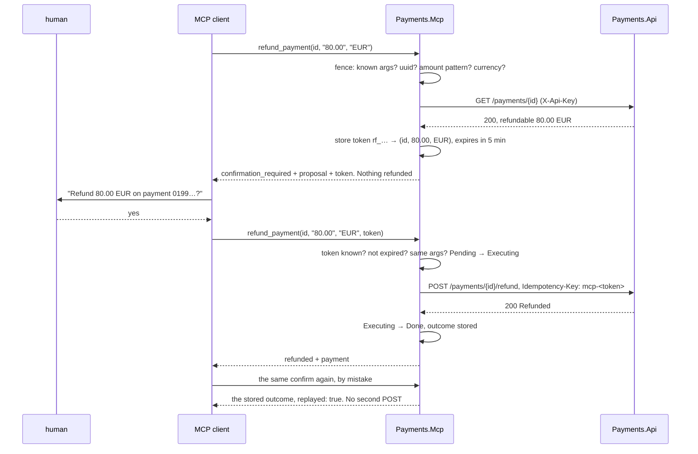
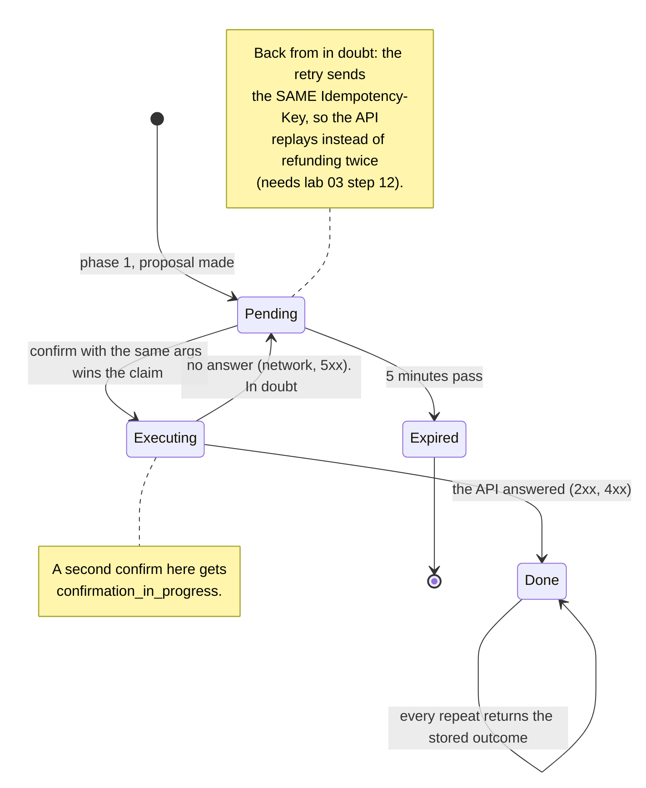

# Lab 08 — The C# MCP server (`Payments.Mcp`)

## What we solve
Let an AI agent use the payment API **safely**: it can look things up freely, but it can never move money by accident.

## Simple example
A support person types to an agent (in lab 09: our own loop on a local model): *"Customer says they were charged twice at M1 Hotel Sofia, refund the duplicate."*

- The agent calls `list_payments` → finds two captured payments of 80.00 EUR, a minute apart.
- It calls `refund_payment` for one of them → the server does **not** refund. It returns a proposal: *"Refund 80.00 EUR on payment 0199…? Token: rf_9x2…"*.
- The human says yes → the agent calls `refund_payment` again with the token → one refund happens. If the agent repeats the confirm by mistake → still one refund.
- If the agent sends `amount: "80,00 euro?"` → refused. Money tools never guess.
- If the agent's key may only read → the API says `403 insufficient_scope`. The agent tells the human it cannot refund.

**MCP** (Model Context Protocol) is the plug between an AI client (here the MCP Inspector, in lab 09 our own C# loop on a local gemma model) and your code. Your code is the **MCP server**. It lists **tools** — named actions with a typed input — and the client's model picks which one to call. **stdio** means the client starts the server as a child process and they talk over its standard input and output.

## Why it matters for a payment platform
This is the role's AI half: *"APIs structured to serve as reliable, deterministic tools within AI agent workflows."* Almost no other .NET candidate will have built one. It stays deliberately small: 3 tools, stdio, calls the API over HTTP.

## Everyday picture
- **The list on the kitchen door:** the blindfolded chef (model) can only ask for what is on the list. "Call the bank" → "Not on my list." No is an answer, not a crash.
- **The IKEA label:** a drawer labelled "stuff" vs "sharp knives — handles to the left — do not reach in blind". The tool description is the label, and it is real code.
- **"Shall I put it through?":** the chef shouts "bin the whole fish delivery". A gated tool writes a note and waits for the manager.
- **The hotel key card:** each card opens one hotel's doors, and only the doors printed on it. The agent's API key is that card: one merchant, a few scopes.

Code sketches: `docs/aperio/AGENT-READY-BACKEND.md` §3 (registry, one tool) and §7 (description is code).

## What this lab builds



The dotted line is the rule: `Payments.Mcp` has no database driver. It can do exactly what the API lets an API client do, nothing more.

## Aperio comparison (our backbone)
| Case | Aperio | Where (verified 2026-10-21) | What this lab adds |
|---|---|---|---|
| MCP server | ✅ Has (JS) | `mcp/index.js`, 14 tool modules in `mcp/tools/`, zod schemas | Same in C# with the official SDK |
| Two-phase confirm for writes | ✅ Has | `db_execute` propose → token (5 min, `CONFIRM_TTL_MS`, `lib/handlers/database/databaseHandlers.js` 113) → approve → re-validate → digest → claim (`lib/security/interruptService.js`) | Same for `refund_payment` |
| Refuse, don't repair, for destructive tools | ✅ Has | `lib/tools/executor.js` 705 | Same for money arguments |
| Dangerous tools off by default | ✅ Has | `APERIO_ENABLE_SHELL` (`mcp/tools/shell.js` 76) | — |
| Untrusted output fenced, writes tainted | ✅ Has | `lib/agent/tool-safety-middleware.js` | — |
| MCP server goes only through an API | ❌ Different by design | Aperio's tools use the store directly through `ctx` (Aperio *is* the backend) | `Payments.Mcp` calls the API over HTTP and never the DB |
| Per-agent identity and scopes, enforced | ⚠️ Partly | tool profiles (`lib/agent/tool-profiles.js`), `lib/security/agentPermissions.js`; but `id/reference/tech-debt.md` line 195 says AgentSpec filesystem/memory scoping is **not enforced at execution time** | API keys with scopes and one merchant, enforced by the API |
| Audit row per tool call | ⚠️ Partly | `agent_runs.tools` (JSONB per job run); tool-failure ledger `var/toolrepair/events.tsv` (`logToolCallFailure`, `lib/tools/schemaCheck.js` 177) | Nothing here. **Moved to lab 14** (2026-10-21) |

---

# The spec

Written 2026-10-21. Steps live in [`WORKBENCH.md`](WORKBENCH.md). Test names live in [`TEST-LIST.md`](TEST-LIST.md). Questions live in [`QA.md`](QA.md).

This lab has four files: `README.md`, `WORKBENCH.md`, `QA.md` and `TEST-LIST.md`. No scaffold.

## Decisions taken for this lab (2026-10-21)

| Question | Decision | Why |
|---|---|---|
| How big? | **API keys + scopes + the 3 tools.** The audit row moves to **lab 14**. Keyset paging stays in the inbox (`CF-022`). | Lab 02 grew too big and closed short. This lab keeps the part only it can teach: the tool boundary. |
| `list_payments` without paging? | **A capped list.** At most 20 rows, a fixed order, and `truncated: true` when more exist. | The model must never pull 10 000 rows into its context. A cursor plugs in later without breaking the shape — see "The capped list". |
| Who needs a key? | **Every `/payments` call.** No key is `401`. `/health` stays open. | One door, always locked. "No key means full access" is an open door for anyone who leaves the key out. |
| Where do keys live? | **The `api_key` table**, SHA-256 hash only. Two kinds: `agent` and `service`. | The real shape. A stolen database gives no usable key. The raw key lives only in the caller's environment. |
| Is a key tied to a merchant? | **Yes, one merchant per key.** | A support agent for one hotel must not see another hotel's payments. Another merchant's payment is `404`, so the key cannot even learn that it exists. |
| Where is the scope checked? | **In the API, in one endpoint filter.** Not in the MCP server. | The API is the only door to the money. A check in the MCP server is skipped by anyone who calls the API directly. |
| Where does the confirmation token live? | **In the MCP server's memory.** 5 minutes, single use, bound to the exact arguments. | One stdio client, one process. A restart loses open proposals, and the human proposes again. Lab 19 can move proposals into the API when a human approver arrives. |
| Who checks the tool arguments? | **The tool, every value.** Plus one call filter that refuses unknown argument names. | Verified 2026-10-21 on SDK 2.3.0: the schema shows `enum`, `minimum` and `maximum` to the model, but the SDK checks none of them, and it silently drops unknown arguments. The schema is a promise, not a check. |
| Which client for the demo? | **The MCP Inspector, by hand. No model, no cloud.** Lab 09 puts a local gemma on `llama-server` in front of the same tools. | A real payments company keeps its data away from external AI providers. The labs never send payment data to a cloud model (`docs/plan/PLAN.md` §8, 2026-10-21). |
| How does `list` read? | **A query, not a replay.** Dapper straight from the `payment` columns into a summary record. | CQRS-lite (`docs/plan/PLAN.md` "API shape"): reads do not need the state machine. 20 replays per list would be waste. |

## Scopes and keys

| Scope | Lets the caller | Given to |
|---|---|---|
| `payments:read` | `GET /payments/{id}`, `GET /payments` | agents, services |
| `payments:write` | `POST /payments`, `/authorise`, `/capture` | services only |
| `payments:refund` | `POST /payments/{id}/refund` | a refund agent, services |
| `payments:approve` | nothing yet (lab 19) | **never an agent.** The database refuses it with a `check` constraint |



The header is `X-Api-Key: <raw key>`. The API hashes it with `ApiKeyHash.Of(raw)` and looks the hash up. One static method, so the tests compute the same value from the same code — the same idea as `RequestHash.Of` in lab 03.

## The key check, on every `/payments` request



## The capped list

`GET /payments?status=Captured&limit=20` — the merchant comes from the key, never from the query.

| Rule | Value |
|---|---|
| Order | `created_at desc, id desc`. Total: two rows never tie, so two calls give the same order |
| `limit` | 1 to 20, default 20. Outside → `400 limit_out_of_range` |
| `status` | optional, one of the 8 `PaymentStatus` names, exact case. Anything else → `400 invalid_status` |
| `truncated` | `true` when more rows match than were returned. Read `limit + 1` rows to know |
| Item | `PaymentSummary`: `id`, `status`, `currency`, `authorisedAmount`, `capturedAmount`, `refundedAmount`, `createdAt`. No `allowedActions` — that needs the state machine. Call `get_payment` for it |
| Index | `payment_by_merchant_newest` from migration `0001` already serves it |

```json
{ "items": [ { "id": "0199…", "status": "Captured", "currency": "EUR", "authorisedAmount": 80.0, "capturedAmount": 80.0, "refundedAmount": 0.0, "createdAt": "…" } ],
  "truncated": false }
```

**Where the cursor plugs in later (`CF-022`).** The response gains one field, `nextCursor`, and `truncated` stays true exactly when `nextCursor` is not null. The tool gains one argument, `cursor`. Until then the argument fence refuses `cursor` as an unknown argument, so a model that invents one learns at once that there is none.

## The three tools

Every result is one JSON text block. Every failure has `isError: true` and the same shape: `{"error": "<code>", "message": "<one sentence>", "hint": "<what to do next>"}`.

| Tool | Arguments | Annotations | Calls | Returns |
|---|---|---|---|---|
| `get_payment` | `payment_id` (string, UUID, required) | read-only, idempotent | `GET /payments/{id}` | `{"result":"found","payment":{…}}` or `{"result":"not_found","payment_id":"…"}` — **not an error** |
| `list_payments` | `status` (string, enum, optional), `limit` (integer 1–20, default 20) | read-only, idempotent | `GET /payments?status=&limit=` | `{"result":"ok","items":[…],"truncated":false}` |
| `refund_payment` | `payment_id` (UUID), `amount` (string), `currency` (string), all required; `confirmation_token` (string, optional) | destructive | phase 1: `GET /payments/{id}`; phase 2: `POST /payments/{id}/refund` | phase 1: `{"result":"confirmation_required", "proposal", "confirmation_token", "expires_at", "next"}`; phase 2: `{"result":"refunded","payment":{…}}` |

**Annotations** are hints the server sends with each tool (`readOnlyHint`, `destructiveHint`, `idempotentHint`). A client may use them to decide when to ask the human. They are hints, never security: the token and the API's scope check are the security.

**Money arguments.** `amount` is a **string** in major units: `^\d{1,7}(\.\d{1,2})?$`, so `"80"`, `"80.5"` and `"80.00"` pass, and `"80,00"`, `"1e3"`, `"-5"`, `" 80"` and `"80.005"` are refused. `"0"` passes the pattern and is refused as not positive. `currency` is `^[A-Z]{3}$`. A JSON number would arrive as a binary float in some clients; a string arrives exactly as typed.

**Descriptions are code** (`AGENT-READY-BACKEND.md` §7). Each one says when to use the tool, when **not** to, the formats, and what comes back. `ToolListTests` snapshots them, so changing a sentence is a reviewed change, never a silent one.

## The refund, in two phases



## The life of a confirmation token



The token is `rf_` plus 16 random bytes in base64url, from `RandomNumberGenerator`. It is bound to the **parsed** values — `"80"` and `"80.00"` are the same proposal — and to nothing the model can change afterwards.

## The new error codes

From the API, all through `ProblemMapper`:

| Case | HTTP | `code` |
|---|---|---|
| No `X-Api-Key`, or a blank one | `401` + `WWW-Authenticate: ApiKey` | `api_key_required` |
| A key nobody knows, or a revoked one | `401` + `WWW-Authenticate: ApiKey` | `api_key_invalid` |
| A key without the route's scope | `403`, extension `required_scope` | `insufficient_scope` |
| `POST /payments` with another merchant's `merchantId` | `403` | `merchant_mismatch` |
| `limit` outside 1–20 | `400` | `limit_out_of_range` |
| `status` not a `PaymentStatus` name | `400` | `invalid_status` |

From the tools, as `isError: true` results:

| Code | When |
|---|---|
| `unknown_argument` | an argument name the tool does not declare, `cursor` included |
| `invalid_payment_id`, `invalid_amount`, `invalid_currency`, `invalid_status`, `invalid_limit` | a value that breaks its rule. Never repaired |
| `payment_not_found` | refund on a payment the key cannot see (a `get_payment` miss is a result, not an error) |
| `amount_exceeds_captured`, `currency_mismatch` | phase 1 pre-check, or the API's `422` in phase 2 |
| `token_unknown`, `token_expired`, `token_mismatch` | phase 2 with a token that does not fit. Nothing is posted |
| `confirmation_in_progress` | a second confirm while the first is still at the API |
| `refund_in_doubt` | the API did not answer. The hint says: the same confirm is safe to repeat |
| `insufficient_scope` | the API said `403`. The hint says: a human must do this |
| `tool_failed` | anything else. One sentence, no stack trace, no key |

## What you deliver

| # | Deliverable | Where |
|---|---|---|
| 1 | Migration `0003`: the `api_key` table | `db/postgres/0003_api_key.sql` |
| 2 | `ApiKeyHash`, `ApiCaller`, the key filter, `RequireScope` on every route, the merchant check | `src/Payments.Api` |
| 3 | `GET /payments`, the capped list, through a Dapper query | `src/Payments.Api` |
| 4 | The test helpers send a service key; `ApiKeyTests`, `ScopeTests`, `MerchantBindingTests`, `ListPaymentsTests` | `tests/Payments.Api.Tests` |
| 5 | `Payments.Mcp`: host with logs on stderr, `AddPaymentsMcp`, the API client, the argument fence, the token store, the 3 tools | `src/Payments.Mcp` |
| 6 | The in-process harness, the stub API, and the 7 MCP test groups | `tests/Payments.Mcp.Tests` |
| 7 | `McpEndToEndTests`: the MCP server against the real API and Postgres | `tests/Payments.Api.Tests` |
| 8 | The scenario run by hand in the MCP Inspector | your terminal and browser |

## Hard requirements

1. **`Payments.Mcp` never touches the database.** No Npgsql, no Dapper, no connection string in that project.
2. **Nothing but protocol on stdout.** Every log goes to stderr. One stray `Console.WriteLine` breaks the client.
3. **The API key lives in the MCP server's environment** (`PAYMENTS_API_KEY`). It is never a tool argument and never in a tool result. The server refuses to start without one.
4. **The API decides, the MCP server only asks.** The scope check and the merchant check are in `Payments.Api`. No `if (scope …)` in `Payments.Mcp`.
5. **Only hashes are stored.** No raw key in any table, log or test assertion message.
6. **No agent key ever has `payments:approve`.** The database refuses it, not only the code.
7. **Refuse, never repair.** A malformed money argument is an error with the expected format. No trimming, no comma-to-dot, no rounding.
8. **Phase 1 moves no money.** A proposal makes zero `POST` requests.
9. **One confirmed token, at most one refund.** A repeat replays the stored outcome. A lost answer retries with the same `Idempotency-Key`.
10. **A failure is a result, not a crash.** No exception text, stack trace or key reaches the model.
11. **The list is capped and totally ordered.** Never more than 20 rows, never an order that can tie.
12. **No real card data**, in any key, argument, result, log or test.

## Done when

- [ ] `dotnet test` is green: the domain tests, every API test, every MCP test.
- [ ] The MCP Inspector starts `Payments.Mcp`, lists the three tools, and runs the simple example above by hand: list, propose, your yes, one refund, a repeated confirm that refunds nothing. No model, no cloud. A local model drives the same tools in lab 09.
- [ ] A read-only agent key gets a proposal, then `insufficient_scope` on confirm, and the payment has no new `Refund` row.
- [ ] An agent key for merchant M2 cannot see M1's payments: `get_payment` says `not_found`, `list_payments` lists none of them.
- [ ] `list_payments` never returns more than 20 items, says `truncated: true` when there are more, and refuses an invented `cursor`.
- [ ] `insert … kind = 'agent', scopes = '{payments:approve}'` fails with `violates check constraint`.
- [ ] `grep -rn -i "npgsql\|dapper" src/Payments.Mcp` finds nothing.
- [ ] `grep -rn "Console.Write" src/Payments.Mcp` finds nothing.
- [ ] `dotnet run --project src/Payments.Db -- migrate --engine postgres` run twice: the second run finds nothing new.
- [ ] `QA.md` answered out loud, misses marked.
