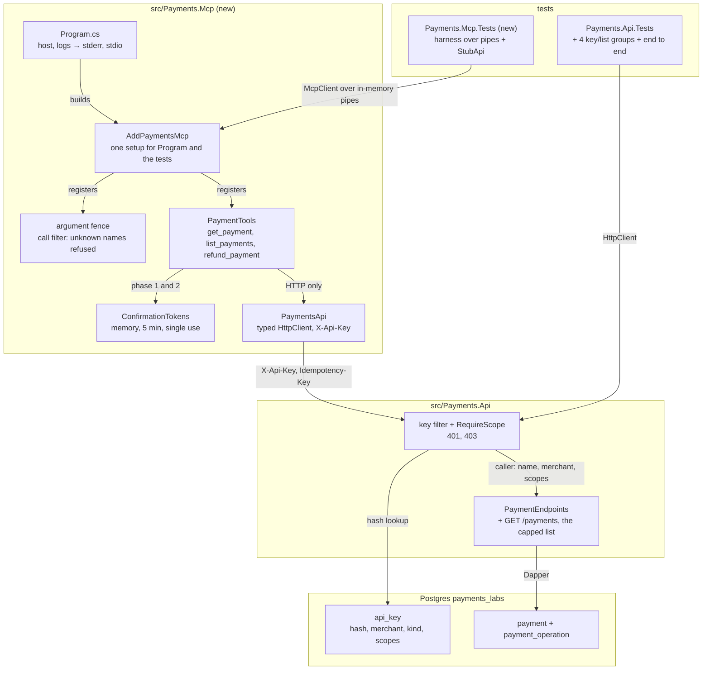

# Lab 08 — Workbench

Follow the steps in order. Each step says **Goal**, **Why**, **Do**, **Proof**, **Commit**.

Spec and Done-when list: [`README.md`](README.md). Test names you must write: [`TEST-LIST.md`](TEST-LIST.md). Interview questions: [`QA.md`](QA.md).

Started 2026-10-21.

**Size.** About 6 hours, in three parts. Steps 2–6 put a lock on the API: keys, scopes, one merchant per key, and the capped list (about 2 h). Steps 7–17 build `Payments.Mcp`, tests first (about 3 h). Steps 18–20 run it for real: against the real API, then by hand in the MCP Inspector (about 1 h). Steps 6, 13 and 17 are safe places to stop for the day.

**TDD shows in the history.** From step 3 on, a `test(lab-08)` step (red) comes before the `feat(lab-08)` step (green) it covers.

**You write all the code, tests included.** Every `// TODO:` block below is your work. The agent wrote the rules, the names and the proofs, not the bodies.

**Working next to lab 03.** Lab 03 is still open on `feature/lab-03-idempotency`. Both labs touch the same three files: `src/Payments.Api/PaymentEndpoints.cs`, `src/Payments.Api/ProblemMapper.cs` and `tests/Payments.Api.Tests/ApiFixture.cs`. Lab 03 adds the `Idempotency-Key` to the refund; this lab adds the `X-Api-Key` to every route. Each time lab 03 lands on `develop`, merge `develop` into this branch at once — small conflicts now beat one big one at the end. Keep both headers when you resolve. Only step 19 truly waits for lab 03.

**The SDK facts in this sheet were checked on 2026-10-21** against `ModelContextProtocol` 2.3.0 in a throwaway project. They are why some steps look stricter than you would expect.

## The target state



---

## Step 0 — Read the questions, not the answers

**Goal.** You have skimmed every question in `QA.md`. 5 minutes. No answers read.

**Why.** Knowing the questions first changes what you notice while you work, and attention is most of the learning. Reading the **answers** now would spoil the test — afterwards you would *recognise* them instead of *recalling* them, which feels like knowing and does not survive an interview. This is the lab that sets you apart from other .NET candidates, so the questions in section B ("Designing tools for agents") are the ones to hold in your head while you build. If one question makes no sense at all, read that single answer and move on.

**Do.**

```bash
grep -E '^\*\*Q' labs/08-mcp-server/QA.md
```

**Proof.** You can say, in one sentence, what this lab is going to be asked about.

**Commit.** Nothing to commit.

---

## Step 1 — Start the lab and start the database

**Goal.** You are on `feature/lab-08-mcp-server`, `develop` is level with `main`, and Postgres says `Up (healthy)`.

**Why.** First bring `develop` level with `main`, then branch. A merge commit that lives only on `main` is missing from a branch cut from a stale `develop`, and that gap shows up later as a conflict over work that is already done. If you already cut the branch to commit this lab's prep, the git lines below are done — the proof still has to hold. Postgres must be up before step 2, because the migration and every API proof in this lab is a real database.

**Do.**

```bash
git checkout develop
git merge main                       # the back-merge: develop must not be behind main
git log --oneline develop..main      # must print nothing
git checkout -b feature/lab-08-mcp-server

docker compose -f docker/docker-compose.yml --env-file .env up -d
docker compose -f docker/docker-compose.yml --env-file .env ps
dotnet test                          # the starting line
```

**Proof.**

```bash
git branch --show-current            # feature/lab-08-mcp-server
git log --oneline develop..main      # empty
```

`payments-postgres` says `Up (healthy)`. `dotnet test` is green. If it is not green now, fix that first — you cannot see your own red against someone else's.

**Commit.** Nothing to commit.

---

## Step 2 — The key table

**Goal.** `api_key` exists in `payments_labs`, the database refuses an agent key with `payments:approve`, and a second `migrate` finds nothing to do.

**Why.** The table comes before any code that reads it, the same order as lab 03. Only the SHA-256 **hash** of a key is stored: a copy of the database then gives nobody a key they can use, and that is the same reason passwords are hashed. A plain SHA-256 is enough here — unlike a password, a key is 24 random bytes, so there is nothing to guess, and a slow hash would only slow every request. The rule "an agent never approves" goes into a `check` constraint, because a rule only in C# is one forgotten `if` away from being broken, and a rule in the table holds for every writer, including a `psql` session at 2 a.m.

**Do.** Write `db/postgres/0003_api_key.sql`:

```sql
-- TODO: create table api_key
--   key_hash    char(64)    primary key            -- SHA-256 hex, lower case
--   name        text        not null unique        -- 'support-bot', 'tests-service'
--   merchant_id uuid        not null references merchant (id)
--   kind        text        not null check (kind in ('agent', 'service'))
--   scopes      text[]      not null
--   created_at  timestamptz not null default now()
--   revoked_at  timestamptz null                   -- null = live
--
-- TODO: constraint api_key_known_scopes check (
--         scopes <@ array['payments:read','payments:write','payments:refund','payments:approve'])
-- TODO: constraint api_key_agent_never_approves check (
--         kind <> 'agent' or not ('payments:approve' = any (scopes)))
```

```bash
dotnet run --project src/Payments.Db -- migrate --engine postgres
dotnet run --project src/Payments.Db -- migrate --engine postgres   # again
```

**Proof.**

```bash
docker exec payments-postgres psql -U labs -d payments_labs -c '\d api_key'
docker exec payments-postgres psql -U labs -d payments_labs -c \
  "insert into api_key (key_hash, name, merchant_id, kind, scopes) values (repeat('a',64), 'bad-bot', '11111111-1111-1111-1111-111111111111', 'agent', '{payments:read,payments:approve}');"
```

The insert must fail with `violates check constraint "api_key_agent_never_approves"`. **That error is the proof.** The same insert with `'service'` succeeds. Then clean up:

```bash
docker exec payments-postgres psql -U labs -d payments_labs -c "delete from api_key;"
```

**Commit.** Stage `db/postgres/0003_api_key.sql`.

```
feat(lab-08): add the api_key table
```

---

## Step 3 — The key tests, red

**Goal.** `ApiKeyTests`, `ScopeTests` and `MerchantBindingTests` are written and fail, because the API checks no key yet. Every older test is still green, and every helper already sends a key.

**Why.** The helpers learn to send a key **now**, while the server still ignores it. In step 4 the key becomes required, and if the helpers did not already send one, every lab 02 and lab 03 test would turn red for a reason that has nothing to do with what it checks. `ApiKeyHash.Of` comes first, because the tests and the API must compute the same hash from the same code — two copies of a hash function drift, and the drift looks like "key invalid". These three groups are the "no" answers. Writing them before the filter proves each one can fail, and a `401` test that has never been red has never been tested.

**Do.** In `src/Payments.Api/Auth/ApiKeyHash.cs`:

```csharp
// TODO: public static class ApiKeyHash
//   public static string Of(string rawKey)
//     => Convert.ToHexStringLower(SHA256.HashData(Encoding.UTF8.GetBytes(rawKey)));
```

In `tests/Payments.Api.Tests/ApiFixture.cs`, in `ApiTestBase`:

```csharp
// TODO: protected async Task<string> InsertKeyAsync(string[] scopes, string kind = "agent", Guid? merchant = null)
//   raw = a fresh random string (Guid.NewGuid().ToString("N") is fine for tests)
//   insert into api_key (key_hash, name, merchant_id, kind, scopes)
//     values (@Hash, @Name, @Merchant, @Kind, @Scopes)
//   Hash = ApiKeyHash.Of(raw). Name must be unique: use raw. Scopes: Dapper sends a string[] as text[].
//   return raw.
//
// TODO: protected async Task<HttpClient> ClientWith(string[] scopes, string kind = "agent", Guid? merchant = null)
//   a new Fixture.Factory.CreateClient() with DefaultRequestHeaders "X-Api-Key" = await InsertKeyAsync(…)
//
// TODO: InitializeAsync, after ResetAsync: the default Client gets a SERVICE key for SeededMerchant
//   with payments:read, payments:write and payments:refund. Respawn empties api_key before every
//   test, so this insert runs every time.
//
// TODO: protected static readonly Guid OtherMerchant = Guid.Parse("22222222-2222-2222-2222-222222222222");
```

Then write the three groups from `TEST-LIST.md`. Send the no-key and bad-key requests to `GET /payments/{id}` of a payment that exists, so a body check can never answer first.

**Proof.** `dotnet test tests/Payments.Api.Tests`: the 13 new tests fail — a `200` where a `401`, `403` or `404` was expected. `An_agent_key_with_approve_is_refused_by_the_database` and `Only_the_hash_is_stored` are green already: they test the table from step 2. Every older test is still green.

**Commit.** Stage `src/Payments.Api/Auth/ApiKeyHash.cs` and `tests/Payments.Api.Tests/`.

```
test(lab-08): add failing tests for api keys, scopes and merchant binding
```

---

## Step 4 — The key filter, green

**Goal.** Every `/payments` route needs a live key with the right scope, a key sees only its own merchant, and the 13 tests from step 3 are green.

**Why.** Two layers, on purpose. The group-level filter answers "who are you?" for every route, so a route someone adds later is locked by default. The per-route `RequireScope` answers "may you do this?", so the scope sits next to the route it guards and a reviewer sees both on one line. An endpoint filter, not ASP.NET Core's authentication handlers: those produce their own empty `401` and `403` bodies, and getting ProblemDetails with our `code` out of them takes more code than the filter itself (QA Q31). Another merchant's payment is a `404`, never a `403`: a `403` would tell the caller "this id exists, it is just not yours", and that is already a leak.

**Do.** In `src/Payments.Api/Auth/`:

```csharp
// TODO: public sealed record ApiCaller(string Name, Guid MerchantId, string Kind, IReadOnlySet<string> Scopes);
//
// TODO: IApiKeyStore / DapperApiKeyStore
//   Task<ApiCaller?> FindAsync(string keyHash, CancellationToken ct)
//   select … from api_key where key_hash = @KeyHash and revoked_at is null
//
// TODO: the key filter, added once on the group: group.AddEndpointFilter(…)
//   1. header missing or blank            -> 401 api_key_required
//   2. FindAsync(ApiKeyHash.Of(header)) null -> 401 api_key_invalid
//   3. http.Items[typeof(ApiCaller)] = caller; return await next(ctx);
//   Both 401s set the header WWW-Authenticate: ApiKey (the HTTP spec requires it on a 401).
//
// TODO: public static RouteHandlerBuilder RequireScope(this RouteHandlerBuilder b, string scope)
//   adds a filter: caller lacks scope -> 403 insufficient_scope, extension required_scope = scope.
//
// TODO: public static ApiCaller Caller(this HttpContext http) — reads it back out of Items.
```

In `src/Payments.Api/PaymentEndpoints.cs`:

```csharp
// TODO: one .RequireScope(…) at the end of every Map… call:
//   GET → payments:read; create, authorise, capture → payments:write; refund → payments:refund
// TODO: every endpoint that loads a payment:
//   loaded is null || loaded.MerchantId != http.Caller().MerchantId  ->  404 payment_not_found
// TODO: create: req.MerchantId != http.Caller().MerchantId  ->  403 merchant_mismatch
```

In `src/Payments.Api/ProblemMapper.cs`, the four new codes. In `Program.cs`, register `IApiKeyStore`.

**Proof.**

```bash
dotnet test
grep -c 'group.Map' src/Payments.Api/PaymentEndpoints.cs     # N routes
grep -c 'RequireScope' src/Payments.Api/PaymentEndpoints.cs  # the same N
```

Run the API and try it by hand. The commands are in [`docs/EVERYDAY-COMMANDS.md`](../../docs/EVERYDAY-COMMANDS.md) → "API keys (from lab 08)": make a service key, then `curl -i http://localhost:5080/payments/<id>` without it (`401`) and with it (`200`).

**Commit.** Stage `src/Payments.Api/`.

```
feat(lab-08): require an api key with a scope on every payments route
```

---

## Step 5 — The list tests, red

**Goal.** `ListPaymentsTests` is written and fails, because `GET /payments` does not exist.

**Why.** The model will read this list and decide which payment to refund, so the order is part of the contract, not a detail. `created_at desc` alone can tie — two payments made in the same millisecond — and a tie means the database may return them in a different order on the next call; the model then "finds" the same duplicate twice, or misses it. The test that catches the classic off-by-one is `Exactly_the_limit_is_not_truncated`: with exactly 20 rows there is nothing more, and a lazy `count >= limit` says there is. Arrange rows with SQL when the test needs exact timestamps, because rows made through the API all land in the same instant.

**Do.** Write `tests/Payments.Api.Tests/ListPaymentsTests.cs` from `TEST-LIST.md`.

```csharp
// TODO: a helper that inserts a payment row straight into Postgres with a chosen id,
//   status and created_at, for the order tests. Same shape as the lab 02 StoreTests arrange.
//   For two rows with one created_at, pick the ids by hand so you know which is "larger":
//   Postgres compares uuid values byte by byte, so 0000…02 sorts after 0000…01.
//
// TODO: read the body into a small record in the test project:
//   record ListBody(List<SummaryBody> Items, bool Truncated);
```

**Proof.** `dotnet test tests/Payments.Api.Tests --filter "ListPaymentsTests"`: all 8 fail, with `404` or `405`. Every older test is still green.

**Commit.** Stage `tests/Payments.Api.Tests/ListPaymentsTests.cs`.

```
test(lab-08): add failing tests for the capped payment list
```

---

## Step 6 — The capped list, green

**Goal.** `GET /payments` returns at most 20 of the caller's payments, newest first, with `truncated`, and the 8 list tests are green.

**Why.** This is a read, so it skips the domain: one Dapper query straight into a `PaymentSummary`, the CQRS-lite split from `docs/plan/PLAN.md`. Replaying 20 payments through the state machine to show 7 columns would be waste. Ask for `limit + 1` rows: if the extra row comes back, there is more, so `truncated` is true and you drop the extra one — no second `count(*)` query, and no race between the count and the page. The merchant comes from the key, never from the query string, so there is no parameter a caller can change to see someone else's payments.

**Do.**

```csharp
// TODO: Contracts.cs
//   public record PaymentSummary(Guid Id, string Status, string Currency, decimal AuthorisedAmount,
//                                decimal CapturedAmount, decimal RefundedAmount, DateTimeOffset CreatedAt);
//   public record PaymentList(IReadOnlyList<PaymentSummary> Items, bool Truncated);
//
// TODO: a query class (not IPaymentStore — that one is for writes and replays):
//   select id as "Id", status as "Status", … from payment
//    where merchant_id = @MerchantId and (@Status::text is null or status = @Status)
//    order by created_at desc, id desc
//    limit @Take                       -- Take = limit + 1
//
// TODO: group.MapGet("/", (string? status, int? limit, …) => …).RequireScope("payments:read")
//   limit ?? 20; outside 1..20 -> 400 limit_out_of_range
//   status not null and not Enum.TryParse<PaymentStatus>(status, ignoreCase: false, out _)
//     -> 400 invalid_status. Careful: TryParse also accepts "3" — check Enum.IsDefined too.
```

**Proof.** `dotnet test` green, all of it. Then by hand, with the service key from step 4:

```bash
curl -s 'http://localhost:5080/payments?limit=2' -H "X-Api-Key: $PAYMENTS_DEV_KEY" | python3 -m json.tool
curl -i 'http://localhost:5080/payments?limit=21' -H "X-Api-Key: $PAYMENTS_DEV_KEY"
```

**Commit.** Stage `src/Payments.Api/`.

```
feat(lab-08): add the capped payment list, newest first
```

**A safe place to stop for the day.** The API side is done, green and committed.

---

## Step 7 — The MCP project

**Goal.** `src/Payments.Mcp` and `tests/Payments.Mcp.Tests` exist in the solution, build, and the server writes nothing to stdout.

**Why.** With stdio, stdout **is** the protocol: the client reads every byte there as JSON-RPC. The .NET host's default console logger writes to stdout — checked on SDK 2.3.0, the very first "Application started" line lands there — so one setting moves every log to stderr before anything else is written. `AddPaymentsMcp` is one extension method that both `Program.cs` and the test harness call, so the tests run the same tools, filter and client the real server runs; only the transport differs. There is no `launchSettings.json` in this project, on purpose: with one, `dotnet run` prints `Using launch settings from …` on stdout before your code even starts.

**Do.**

```bash
dotnet new console -n Payments.Mcp -o src/Payments.Mcp
dotnet sln Payments.slnx add src/Payments.Mcp/Payments.Mcp.csproj
dotnet add src/Payments.Mcp package ModelContextProtocol --version 2.3.0
dotnet add src/Payments.Mcp package Microsoft.Extensions.Hosting --version 10.0.13
dotnet add src/Payments.Mcp package Microsoft.Extensions.Http --version 10.0.13
```

The test project is written by hand, from `tests/Payments.Api.Tests/Payments.Api.Tests.csproj`: the same `PropertyGroup`, `xunit.v3` 4.0.2, plus `Microsoft.Extensions.TimeProvider.Testing` 10.11.0, and a `ProjectReference` to `src/Payments.Mcp`. Add it with `dotnet sln Payments.slnx add tests/Payments.Mcp.Tests/Payments.Mcp.Tests.csproj`. Add `<InternalsVisibleTo Include="Payments.Mcp.Tests" />` to the MCP csproj.

```csharp
// TODO: src/Payments.Mcp/Program.cs
//   var builder = Host.CreateApplicationBuilder(args);
//   builder.Logging.AddConsole(o => o.LogToStandardErrorThreshold = LogLevel.Trace);
//   builder.Services.AddPaymentsMcp(builder.Configuration).WithStdioServerTransport();
//   await builder.Build().RunAsync();
//
// TODO: src/Payments.Mcp/McpSetup.cs
//   public static IMcpServerBuilder AddPaymentsMcp(this IServiceCollection services, IConfiguration config)
//     => services.AddMcpServer();        // tools, filter and client come in later steps
```

**Proof.**

```bash
dotnet build
dotnet run --project src/Payments.Mcp < /dev/null 2>/dev/null | wc -c   # 0: not one byte on stdout
dotnet run --project src/Payments.Mcp < /dev/null 2>&1 >/dev/null | head -3   # the logs, on stderr
ls src/Payments.Mcp/Properties 2>/dev/null                                 # nothing
```

With `< /dev/null` the client "hangs up" at once, so the server starts and stops. `0` is the proof. Remove the `AddConsole` line once, run again, and watch the count jump.

**Commit.** Stage `src/Payments.Mcp/`, `tests/Payments.Mcp.Tests/` and `Payments.slnx`.

```
build(mcp): add the Payments.Mcp server and its test project
```

---

## Step 8 — The harness and the tool list tests, red

**Goal.** `McpHarness` and `StubApi` exist, and `ToolListTests` fails because the server has no tools.

**Why.** The harness runs the real server in the test process and talks to it with the SDK's real client over two in-memory pipes, so every test goes through the protocol — the JSON schema, the filter and the error shape — exactly as the Inspector and lab 09's loop will. `StubApi` is an `HttpMessageHandler` that records every request and answers from a queue, so a test can say "the API answered `403`" without an API, and then check what went over the wire. `tools/list` is the contract an agent reads; a renamed field or a lost `required` is a breaking change for every agent using it, so it gets a test before any tool exists.

**Do.** In `tests/Payments.Mcp.Tests/`:

```csharp
// TODO: StubApi : HttpMessageHandler
//   public List<RecordedRequest> Requests { get; }      // method, path+query, headers, body as string
//   public void Enqueue(HttpStatusCode status, object? body)   // and an overload that throws
//   SendAsync: record, then dequeue. An empty queue -> fail loudly, not a default 200.
//
// TODO: McpHarness : IAsyncDisposable
//   var clientToServer = new Pipe(); var serverToClient = new Pipe();
//   var builder = Host.CreateApplicationBuilder();
//   builder.Configuration.AddInMemoryCollection(new Dictionary<string, string?> {
//       ["PAYMENTS_API_URL"] = "http://api.test/", ["PAYMENTS_API_KEY"] = "test-key-123" });
//   builder.Services.AddPaymentsMcp(builder.Configuration)
//       .WithStreamServerTransport(clientToServer.Reader.AsStream(), serverToClient.Writer.AsStream());
//   — and make the API client use the StubApi (step 13 adds the hook; for now nothing calls it)
//   host.StartAsync(); then
//   Client = await McpClient.CreateAsync(
//       new StreamClientTransport(clientToServer.Writer.AsStream(), serverToClient.Reader.AsStream()));
//   StreamClientTransport is in namespace ModelContextProtocol.Protocol, not .Client.
//   A FakeTimeProvider registered as TimeProvider, exposed as harness.Clock.
//
// TODO: helpers: CallAsync(tool, args) -> (bool IsError, JsonElement Body)
//   reads the single TextContentBlock and parses it as JSON.
```

Then write `ToolListTests` from `TEST-LIST.md`. `client.ListToolsAsync()` gives each tool's `Name`, `Description`, `JsonSchema` (a `JsonElement`) and `ProtocolTool.Annotations`.

**Proof.** `dotnet test tests/Payments.Mcp.Tests`: the 5 tests fail — no tools listed. Not a build error, not a hang. If it hangs, see the Traps table.

**Commit.** Stage `tests/Payments.Mcp.Tests/`.

```
test(lab-08): add the mcp harness and failing tests for the tool list
```

---

## Step 9 — The three tools, shape only

**Goal.** The three tools are listed with their final names, arguments, annotations and descriptions. Each body returns `tool_failed` for now. `ToolListTests` is green.

**Why.** The shape is the contract and the description is code (`AGENT-READY-BACKEND.md` §7), so they get written and reviewed on their own, before any logic can distract. Every argument is a `string` or an `int`, never a `Guid` or an enum — checked on SDK 2.3.0: a `Guid` argument given `"42"` makes the SDK answer "An error occurred invoking 'get_payment'", which teaches the model nothing; a `string` lets you answer `invalid_payment_id: a UUID is expected`. `[AllowedValues]` and `[Range]` still go on, because the SDK copies them into the schema as `enum`, `minimum` and `maximum`, and that is what the model reads. Write the descriptions for a model that has never seen this API: when to use it, when not to, the formats, what comes back.

**Do.** In `src/Payments.Mcp/PaymentTools.cs`:

```csharp
// TODO: [McpServerToolType] public sealed class PaymentTools(…)
//
// [McpServerTool(Name = "get_payment", ReadOnly = true, Idempotent = true), Description("…")]
//   payment_id: string, [Description("The payment id, a UUID such as 0199…")]
//
// [McpServerTool(Name = "list_payments", ReadOnly = true, Idempotent = true), Description("…")]
//   [AllowedValues("Created", "Authorised", …all 8…)] string? status = null
//   [Range(1, 20)] int limit = 20
//
// [McpServerTool(Name = "refund_payment", Destructive = true, ReadOnly = false), Description("…")]
//   string payment_id, string amount, string currency, string? confirmation_token = null
//
// Each returns CallToolResult. A helper builds the error shape:
//   new CallToolResult { IsError = true, Content = [new TextContentBlock { Text = json }] }
//   where json = {"error": code, "message": …, "hint": …}
//
// TODO: McpSetup: .WithTools<PaymentTools>()
```

The descriptions to aim for — make them yours, then copy them into `The_descriptions_match_the_snapshot`:

- `get_payment`: what it returns, that it needs the exact UUID, to use `list_payments` first if you only have a merchant or a date, that a miss is `result: not_found`, read-only.
- `list_payments`: newest first, at most 20, the merchant is fixed by the key, what `truncated` means and to narrow with `status` — and that there is no paging, so never invent a cursor.
- `refund_payment`: two phases in plain words; the amount format with an example; that the first call refunds nothing; that the second call needs the **same** arguments plus the token, and only after a human said yes.

**Proof.** `dotnet test tests/Payments.Mcp.Tests --filter "ToolListTests"` green.

**Commit.** Stage `src/Payments.Mcp/`.

```
feat(lab-08): add the three tool shapes and their descriptions
```

---

## Step 10 — The fence tests, red

**Goal.** `ArgumentFenceTests` is written and fails: bad arguments reach the tool bodies, which answer `tool_failed`.

**Why.** Checked on SDK 2.3.0: the SDK silently drops an argument the tool does not declare, and it does not enforce `enum`, `minimum` or `maximum` from its own schema — `status: "nope"` and `limit: 500` went straight through to the method. So the schema is a promise to the model, not a check, and these tests prove the server keeps the promise anyway. A dropped argument is the dangerous one: the model sends `merchant: "M1 Hotel"`, the tool ignores it, lists everybody's payments, and the model believes the list is filtered. Every test also asserts the stub saw zero requests, because a refused call that still reached the API is not refused.

**Do.** Write `tests/Payments.Mcp.Tests/ArgumentFenceTests.cs` from `TEST-LIST.md`. For `An_unknown_tool_…`-style surprises, note in your Notes what the client throws — an unknown **tool** name is a protocol error (`McpProtocolException`), not a tool result. That is the SDK's job and not part of the fence.

**Proof.** `dotnet test tests/Payments.Mcp.Tests --filter "ArgumentFenceTests"`: they fail, with `tool_failed` where a precise code was expected.

**Commit.** Stage `tests/Payments.Mcp.Tests/ArgumentFenceTests.cs`.

```
test(lab-08): add failing tests for the argument fence
```

---

## Step 11 — The fence, green

**Goal.** Unknown argument names are refused for every tool by one filter, every value is checked by its tool, and `ArgumentFenceTests` is green.

**Why.** Unknown names are the same check for every tool, so they go in one call filter that reads the tool's own schema: add a tool tomorrow and it is fenced for free, with no list of names to keep in step. Value rules are different per tool, so they live in the tool, in small static parse methods that return either the value or the error — the same `Result` idea as lab 01, and no exceptions for control flow. The rule is refuse, never repair: no `Trim()`, no comma to dot, no rounding. A repaired amount is a guess, and a guess on a refund is money sent to the wrong place.

**Do.**

```csharp
// TODO: McpSetup: .WithRequestFilters(f => f.AddCallToolFilter(next => async (ctx, ct) => { … }))
//   var tool  = ctx.MatchedPrimitive as McpServerTool;
//   var known = tool.ProtocolTool.InputSchema.GetProperty("properties").EnumerateObject().Select(p => p.Name)
//   var sent  = ctx.Params?.Arguments?.Keys ?? []
//   any sent name not in known -> the error result unknown_argument, naming every one; else await next(ctx, ct)
//
// TODO: src/Payments.Mcp/ToolArguments.cs — static parsers, each (value | error):
//   PaymentId(string)  -> Guid.TryParseExact(s, "D", …)      else invalid_payment_id
//   Amount(string)     -> Regex ^\d{1,7}(\.\d{1,2})?$, then decimal.Parse(s, CultureInfo.InvariantCulture),
//                         then > 0                            else invalid_amount
//   Currency(string)   -> Regex ^[A-Z]{3}$                     else invalid_currency
//   Status(string?)    -> null, or one of the 8 names, exact  else invalid_status
//   Limit(int)         -> 1..20                               else invalid_limit
//   Each message says the expected format, with an example: "amount must look like 80.00".
```

**Proof.** `dotnet test tests/Payments.Mcp.Tests` green.

```bash
grep -n "Trim()\|Replace(\",\"" src/Payments.Mcp/*.cs     # nothing: refuse, never repair
```

**Commit.** Stage `src/Payments.Mcp/`.

```
feat(lab-08): fence the tool arguments, refuse and never repair
```

---

## Step 12 — The read tool tests, red

**Goal.** `ApiKeyHeaderTests` and `ReadToolTests` are written and fail, because the tools do not call the API yet.

**Why.** These pin the two promises of the read side. The key is the MCP server's, from its environment, on every request, and never visible to the model — not as an argument, not in a result, not in an error that echoes an API body. And a miss is a fact, not a failure: `get_payment` on an unknown id is `result: not_found`, so the model reads it and moves on, while a `403` is a real error with a hint that a human must act. The stub makes both sides visible at once: what the tool sent, and what the model got back.

**Do.** Write the two groups from `TEST-LIST.md`. For `The_server_refuses_to_start_without_a_key`, give the harness a way to start with `PAYMENTS_API_KEY` set to `""`. An in-memory value wins over a real environment variable, so the test still holds if your shell has the key set.

**Proof.** `dotnet test tests/Payments.Mcp.Tests`: the 9 new tests fail. The 12 older ones are still green.

**Commit.** Stage `tests/Payments.Mcp.Tests/`.

```
test(lab-08): add failing tests for the read tools and the api key header
```

---

## Step 13 — The API client and the read tools, green

**Goal.** `PaymentsApi` calls the API with the key, `get_payment` and `list_payments` work against the stub, and the server will not start without a key.

**Why.** A typed `HttpClient` from `AddHttpClient<PaymentsApi>` gets its base address and the `X-Api-Key` header once, in setup, so no tool can forget the key or send the wrong one. The client returns a small result type — the body, or `(status, code, detail)` from the ProblemDetails — and the tools map that to the model's answer; an `HttpResponseMessage` never leaks into a tool. Options validation with `ValidateOnStart` makes a missing key fail at start-up, with the variable named, instead of as a `401` on the first tool call twenty minutes into a conversation.

**Do.**

```csharp
// TODO: PaymentsApiOptions { Url, ApiKey }, bound from PAYMENTS_API_URL and PAYMENTS_API_KEY.
//   services.AddOptions<PaymentsApiOptions>()…Validate(o => !string.IsNullOrWhiteSpace(o.ApiKey),
//       "PAYMENTS_API_KEY is not set.").ValidateOnStart();
//
// TODO: services.AddHttpClient<PaymentsApi>((sp, http) => { BaseAddress = …; DefaultRequestHeaders "X-Api-Key" = … })
//   The harness adds .ConfigurePrimaryHttpMessageHandler(() => stub). Give AddPaymentsMcp an optional
//   Action<IHttpClientBuilder> so the harness and step 18 can plug in their own handler.
//
// TODO: PaymentsApi
//   GetAsync(Guid id), ListAsync(string? status, int limit), RefundAsync(Guid id, decimal amount,
//   string currency, string idempotencyKey) — each returns ApiResult<T>.
//   Read the problem's "code" the same way ApiTestBase.ErrorCodeAsync does.
//   A 5xx or an HttpRequestException -> a failure the tool turns into tool_failed (refund: refund_in_doubt).
//
// TODO: get_payment and list_payments: parse (step 11), call, map:
//   200 -> result; 404 on get -> result not_found; 403 -> insufficient_scope; anything else -> tool_failed
//   Never put the API's body text into the result: it may echo things the model must not see.
```

**Proof.** `dotnet test tests/Payments.Mcp.Tests` green.

**Commit.** Stage `src/Payments.Mcp/` and `tests/Payments.Mcp.Tests/` (the harness hook).

```
feat(lab-08): add the api client and the two read tools
```

**A safe place to stop for the day.** An agent could already look things up. Nothing can move money yet.

---

## Step 14 — The token tests, red

**Goal.** `ConfirmationTokenTests` is written and fails, against an empty `ConfirmationTokens` class.

**Why.** The token store is the second gate. A good client asks the human before a destructive call, but a client that skips its own question still cannot refund without a token the server issued for exactly those arguments. It is a small concurrent state machine — `Pending → Executing → Done`, plus `Expired` — and lab 03 taught that the race lives in the claim, so `Two_claims_at_once_one_wins` is the test that matters most. `FakeTimeProvider` makes "5 minutes later" a line of code instead of a 5-minute test.

**Do.** Write `tests/Payments.Mcp.Tests/ConfirmationTokenTests.cs` from `TEST-LIST.md`, against this shape:

```csharp
// TODO: src/Payments.Mcp/ConfirmationTokens.cs — methods throw NotImplementedException for now
//   public sealed record RefundArgs(Guid PaymentId, decimal Amount, string Currency);
//   public (string Token, DateTimeOffset ExpiresAt) Propose(RefundArgs args)
//   public Redeem Claim(string token, RefundArgs args)
//   public void Complete(string token, string outcomeJson)
//   public void Release(string token)                      // in doubt: back to Pending
//
//   public abstract record Redeem { Won, Unknown, Expired, Mismatch, InProgress, AlreadyDone(string OutcomeJson) }
//   The same closed-set idea as lab 03's Claim.
```

**Proof.** `dotnet test tests/Payments.Mcp.Tests --filter "ConfirmationTokenTests"`: 7 fail with `NotImplementedException`.

**Commit.** Stage `src/Payments.Mcp/ConfirmationTokens.cs` (the empty one) and `tests/Payments.Mcp.Tests/`.

```
test(lab-08): add failing tests for the confirmation tokens
```

---

## Step 15 — The token store, green

**Goal.** `ConfirmationTokens` issues, expires and claims tokens safely, and the 7 tests are green.

**Why.** A `ConcurrentDictionary` alone does not make a claim safe: "read, check `Pending`, write `Executing`" is the check-then-act race from lab 03, in memory. Hold one `lock` around the read and the write, or use `TryUpdate` with the old value — either way the check and the change are one step. The token comes from `RandomNumberGenerator`, never `Random` or a `Guid`: it is a capability, and a guessable capability is no gate. A mismatch does **not** burn the token, so a model that sent `79.99` by mistake can still confirm the `80.00` the human approved.

**Do.**

```csharp
// TODO: Propose: token = "rf_" + Base64Url(RandomNumberGenerator.GetBytes(16)); ExpiresAt = clock.GetUtcNow() + 5 min
// TODO: Claim, under one lock:
//   no entry -> Unknown;  Done -> AlreadyDone(outcome);  now >= ExpiresAt -> Expired
//   args differ -> Mismatch (state unchanged);  Executing -> InProgress;  Pending -> Executing, Won
//   The args compare as values: RefundArgs is a record, so == compares 80.00m and 80m as equal.
// TODO: Complete -> Done with the outcome. Release -> back to Pending (only from Executing).
// TODO: register as a singleton. One store per server process; a scoped one forgets every token.
```

**Proof.** `dotnet test tests/Payments.Mcp.Tests` green. Run `--filter "Two_claims_at_once_one_wins"` five times; it must pass every time.

**Commit.** Stage `src/Payments.Mcp/`.

```
feat(lab-08): add the confirmation token store
```

---

## Step 16 — The refund tests, red

**Goal.** `RefundProposeTests` and `RefundConfirmTests` are written and fail, because `refund_payment` still answers `tool_failed`.

**Why.** These are the tests a payments interviewer cares about, because each one is a way an agent loses money. The proposal must post nothing. A repeated confirm must replay, not refund again. A lost answer is the hardest case: the refund may or may not have happened, so the tool must not guess — it says `refund_in_doubt`, and the retry sends the **same** `Idempotency-Key`, so the API (lab 03) can tell "a retry" from "a second refund". Holding a stub request open is how you test "two confirms at once" without a sleep.

**Do.** Write both groups from `TEST-LIST.md`. For `Two_confirms_at_once_post_once`, give `StubApi` an answer that waits on a `TaskCompletionSource` you complete after the second call returned.

**Proof.** `dotnet test tests/Payments.Mcp.Tests`: the 14 new tests fail. Every older test is still green.

**Commit.** Stage `tests/Payments.Mcp.Tests/`.

```
test(lab-08): add failing tests for the two-phase refund
```

---

## Step 17 — The refund tool, green

**Goal.** `refund_payment` proposes, confirms once, replays repeats and handles a lost answer, and every MCP test is green.

**Why.** Phase 1 reads the payment so the proposal is concrete — the amount, the currency and what is left to refund — and refuses early what the API would refuse anyway, without issuing a token for an impossible refund. Phase 2 trusts nothing from phase 1 except the token: the API checks the state, the amount and the scope again at the moment of the refund, because the payment may have changed in the five minutes the human took. The `Idempotency-Key` is derived from the token, `mcp-<token>`, so one approval maps to one key, whatever the network does.

**Do.**

```csharp
// TODO: refund_payment, no token (phase 1):
//   parse all three (step 11) -> GET the payment -> 404: payment_not_found (an ERROR here)
//   currency differs -> currency_mismatch; amount > refundableRemaining -> amount_exceeds_captured, say the max
//   Propose(args) -> { result: "confirmation_required", proposal: "Refund 80.00 EUR on payment …",
//                      confirmation_token, expires_at, next: "Show the proposal to the human. Only after
//                      they say yes, call refund_payment again with the same arguments and this token." }
//
// TODO: with a token (phase 2): parse all three again, then switch on Claim(token, args):
//   Unknown/Expired/Mismatch -> token_unknown / token_expired / token_mismatch
//   InProgress -> confirmation_in_progress; AlreadyDone(o) -> o with replayed: true
//   Won -> RefundAsync(…, "mcp-" + token):
//     200 -> Complete(token, refunded result) and return it
//     4xx -> Complete(token, the error) and return it: a final answer is stored, like lab 03
//     5xx or no answer -> Release(token), return refund_in_doubt with the hint "the same call is safe to repeat"
```

**Proof.** `dotnet test` green, all of it.

```bash
grep -rn -i "npgsql\|dapper\|ConnectionString" src/Payments.Mcp      # nothing
grep -rn "Console.Write" src/Payments.Mcp                            # nothing
```

**Commit.** Stage `src/Payments.Mcp/`.

```
feat(lab-08): add the two-phase refund tool
```

**A safe place to stop for the day.** The MCP server is complete against the stub.

---

## Step 18 — End to end, against the real API

**Goal.** `McpEndToEndTests` (the first three) run the MCP server against the real API and the real throwaway Postgres, and are green.

**Why.** The stub proves the MCP server keeps its promises. It cannot prove that the API it believes in is the API that exists: a wrong JSON property name, a route typo, a scope the API does not know. Here the harness's `HttpClient` points at `Fixture.Factory.Server.CreateHandler()`, so the whole chain runs in one process — tool, filter, client, key filter, endpoint, Dapper, Postgres — and the proof is a row count in `payment_operation`, not a stub's say-so. These go green at once if steps 2–17 are right. Make each fail once by hand, for example by giving the agent key the wrong merchant.

**Do.** Add a `ProjectReference` from `tests/Payments.Api.Tests` to `src/Payments.Mcp`. Write the first three `McpEndToEndTests` from `TEST-LIST.md`.

```csharp
// TODO: in the API test project, a small harness that calls AddPaymentsMcp with
//   PAYMENTS_API_URL = Fixture.Factory.Server.BaseAddress, PAYMENTS_API_KEY = await InsertKeyAsync(…),
//   and the http-client hook from step 13: b => b.ConfigurePrimaryHttpMessageHandler(() => Fixture.Factory.Server.CreateHandler())
//   Same pipes and McpClient as McpHarness. Do not copy McpHarness wholesale — note the duplication in Notes.
```

**Proof.** `dotnet test tests/Payments.Api.Tests --filter "McpEndToEndTests"`: 3 green, each seen red once.

**Commit.** Stage `tests/Payments.Api.Tests/`.

```
test(lab-08): run the mcp tools end to end against the real api
```

---

## Step 19 — After lab 03 lands: the dropped answer

**Goal.** Lab 03 is merged into this branch, and `A_dropped_answer_still_refunds_once` is green.

**Why.** This is the one test that needs lab 03's step 12: the API must replay a refund sent twice with the same `Idempotency-Key`. Without it, the retry after a lost answer refunds a second time, and the test shows exactly that — two `Refund` rows. Run it **before** the merge too, if you like, and watch it fail for that reason: it is the clearest picture of why lab 03 exists. A `DelegatingHandler` that forwards the request and then throws is how you lose an answer on purpose, after the work was done.

**Do.** Only once `feature/lab-03-idempotency` is merged into `develop`:

```bash
git checkout develop && git pull --ff-only 2>/dev/null; git checkout feature/lab-08-mcp-server
git merge develop                   # resolve: keep BOTH headers in ApiFixture.cs and both checks in PaymentEndpoints.cs
dotnet test                         # everything from both labs, green
```

```csharp
// TODO: DropFirstAnswer : DelegatingHandler
//   first POST to …/refund: await base.SendAsync(…) (the API does the refund), then throw HttpRequestException
//   every later call: pass through
```

**Proof.** `dotnet test --filter "A_dropped_answer_still_refunds_once"` green, and the test counts exactly one `Refund` row.

**Commit.** The merge commit is the record of the merge. Then stage `tests/Payments.Api.Tests/`:

```
test(lab-08): prove a dropped refund answer still refunds once
```

---

## Step 20 — The MCP Inspector, by hand

**Goal.** The MCP Inspector starts `Payments.Mcp`, lists the three tools, and you run the simple example from `README.md` by hand: list, propose, your yes, one refund, a repeat that refunds nothing. Then the read-only key fails to refund.

**Why.** This is the demo you will describe in the interview, with you in the model's seat: you see exactly what a model sees — the descriptions, the schema, every result and every error — and nothing goes to a cloud provider. A real payments company will not send payment data to an external model, so the labs never do (`docs/plan/PLAN.md` §8, 2026-10-21); lab 09 puts a local gemma on `llama-server` in front of these same tools. The Inspector starts the server itself, so it must run the built `.dll`, not `dotnet run` — `dotnet run` can print a line on stdout before your `Main` runs. The key goes in with `-e`, from `.env`, so it never lands in a file in git.

**Do.** Make two agent keys for M1 — one with `payments:read,payments:refund`, one with `payments:read` only — with the commands in [`docs/EVERYDAY-COMMANDS.md`](../../docs/EVERYDAY-COMMANDS.md) → "API keys (from lab 08)". Put them in `.env` as `PAYMENTS_AGENT_KEY` and `PAYMENTS_READONLY_AGENT_KEY`. Make two captured 80.00 EUR payments with the service key. Then:

```bash
dotnet run --project src/Payments.Api --urls http://localhost:5080      # terminal 1, keep it running
dotnet build src/Payments.Mcp                                          # terminal 2
set -a; source .env; set +a                                            # the keys, into this shell only
npx @modelcontextprotocol/inspector \
  -e PAYMENTS_API_URL=http://localhost:5080 \
  -e PAYMENTS_API_KEY="$PAYMENTS_AGENT_KEY" \
  dotnet "$PWD/src/Payments.Mcp/bin/Debug/net10.0/Payments.Mcp.dll"
```

Every command in this step — the key check, the captured payment, the shell client, the hang checklist — is in [`docs/EVERYDAY-COMMANDS.md`](../../docs/EVERYDAY-COMMANDS.md) → "The MCP server (from lab 08)". Check the agent key answers `200` **before** you start the Inspector: the server turns every API failure into the same `tool_failed` message, so a key that is in `.env` but not in the database looks like a broken tool.

The first run downloads the Inspector from npm. It opens a page in the browser. Click **Connect**, then **Tools → List Tools**. Call `list_payments` with `status: Captured`. Call `refund_payment` on one payment without a token, read the proposal, then call it again with the token. Call it a third time. Try `amount: "80,00"` and an extra argument `cursor`. Then stop the Inspector, start it again with `PAYMENTS_READONLY_AGENT_KEY`, and try the refund.

**Proof.**

```bash
docker exec payments-postgres psql -U labs -d payments_labs \
  -c "select payment_id, kind, amount from payment_operation where kind = 'Refund';"
```

Exactly one row. The third call said `replayed: true`. The read-only key got `insufficient_scope`. Write down in Notes every result that would confuse a model — that is a description or a hint to improve, and lab 09's gemma will find the rest.

**Commit.** Nothing to commit. If you improved a description, that is a `feat(lab-08)` commit with its snapshot test.

---

## Step 21 — The Done-when list, by hand

**Goal.** Every line of `README.md` → "Done when" is ticked.

**Why.** The tests ran against throwaway containers that are gone now. The greps check the hard requirements no test can see: a database driver sneaking into `Payments.Mcp`, a `Console.Write` that would break stdio, a scope check written in the wrong project. Reading the real `api_key` table is also the moment you see that it holds no raw key — only hashes, names and scopes.

**Do.**

```bash
dotnet test
grep -rn -i "npgsql\|dapper" src/Payments.Mcp
grep -rn "Console.Write" src/Payments.Mcp
grep -rn "payments:refund\|payments:read" src/Payments.Mcp              # descriptions only, no if
docker exec payments-postgres psql -U labs -d payments_labs -c "select name, kind, scopes, left(key_hash, 12) from api_key;"
dotnet run --project src/Payments.Db -- migrate --engine postgres       # nothing new
```

**Proof.** Every Done-when box ticked. The first three greps find nothing (the third may find words in a description, never in an `if`).

**Commit.** Nothing to commit.

---

## Step 22 — Say the answers out loud

**Goal.** You answered every question in `QA.md` out loud, then checked.

**Why.** This is the test the lab was for. Speaking the answer uses a different path than reading it, and it is the path an interview uses. Mark every question you got wrong or said badly — those marked ones are a 5-minute warm-up at the start of your next session, and that repeat is where most of the gain sits. Section E is about audit, which moved to lab 14: say what you would log and why it is not built yet.

**Do.**

1. Cover the file. Work down the question list.
2. Say the answer out loud. Then read the real answer.
3. Mark the misses.
4. Answer `Q-APERIO` last: "Have you solved this before?"

**Proof.** You answered every question without looking. The marked list is short.

**Commit.** Nothing to commit.

---

## Step 23 — Close the lab

**Goal.** Lab 08 is on `develop`, `main` carries the `lab-08` tag, `develop` is level with `main`, the feature branch is gone, and `docs/PROGRESS.md` says `Done`.

**Why.** The merge and the tag are the record that a lab finished. `--no-ff` keeps a merge commit even when a fast-forward is possible, so the history shows the lab as one unit of work. Before that, the lab's notes move into the inbox, because a finding written in a workbench file is lost the moment the next lab starts. `docs/plan/PLAN.md` §5 cuts `release/x.y` once, after this lab — that is its own step, after this one, and it wants the CI gate (`CF-006`) in place first.

**Do.** Run the full Done-when list in `README.md` first. Then move every line from **Notes while you work** below into `docs/plan/CARRY-FORWARD.md` as a `CF-NNN` row with the date, and groom the inbox. Set the lab 08 row in `docs/PROGRESS.md` to `Done` with the tag. Then:

Git opens an editor for each `--no-ff` merge message; `--no-edit` keeps git's own default and opens nothing. If vim is on your screen anyway, `:wq` then **Enter** saves and finishes, `:q!` then **Enter** cancels. See [`docs/EVERYDAY-COMMANDS.md`](../../docs/EVERYDAY-COMMANDS.md).

```bash
git status --short      # must be empty
git checkout develop
git merge --no-ff --no-edit feature/lab-08-mcp-server
git checkout main
git merge --no-ff --no-edit develop
git tag lab-08
git checkout develop
git merge main          # the back-merge. Without it develop is behind main
git branch -d feature/lab-08-mcp-server
```

The small `-d` deletes the branch only if its work is really merged. Never use the capital `-D` here: it skips that check.

Stop the database when you are done for the day. `stop` keeps the data; `down -v` destroys it.

```bash
docker compose -f docker/docker-compose.yml --env-file .env stop
```

**Proof.**

```bash
git log --oneline --graph --all | head -30
git tag                           # … lab-08
git branch                        # develop and main only
git log --oneline develop..main   # empty: develop is level with main
```

The history must show each `test(lab-08)` commit before the `feat(lab-08)` commit it covers.

**Commit.** The grooming and the board are one commit, on the feature branch, **before** the merges. Stage `docs/plan/CARRY-FORWARD.md` and `docs/PROGRESS.md`:

```
docs(plan): groom the inbox and close lab 08 on the board
```

The merge commits are the record of the rest of this step.

---

## Traps

| Trap | What happens | Fix |
|---|---|---|
| The default console logger | "Application started" lands on stdout, and the client fails to parse the first message — often as a vague "connection closed" | `builder.Logging.AddConsole(o => o.LogToStandardErrorThreshold = LogLevel.Trace)` before anything else |
| Logging at `Information` on stdio | The client is free to ignore stderr. The MCP Inspector does. The pipe fills after a few tool calls, the next log line blocks, and the server freezes mid-call: every call after it is "Request timed out after 1m00s" | `builder.Logging.SetMinimumLevel(LogLevel.Warning)`. Four `HttpClient` info lines per call fill a pipe; warnings cannot |
| A `Console.WriteLine` "just to debug" | Same as above, but only on the code path you were debugging | `Console.Error.WriteLine`, or a logger. Step 17's grep finds it |
| The Inspector starts `dotnet run` | `Using launch settings from …` goes to stdout first, whenever a `launchSettings.json` exists | Point the Inspector at the built `.dll`. Keep `Properties/` out of `src/Payments.Mcp` |
| A `Guid` or an enum as a tool parameter | A bad value gives the model "An error occurred invoking 'get_payment'" and nothing else | Take `string`, parse it yourself, return `invalid_payment_id` with the expected format |
| Trusting the schema | `[AllowedValues]` and `[Range]` show in the schema, and the SDK checks neither — `limit: 500` reaches your method | Check every value in the tool. The schema is a promise, the parse is the check |
| No fence on unknown names | The model sends `merchant: "M1 Hotel"`, the SDK drops it silently, and the model believes its list is filtered | The call filter from step 11. Every tool, no list to keep in step |
| `amount` as a `decimal` or `double` parameter | `80.1` can arrive as `80.09999…` from a client that uses floats, and the schema invites any number | `string` with a pattern, parsed with `CultureInfo.InvariantCulture` |
| `decimal.Parse` without a culture | On a machine set to Bulgarian, `"80.00"` fails and `"80,00"` passes — the exact opposite of the rule | Always `CultureInfo.InvariantCulture`, after the pattern check |
| `Enum.TryParse` for `status` | `"3"` and `"captured"` with `ignoreCase` both parse | `ignoreCase: false`, and `Enum.IsDefined` on the result |
| A `403` for another merchant's payment | The caller learns the id exists | `404 payment_not_found`, the same as a missing id |
| The scope check in `Payments.Mcp` | It works, until someone calls the API directly with that key | The API decides. The MCP server only maps the `403` to a hint |
| `401` without `WWW-Authenticate` | Works in every test; strict clients and proxies treat it as a broken response | Set `WWW-Authenticate: ApiKey` on both `401`s |
| A new route without `RequireScope` | The group filter still demands a key, but any live key may call it | Step 4's two greps must print the same number |
| `count >= limit` for `truncated` | Exactly 20 rows says "there are more" and the model looks for a page that does not exist | Fetch `limit + 1`; truncated means the extra row came back |
| `order by created_at desc` alone | Two payments in one millisecond swap places between calls | `created_at desc, id desc` |
| A scoped `ConfirmationTokens` | Every tool call gets a fresh, empty store, and every confirm is `token_unknown` | `AddSingleton` |
| Check-then-set on the token | Two confirms both see `Pending`, both post: two refunds | One `lock` around the read and the write, and `Two_claims_at_once_one_wins` run five times |
| `Random` or `Guid` for the token | Predictable, so not a gate | `RandomNumberGenerator.GetBytes(16)` |
| Storing `refund_in_doubt` as the final outcome | The human's approved refund can never be retried, though it may not have happened | `Release` the token on no answer or a `5xx`; store only a real API answer |
| The harness hangs | One side waits on a pipe the other never writes; usually the host was not started, or the client was created before it | `await host.StartAsync()` before `McpClient.CreateAsync`, and a test timeout |
| The "no key" test passes the key anyway | `Host.CreateApplicationBuilder` reads your real environment, and your shell has `PAYMENTS_API_KEY` | Set the key to `""` in the in-memory config: the last source wins |
| A real key in a committed file | The key is in git forever | `-e` on the command line, from `.env`. The raw key lives in `.env` only, and `.env` is git-ignored |
| Merging lab 03 late | One big conflict across `ApiFixture.cs`, `PaymentEndpoints.cs` and `ProblemMapper.cs` | Merge `develop` into this branch each time lab 03 lands. Keep both headers |
| Editing a test to make it pass | The lab is pointless, and the interview answer becomes a lie | Never. If a test looks wrong, ask — `CLAUDE.md` says the agent must ask before changing a test |
| Lab work committed straight to `main` | `develop` is behind, and the next feature branch starts from a stale base | Commit on `feature/lab-08-mcp-server` |

## Notes while you work

Write what surprised you here, as it happens. At the end of the lab these move into `docs/plan/CARRY-FORWARD.md` (the inbox) as `CF-NNN` rows. From there each one graduates to `docs/plan/PLAN.md` section 8, to a lab `README.md`, or it is dropped.

Moved to the inbox on 2026-10-22: `CF-031`, `CF-032`, `CF-033`.
