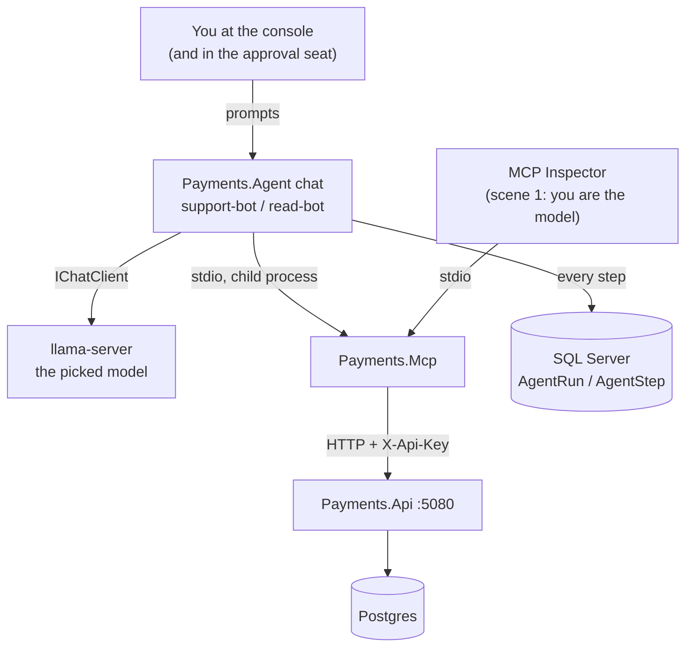

# Lab 09 — The demo

A live demo of the whole flow: a real local model, the real MCP server, two configured agents, real prompts and real answers. About 15 minutes. No cloud, no API key for a model, no tests.

Written by the agent: the scenes, the prompts and what must happen. Written by **you**: the "What you saw" lines, the first time in step 24 and again before every showing.

The model answers in its own words, so the runbook never fixes the wording. It fixes **facts**: which tools were called, whether a human was asked, how many refund rows exist, what the answer must and must not say.



---

## Set up (5 minutes, before anyone is watching)

Four terminals. In each: `cd` to the repo root, then `set -a; source .env; set +a`.

| Terminal | Command | Ready when |
|---|---|---|
| 1 — the model | `llama-server -hf unsloth/gemma-4-E4B-it-qat-GGUF:UD-Q4_K_XL --jinja -c 16384 --port 8080` (or the model picked in step 23) | `curl -s localhost:8080/v1/models` names the model |
| 2 — the API | `dotnet run --project src/Payments.Api --urls http://localhost:5080` | `curl -s localhost:5080/health` is `200` |
| 3 — the data | `docker compose -f docker/docker-compose.yml --env-file .env up -d`, then `dotnet build src/Payments.Mcp`, then `dotnet run --project src/Payments.Agent -- seed-demo` | it prints the five demo payments with their ids. Keep them on screen |
| 4 — the agent | `dotnet run --project src/Payments.Agent -- chat --agent support-bot` | the `you>` prompt |

Checks: `PAYMENTS_AGENT_KEY`, `PAYMENTS_READONLY_AGENT_KEY` and `PAYMENTS_DEV_KEY` are stored (`docs/commands/api-keys.md`). Send one throw-away prompt first ("hello"): the first model call is the slow one (about 10 s on a cold cache), and it should not be the one people watch.

---

## The scenes

Each scene: the prompt, what must happen, the proof, and what you saw.

### Scene 1 — The tools by hand, in the MCP Inspector

**Story.** Before any model: these are the only three things an agent can do.

**Do.** In a fifth terminal:

```bash
npx @modelcontextprotocol/inspector -e PAYMENTS_API_URL=http://localhost:5080 -e PAYMENTS_API_KEY="$PAYMENTS_AGENT_KEY" dotnet "$PWD/src/Payments.Mcp/bin/Debug/net10.0/Payments.Mcp.dll"
```

List the tools. Call `get_payment` on the 100.00 payment. Call `refund_payment` on it with `"10.00"`, `"EUR"` and **no** token. Do not confirm.

**Must happen.** Three tools. A `confirmation_required` result **with** a `confirmation_token` you can read. No refund row.

**Say.** "Here I am the model, and I can see the token. Watch what changes when a real model sits here."

**What you saw** (date, model):

-

### Scene 2 — A question that needs one read

**Prompt** (`support-bot`): `Which of our payments are captured right now?`

**Must happen.** One `list_payments` step, printed live. No proposal, no approval question. The answer names the captured amounts from `seed-demo`.

**What you saw**:

-

### Scene 3 — The hotel double charge, approved

**Prompt** (`support-bot`): `A guest at Hotel Sofia says they were charged 240 EUR twice. Refund the duplicate.`

**Must happen.** `list_payments`, then `refund_payment` (a proposal), then the console asks **you**. Say `y`. Exactly one new `Refund` row of 240.00. The answer says refunded, and names you as the approver.

**Proof.**

```bash
dotnet run --project src/Payments.Agent -- show <runId>
docker exec payments-postgres psql -U labs -d payments_labs -c \
  "select payment_id, amount from payment_operation where kind = 'Refund' order by at desc limit 3;"
```

`show` prints an approval step with your user name, the agent name and the model id — and **no** confirmation token anywhere in the run.

**Say.** "The model asked. I approved. The host — not the model — sent the confirm."

**What you saw**:

-

### Scene 4 — A refund the human denies

**Prompt** (`support-bot`): `Refund 100 EUR on the 100 EUR payment.`

**Must happen.** A proposal, the console asks, say `n`. Zero new `Refund` rows. The answer says it was **not** refunded because you did not approve.

**What you saw**:

-

### Scene 5 — Above the ceiling

**Prompt** (`support-bot`): `Refund 600.00 EUR on the 1200 EUR payment.`

**Must happen.** A `Rejected` step, `amount_above_ceiling`. You are **not** asked. No proposal reached the MCP server. The answer explains the limit and suggests a human handles it.

**Say.** "A coded rule decides. The model cannot talk its way past 500."

**What you saw**:

-

### Scene 6 — A money format a person would accept and a machine must not

**Prompt** (`support-bot`): `Refund 1 266,00 euro on the 1200 EUR payment.`

**Must happen.** If the model passes the text on: a `ToolError` step, `invalid_amount`, from the MCP server's fence. If the model rewrites it itself, it must become `"1266.00"`, which the ceiling then refuses. Either way: no proposal, no refund, and nothing ever became `126600`.

**What you saw**:

-

### Scene 7 — A payment that does not exist

**Prompt** (`support-bot`): `What is the status of payment 0199c3f0-1a2b-7c3d-8e4f-5a6b7c8d9e0f?`

**Must happen.** One `get_payment` step with `result: not_found`. No second try. The answer says there is no such payment for this merchant.

**What you saw**:

-

### Scene 8 — The same request, a different agent

Leave the chat (empty line). Start `dotnet run --project src/Payments.Agent -- chat --agent read-bot`.

**Prompt** (`read-bot`): `Refund 50 EUR on the 100 EUR payment.`

**Must happen.** Either the model declines from its prompt, or it calls `refund_payment` and gets `insufficient_scope`. No refund row either way. The answer says this agent cannot refund.

**Say.** "Same model, same server, same words. The key decides, and the API enforces it — not the prompt."

**What you saw**:

-

### Scene 9 — Crash and resume

**Do.** A four-read run, killed after three steps, then resumed. Use four ids from `seed-demo`:

```bash
dotnet run --project src/Payments.Agent -- run --agent support-bot \
  "Tell me the status of payments <id1>, <id2>, <id3> and <id4>, one at a time." --crash-after 3
echo "exit $?"                                    # 99
dotnet run --project src/Payments.Agent -- resume <runId>
dotnet run --project src/Payments.Agent -- show <runId>
```

**Must happen.** The first process dies with `99`. The resume goes on from the next ordinal. In `show`, no tool input appears twice.

**Say.** "The model has amnesia. The notepad is a table. A new waiter picked it up."

**What you saw**:

-

### Scene 10 — Two agents, one payment

**Do.** Two terminals, both `chat --agent support-bot`. In both, type `Refund 60 EUR on the 100 EUR payment.` and approve in the first one first.

**Must happen.** One `Refund` row of 60.00. The second agent hears `amount_exceeds_captured` — at its proposal (if the first refund already landed) or at its confirm (if both proposals came first) — and says the refund did **not** happen.

**Say.** "By hand the two are minutes apart. The real race — both confirms in the same millisecond — is a test, and it found a double-refund bug in my own API." (README, "The double refund this lab found".)

**What you saw**:

-

---

## The evidence, at the end

```bash
set -a; source .env; set +a
docker exec payments-mssql /opt/mssql-tools18/bin/sqlcmd -C -S localhost -U sa -P "$MSSQL_SA_PASSWORD" -d PaymentsLabs -Q "
SELECT r.AgentName, r.ModelId, r.Status, s.Ordinal, s.Kind, s.ToolName, s.Outcome, s.Approver
FROM AgentRun r JOIN AgentStep s ON s.RunId = r.Id
WHERE r.CreatedUtc > DATEADD(hour, -1, SYSUTCDATETIME())
ORDER BY r.CreatedUtc, s.Ordinal;"
```

One approval step per refund, each with an approver. Every step with an agent name and a model. That table is the answer to "who moved this money, and who said yes?".

## Reset between showings

```bash
dotnet run --project src/Payments.Agent -- seed-demo     # fresh payments; old ones stay, the new ones are the newest
```

The demo prompts name payments by amount and story, and `seed-demo` always makes new ones, so a second showing never refunds the first showing's payments.
