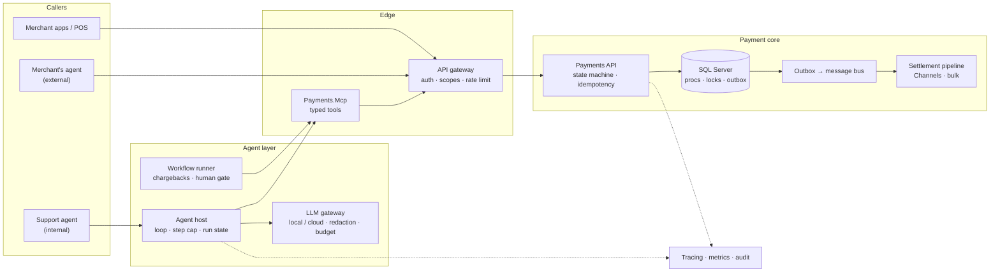

# Lab 18 — System design capstone: an agent-ready payment platform

## What we solve
Senior interviews almost always have a system design round. This lab puts every earlier lab together into **one design you can draw and defend in 45 minutes**.

## Simple example (the interview prompt)
*"We process card payments for thousands of merchants. We want to let AI agents — our own support agents, and later merchants' agents — look up payments, issue refunds and handle chargebacks. Design it."*

A weak answer draws an LLM in the middle and arrows everywhere. A strong answer:
- starts with **requirements and numbers**,
- puts the **payment core** at the centre and the agents at the **edge**,
- shows **where every write is made atomic and safe to retry**,
- says what happens when each box **fails**,
- explains **who may do what**, and how you **prove it later**.

## Everyday picture
**Airport security.** Passengers (agents, merchants, apps) come from everywhere. Every one of them goes through the **same checkpoint** (the API with scopes, validation and idempotency). Behind it, the **control tower** (the payment core and the database) decides what is allowed to move, and its decisions are **logged**. Nobody walks onto the runway, however smart they are.

## The design to practise (draw it, then defend it)

## Checklist to cover (and which lab proves it)

| Topic | What to say | Lab |
|---|---|---|
| Requirements | Functional (lookup, refund, chargeback); non-functional (latency, availability, audit, PCI) | — |
| Numbers | Requests per second at peak, payments per day, read/write ratio, how long data is kept | — |
| API contract | Small single-job endpoints, ProblemDetails `code`, versioning | 02 |
| Retry safety | `Idempotency-Key` + unique index on every write | 03 |
| Atomic writes | Conditional update / proc with locks; state + step log in one transaction | 04, 13 |
| Concurrency | Who can race whom; how the DB arbitrates; queue claims with `READPAST` | 04, 06 |
| Async work | Outbox → bus → settlement pipeline with backpressure | 06, 13 |
| Agent boundary | Typed tools, scopes enforced by the API, two-phase confirm for money | 08 |
| Agent host | Loop, step cap, run state, resume | 09, 16 |
| Long processes | Durable workflow, human gate, deadline, compensation | 13 |
| Models | LLM gateway: local vs cloud routing, redaction, budgets, fallback | 09 |
| Context and cost | KV cache, trimming, offload, tool cache | 15 |
| Failures | In-doubt calls, retries with jitter, circuit breaker, task contracts | 16 |
| Startup and scale | Live vs ready, warm-up, rolling deploys, stateless hosts | 11, 17 |
| Security | PCI scope, no card data in prompts, prompt injection, least privilege | 08, 12 |
| Observability | One trace from agent to SQL; per-call audit | 14 |
| Evolution | Framework → Core strangler, schema expand/contract | 10, 00 |

## How the session runs
1. You get the prompt above (or a variant).
2. 5 min: ask questions and write down requirements and numbers.
3. 15 min: draw the high-level design.
4. 15 min: deep dive on two areas the interviewer picks (for example "refund under concurrency" and "agent safety").
5. 10 min: failure modes, trade-offs, what you'd do next.
6. The agent plays the interviewer, pushes on weak spots, and gives a written review.

## Aperio comparison (our backbone)
| Case | Aperio | Where (verified 2026-10-17) | What this lab adds |
|---|---|---|---|
| A written architecture | ✅ Has | `id/reference/architecture.md` | A payments design in the same style |
| Blast radius and coupling map | ✅ Has | `AGENTS.md`: "Fragile / No-Touch Zones", "Module Coupling Map" | Failure-mode analysis per box |
| Provider-agnostic model layer | ✅ Has | six providers behind one orchestrator (`lib/agent/providers/`, `lib/agent/index.js`) | An LLM gateway as a shared service |
| Redaction before the model | ✅ Has | `lib/agent/redaction-relay.js`, `lib/privacy/redact.js` | Redaction enforced at the gateway |
| Capacity data for local models | ✅ Has | `db/migrations/011_model_facts.sql`: size, max context, KV bytes per token, dense/MoE, active parameters | Capacity planning for model hosts |
| Multi-node, high volume, load numbers | ❌ No | single process, small team | Scale, partitioning and multi-instance thinking — on paper |
| Message bus, outbox, settlement | ❌ No | — | The async half of the design |

## Done when
- A one-page design doc in your own words, with the diagram, the numbers and the trade-offs.
- You can answer every question in `QA.md` without notes.
- One full 45-minute mock interview with written feedback, and a second run that fixes what the first one found.

Spec and mock interview: run when the lab starts.
