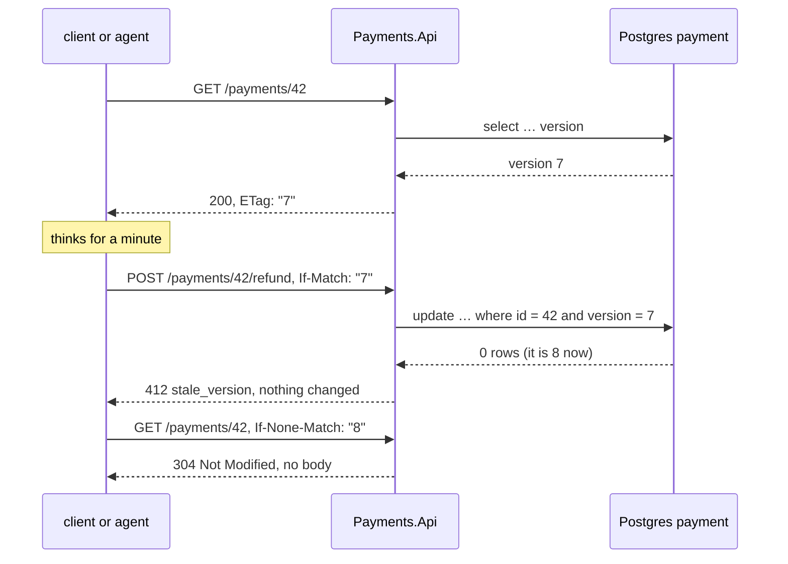

# Lab 20 — ETag and If-Match *(optional)*

Spec only. Written 2026-10-22, when it moved out of lab 04 as the "same rule over HTTP" stretch. `WORKBENCH.md` and `TEST-LIST.md` are written when this lab starts, never earlier (`docs/plan/PLAN.md` §8).

Needs: lab 03 (idempotency), lab 04 (`rowversion`, optimistic concurrency), lab 08 (the refund token). Idea borrowed from ScroogeCorp B03 + B07 ("Two approvers cannot both win", "ETag").

## What we solve
A client acts on what it **saw**, not on what is there **now**. Between the read and the write, someone else changed the payment.

## Simple example
- An operator opens payment 42. It says `Captured`, 100 EUR, **version 7**.
- They think for a minute. Meanwhile an agent refunds 80 EUR. Now it is **version 8**.
- The operator sends "refund 50 EUR" with `If-Match: "7"`.
- Without the check: a second refund, based on a screen that is a minute old.
- With the check: `412 Precondition Failed`, code `stale_version`. Nothing changes. The operator reads again and decides again.

**ETag** (entity tag) is a label for one version of a resource. The server sends it in a header on `GET`. **`If-Match`** is the client sending it back: "do this only if it is still that version". **`If-None-Match`** on a `GET` asks: "send the body only if it changed".

## Why it matters for a payment platform
`rowversion` (lab 04) protects one save from another save. It does not protect a decision made on old data, because the race often starts **in a head**: a person or an agent reads, thinks, then acts. An agent is the worst case. It read the payment ten tool calls ago.

## Everyday picture
**The shared shopping list on the fridge.** You read "milk" and go to the shop. Your partner already bought milk and crossed it out. If you check the list's "last changed" time before you pay, you see it is not the list you read, and you put the milk back.

## What this lab builds

## The rules (first draft)

- `GET /payments/{id}` returns `ETag: "<version>"`. The ETag **is** the row version. Do not hash the body.
- `POST /payments/{id}/capture` and `/refund` with `If-Match: "7"`. Version still 7 → it runs. Version now 8 → `412`, a `stale_version` ProblemDetails, nothing changes.
- `GET` with `If-None-Match: "7"` and no change → `304 Not Modified`, no body.
- **Which version?** Postgres: an explicit `version int` column, bumped in the same `UPDATE` as the status. SQL Server: `rowversion`, turned into a string for the header. One ETag rule, both engines. Postgres `xmin` would work too, but only on Postgres, and it can wrap around.
- **Two reasons, one status family:** a domain refusal ("already captured") is `409`. A stale version is `412`. Tests tell them apart by `code`, not by luck.
- **Agent link:** lab 08's refund token binds to the version. The human approves "refund 80 EUR on payment 42 **at version 7**". If the payment changed after that, the confirm fails. It never refunds what the human did not see.

## Open questions for when the lab starts

- Is `If-Match` **required** on refund, or optional? Required is safer; optional keeps old clients working.
- The idempotency request hash (lab 03) is method + path + body. Does `If-Match` join it? If not, the same key with another `If-Match` replays the first answer.
- Does the version live in the domain (`Payment.Version`) or only in the store?

## Aperio comparison (our backbone)
| Case | Aperio | Where (verified 2026-10-22) | What this lab adds |
|---|---|---|---|
| ETag / `If-Match` / `412` | ❌ No | no hit for `ETag`, `If-Match` or `412` in the code | All of it |
| Act only on the state that was approved | 🟡 Partly | `claimAgentInterrupt` claims only `WHERE status IN ('approved','edited')` (`db/postgres/store.js` 1151): it checks the **status**, not a version | Bind the approval to the row version |

## Done when
Two clients read version 7. The first capture wins. The second gets `412 stale_version`. A fresh read shows the winner's state.
