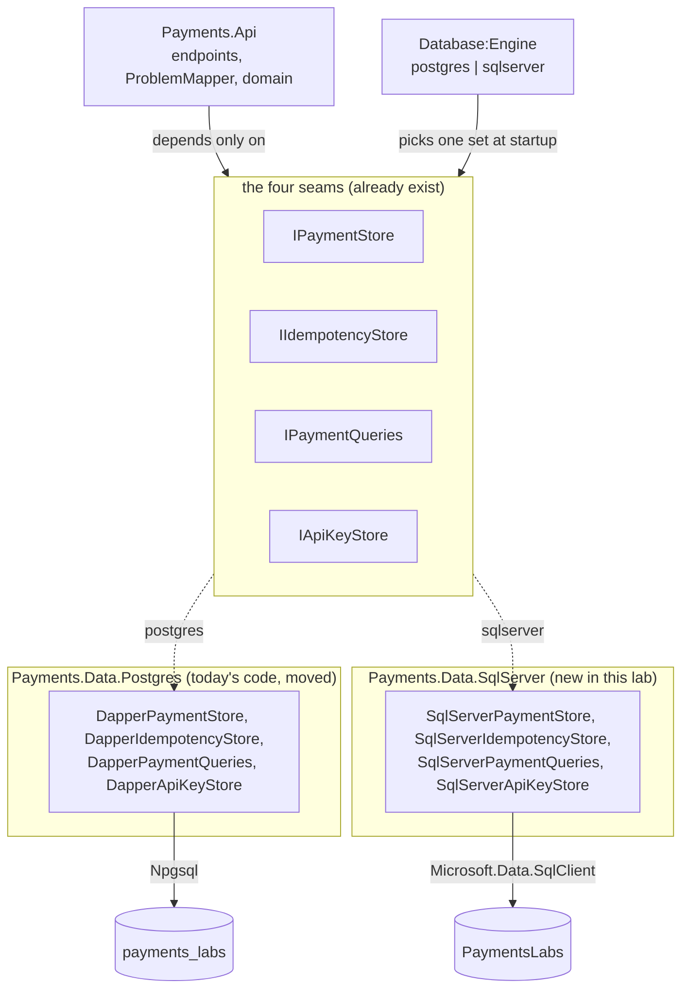
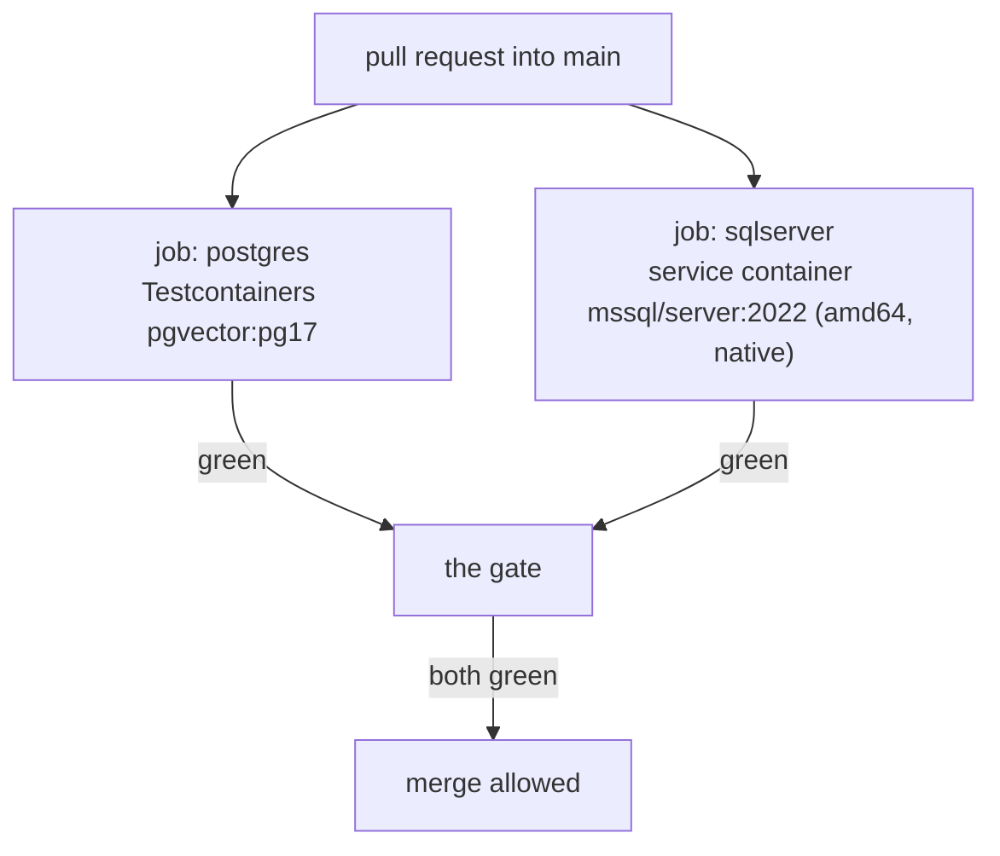

# Lab 21 — Engine parity: one API, two databases

Spec only. Written 2026-10-23. `WORKBENCH.md` and `TEST-LIST.md` are written when this lab starts, never earlier (`docs/plan/PLAN.md` §8).

Needs: lab 03 (`idempotency_key`), lab 06 (by then you have written SQL Server by hand in labs 04, 05 and 06), lab 08 (`api_key`).

## What we solve
The API runs on Postgres. The ad names **SQL Server**. Today those are two different worlds: Postgres holds the API tables, SQL Server holds the procs. The two sets of migrations can drift apart until one engine can do things the other cannot. This lab makes the API run on **either** engine, picked by one line of configuration.

## Simple example
You are in the interview. They ask: *"How fast could you move this off Postgres onto SQL Server?"*

```
# appsettings.json
"Database": { "Engine": "postgres" }     →     "Database": { "Engine": "sqlserver" }
```

Then `dotnet run`. The same endpoints, the same tests, the same demo. Nothing else changes.

## Why it matters for a payment platform
Acquirers do not rewrite a payment core because a database changed. They put a seam in front of the database and keep it honest. The seam is also how you test: a fast engine for the inner loop, the production engine for the gate. And the ad asks about moving **.NET Framework → .NET Core** — that migration is the same skill, one layer up: a seam, two implementations, one test suite proving both.

## Everyday picture
**Two-pin plugs and the travel adapter.** The lamp does not care which country's socket it is in. The adapter is small, it is the only thing that knows about sockets, and you carry one. If the lamp had the socket wired into it, every country would need a new lamp.

## What this lab builds



The seams are already there, written in labs 02, 03 and 08. This lab adds the second implementation behind them and the switch in front.

## Decisions taken for this lab (2026-10-23)

| Question | Decision | Why |
|---|---|---|
| Is parity worth a lab? | **Yes.** The interview answer "a flick of the fingers, and here is the six-line difference" is worth more than either engine alone. | It also kills the drift risk for good. |
| When? | **After lab 06.** | By then labs 04, 05 and 06 have made you write T-SQL by hand. This lab is then typing, not learning. |
| Does it change lab 04? | **No.** Lab 04 stays about procs and locking. | One lesson per lab. Bolting a data layer onto lab 04 would double it and blur it. |
| What stops drift until then? | A rule, from **2026-10-23**: every new Postgres migration gets a **SQL Server twin in the same commit**. Written in `CLAUDE.md` and `db/README.md`. | Cheap now, expensive later. |
| Does the API ever call a proc? | **Not here.** Both store sets are Dapper over plain SQL. The procs stay the lab 04–06 story. | Parity means the *same behaviour*, not the same implementation trick. A later lab may route the SQL Server capture through `usp_CapturePayment`. |
| Is `rowversion` part of parity? | **No.** It is SQL Server only and lab 20 owns the cross-engine version story (an explicit `version` column in Postgres, `rowversion` in SQL Server, one `ETag` rule). | Lab 20 already decided it. |
| Which engine is the default? | **Open** (`CF-039`). Postgres stays the default for now. | Flipping it is one config line; decide it when the demo is rehearsed. |

## The six differences (measured 2026-10-23 on today's code)

This is the whole list, from `src/Payments.Api/Storage/` and `src/Payments.Api/Auth/`. Learn it by heart — it is the interview answer.

| # | Postgres | SQL Server | Where it bites |
|---|---|---|---|
| 1 | `insert … on conflict (merchant_id, key) do nothing returning key` | `insert … where not exists (…)` then `@@ROWCOUNT`, or `MERGE` with `HOLDLOCK` | `DapperIdempotencyStore.cs:30` — the insert-first claim |
| 2 | `now()` | `SYSUTCDATETIME()` | `DapperIdempotencyStore.cs:109` |
| 3 | `@Status::text is null` (the cast tells Postgres the type of a null) | `@Status is null` — no cast needed | `DapperPaymentQueries.cs:26` |
| 4 | `limit @Take` | `offset 0 rows fetch next @Take rows only` | paging (`CF-022`) |
| 5 | `created_at as "CreatedAt"` — an alias per column | `CreatedAt` — no alias | every query, from the `snake_case` / `PascalCase` decision (2026-10-19) |
| 6 | `uuid`, `numeric(19,4)`, `timestamptz` | `uniqueidentifier`, `decimal(19,4)`, `datetimeoffset(6)` | the migration files |

Two more that are not SQL but matter:

- **`select … for update`** (the lab 09 double-refund fix) is **`with (updlock, rowlock)`** in SQL Server — and that is lab 04's lesson arriving back in the API.
- **Isolation.** `RepeatableRead` for a load snapshot (decided 2026-10-22) behaves differently: Postgres takes a snapshot, SQL Server holds shared locks. With **RCSI on** (lab 04 switches it on) SQL Server's `ReadCommitted` becomes a snapshot read, which is the closer match. The lab measures both.

## What you deliver

| # | Deliverable | Where |
|---|---|---|
| 1 | The two missing SQL Server tables: `IdempotencyKey` (lab 03's) and `ApiKey` (lab 08's), in lockstep | `db/sqlserver/00NN_api_tables.sql` |
| 2 | Today's four Dapper stores moved out of the API into their own project | `src/Payments.Data.Postgres` |
| 3 | A SQL Server implementation of all four seams | `src/Payments.Data.SqlServer` |
| 4 | `Database:Engine` configuration + the DI wiring that picks one set | `src/Payments.Api/Program.cs` |
| 5 | Every API test run against **both** engines, as a `[Theory]` on the engine | `tests/Payments.Api.Tests` |
| 6 | The seeder working on both engines | `src/Payments.Db` |
| 7 | CI running both halves | `.github/workflows/ci.yml` |
| 8 | A one-page parity note in your own words: the six differences and what each one taught you | `labs/21-engine-parity/PARITY-NOTES.md` (scaffold; **written by you**) |

## Hard requirements

1. **The API project references no database driver.** `grep -c "Npgsql\|SqlClient" src/Payments.Api/Payments.Api.csproj` prints `0`. If the API can still name a driver, the seam is a lie.
2. **No `if (engine == "postgres")` inside a store.** The engine is chosen once, at startup, in `Program.cs`. A store knows one engine.
3. **One test suite, not two.** The same test body runs on both engines. A test that passes on one engine and not the other is a bug in a store, never a reason for a second test.
4. **Behaviour is identical, including error codes.** The same request gives the same status, the same `code`, the same `ProblemDetails`. Idempotent replay is byte for byte on both.
5. **Every SQL value is a parameter.** No string-built SQL on either engine.
6. **The SQL Server half of the suite carries `[Trait("runs", "local")]` for the Mac, and CI runs it anyway** via a GitHub **service container** — the amd64 image is native on an `ubuntu-latest` runner, no Rosetta. The tag is about this Mac being slow, not about CI being unable. Verify this before you trust it.
7. **No real card data.**

## CI: both engines, one gate



This is the point of the lab. Parity you cannot prove is a claim. Parity a gate proves is a fact.

## Aperio comparison (our backbone)
| Case | Aperio | Where (verified 2026-10-23) | What this lab adds |
|---|---|---|---|
| Two engines behind one seam | ✅ Has | `db/index.js`: `DB_BACKEND` = `postgres` \| `sqlite`, resolved once at startup; `PostgresStore` / `SqliteStore` | The same shape in C#, with DI instead of a module resolver |
| Two store implementations kept in step | ✅ Has | `db/postgres/store.js` (1395 lines) and `db/sqlite/store.js` (1589 lines) — same methods, different SQL | Ours stays small because the domain is in `Payments.Domain`, not in the store |
| Two migration sets in lockstep | ✅ Has | `db/migrations/` and `db/migrations-sqlite/` — **14 files each** | DbUp with a journal table, and a twin-in-the-same-commit rule written down |
| Auto-detect with a fallback engine | ✅ Has | pings Docker, uses Postgres if reachable, else SQLite; Postgres failure falls back and the app still boots | **We reject this.** A payment API must not silently switch database. Our switch is explicit and a bad value is a startup failure. |
| Both engines proved by CI | ❌ No | `DB_BACKEND` appears in tests, but no two-engine gate | Two CI jobs, both required |
| SQL Server | ❌ No | Postgres and SQLite only | the whole SQL Server side |

The fallback row is the one to talk about in the interview. Aperio's auto-detect is right for a local-first desktop app: boot, always. It is wrong for an acquirer: a config typo must stop the process, not quietly write payments to the wrong database.

## Open questions for when the lab starts

- Which engine is the **default** after this (`CF-039`)? Postgres is faster on this Mac; SQL Server is what the ad names.
- Does `src/Payments.Data.SqlServer` (labs 04–06, procs) also hold these stores, or do they get `src/Payments.Data.SqlServer.Api`? One project is simpler; two keep the proc work and the API work apart.
- Does the Postgres load snapshot (`RepeatableRead`, decided 2026-10-22) stay `RepeatableRead` on SQL Server, or become `ReadCommitted` with RCSI on? Measure both.
- `CF-023` (the EF Core store) is a **third** implementation behind the same seams. Does it fold into this lab's `[Theory]`, or stay its own axis?

## Done when

- [ ] `"Engine": "sqlserver"` plus `dotnet run` serves every endpoint, with no other change.
- [ ] The full API suite is green on **both** engines, from one test body.
- [ ] An idempotent replay returns the identical bytes on both engines.
- [ ] `grep -c "Npgsql\|SqlClient" src/Payments.Api/Payments.Api.csproj` prints `0`.
- [ ] `grep -rn 'engine ==' src/Payments.Data.*` finds nothing.
- [ ] Both CI jobs are green on a pull request.
- [ ] The demo runs end to end on SQL Server: seed, `POST /payments`, capture, refund, the MCP tools, the agent loop.
- [ ] You can say the six differences out loud, without notes.
- [ ] `PARITY-NOTES.md` is written in your own words.
