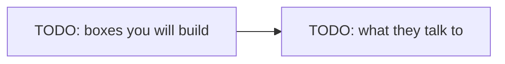

# Lab NN — Workbench

> **Blueprint.** Copy this file to `labs/NN-short-name/WORKBENCH.md` when the lab starts.
> Replace every `NN`, every `<…>` and every `TODO`. Delete this blockquote.
> Rules for this file live in `CLAUDE.md` → "Writing style for docs".

Follow the steps in order. Each step says **Goal**, **Why**, **Do**, **Proof**, **Commit**.

Spec and Done-when list: `README.md` in this folder. Interview questions: `QA.md`.

Started YYYY-MM-DD.

## The target state

One diagram of what exists when the lab is done. Draw this **before** step 1 — if you cannot draw it, the lab is not specified yet.



---

## Step 0 — Read the questions, not the answers

**Goal.** You have skimmed every question in `QA.md`. 5 minutes. No answers read.

**Why.** Knowing the questions first changes what you notice while you work, and attention is most of the learning. Reading the **answers** now would spoil the test — afterwards you would *recognise* them instead of *recalling* them, which feels like knowing and does not survive an interview. So eyes off every `A:` line. If one question makes no sense at all, read that single answer and move on.

**Do.**

```bash
grep -E '^\*\*Q' labs/NN-short-name/QA.md
```

**Proof.** You can say, in one sentence, what this lab is going to be asked about.

**Commit.** Nothing to commit.

---

## Step 1 — <short title>

**Goal.** One line. What exists when this step is done.

**Why.** 3–4 sentences. What we accomplish, and why it is done this way and not another way. Name the thing that goes wrong if you skip it. This is the part that teaches; never shorten it to one line.

**Do.**

```bash
# exact commands
```

**Proof.** The command or output that shows it worked.

**Commit.** Stage `<files this step touched>`.

```
<type>(lab-NN): <short summary in imperative mood>
```

---

## Step 2 — <short title>

**Goal.**

**Why.**

**Do.**

**Proof.**

**Commit.** Stage `<files>`.

```
<type>(lab-NN): <short summary>
```

<!-- Add a diagram inside any step where the shape is hard to hold in your head:
     a flow, a sequence, a state machine, a branch history, a lock timeline. -->

---

## Step N-1 — Say the answers out loud

**Goal.** You answered every question in `QA.md` out loud, then checked.

**Why.** This is the test the lab was for. Speaking the answer uses a different path than reading it, and it is the path an interview uses. Mark every question you got wrong or said badly — those marked ones are a 5-minute warm-up at the start of your next session, and that repeat is where most of the gain sits.

**Do.**

1. Cover the file. Work down the question list.
2. Say the answer out loud. Then read the real answer.
3. Mark the misses. Read the **Trap** follow-up for each one.
4. Answer `Q-APERIO` last: "Have you solved this before?"

**Proof.** You answered every question without looking. The marked list is short.

**Commit.** Nothing to commit.

---

## Step N — Close the lab

**Goal.** The lab is merged to `develop`, `main` carries the `lab-NN` tag, `develop` is level with `main`, the feature branch is gone, and `PROGRESS.md` says `Done`.

**Why.** The merge and the tag are the record that a lab finished. `--no-ff` keeps a merge commit even when a fast-forward is possible, so the history shows the lab as one unit of work. A branch name is only a pointer at one commit, so deleting a merged feature branch drops the pointer and never the work — the tag is the bookmark after that. Every lab repeats this, so the shape stays the same.

**Do.** Run the full Done-when list in `README.md` first. Every step above is already committed, so this step only merges and tags.

```bash
git checkout develop
git merge --no-ff feature/lab-NN-short-name
git checkout main
git merge --no-ff develop
git tag lab-NN
git checkout develop
git merge main                 # the back-merge. Without it develop is behind main
git branch -d feature/lab-NN-short-name
```

The back-merge is the line people forget. Merging `develop` into `main` makes a merge commit that lives **only** on `main`, so from that second on `develop` is behind. The content is the same today, but the next lab branches from a base that is missing `main`'s history, and a later hotfix on `main` would be missing from `develop` altogether — that one is lost work, not just untidy history. `git merge main` on `develop` costs nothing and keeps the two in step.

The small `-d` deletes the branch only if its work is really merged. If something is unmerged, git refuses. Never use the capital `-D` here: it skips that check.

You run every git command. The agent never commits, merges, pushes or tags.

**Proof.**

```bash
git log --oneline --graph --all | head -20
git tag
git branch                     # develop and main only — no feature branch
git log --oneline develop..main   # empty: develop is level with main
```

**Commit.** Nothing to commit. The merge commits are the record of this step.

---

## Traps

| Trap | What happens | Fix |
|---|---|---|
| TODO | TODO | TODO |

## Notes while you work

Write what surprised you here, as it happens. At the end of the lab these move into `CARRY-FORWARD.md` (the inbox) as `CF-NNN` rows. From there each one graduates to `PLAN.md` section 8, to a lab `README.md`, or it is dropped.

-
