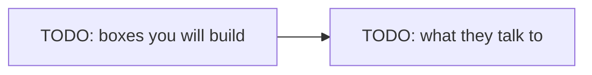

# Lab NN — Workbench

> **Blueprint.** Copy this file to `labs/NN-short-name/WORKBENCH.md` when the lab starts.
> Replace every `NN`, every `<…>` and every `TODO`. Delete this blockquote.
> Rules for this file live in `CLAUDE.md` → "Writing style for docs".

Follow the steps in order. Each step says **Goal**, **Why**, **Do**, **Proof**.

Spec and Done-when list: `README.md` in this folder. Interview questions: `QA.md`.

Started YYYY-MM-DD.

## The target state

One diagram of what exists when the lab is done. Draw this **before** step 1 — if you cannot draw it, the lab is not specified yet.



---

## Step 0 — <short title>

**Goal.** One line. What exists when this step is done.

**Why.** 3–4 sentences. What we accomplish, and why it is done this way and not another way. Name the thing that goes wrong if you skip it. This is the part that teaches; never shorten it to one line.

**Do.**

```bash
# exact commands
```

**Proof.** The command or output that shows it worked.

---

## Step 1 — <short title>

**Goal.**

**Why.**

**Do.**

**Proof.**

<!-- Add a diagram inside any step where the shape is hard to hold in your head:
     a flow, a sequence, a state machine, a branch history, a lock timeline. -->

---

## Step N — Close the lab

**Goal.** The lab is merged to `develop`, and `main` carries the `lab-NN` tag.

**Why.** The merge and the tag are the record that a lab finished. `--no-ff` keeps a merge commit even when a fast-forward is possible, so the history shows the lab as one unit of work. Every lab repeats this, so the shape stays the same.

**Do.** Run the full Done-when list in `README.md` first. Suggested commits, smallest first:

```
test(lab-NN): <the red commit, if the lab has tests>
feat(lab-NN): <the green commit>
docs(lab-NN): <notes>
```

```bash
git checkout develop
git merge --no-ff feature/lab-NN-short-name
git checkout main
git merge --no-ff develop
git tag lab-NN
```

You run every git command. The agent never commits, merges, pushes or tags.

**Proof.**

```bash
git log --oneline --graph --all | head -20
git tag
```

---

## Traps

| Trap | What happens | Fix |
|---|---|---|
| TODO | TODO | TODO |

## Notes while you work

Write what surprised you here. It feeds `PLAN.md` section 8 and the next lab.

-
